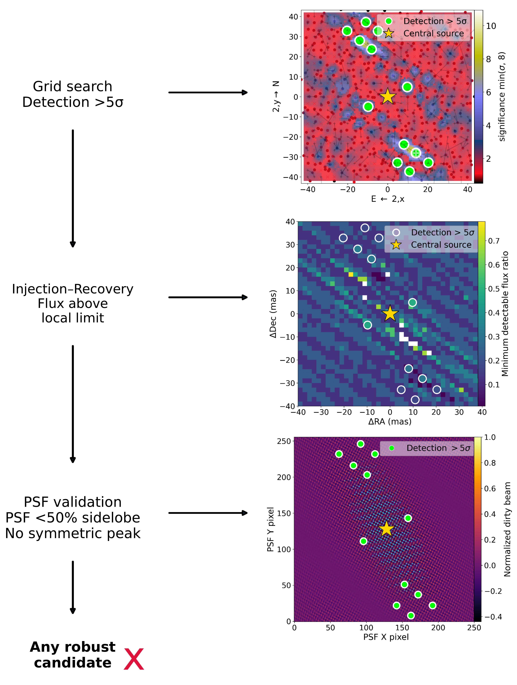
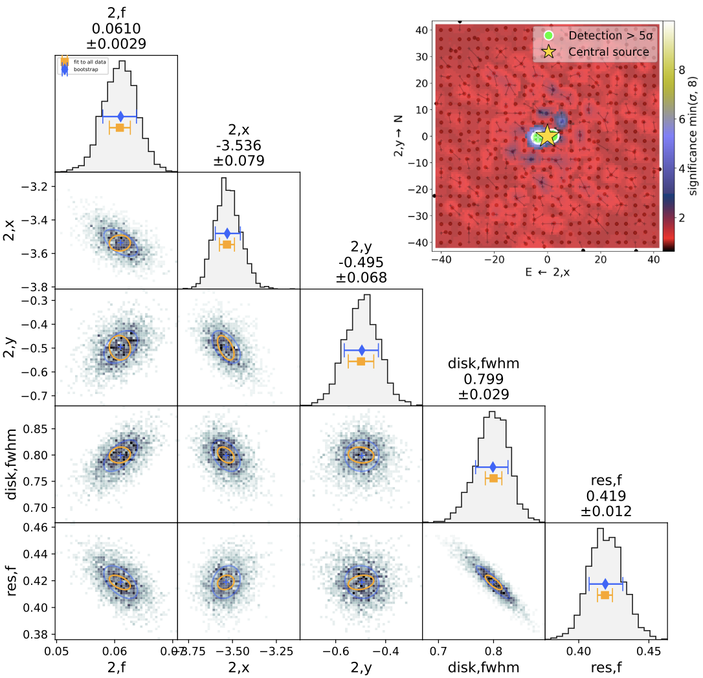
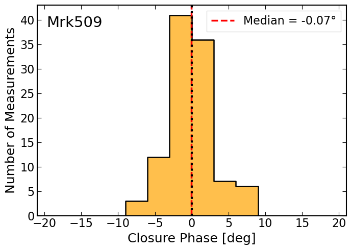
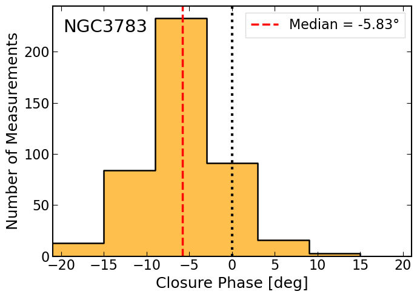

$\newcommand{\ensuremath}{}$
$\newcommand{\xspace}{}$
$\newcommand{\object}[1]{\texttt{#1}}$
$\newcommand{\farcs}{{.}''}$
$\newcommand{\farcm}{{.}'}$
$\newcommand{\arcsec}{''}$
$\newcommand{\arcmin}{'}$
$\newcommand{\ion}[2]{#1#2}$
$\newcommand{\textsc}[1]{\textrm{#1}}$
$\newcommand{\hl}[1]{\textrm{#1}}$
$\newcommand{\footnote}[1]{}$
$\newcommand{\mr}{\multirow{2}{*}}$
$\newcommand{\mc}{\multicolumn{2}{c}}$
$\newcommand{\fmp}{\texttt{FMP}}$
$\newcommand{\grav}{{\rm GRAVITY}\xspace}$
$\newcommand{\Nensemb}[2]{\mathcal{N}_{#1}\left(#2\right)}$
$\newcommand{\check}[1]{\textcolor{red}{check: #1}}$
$\newcommand{\kms}{\rm  km s^{-1}}$
$\newcommand{\hagn}{\mbox{{\sc \small Horizon-AGN}}}$
$\newcommand{\msun}{ {\rm M_\odot}}$
$\newcommand{\kms}{ {\rm km s^{-1}}}$
$\newcommand{\Egw}{E_{\mathrm{GW}}}$
$\newcommand{\forb}{f_{\mathrm{orb}}}$
$\newcommand{\fgw}{f_{\mathrm{GW}}}$
$\newcommand{\Lgwcirc}{L_{\mathrm{GW}}^{\mathrm{(circ)}}}$
$\newcommand{\Ayr}{A_{\mathrm{yr}}}$
$\newcommand{\resPSD}{S_{\rm r}^{(\mathrm{GWB})}}$
$\newcommand{\fyr}{f_{\mathrm{yr}}}$
$\newcommand{\GWRMS}{\rho_{\rm r}^{(\mathrm{GWB})}}$
$\newcommand{\Vsim}{V_{\mathrm{sim}}}$
$\newcommand{\Dlnf}{\Delta \ln f}$

# Searching for Nearby Supermassive Black Hole Binaries with GRAVITY

<mark>Appeared on: 2026-10-14</mark> -  _19 pages, 10 figures_

G. Collaboration, et al. -- incl., <mark>W. Brandner</mark>, <mark>P. Garcia</mark>, <mark>L. Kreidberg</mark>, <mark>J. Sauter</mark>

**Abstract:** We present a systematic interferometric search for close supermassive black hole (SMBH) binaries in 20 nearby type 1 active galactic nuclei (AGN) observed with VLTI/ $\grav$ .We investigate parsec-scale asymmetric emission by modeling the squared visibilities and closure phases with a single circular Gaussian component plus a background point source for the central AGN, and searching for additional compact companions through grid-based binary models. The robustness of the search is validated using injection--recovery simulations and point-spread-function diagnostics.Several features are identified in the initial significance maps, but only one candidate out of 20 shows a persistent compact asymmetry, corresponding to an observed incidence of $5\%$ . If NGC 3783 is interpreted as a binary AGN, we derive a Poissonian one-sided $1\sigma$ upper limit of $f_{\rm bin}<16.5\%$ for $\grav$ -detectable binaries among bright nearby AGN ( $K<12.5$ ) at separations of $\sim1$ -- $100$ pc. Conversely, if the observed asymmetry in NGC 3783 is associated with asymmetric circumnuclear dust emission, the corresponding upper limit on the binary fraction is $f_{\rm bin}<9.2\%$ .We compare these results with predictions from the Horizon-AGN simulation, finding comparable binary fractions. We also noted that the expected fraction strongly depends on the assumed distribution of individual SMBH accretion rates within binaries, which is currently unresolved in cosmological models.Our results demonstrate the potential of infrared interferometry to identify parsec-scale binary AGN candidates and motivate future $\mbox{\grav}$ + observations to expand the sample and follow up known candidates, helping to confirm their nature and distinguish genuine binaries from asymmetric nuclear structures.

**Figure 8. -** Example of the candidate validation workflow for NGC 7603. The yellow star marks the position of the central source. The panels illustrate the successive steps of the candidate validation procedure. The first panel shows the significance map obtained from the grid search, with the colour bar indicating the detection significance in units of $\sigma$. Candidate positions exceeding the adopted $5\sigma$ threshold are highlighted by green circles. The second panel shows the injection--recovery detection-limit map, with the colur scale indicating the minimum detectable flux ratio at each position. Candidate positions are overlaid as open circles, with their colour encoding their measured flux ratio; candidates are retained only if their measured flux ratio exceeds the local detection limit.
    The third panel shows the PSF-based diagnostic. The colour scale represents the absolute normalized PSF response, while the cyan contours delimit the regions where the PSF response exceeds 50\% of the maximum sidelobe amplitude outside the central PSF core. Candidate positions falling within these contoured regions, or showing a symmetric counterpart consistent with the PSF structure, are rejected as likely PSF artefacts.
    In this example, no candidate survives all validation steps. (*fig:workflow*)

**Figure 4. -** Posterior distributions and parameter correlations for the fit with a secondary component in NGC 3783, showing its flux fraction, position $(x,y)$, disk FWHM, and unresolved flux fraction. Blue and orange markers indicate the best-fit and bootstrap estimates, respectively. The upper-right panel shows the detection-significance map, with the central source marked by a yellow star and $>5\sigma$ detections highlighted in green. (*fig:gaussngc3783*)

**Figure 1. -** Multiple measurements of the closure phase for Mrk 509 (upper panel) and NGC 3783 (lower panel), with median values of $-0.07^\circ$ and $-5.83^\circ$, respectively (red lines). The zero phase is indicated by the black line.
  (*fig:cp*)

