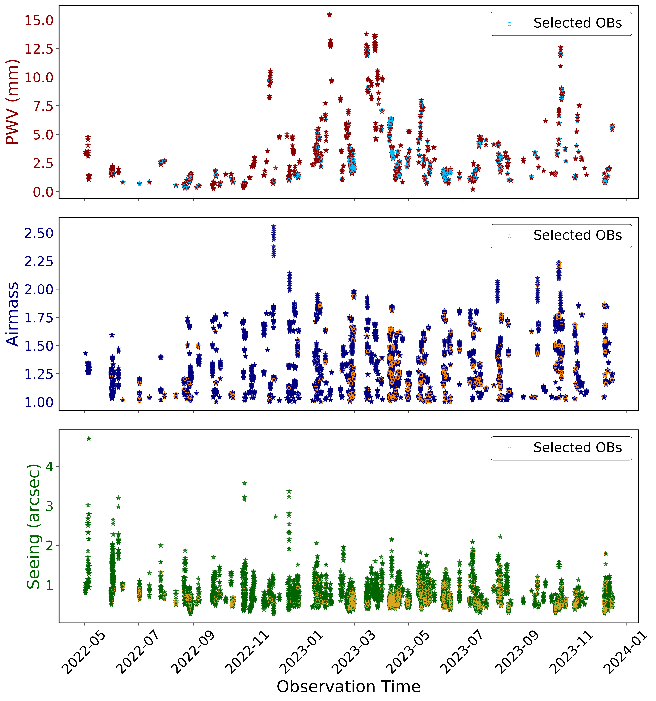
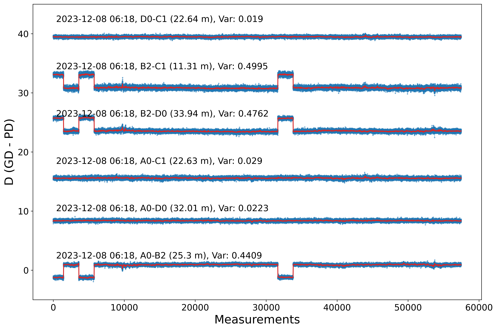
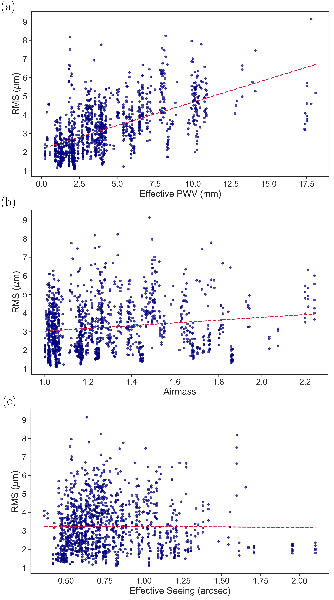

$\newcommand{\ensuremath}{}$
$\newcommand{\xspace}{}$
$\newcommand{\object}[1]{\texttt{#1}}$
$\newcommand{\farcs}{{.}''}$
$\newcommand{\farcm}{{.}'}$
$\newcommand{\arcsec}{''}$
$\newcommand{\arcmin}{'}$
$\newcommand{\ion}[2]{#1#2}$
$\newcommand{\textsc}[1]{\textrm{#1}}$
$\newcommand{\hl}[1]{\textrm{#1}}$
$\newcommand{\footnote}[1]{}$
$\newcommand{\thebibliography}{\DeclareRobustCommand{\VAN}[3]{##3}\VANthebibliography}$

# Mid-IR Water-Vapor Seeing: Implications for ELT/METIS High-Contrast Imaging from VLTI Data

<mark>Appeared on: 2026-10-14</mark> - 

A. S. Raghu, et al. -- incl., <mark>R. v. Boekel</mark>

**Abstract:** Direct imaging and characterization of rocky exoplanets remains one of the central challenges in exoplanetary science. The mid-infrared (mid-IR) offers a favorable high-contrast imaging (HCI) regime, as the planet-star contrast is more moderate than at shorter wavelengths. However, mid-IR observations with extremely large ground-based telescopes (ELTs) are strongly affected by spatio-temporal fluctuations in atmospheric water vapor (WV), which introduce chromatic wavefront errors that are largely invisible to adaptive optics systems operating at shorter wavelengths. This poses a significant challenge for mid-IR HCI instruments such as METIS, which aims to detect thermal emission from rocky exoplanets in the $N$ -band (8–13 $\mu$ m). To quantify WV-induced wavefront errors, we analyze $K$ -band fringe-tracker data from the GRAVITY instrument at the VLTI and derive the optical path difference between group-delay and phase-delay measurements. This difference provides a direct measure of the differential WV column density ( $\Sigma$ ) above the telescopes. We examine the dependence of the RMS differential WV column density ( $\sigma_{\Sigma}$ ) on precipitable water vapor (PWV), airmass, seeing, and wind speed across multiple VLTI configurations. Among these parameters, PWV shows the strongest correlation with $\sigma_{\Sigma}$ . We further explore the influence of the vertical PWV distribution on this relationship. Next, we use power-spectral-density analysis to quantify how increasing PWV modulates $\Sigma$ variability. The  wavefront error associated with this phenomenon on ELT scale is approximately 15 nm RMS in the $L$ -band and 175 nm RMS in the $N$ -band, relative to the $K$ -band. These results provide a quantitative framework for assessing and mitigating atmospheric WV effects in next-generation mid-IR HCI instruments.

**Figure 2. -**  PWV, airmass, and seeing across observation dates for the small, medium, and large AT configurations are plotted, and the OBs retained after filtering are highlighted with circles. (*fig:pwv_airmass*)

**Figure 3. -** Example of raw data of the A0B2D0C1 configuration showing measurements across all baselines for a particular OB showing the dispersion metric $D$. The blue represents the original data, while the red shows the smoothed version. (*fig:before*)

**Figure 4. -** Correlation of RMS WV seeing $\sigma_{\rm{wv}}$  with (panel (a)) effective PWV, (panel (b)) airmass, and (panel (c)) effective seeing with linear fit for configuration A0B2D0C1. (*fig:rms_three_plots*)

