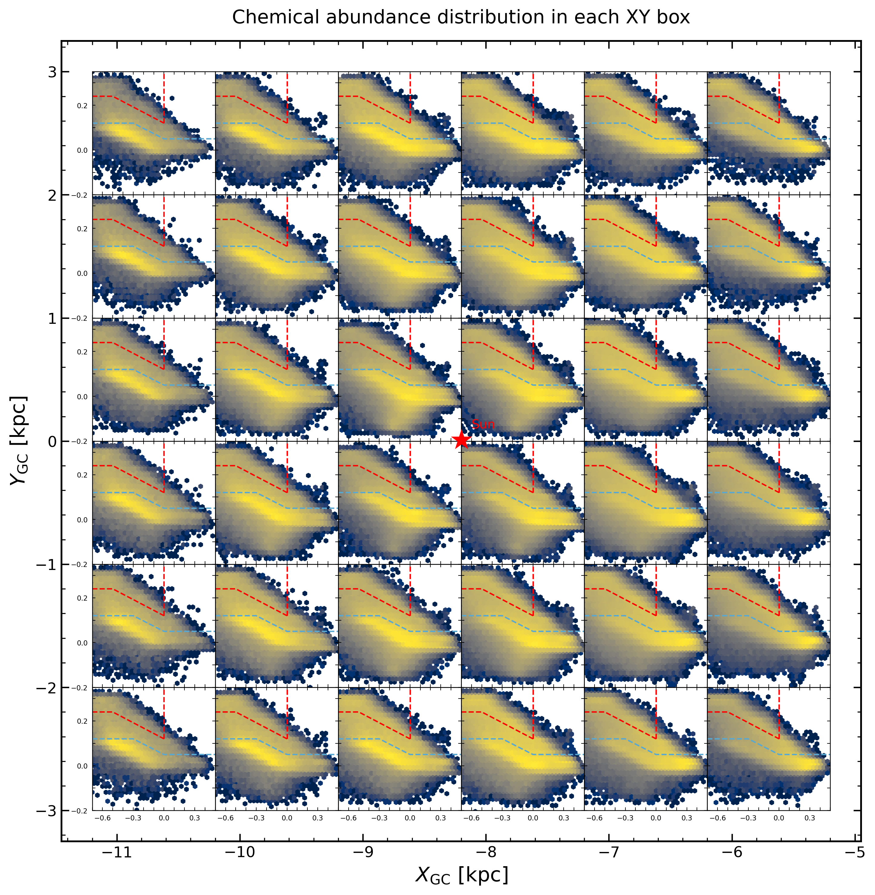
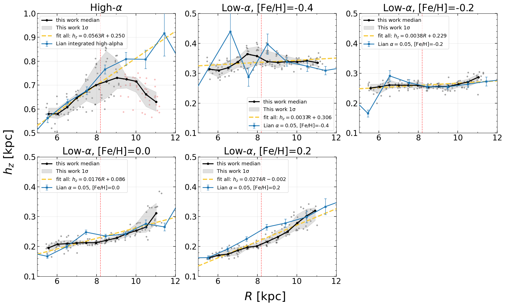
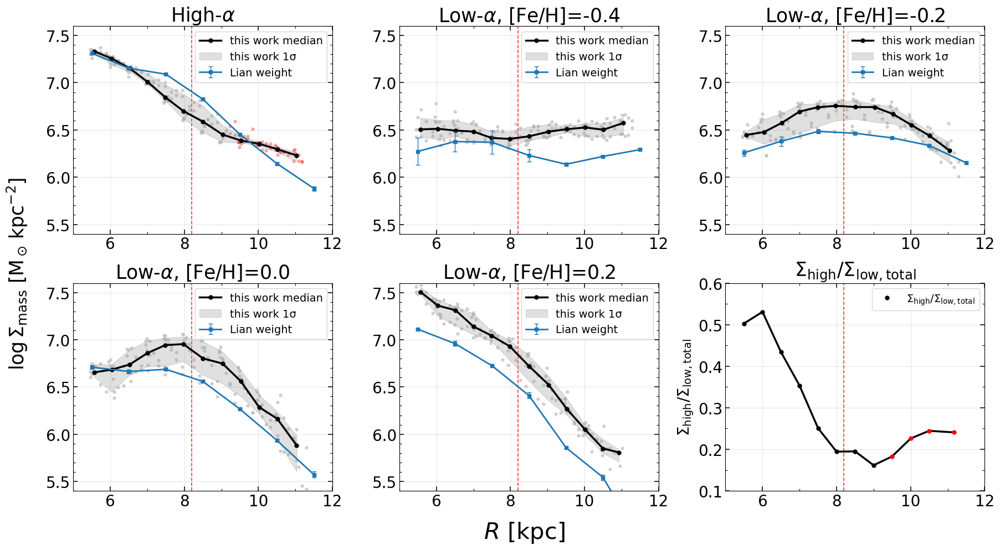

$\newcommand{\ensuremath}{}$
$\newcommand{\xspace}{}$
$\newcommand{\object}[1]{\texttt{#1}}$
$\newcommand{\farcs}{{.}''}$
$\newcommand{\farcm}{{.}'}$
$\newcommand{\arcsec}{''}$
$\newcommand{\arcmin}{'}$
$\newcommand{\ion}[2]{#1#2}$
$\newcommand{\textsc}[1]{\textrm{#1}}$
$\newcommand{\hl}[1]{\textrm{#1}}$
$\newcommand{\footnote}[1]{}$
$\newcommand{\jl}[1]{#1}$
$\newcommand{\jd}[1]{#1}$
$\newcommand{\rev}[1]{\textcolor{blue}{#1}}$
$\newcommand{\rev}[1]{#1}$

# The Galactic disk structure revealed by Gaia XP spectra

<mark>Appeared on: 2026-10-14</mark> -  _Accepted for publication in Astronomy & Astrophysics. 24 pages, 11 figures, including appendices_

Z. Tang, J. Lian, J. Zhou, <mark>J. Li</mark>

**Abstract:** The spatial structures of different chemical populations in the Galactic disk provide important constraints on disk evolution and underlying physical processes. Gaia XP spectra provide one of the largest spectroscopic samples currently available, offering a new opportunity to investigate Galactic disk structure. We use Gaia XP spectra to study the structure of mono-abundance populations (MAPs) of the Galactic disk.    In particular, we measure their scale heights as a function of radius as well as radial surface-mass-density profiles. We construct a red giant branch (RGB) sample from Gaia XP spectra and divide it into MAPs according to $[\alpha/{\rm M}]$ and $[{\rm M/H}]$ . The working sample covers a $6 {\rm kpc}\times6 {\rm kpc}$ region centered on the Sun in the Galactic plane and extends to $|Z|<3.7 {\rm kpc}$ in the vertical direction. We estimate the XP completeness using a Gaia photometric parent sample. We then combine PARSEC isochrones and a Kroupa initial mass function (IMF) to calculate the selection function and convert the observed stellar counts into intrinsic stellar mass densities. The vertical density profiles are fitted with an exponential model to derive the scale heights, and the corresponding surface mass densities are obtained by integrating the fitted vertical profiles. The scale height and surface-mass-density profiles derived from Gaia XP are generally consistent with those obtained from APOGEE. All MAPs show flaring, with the high- $\alpha$ population exhibiting the strongest flaring and the metal-poor and sub-solar low- $\alpha$ populations showing the weakest. The surface-mass-density profiles also differ significantly among MAPs. The high- $\alpha$ and metal-rich low- $\alpha$ populations show approximately exponential declines, whereas the other low- $\alpha$ populations exhibit plateau-like features, indicating that the Galactic disk cannot be described by a simple single-exponential profile. The differential structures of MAPs suggest a complex assembly history of the Galactic disk likely regulated by birth conditions, secular dynamical heating and radial migration, and external perturbations.

**Figure 11. -** Spatial variation of the $[\alpha/{\rm M}]$--$[{\rm M/H}]$ abundance distribution in the Galactocentric $XY$ plane. Each panel corresponds to a $1 {\rm kpc}\times1 {\rm kpc}$ spatial cell. The red and blue dashed lines indicate the adopted high-$\alpha$ and low-$\alpha$ classification boundaries, respectively, as defined by Eqs. (\ref{eq:alpha_high}) and (\ref{eq:alpha_low}). (*fig:chemical_xy*)

**Figure 18. -** Radial variation of the scale height $h_z$ for different MAPs. In each panel, the gray points show the scale heights measured in individual spatial bins at different Galactocentric radii. The black solid line represents the median relation, and the gray shaded region indicates the 16th–84th percentile range. Gray points indicate bins included in the fitting, while red points denote bins excluded by the masking procedure. The yellow lines show the best-fitting linear relations to the individual measurements, with the corresponding fitting results listed in the legends. The blue line and error bars show the corresponding measurements from [Lian, et. al (2025)](https://ui.adsabs.harvard.edu/abs/2025ApJ...984L..48L) for the closest matching MAP. (*fighr*)

**Figure 19. -** Radial variation of the surface-mass-density $\Sigma_{\mathrm{mass}}$ for different MAPs. Gray points connected by lines show the surface mass densities derived for individual spatial bins by integrating the best-fitting vertical density profiles. The black solid line represents the median relation, while the gray shaded region indicates the 16th–84th percentile range. The blue solid lines and error bars show the corresponding APOGEE-based surface-mass-density profiles from [Lian, et. al (2024)](https://ui.adsabs.harvard.edu/abs/2024NatAs...8.1302L). The vertical red dashed line marks the solar radius ($R=8.2 \mathrm{kpc}$). $\rev${The bottom-right panel shows the radial variation of the surface-mass-density ratio between the high-$\alpha$ population and the combined low-$\alpha$ populations. As in Fig. \ref{fighr}, the red points indicate the potentially contaminated outer-disk region at $R>9.2 \mathrm{kpc}$ for the high-$\alpha$ population.} (*density*)

