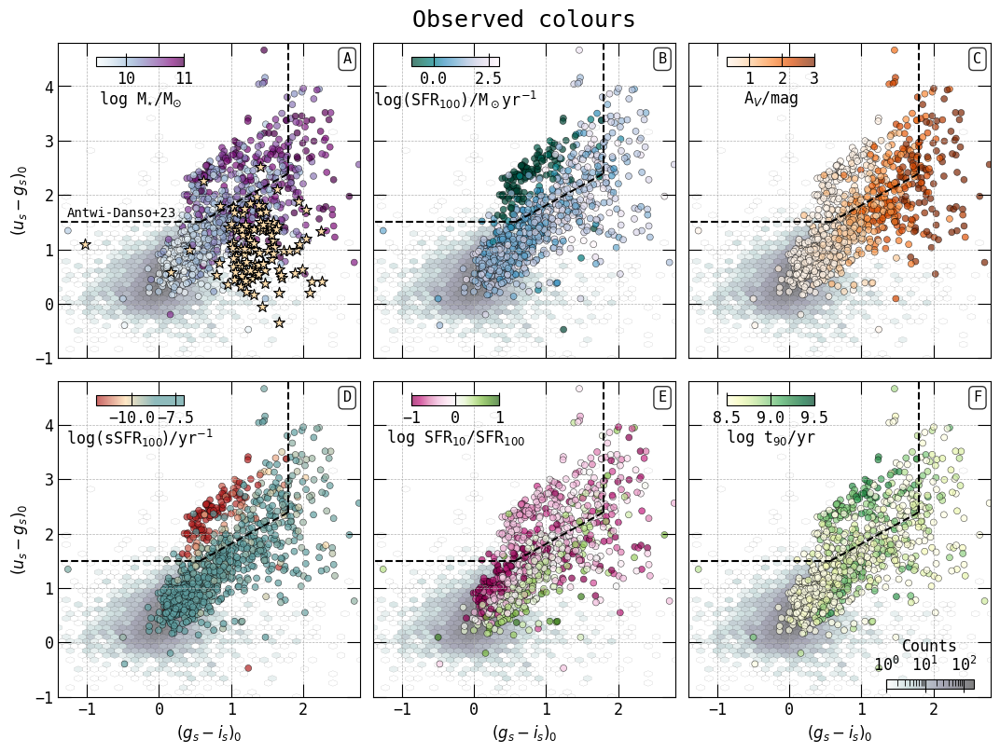
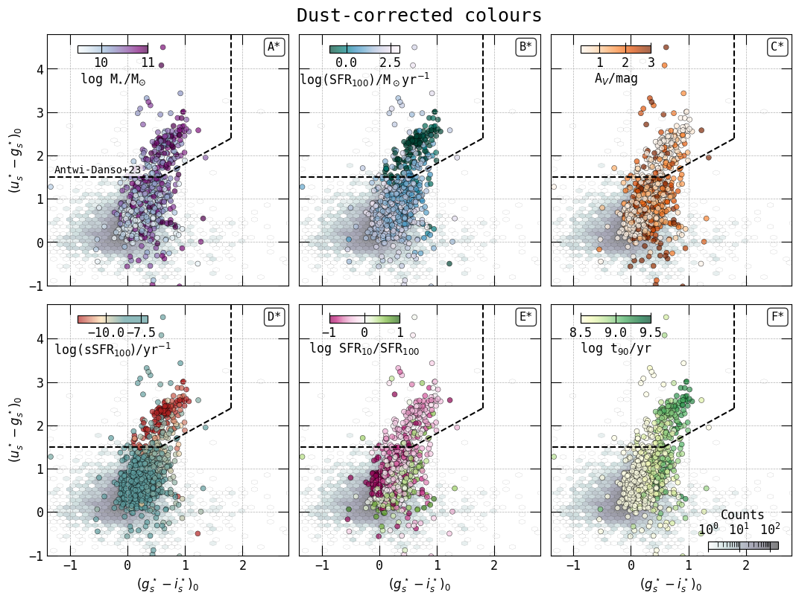
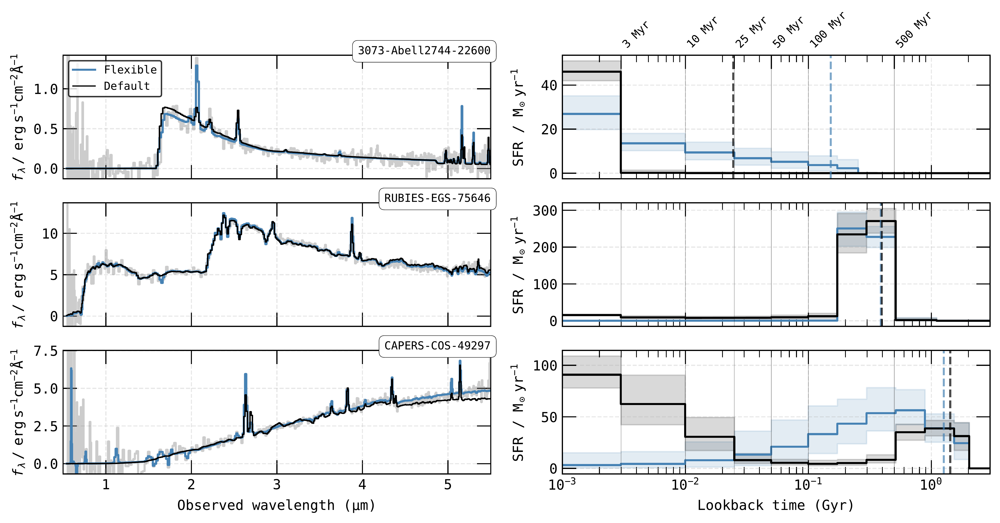
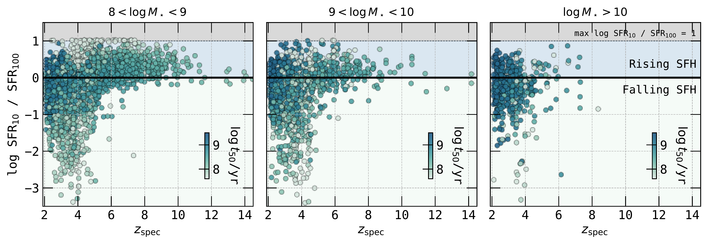

$\newcommand{\ensuremath}{}$
$\newcommand{\xspace}{}$
$\newcommand{\object}[1]{\texttt{#1}}$
$\newcommand{\farcs}{{.}''}$
$\newcommand{\farcm}{{.}'}$
$\newcommand{\arcsec}{''}$
$\newcommand{\arcmin}{'}$
$\newcommand{\ion}[2]{#1#2}$
$\newcommand{\textsc}[1]{\textrm{#1}}$
$\newcommand{\hl}[1]{\textrm{#1}}$
$\newcommand{\footnote}[1]{}$
$\newcommand{\comment}[1]{\textcolor{purple}{#1}}$
$\newcommand\hst{{HST}\xspace}$
$\newcommand\jwst{{JWST}\xspace}$
$\newcommand\bagpipes{{\sc Bagpipes}}$
$\newcommand\msaexp{{\sc Msaexp}}$
$\newcommand\grizli{{\sc Grizli}}$
$\newcommand\eazy{{\sc Eazy}}$
$\newcommand\cloudy{{\sc Cloudy}}$
$\newcommand\av{A_V}$
$\newcommand\sfrt{{\rm SFR_{10 Myr}}}$
$\newcommand\sfrh{{\rm SFR_{100 Myr}}}$
$\newcommand\ssfrt{{\rm sSFR_{10 Myr}}}$
$\newcommand\ssfrh{{\rm sSFR_{100 Myr}}}$
$\newcommand\ugis{(ugi)_s}$
$\newcommand\us{u_s}$
$\newcommand\gs{g_s}$
$\newcommand\is{i_s}$
$\newcommand\ug{(u_s-g_s)_0}$
$\newcommand\gi{(g_s-i_s)_0}$
$\newcommand{\arraystretch}{1.5}$
$\newcommand{\arraystretch}{1.5}$
$\newcommand{\arraystretch}{1.5}$
$\newcommand{\arraystretch}{1.5}$
$\newcommand{\arraystretch}{1.5}$

# The DAWN $\jwst$ Archive:\ A spectroscopically-informed population study of the physical properties of galaxies at $\texorpdfstring{$z>2$}{Lg}$

<mark>Appeared on: 2026-10-14</mark> -  _23 pages, 15 figures, submitted to Astronomy and Astrophysics (A&A)_

R. Gottumukkala, et al. -- incl., <mark>A. d. Graaff</mark>, <mark>Y. Zhang</mark>

**Abstract:** Charting the evolution of star-formation, stellar mass and dust build-up over cosmic time relies on the accurate characterisation of the stellar population properties of high redshift galaxies.Here, we present a catalogue of spectroscopically derived physical properties for $\sim 12,000$ galaxies, with archival $\jwst$ /NIRSpec PRISM spectroscopy and $\jwst$ /NIRCam imaging. Our sample includes all publicly available high quality PRISM spectra at $z_{\rm spec}>2$ , uniformly reduced and available on the DAWN $\jwst$ Archive (DJA). We present a custom version of the spectral energy distribution (SED) fitting code $\bagpipes$ , used to perform joint spectrophotometric SED modelling of PRISM spectra and available broadband NIRCam photometry. In doing so, we publicly release a science-ready catalogue characterising the physical properties of galaxies at cosmic noon and beyond. We report key physical properties, such as stellar masses, star-formation rates, star-formation timescales, and V-band dust attenuation ( $\av$ ).We further probe the recent star-formation histories (SFH) of galaxies via their star-formation rates on 3 Myr, 10 Myr, and 100 Myr timescales, capturing both rising and falling recent SFHs.Through dust-corrected $\ugis$ colour-colour diagrams of massive galaxies, we show how quiescent and dusty galaxies populate this colour space at $z>2$ , with galaxies experiencing a recent downturn in star-formation occupying distinct parameter space.We additionally study the dustiest galaxies in our sample, showing that they are preferentially more massive and strongly star-forming relative to the parent sample, residing on the high-mass end of the star-forming main-sequence. The slope of the dust attenuation curve has a strong dependence on $\av$ , varying from steep (higher dust index) to shallow (lower dust index) as the dust attenuation increases and the specific star-formation rate decreases.Our findings show that the unparalleled number statistics of this catalogue of spectroscopically derived stellar population properties uniquely enables the study star-formation, quenching and dust properties of galaxies from cosmic noon to cosmic dawn.

**Figure 13. -** Rest-frame and dust-corrected \ugis  colour-colour diagrams of our sample of galaxies; coloured scatter points correspond to sources with ${\rm \log M_\star / M_\odot > 9.5}$, and lower mass sources can be seen in the background greyscale plot. Stars denote LRDs identified from [de Graaff, et. al (2025)](https://ui.adsabs.harvard.edu/abs/2025arXiv251121820D). From top left to bottom right, the observed (and below, the dust-corrected) \ugis  diagram is coloured by A (A*): stellar mass, B (B*): star-formation rate, C (C*): V-band dust attenuation, D (D*): specific star-formation rate, E (E*): logarithm of the ratio of ${\rm SFR_{10} / SFR_{100}}$, and F (F*): $t_{90}$. (*fig:ugi_sed_cbar*)

**Figure 4. -** Example of flexible (blue) and default (black) \bagpipes  SED fits and SFHs of a star-forming galaxy at $z=12.3$, a quiescent galaxy at $z = 4.9$ and a dusty galaxy at $z=3.0$. For the star-forming galaxy, emission lines are better captured by the flexible line fitting method, which also prefers a gradually rising SFH as opposed to the rapid SFH preferred by the default fitting method. For the quiescent galaxy, while both SED fits are comparable, the flexible method prefers a completely quiescent SFH solution while the default SFH finds some residual star-formation in the most recent time bins, arising from mis-identifying an [N {\sc ii}] line as H$\alpha$ due to the PRISM resolution. In the case of the dusty galaxy, both recent SFHs look dramatically different; we see that the flexible line fitting captures the emission lines better as well as the NIR stellar continuum. (*fig:technical_seds_flex_vs_def*)

**Figure 12. -** Logarithmic ratio of \sfrt over \sfrh as a function of spectroscopic redshift for galaxies with ${\rm 8< \log M_\star / M_\odot < 9}$(left), ${\rm 9 < \log M_\star / M_\odot < 10}$(centre) and ${\rm \log M_\star / M_\odot > 10}$(right). ${\rm \log SFR_{10} / SFR_{100} > 0}$ denotes a rising SFH and ${\rm \log SFR_{10} / SFR_{100} < 0}$ denotes a falling SFH in the last 100 Myr. Each scatter point is coloured by the $t_{50}$ timescales which is a measure of the median stellar age. At $z>6$ a majority of sources in this sample have rising SFHs, while falling SFHs tend of appear at $z<6$. Galaxies with high $t_{50}$ values tend for fall within a range of ${\rm -1 < \log SFR_{10} / SFR_{100} < 1}$, while galaxies with the lowest $t_{50}$ tend to have rising SFHs. Interestingly at ${\rm \log SFR_{10} / SFR_{100} < -1}$ which shows steeply falling SFHs we find galaxies with low $t_{50}$, which implies that these are younger galaxies than are experiencing a recent downturn in star-formation. (*fig:dja_nirspec_sfr10_sfr100_vs_redshift*)

