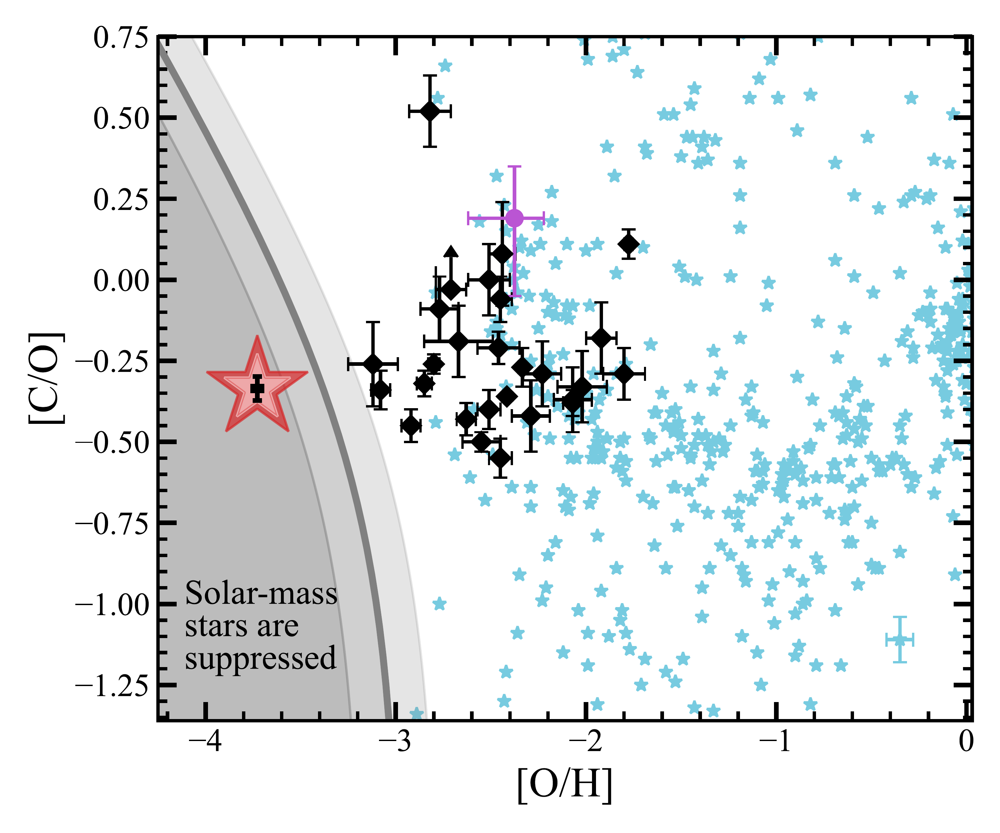
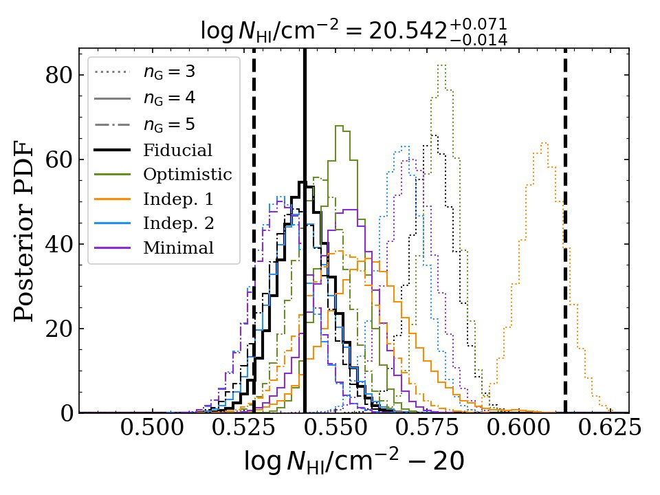
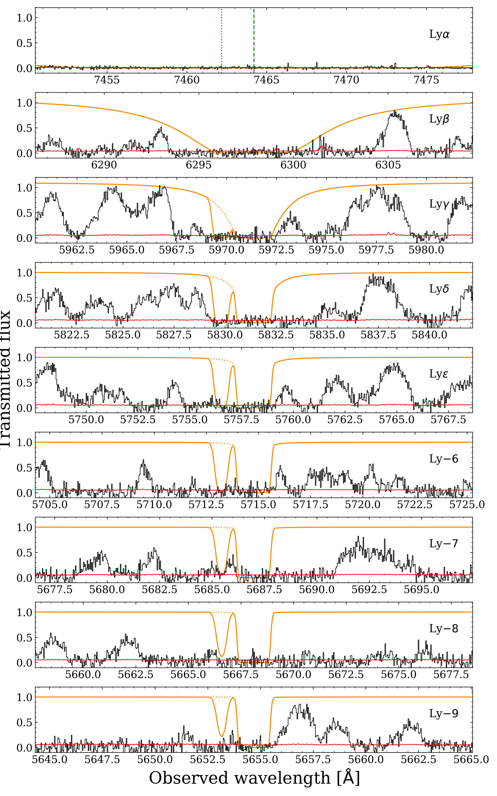

$\newcommand{\ensuremath}{}$
$\newcommand{\xspace}{}$
$\newcommand{\object}[1]{\texttt{#1}}$
$\newcommand{\farcs}{{.}''}$
$\newcommand{\farcm}{{.}'}$
$\newcommand{\arcsec}{''}$
$\newcommand{\arcmin}{'}$
$\newcommand{\ion}[2]{#1#2}$
$\newcommand{\textsc}[1]{\textrm{#1}}$
$\newcommand{\hl}[1]{\textrm{#1}}$
$\newcommand{\footnote}[1]{}$
$\newcommand{\bibinfo}[2]{#2}$
$\newcommand{\eprint}[2][]{\url{#2}}$
$\newcommand{\bibinfo}[2]{#2}$
$\newcommand{\eprint}[2][]{\url{#2}}$
$\newcommand{\mnras}{MNRAS}$
$\newcommand{\nat}{Nature}$
$\newcommand{\apj}{ApJ}$
$\newcommand{\apjl}{ApJL}$
$\newcommand{\aap}{A\&A}$
$\newcommand{\apjs}{ApJS}$
$\newcommand{\aj}{AJ}$
$\newcommand{\prd}{Phys. Rev. D}$
$\newcommand{\araa}{ARA\&A}$
$\newcommand{\pasp}{PASP}$
$\newcommand{\pasj}{PASJ}$
$\newcommand{\ssr}{Space Sci. Rev.}$
$\newcommand{\jqsrt}{J. Quant. Spectrosc. Radiat. Transf.}$
$\newcommand{\sime}{\simeq}$
$\newcommand{\gsim}{\gtrsim}$
$\newcommand{\nbsp}{ }$
$\newcommand{\JournalTitle}[1]{#1}$
$\newcommand{\nhi}{N_\text{HI}}$
$\newcommand{\lal}{Lyman-\alpha }$
$\newcommand\mgh{#1}$
$\newcommand\url{#1}$
$\newcommand{\urlprefix}{URL }$
$\newcommand{\doiprefix}{DOI: }$
$\newcommand\url{#1}$
$\newcommand{\urlprefix}{URL }$
$\newcommand{\doiprefix}{DOI: }$

# Nearly pristine gas in a galaxy 1 billion years after the Big Bang

<mark>Appeared on: 2026-10-14</mark> -  _Accepted in Nature_

$. E. I. Bosman, et al. -- incl., <mark>B. Maity</mark>, <mark>E. Bañados</mark>

**Abstract:**            Excitation of carbon and oxygen ions is the primary mechanism by which collapsing gas clouds dissipate heat to form new stars. At early cosmic times, in galaxies with chemically pristine gas, many stars are expected to have masses far larger than the mass of our sun due to the deficit in these elements. We searched for ultra-metal-poor galaxies using their spectroscopic absorption signatures in front of bright background quasars, employing the new GHOST high-resolution spectrograph. Here we report the discovery of the first galaxy containing a reservoir of neutral hydrogen gas with metallicity below the ultra-metal-poor threshold: with a measured carbon-to-hydrogen ratio 11,000 times lower than the Sun, it is the most pristine ever found by a factor of four. UMP-DLA-1 is the only known galaxy with measured carbon and oxygen abundances too low to enable efficient formation of stars with solar mass or below. The low metallicity alone therefore guarantees a top-heavy stellar population, providing a direct view of the chemical composition imprinted by massive low-metallicity stars that perished long before the present day: an elevated oxygen-to-carbon ratio. The abundance pattern of UMP-DLA-1 is likely a close representation of the atomic yields of first- or early second-generation stars.         

**Figure 3. -** **The transition discriminant.** With sufficiently low abundances of oxygen and carbon, UMP--DLA--1 (red star) is the first gas reservoir detected below the transition discriminant\cite{Frebel07}(grey area, with uncertainties in light grey) where the IMF is known to be top-heavy. It follows the trend seen in extremely metal-poor and very metal-poor DLAs (black points) of a slight carbon deficit compared to oxygen, while individual metal-poor local stars (blue points, from SAGA\cite{SAGA}) display far more scatter. Characteristic uncertainties for stellar abundances are shown in the bottom-right corner. The purple circle represents the lowest-metallicity galaxy discovered in emission to date\cite{Nakajima25}.
 (*fig:forbidden*)

**Figure 7. -** **Extended Data Figure 3.** Comparison of the marginalised posterior distributions of $\nhi$ for all fifteen permutations of fitting choices $-$ three choices for the number of Gaussians representing the $\lal$ emission line, and five choices corresponding to different combinations of the fitting regions B1$-$B4 and R1$-$R4. The full envelope of the $1\sigma$ uncertaintites of the individual fits gives us the total uncertaintites on the fiducial $\nhi$. (*fig:forbidden*)

**Figure 8. -** **Extended Data Figure 4.** Spectrum of the background quasar (black) and best-fit H {I} absorption profiles obtained from the Lyman-$\alpha$ absorption profile (orange). All transitions of the Lyman-series are fully opaque at the redshift of UMP--DLA--1, confirming its high hydrogen column density. The displayed velocity range is $\pm 550$ km s$ ^{-1}$. Absorption by deuterium is also shown as the left-most component of the orange lines in all panels.
 (*fig:forbidden*)

