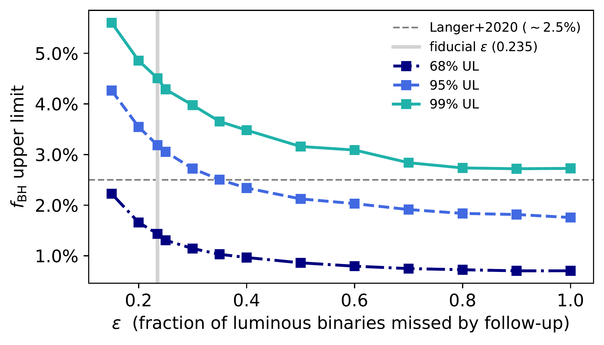
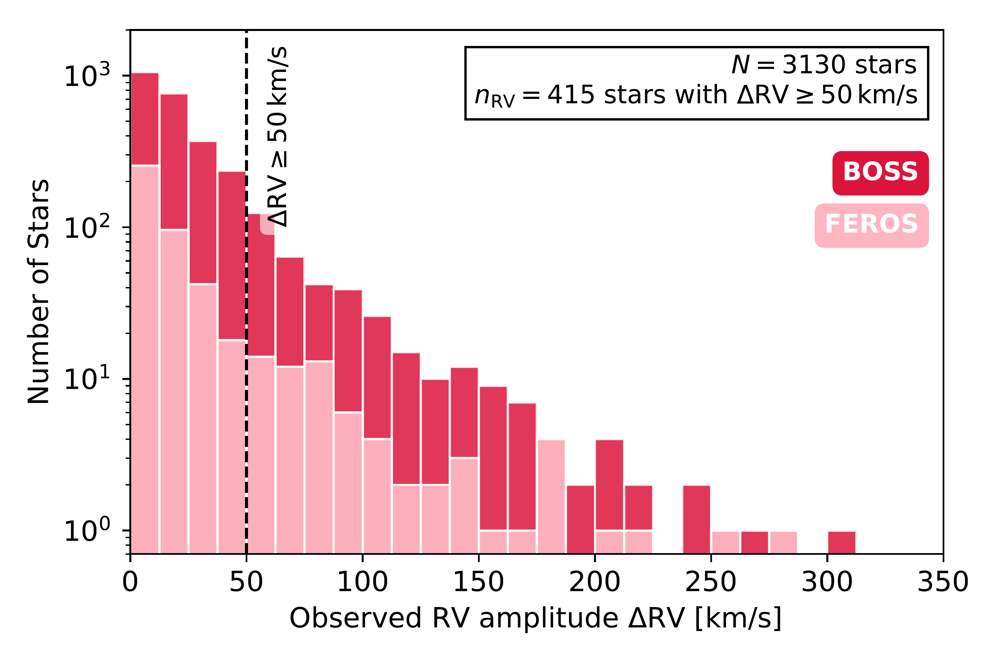
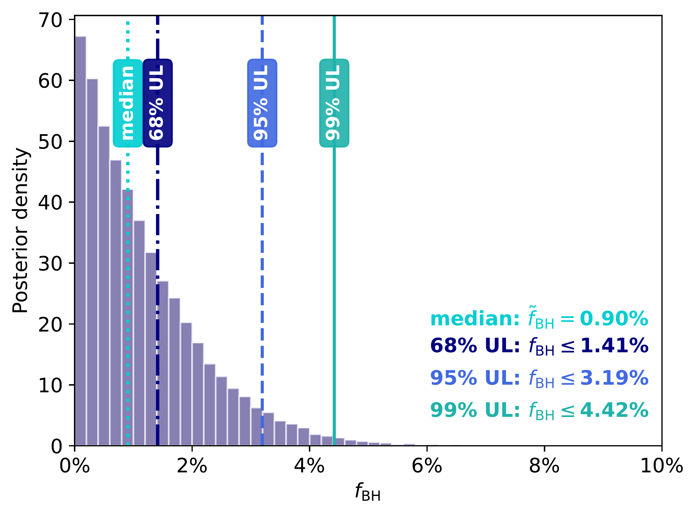

$\newcommand{\ensuremath}{}$
$\newcommand{\xspace}{}$
$\newcommand{\object}[1]{\texttt{#1}}$
$\newcommand{\farcs}{{.}''}$
$\newcommand{\farcm}{{.}'}$
$\newcommand{\arcsec}{''}$
$\newcommand{\arcmin}{'}$
$\newcommand{\ion}[2]{#1#2}$
$\newcommand{\textsc}[1]{\textrm{#1}}$
$\newcommand{\hl}[1]{\textrm{#1}}$
$\newcommand{\footnote}[1]{}$
$\newcommand{\kiril}[1]{\textcolor{magenta}{\textbf{KM: #1}}}$
$\newcommand{\reed}[1]{\textcolor{red}{#1}}$

# An upper limit on Galactic OB+black hole binaries from SDSS-V

<mark>Appeared on: 2026-10-14</mark> -  _9 pages, 4 figures, submitted to A&A_

<mark>J. Müller-Horn</mark>, et al. -- incl., <mark>H.-W. Rix</mark>, <mark>S. Shahaf</mark>, <mark>B. Pennell</mark>, <mark>K. Maltsev</mark>

**Abstract:** Binaries composed of a luminous OB star and a black hole (BH) are a key evolutionary link between massive stellar binaries and merging compact-object binaries, but only a handful are known and their occurrence fraction remains poorly constrained.We use multi-epoch spectroscopy from the SDSS-V Milky Way Mapper to place a first rigorous empirical upper limit on the fraction of Galactic massive ( ${\geq} 10   \mathrm{M_\odot}$ ) OB stars with a close BH companion, $f_{\rm BH}$ .Radial-velocity (RV) variability alone cannot distinguish BH companions from the far more numerous luminous binaries. We therefore combine the SDSS-V RV variability measurements of 3130 massive OB stars with high-resolution follow-up and literature information to identify luminous companions among the RV-variable subset.Forward-modelling the detectability of OB+BH systems using BH masses and orbital parameters from binary-evolution models, we find $f_{\rm BH}\lesssim 3\%$ at 95 \% credibility.This empirical upper limit approaches, but does not exclude, theoretical predictions for the OB+BH fraction.The constraint is primarily limited by the number of RV-variable systems that can be decisively classified, highlighting the importance of complete, high-quality follow-up for future searches.

**Figure 3. -** Dependence of the inferred upper limit on $f_\mathrm{BH}$ on the assumed value of $\epsilon$; the fraction of RV-variable non-BH systems that evade our follow-up tests and classification. For the fiducial model, we adopted $\epsilon{\simeq} 0.235$ as a conservative lower estimate. (*fig:eps_scan*)

**Figure 1. -** Observed maximum RV differences in the OB parent sample.
 (*fig:drv_histogram*)

**Figure 2. -** Normalised posterior probability density distribution of the OB+BH fraction $f_{\rm BH}$. Vertical lines indicate the median value and the $68\%$, $95\%$, and $99\%$ upper limits of $f_{\rm BH} \leq 1.41\%,$$3.19\%,$$\mathrm{and} 4.42\%.$ (*fig:fbh_posterior*)

