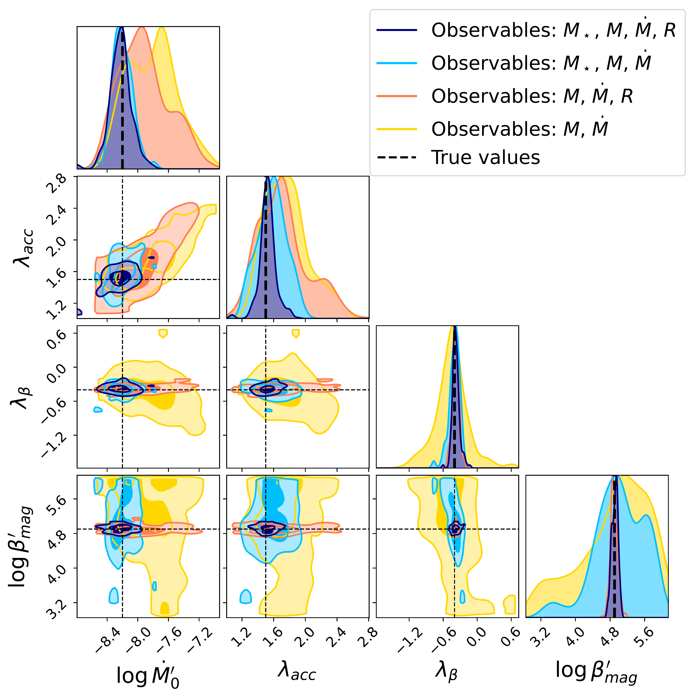

$\newcommand{\ensuremath}{}$
$\newcommand{\xspace}{}$
$\newcommand{\object}[1]{\texttt{#1}}$
$\newcommand{\farcs}{{.}''}$
$\newcommand{\farcm}{{.}'}$
$\newcommand{\arcsec}{''}$
$\newcommand{\arcmin}{'}$
$\newcommand{\ion}[2]{#1#2}$
$\newcommand{\textsc}[1]{\textrm{#1}}$
$\newcommand{\hl}[1]{\textrm{#1}}$
$\newcommand{\footnote}[1]{}$
$\newcommand{\tildea}[1]{\overset{\sim}{#1}}$
$\newcommand{\arraystretch}{1.1}$

# DEMOS: I. A Bayesian inference framework to constrain disc evolution from observed demographics

<mark>Appeared on: 2026-10-14</mark> -  _18 pages_

L. A. Malanga, et al. -- incl., <mark>A. Somigliana</mark>

**Abstract:** The mechanism driving the evolution and dispersal of protoplanetary discs has a substantial impact on the theories of planet formation. To date, neither the viscous paradigm nor the Magneto-Hydrodynamic (MHD) wind-driven framework have been ruled out by the observations. The statistical richness of the observed samples provides a unique opportunity to test evolutionary models through population synthesis. However, comparisons between models and observations are normally carried out by eye, and a more statistically rigorous approach has not yet been implemented. We present \texttt{DEMOS} , a Bayesian inference tool that aims to infer the model parameters and initial conditions that best reproduce the full distribution of global properties of disc populations. This framework relies on a comparison between observations and synthetic populations generated with the 1D disc population-synthesis code \texttt{Diskpop} . We tested the tool with both the MHD wind model and the viscous framework with internal photoevaporation. Applying \texttt{DEMOS} to synthetic populations, we find that, for both models, it accurately recovers the model parameters of disc populations and their associated uncertainties, including cases in which initial conditions are correlated with the stellar mass. In the optimal scenario in which disc masses, accretion rates and disc sizes are available, the tool can also constrain the angular-momentum transport parameter. We show that, although parameter estimates are the most precise with samples of $\sim$ 100 discs, the tool also yields meaningful constraints for smaller populations of 10--30 discs. We further find that the predictions obtained with \texttt{DEMOS} closely align with those found by previous works when applied to the same datasets. We anticipate that \texttt{DEMOS} will be a valuable tool to infer the initial conditions of observed disc populations, to design observational programmes, and to assess which evolutionary model best reproduces the data. This statistical framework can be easily extended to test more evolutionary models, such as late-infall or external photoevaporation models.

**Figure 10. -** Posterior distribution of the model parameters obtained with \texttt{DEMOS} reproducing a synthetic dataset $D'$ with the MHD winds model. The free parameters $\theta$ are \{$\log (M_0/\text{M}_\odot)',  \lambda_m,  \log (\dot{M}_0/\text{M}_\odot  \text{yr}^{-1})',  \lambda_\text{acc}, \lambda_\beta,  \log \beta_\text{mag} ' ,  \sigma_t,  \lambda ,  \omega ,  \langle  t  \rangle  [\text{Myr}] $\} and the true values (red dashed lines) are \{-1.7, 1.8, -8.2, 1.5, -0.4, 4.9, 0.3, 8.0, 0.8, 2\}. In all cases the true values are compatible with the obtained distributions within 1$\sigma$ intervals. (*fig:mcmc_mhd_4_variables_corr*)

**Figure 14. -** Posterior distribution of the model parameters obtained with \texttt{DEMOS} reproducing the different subsets of the same synthetic population of Fig. \ref{fig:mcmc_mhd_4_variables_corr}. Each subsets contains 100 (blue), 30 (orange) and 10 (green) objects, respectively. Black dashed lines mark the true values, while dark and light hatched regions include the 1$\sigma$ and 2$\sigma$ confidence intervals, respectively. (*fig:test_ndiscs*)

**Figure 2. -** Comparison between the posterior distribution of a subset of the model parameters of a synthetic dataset that evolves according to the MHD-wind model for different sets of observables. The considered observables are $\{M_\star,  M,  \dot{M}, R\}$(blue), $\{M_\star,  M,  \dot{M}\}$(light blue), $\{M,  \dot{M}, R\}$(dark orange), and $\{M,  \dot{M}\}$(yellow). For all fits, the disc fraction is also included among the observables. The darker and lighter hatched regions include the 1$\sigma$ and 2$\sigma$ confidence intervals, respectively. The dashed black lines show the true values for each parameter. (*fig:test_observables*)

