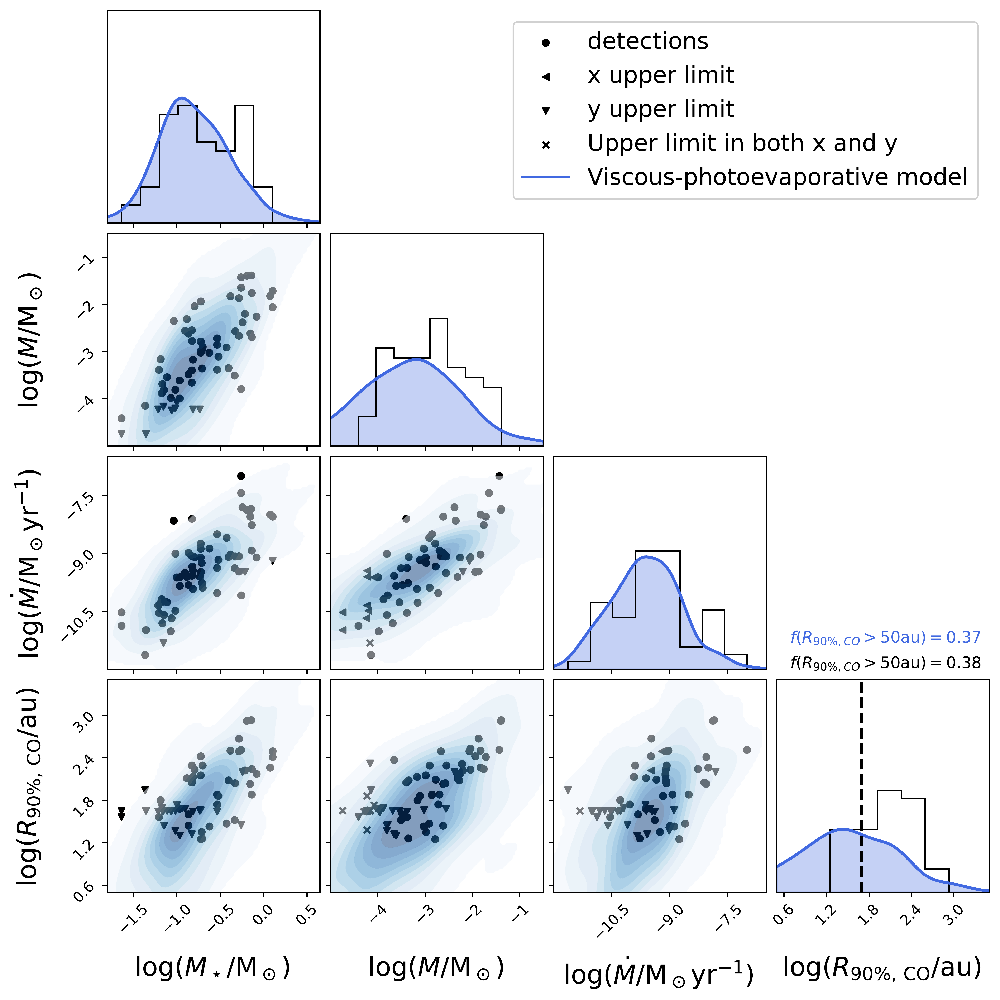
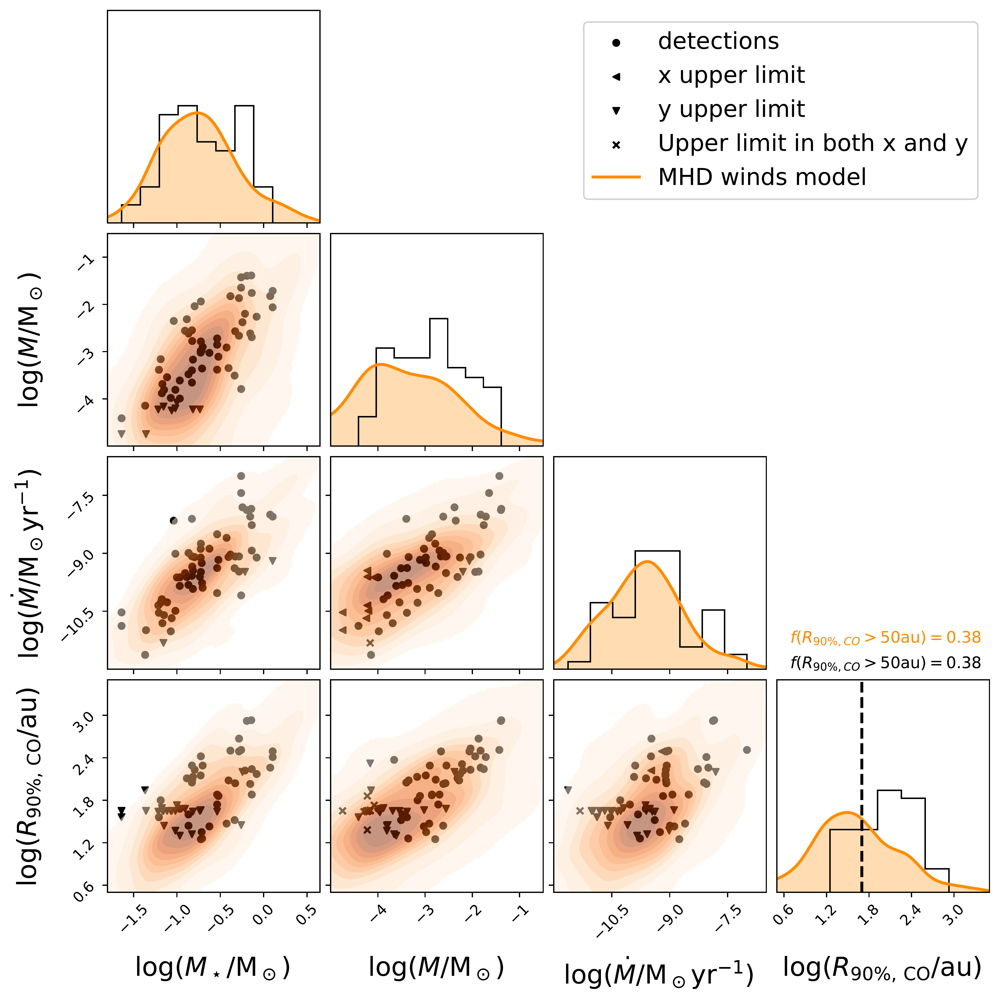
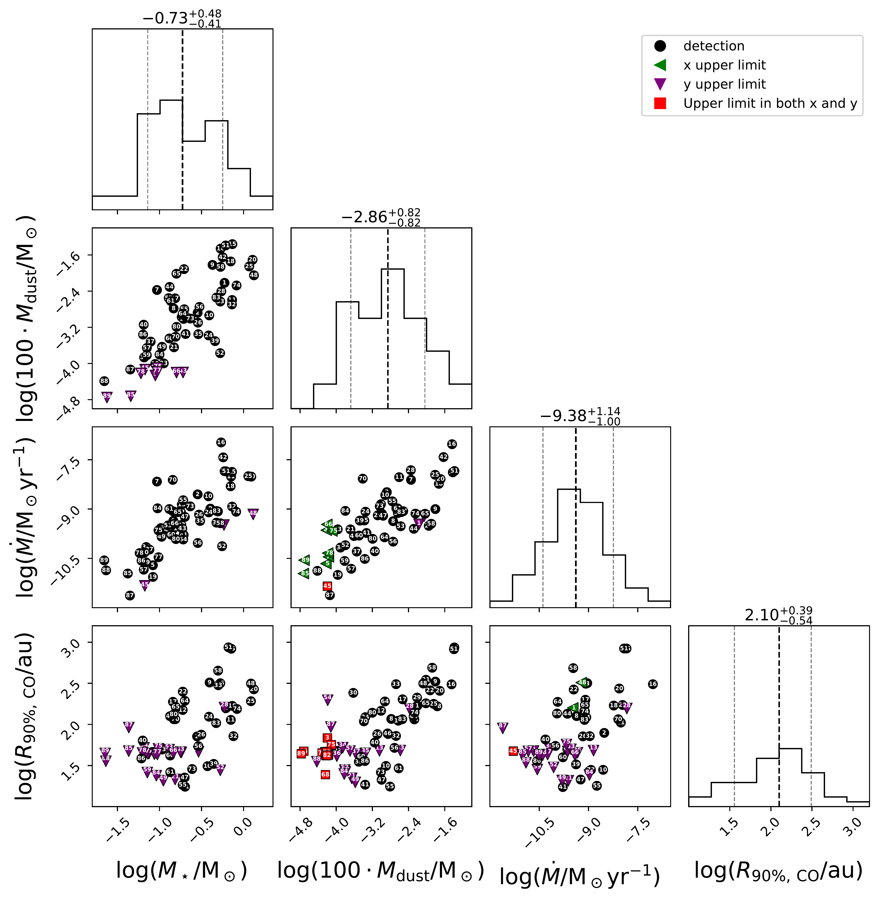
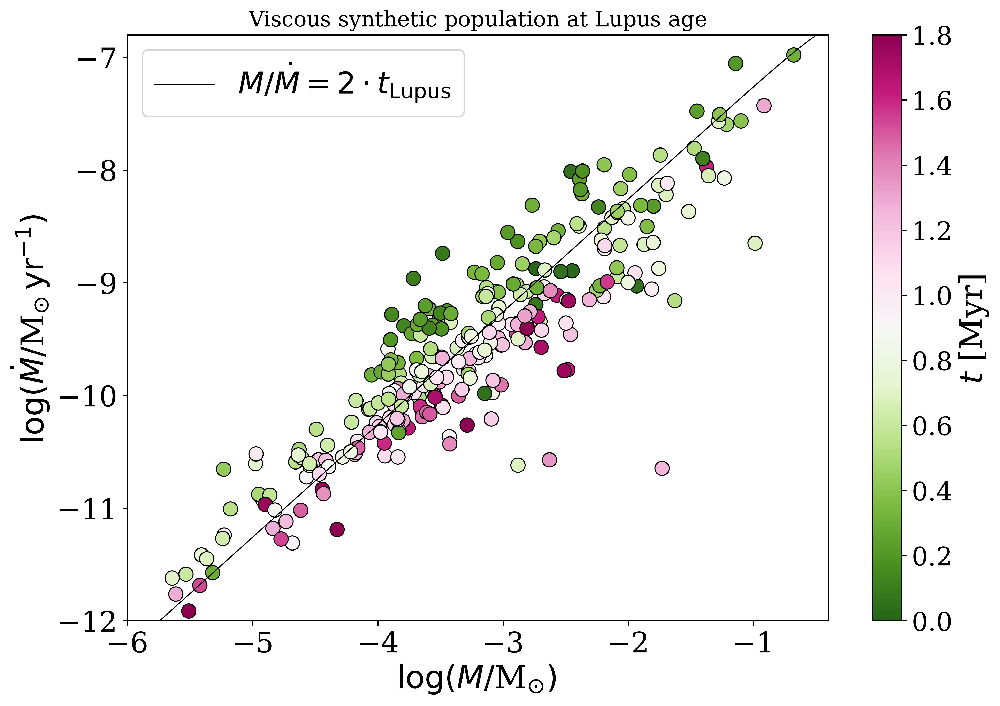
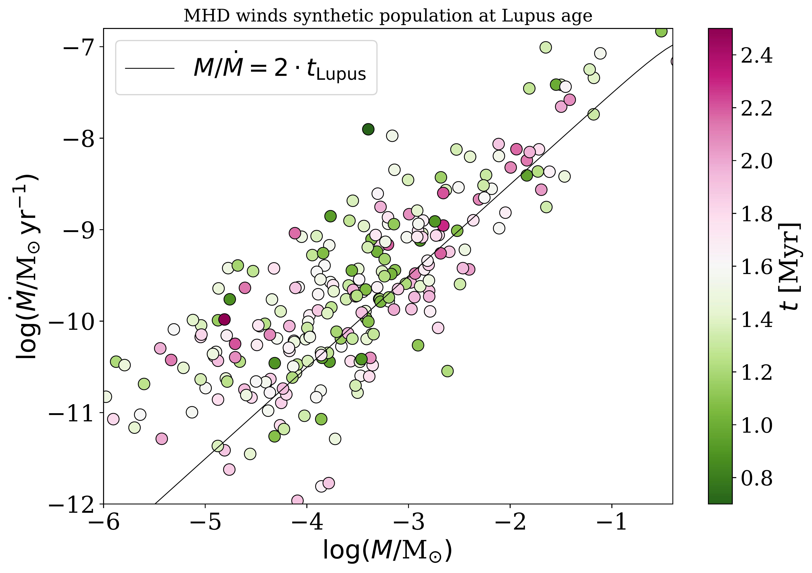

$\newcommand{\ensuremath}{}$
$\newcommand{\xspace}{}$
$\newcommand{\object}[1]{\texttt{#1}}$
$\newcommand{\farcs}{{.}''}$
$\newcommand{\farcm}{{.}'}$
$\newcommand{\arcsec}{''}$
$\newcommand{\arcmin}{'}$
$\newcommand{\ion}[2]{#1#2}$
$\newcommand{\textsc}[1]{\textrm{#1}}$
$\newcommand{\hl}[1]{\textrm{#1}}$
$\newcommand{\footnote}[1]{}$
$\newcommand{\tildea}[1]{\overset{\sim}{#1}}$
$\newcommand{\rev}[1]{#1}$
$\newcommand{\revv}[1]{#1}$
$\newcommand{\revvv}[1]{#1}$
$\newcommand{\arraystretch}{1.1}$
$\newcommand{\arraystretch}{1.35}$

# DEMOS. II. What the full Lupus demographics truly tell us about protoplanetary disc evolution

<mark>Appeared on: 2026-10-14</mark> -  _22 pages_

L. A. Malanga, et al. -- incl., <mark>A. Somigliana</mark>, <mark>F. Zagaria</mark>

**Abstract:** Assessing whether disc evolution is driven by viscosity or Magneto Hydro-dynamic (MHD) winds is crucial to determine the conditions in which planets form. The rich statistical information encoded in the nearby star-forming regions provides an excellent opportunity to probe disc evolution. In this paper, we apply the Bayesian inference tool \texttt{DEMOS} , which is designed to fully exploit the statistical properties of disc populations and infer initial conditions and model parameters, to the Lupus disc population. We consider the observed distribution of stellar mass $M_\star$ , disc mass $M$ (obtained from continuum flux), mass accretion rate $\dot{M}$ and CO disc size $R_{90\%, \text{CO}}$ . We constrain all parameters for both the viscous model, which includes dispersal driven by internal photoevaporation, and the MHD winds model, with unprecedented precision. The inferred initial conditions suggest that positive correlations between initial disc properties, such as mass $M_0$ and truncation radius $R_0$ , with the stellar mass $M_\star$ , must be already present in the population before the disc phase. According to both models, the typical $R_0$ , for a disc around a $0.3 \text{M}_\odot$ star, is $3-5$ au, with a strong dependence on stellar mass of $\sim 2$ and $\sim 1$ for the viscous-photoevaporative and MHD winds models, respectively. We infer values for the angular momentum transport parameter $\alpha$ (or $\alpha_\text{DW}$ ) of $3-4 \times 10^{-4}$ , in both models, for discs around $0.3 \text{M}_\odot$ stars, and an approximately quadratic dependence on $M_\star$ . For the viscous-photoevaporative model, we infer a typical wind's mass-loss rate $\dot{M}_\text{w} \sim 10^{-9}$ M $_\odot$ yr $^{-1}$ for a disc around a $0.3 \text{M}_\odot$ star, and a steep correlation with $M_\star$ with an exponent $\sim 2.5$ . The inferred mean age of the Lupus population differs between models, with $\langle t\rangle$ = 1.6 Myr for the MHD winds model and $\langle t\rangle$ = 0.9 Myr for the viscous-photoevaporative framework. Despite indicating a slight preference for the viscous-photoevaporative framework, the Bayesian evidence computed with \texttt{DEMOS} shows that both models reproduce the data with comparable accuracy and does not allow either scenario to be ruled out. However, the best-fit synthetic populations predict substantially different evolutionary pathways, suggesting that the application of \texttt{DEMOS} to multiple populations, especially to evolved ones such as Upper Scorpius, will allow to place stronger constraints on disc evolution mechanisms.

**Figure 1. -** \small{
    Comparison between the observed Lupus distribution in the observables space (black), where the axes are $\log (M_\star/$M$_\odot)$, $\log (M/$M$_\odot)$, $\log (\dot{M}/$M$_\odot $yr$^{-1})$ and $\log (R_{90\%, \text{CO}}/$au) to the probability function predicted by the viscous model (blue, top panel) and MHD winds model (orange, bottom panel). Dots represent detections, while triangles and crosses identify measurements with an upper limit on one or both axes, respectively.
    The dashed vertical lines in the $\log (R_{90\%, \text{CO}}/$au) histogram indicate the typical detection threshold. The fraction of discs with size above such threshold is reported above the histogram for both observed discs (black) and best-fit synthetic discs (blue and orange).
    } (*fig:fit*)

**Figure 8. -** Distribution of the Lupus demographics across the four observables stellar mass $\log (M_\star / \text{M_\odot)$, disc mass, obtained as 100 times the dust mass $\log (100 \cdot M_\text{dust} / \text{M}_\odot)$, mass accretion rate $\log (\dot{M} / \text{M}_\odot  \text{yr}^{-1})$, and disc radius $\log (R_{\text{CO}, 90\%} / \text{au})$. Histograms represent the 1-dimensional distribution, where the median and the difference with respect to the $16^{\text{th}}$ and $84^\text{th}$ percentile are indicated. $\rev${Percentiles are indicated by the dashed vertical lines}. The scatter plots show the correlation among the observables. Black circles represent detections, green and purple triangles the upper limits with respect to the x and y axes, respectively, and the red squares upper limits for both axes. Each point is labeled with the characteristic index of each source, defined in Table \ref{tab:Lupus}.} (*fig:Lupus_demographics*)

**Figure 10. -** \small{
    Synthetic populations evolved with the best-fit parameters obtained by \texttt{DEMOS} for the viscous model (left) and the MHD winds model (right), respectively, displayed in the $\dot{M}-M$ plane. The colorbar highlights the age of individual discs, where green and pink correspond to discs younger and older than the mean age, respectively. The mean ages of the population are 0.9 Myr in the viscous case and 1.6 Myr in the wind-driven case.
    The black line traces the viscous isochrone.
    } (*fig:age_scatter*)

