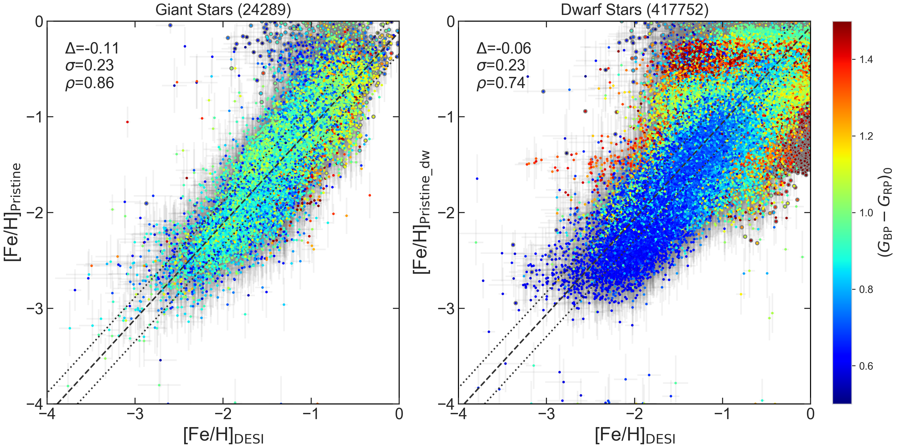
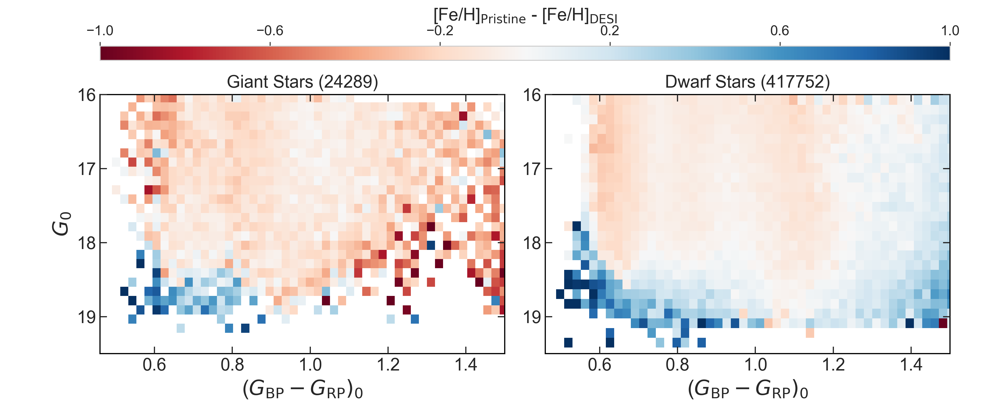
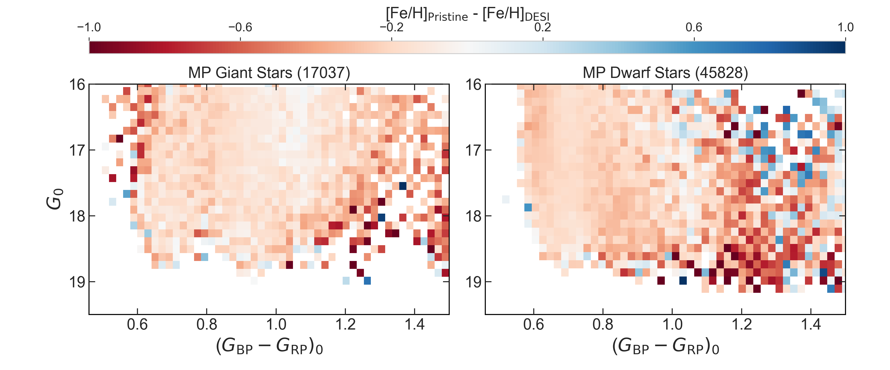
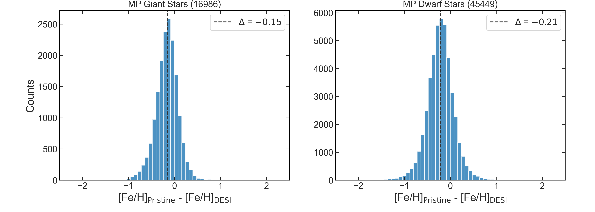
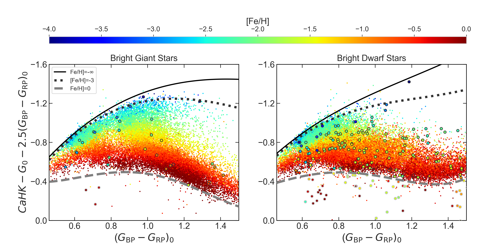
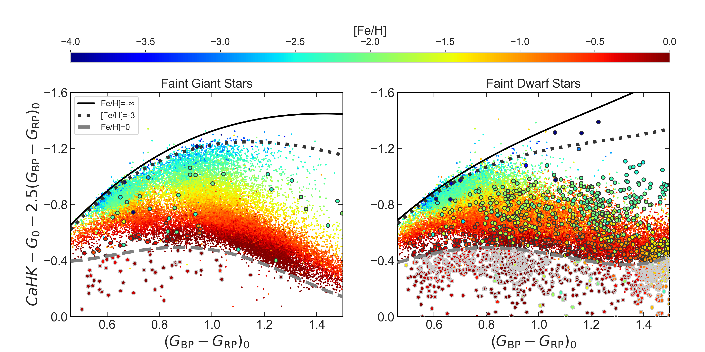

$\newcommand{\ensuremath}{}$
$\newcommand{\xspace}{}$
$\newcommand{\object}[1]{\texttt{#1}}$
$\newcommand{\farcs}{{.}''}$
$\newcommand{\farcm}{{.}'}$
$\newcommand{\arcsec}{''}$
$\newcommand{\arcmin}{'}$
$\newcommand{\ion}[2]{#1#2}$
$\newcommand{\textsc}[1]{\textrm{#1}}$
$\newcommand{\hl}[1]{\textrm{#1}}$
$\newcommand{\footnote}[1]{}$
$\newcommand{\fmmm}[1]{\mbox{#1}}$
$\newcommand{\scnd}{\mbox{\fmmm{"}\hskip-0.3em .}}$
$\newcommand{\scnp}{\mbox{\fmmm{"}}}$
$\newcommand{\mcnd}{\mbox{\fmmm{'}\hskip-0.3em .}}$
$\newcommand{\gkai}[1]{\begin{CJK*}{UTF8}{gkai}\raisebox{.1em}{(}#1\raisebox{.1em}{)}\end{CJK*}}$
$\newcommand{\feh}{\ensuremath{\mathrm{[Fe/H]}}}$
$\newcommand{\teff}{\ensuremath{T_{\rm eff}} }$
$\newcommand{\Gaia}{\textit{Gaia}\xspace}$
$\newcommand{\CaHK}{\emph{CaHK}\xspace}$
$\newcommand{\notea}[1]{{\textbf{\color{orange}#1}}}$
$\newcommand{\nvmp}{{92,156 }}$
$\newcommand{\nemp}{{1,668 }}$
$\newcommand{\Gyr}{{\rm Gyr}}$
$\newcommand{\FeH}{{\rm[Fe/H]}}$
$\newcommand{\kmsd}{{\rm km/s/degree}}$
$\newcommand{\magg}{{\rm g}}$
$\newcommand{\magi}{{\rm i}}$
$\newcommand{\age}{{\rm age}}$
$\newcommand{\erf}{\mathop{\rm erf}\nolimits}$
$\newcommand{\sech}{ \mathop{\rm sech}\nolimits}$
$\newcommand{\csch}{ \mathop{\rm csch}\nolimits}$
$\newcommand{\arcsinh}{\mathop{\rm arcsinh}\nolimits}$
$\newcommand{\arccosh}{\mathop{\rm arccosh}\nolimits}$
$\newcommand{\arctanh}{\mathop{\rm arctanh}\nolimits}$
$\newcommand{\arccoth}{\mathop{\rm arccoth}\nolimits}$
$\newcommand{\arcsech}{\mathop{\rm arcsech}\nolimits}$
$\newcommand{\arccsch}{\mathop{\rm arccsch}\nolimits}$
$\newcommand{\arccot}{\mathop{\rm arccot}\nolimits}$
$\newcommand{\arcsec}{\mathop{\rm arcsec}\nolimits}$
$\newcommand{\arccsc}{\mathop{\rm arccsc}\nolimits}$
$\newcommand{\ylm}{\mathop{\rm Y}_l^m\nolimits}$
$\newcommand{\ylmp}{\mathop{\rm Y}_{l'}^{m'}\nolimits}$
$\newcommand{\real}{\Re e}$
$\newcommand{\imag}{\Im m}$
$\newcommand{\km}{{\rm km}}$
$\newcommand{\kms}{{\rm km s^{-1}}}$
$\newcommand{\mas}{{\rm mas}}$
$\newcommand{\masyr}{{\rm mas/yr}}$
$\newcommand{\kpc}{{\rm kpc}}$
$\newcommand{\mpc}{{\rm Mpc}}$
$\newcommand{\msun}{{\rm M_\odot}}$
$\newcommand{\lsun}{{\rm L_\odot}}$
$\newcommand{\rsun}{{\rm R_\odot}}$
$\newcommand{\pc}{{\rm pc}}$
$\newcommand{\cm}{{\rm cm}}$
$\newcommand{\yr}{{\rm yr}}$
$\newcommand{\au}{{\rm AU}}$
$\newcommand{\g}{{\rm g}}$
$\newcommand{\om}{\Omega_0}$
$\newcommand\ca{{\it ca.\/}}$
$\newcommand\r{r^{1/4} }$
$\newcommand\magnitude{^{\rm m}}$
$\newcommand{\kr}{{\cal K}_r}$
$\newcommand{\kz}{{\cal K}_z}$
$\newcommand{\kzz}{{\cal K}_z(z)}$
$\newcommand{\mss}{{\rm M}_\odot \rm pc^{-2}}$
$\newcommand{\msss}{{\rm M}_\odot \rm pc^{-3}}$
$\newcommand{Å}{\; \buildrel \circ \over{\rm A}}$
$\newcommand{\yr}{{\rm yr}}$
$\newcommand{\CompactFigs}{0}$
$\newcommand{\UseFigs}{1}$
$\newcommand{\deg}{^\circ}$
$\newcommand{\degg}{\hbox{\null^\circ\hskip-3pt .}}$
$\newcommand{\sec}{\hbox{"\hskip-3pt .}}$
$\newcommand{\half}{{\scriptstyle{1\over2}}}$
$\newcommand{\s}{\ifmmode \widetilde \else \~\fi}$
$\newcommand{\=}{\overline}$
$\newcommand{\scre}{{\cal E}}$
$\newcommand\spose{#1}$
$\newcommand{\larrow}{\leftarrow}$
$\newcommand{\rarrow}{\rightarrow}$
$\newcommand{\llangle}{\langle\langle}$
$\newcommand{\rrangle}{\rangle\rangle}$
$\newcommand{\etal}{{\it et al. }}$
$\newcommand{\cf}{{\it cf. }}$
$\newcommand{\eg}{{e.g., }}$
$\newcommand{\ie}{{i.e., }}$
$\newcommand{\lta}{\mathrel{\spose{\lower 3pt\hbox{\mathchar"218}}$
$     \raise 2.0pt\hbox{\mathchar"13C}}}$
$\newcommand{\gta}{\mathrel{\spose{\lower 3pt\hbox{\mathchar"218}}$
$     \raise 2.0pt\hbox{\mathchar"13E}}}$
$\newcommand{\Dt}{\spose{\raise 1.5ex\hbox{\hskip3pt\mathchar"201}}}$
$\newcommand{\dt}{\spose{\raise 1.0ex\hbox{\hskip2pt\mathchar"201}}}$
$\newcommand{\del}{\nabla}$
$\newcommand{\delv}{\bb\nabla}$
$\newcommand{\r}{{\rm r^{1/4}}}$
$\newcommand{\kms}{ \mathrm{km s}^{-1}}$
$\newcommand{\ie}{{ i.e., }}$
$\newcommand{\eg}{{ e.g., }}$
$\newcommand{\lsun}{{\rm L}_\odot}$
$\newcommand{\msun}{{\rm M_\odot}}$
$\newcommand\zy{#1}$
$\newcommand\NFM{#1}$

# The Pristine survey: XXIX. Data Release 2: Photometric metallicities for 15 millions stars down to $G\sim 20.5$

<mark>Appeared on: 2026-10-16</mark> -  _accepted for publication in A&A. The Pristine DR2 is available at this https URL_

Z. Yuan, et al. -- incl., <mark>M. Fouesneau</mark>, <mark>H. Zhang</mark>

**Abstract:** Tailored narrow-band photometric observations are an efficient way to measure the metallicity of Milky Way stars. The Pristine survey has been mapping the northern sky since 2015 using narrow-band $CaHK$ photometry obtained with the MegaCam imager on the Canada-France-Hawaii Telescope (CFHT). Data Release 1 (DR1) provided a high-precision absolute calibration of the survey observed before October 2022 using $\Gaia$ DR3 XP synthetic photometry, yielding photometric metallicities over $\sim$ 6,500 deg $^2$ , but was limited in depth to the availability of $\Gaia$ spectro-photometry ( $G \lesssim 17.65$ ). We present the Pristine Data Release 2 (DR2) that includes all Pristine observations until January 2025, corresponding to an additional 1,500 deg $^2$ of coverage, and including all faint sources down to $G\sim20.5$ . This release aims to exploit the full depth of the Pristine observations to uncover the faint metal-poor halo. We process all images observed from the start of the survey in March 2015 through to January 2025 following the methodology presented in DR1. The core of the calibration utilizes the subset of bright stars with $\Gaia$ synthetic $CaHK_\mathrm{syn}$ magnitudes to train the \texttt{PhotCalib} neural network. We then derive photometric metallicities using the established Pristine ( $CaHK, G, G_{\rm BP}, G_{\rm RP}$ ) to $\FeH$ model. The resulting catalogue covers approximately $\sim$ 8,000 deg $^{2}$ and provides photometric metallicities for 15 millions FGK stars, which show good agreement with recently published, independent Dark Energy Spectroscopic Instrument (DESI) metallicities. With its increased coverage and access to a significantly fainter regime compared to DR1, DR2 significantly increases the volume of the survey. We report more than 200,000 and 6,500 very and extremely metal-poor star candidates, respectively.

**Figure 6. -** Comparison of metallicities from Pristine DR2 and DESI (corrected following \citealt{Koposov2026}) for giant (left) and dwarf (right) stars. The Pristine quality cuts described in the text are applied and the giant and dwarf classification is based on the $\log g$ values from the DESI RVS pipeline \citep{Koposov2024}. Stars are color-coded by $(G_\mathrm{BP}-G_\mathrm{RP})_0$ as a proxy for temperature. Stars flagged with $\text$tt{Flag\_training=1} or $\text$tt{Flag\_training\_dw=1}, distributed below the solar-metallicity line in the color-color space, are further highlighted with gray circles. They mainly contribute to the metal-rich populations in both surveys. In each panel, the dashed line represent the mean one-to-one relation between the two data sets, offset by $\Delta$, as reported in the label, and the dotted line represent the dispersion of the differences ($\pm$\s$igma$ above/below the dashed line). The correlation coefficient $\rho$ is also reported in the label. More comparisons for the bright ($G \le 17.65$) and faint ($G > 17.65$) sub-samples are shown in the Appendix, in Fig. $\r$ef{fig:desi2}. (*fig:desi*)

**Figure 11. -** CMD of stars in both Pristine and DESI, color-coded by $\FeH_{$\r$m Pristine}-$\FeH$_{$\r$m DESI}$(upper row), and CMD of just the metal-poor stars (middle row). The left/right columns show the comparisons for giants/dwarfs, with the classification based on the $\log g$ values from DESI. A population of metal-rich blue stars ($(G_\mathrm{BP}-G_\mathrm{RP})_0 \lesssim 0.8$) shows a systematic metallicity offset between Pristine and DESI in the upper panel (see also Fig. $\r$ef{fig:desi}). These stars are effectively removed in the lower panel by applying a metallicity cut of $\FeH_{$\r$m Pristine} < -1$. In the metal-poor regime, DESI has systematically higher metallicities (bottom row). The mean $\FeH_{$\r$m Pristine}-$\FeH$_{$\r$m DESI}$ offsets are $-0.15$ for the MP giants, with a dispersion of 0.22, and $-0.21$ for the MP dwarfs, with a dispersion of 0.26. The means are represented by the black dashed lines. (*fig:cmd2*)

**Figure 8. -** The background shows the photometric metallicity code's training sample in the Pristine color space, color-coded by the spectroscopic metallicities from the literature. Stars in the training sample are mostly distributed between the EMP and solar metallicity lines. The cross-matched DESI stars with large metallicity discrepancy ($\Delta$\r$m [Fe/H]_{$\r$m DESI - Pristine} >$1.0 dex) are color-coded by $\rm [Fe/H]_{$\r$m Pristine}$ and highlighted with black circles if they are above the solar metallicity lines, for bright and faint stars (split by $G=17.65$) in the upper and lower panels, respectively. Those stars below the solar metallicity lines are flagged and plotted with gray circles. (*fig:color*)

