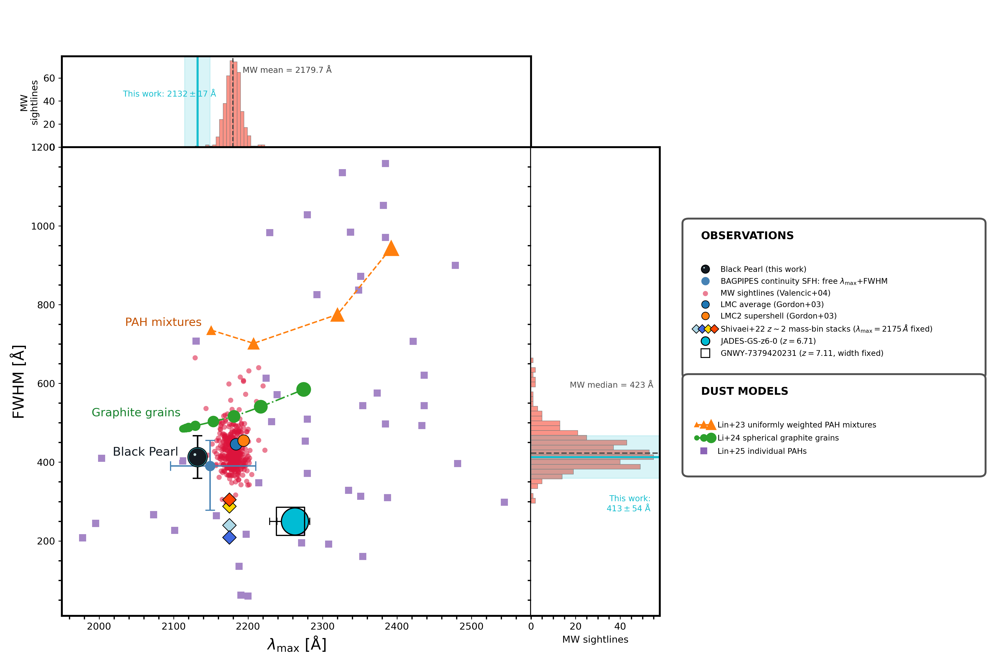
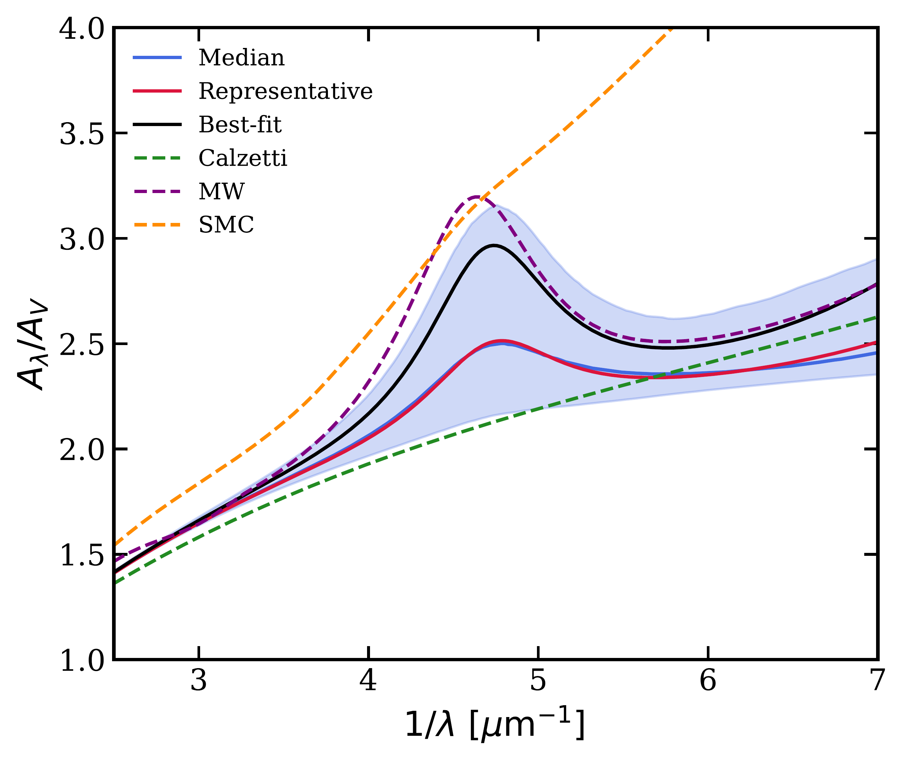
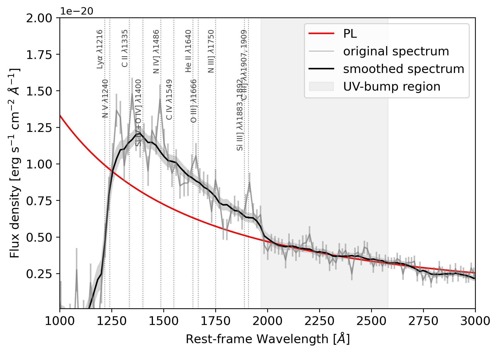

$\newcommand{\ensuremath}{}$
$\newcommand{\xspace}{}$
$\newcommand{\object}[1]{\texttt{#1}}$
$\newcommand{\farcs}{{.}''}$
$\newcommand{\farcm}{{.}'}$
$\newcommand{\arcsec}{''}$
$\newcommand{\arcmin}{'}$
$\newcommand{\ion}[2]{#1#2}$
$\newcommand{\textsc}[1]{\textrm{#1}}$
$\newcommand{\hl}[1]{\textrm{#1}}$
$\newcommand{\footnote}[1]{}$
$\newcommand{\vdag}{(v)^\dagger}$
$\newcommand\aastex{AAS\TeX}$
$\newcommand\latex{La\TeX}$
$\newcommand{\oii}{[\ion{O}{2}]}$
$\newcommand{\oiii}{[\ion{O}{3}]}$
$\newcommand{\neiii}{[\ion{Ne}{3}]}$
$\newcommand{\ciii}{\ion{C}{3}]}$
$\newcommand{\feii}{\ion{Fe}{2}}$
$\newcommand{\feiii}{\ion{Fe}{3}}$

# An Attenuation Bump at $z=9.3$: Probing Dust Diversity at Cosmic Dawn

<mark>Appeared on: 2026-10-16</mark> -  _paper submitted to ApJ, Figure 8 summarizes the key finding of this work_

G. Rodighiero, et al. -- incl., <mark>F. Walter</mark>

**Abstract:** We report the identification of a UV attenuation bump in the Black Pearl, a galaxy at $z_{\rm spec}=9.3335$ observed with JWST/NIRSpec as part of the ZENITH and EMBER surveys. This is the highest-redshift UV bump reported to date, probing dust properties only $\sim500 \mathrm{Myr}$ after the Big Bang. The feature is directly detected as a broad depression in the rest-frame UV continuum and is well described by a local Drude profile, with a central wavelength $\lambda_{\max}=2132\pm17 Å$ , an FWHM $=413\pm54 Å$ , and a peak attenuation $A_{\max}=0.21\pm0.02 \mathrm{mag}$ . Joint spectrophotometric modeling with a flexible attenuation law independently recovers a pronounced UV bump without imposing its presence a priori, regardless of the adopted star-formation history. The modeling indicates a relatively low-mass, actively star-forming galaxy, with $\log(M_\star/M_\odot)=8.35^{+0.09}_{-0.08}$ , a star-formation rate of $2.36^{+0.54}_{-0.42} M_\odot{\rm yr}^{-1}$ , and $A_V=0.34^{+0.12}_{-0.11} \mathrm{mag}$ . Rest-frame optical emission-line diagnostics indicate a hard ionizing spectrum and allow for a moderate AGN contribution, but provide no evidence for a powerful AGN capable of dominating the observed UV continuum. The bump is blueshifted by $43\pm17 Å$ ( $\simeq2.5\sigma$ ) relative to the canonical Milky Way $2175 Å$ feature and by $127\pm17 Å$ relative to the few UV bumps currently known at $z\sim7$ , while its width is consistent with the broad distribution measured along Milky Way sightlines. The displaced central wavelength therefore provides the clearest evidence for a nonstandard UV-bump profile at $z=9.3335$ , pointing to substantial diversity in the properties of UV-bump carriers at early cosmic times, with both PAHs and small graphite grains remaining plausible candidates.

**Figure 9. -** UV-bump profile space. The bump central wavelength,
$\lambda_{\max}$, is plotted against its full width at half maximum
(FWHM). Red points represent individual Milky Way (MW) sightlines
from \citet{Valencic2004}. The marginal histograms show their
$\lambda_{\max}$ distribution (top) and FWHM distribution (right);
the dashed reference lines indicate the MW mean
$\lambda_{\max}=2179.7 Å$ and median FWHM $=423 Å$.
The cyan vertical and horizontal bands indicate the $1 \sigma$
intervals of the direct spectroscopic measurement for the Black Pearl,
$\lambda_{\max}=2132 \pm 17 Å$ and
FWHM $=413 \pm 54 Å$, respectively.
The Black Pearl at $z_{\rm spec}=9.3335$ is marked by the large black circle,
with its $1 \sigma$ error bars; the blue point and error bars show
the joint spectrophotometric \texttt{BAGPIPES}
constraints obtained with the nonparametric continuity
star-formation history and with both bump parameters free.
The blue filled circle and orange filled circle indicate the
average LMC and LMC2 supershell
measurements from \citet{Gordon2003}, respectively.
Four colored diamonds at $\lambda_{\max}=2175 Å$
represent the $z\sim2$ stellar-mass-bin stacks from
\citet{Shivaei2022}; the central wavelength was fixed in those fits.
The cyan filled circle marks JADES-GS-z6-0 ($z=6.71$), while
the open square marks GNWY-7379420231 ($z=7.11$), for which
the bump width was fixed.
Marker sizes for the observational measurements are proportional to the peak bump attenuation, $A_{\max}$.
The observational datasets and theoretical models are identified in the two legend boxes on the right.
The theoretical predictions include orange triangles connected
by a dashed line for uniformly weighted PAH mixtures from
\citet{Lin2023}, green circles connected by a dash-dotted line
for spherical graphite grains from \citet{Li2024}, and purple
squares for individual PAHs from \citet{Lin2025}.
Increasing marker sizes along the orange and green model sequences
indicate increasing PAH-mixture size and graphite-grain radius,
respectively. The PAH-mixture and graphite-grain sequences,
together with the Black Pearl, are labeled directly in the main panel. (*fig:bump_profile_space*)

**Figure 3. -** Posterior attenuation curves obtained with the nonparametric SFH model. The blue curve shows the median attenuation curve, while the shaded blue region encloses the 16th--84th percentiles at each wavelength. The red curve corresponds to the representative posterior model, while the black curve shows the maximum-likelihood (best-fitting) posterior model (see Section \ref{sed_fitting_results} for details). For comparison, standard attenuation and extinction curves are also shown. (*fig:dust_curves*)

**Figure 2. -** 
Rest-frame UV spectrum used to assess the broad continuum depression
associated with the UV bump. The original NIRSpec/PRISM spectrum is
shown in gray and the smoothed spectrum in black. The red curve shows
the power-law continuum fitted at $\lambda_{\rm rest}>2000 Å$ and
extrapolated toward shorter wavelengths. The gray shaded region marks
the wavelength interval $1968$--$2580 Å$ adopted to characterize
the UV bump \citep[as in][]{Witstok2023}. Vertical dotted lines indicate the expected wavelengths
of prominent rest-frame UV spectral features, including Ly$\alpha$,
N V, C II, Si IV+O IV], N IV], C IV, He II,
O III], N III], Si III], and C III].
Although individual spectral features may contribute locally to the
UV spectrum, they cannot reproduce the broad spectral curvature and
continuum recovery observed blueward of the UV-bump region.
 (*fig:2000*)

