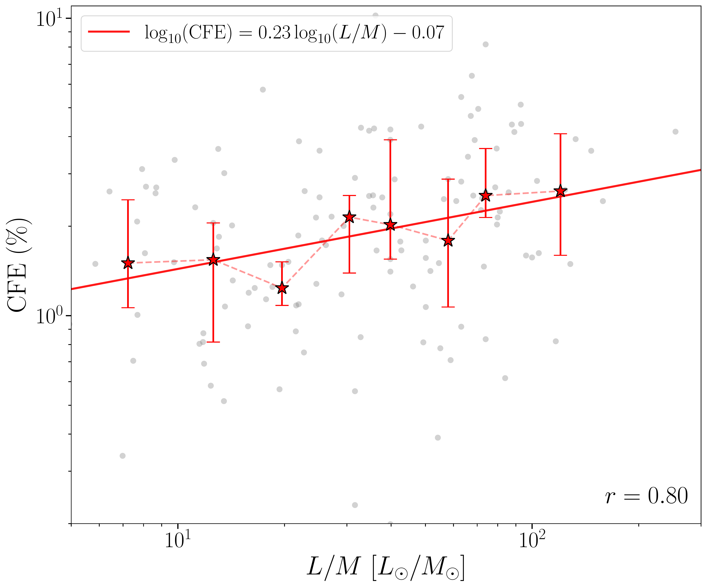
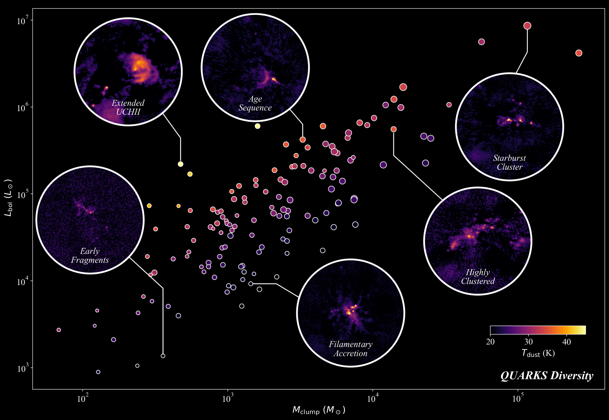
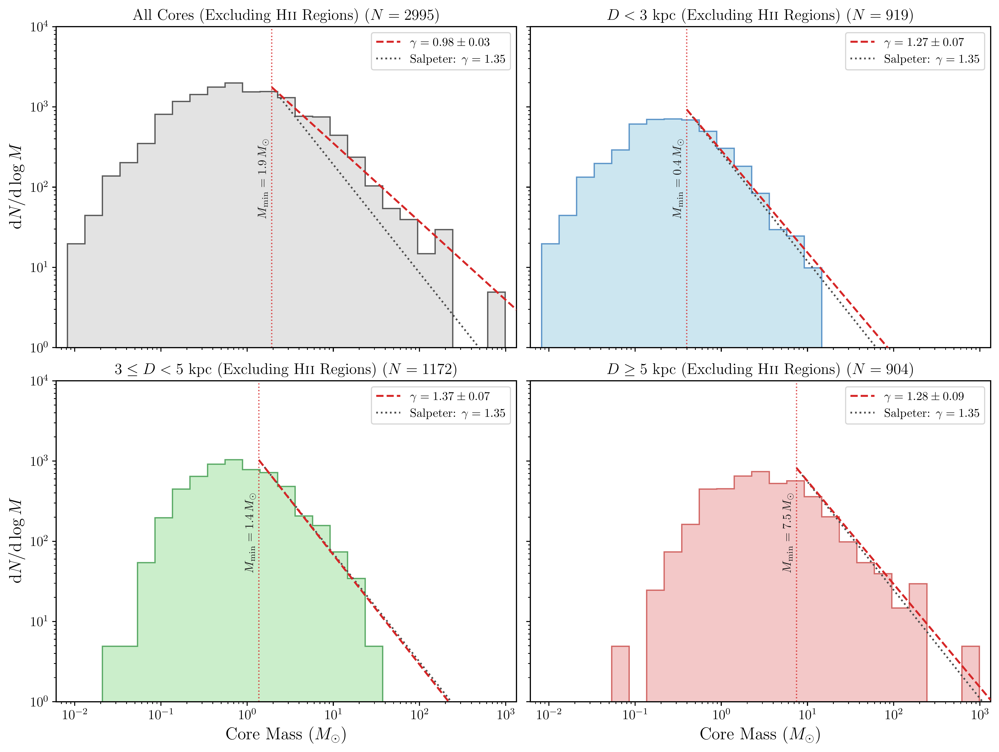

$\newcommand{\ensuremath}{}$
$\newcommand{\xspace}{}$
$\newcommand{\object}[1]{\texttt{#1}}$
$\newcommand{\farcs}{{.}''}$
$\newcommand{\farcm}{{.}'}$
$\newcommand{\arcsec}{''}$
$\newcommand{\arcmin}{'}$
$\newcommand{\ion}[2]{#1#2}$
$\newcommand{\textsc}[1]{\textrm{#1}}$
$\newcommand{\hl}[1]{\textrm{#1}}$
$\newcommand{\footnote}[1]{}$
$\newcommand{\CMFadd}[1]{{\color{red}#1}}$
$\newcommand{\CMFdel}[1]{{\setstcolor{red}\st{#1}}}$
$\newcommand{\vdag}{(v)^\dagger}$
$\newcommand\aastex{AAS\TeX}$
$\newcommand\latex{La\TeX}$
$\newcommand{\thetable}{A\arabic{table}}$
$\newcommand{\arraystretch}{1.2}$

# The ALMA-QUARKS Survey. IV. Core Mass Function and Evolutionary Trends in Core Formation Efficiency and Chemistry

<mark>Appeared on: 2026-10-16</mark> -  _28 pages, 14 figures, submitted to the ApJS_

W. Jiao, et al. -- incl., <mark>F. Xu</mark>, <mark>Y. Zhang</mark>

**Abstract:** The ALMA-QUARKS (Querying Underlying Mechanisms of Massive Star Formation with ALMA-Resolved Gas Kinematics and Structures) survey targets 139 massive protoclusters selected from the ATOMS survey. The targets were observed at 1.3 mm wavelength with an angular resolution of $\sim0.3^{\prime\prime}$ , corresponding to $\sim10^3$ au at the sample's median distance of $\sim3.8$ kpc. Using \texttt{getsf} , we identify 3374 dense cores and classify them as starless, protostellar, hot core, or H ${\sc ii}$ region candidates based on spectral-line diagnostics (e.g., H30 $\alpha$ , $CH_3$ CN, and $CH_3$ OH) and CO outflow associations. The resulting catalog provides core physical properties and enables statistical investigations of dense core populations in massive protocluster environments. The derived global core mass function (CMF) after excluding H ${\sc ii}$ region candidates, which is biased by distance effects, has a relatively flat power-law slope at the high-mass end ( $\mathrm{d}N/\mathrm{d}\log M \propto M^{-\gamma}$ , with $\gamma=0.98\pm0.03$ ). In contrast, the measured high-mass slopes in individual distance bins are approximately Salpeter-like, while their fitted lower mass limits increase with distance. We further examine the core formation efficiency (CFE) across the full sample and find that it positively correlates with the luminosity-to-mass ratio of the parental clumps, consistent with an evolutionary increase in the fraction of mass concentrated into dense cores. We also investigate the detection rates of different molecular tracers and find systematic chemical variations with evolutionary stage. Compared with the ASHES survey, we find that the detection rates of deuterated species vary significantly even for cores at the same evolutionary stages, suggesting an important environmental influence on the chemical evolution of cores.

**Figure 4. -** The relation between the CFE and the clump luminosity-to-mass ratio. The clump luminosity-to-mass ratios are adopted from \citet{Liu_2024_QUARKSI}. Grey points show individual clumps, while the red stars indicate the median CFE in equal-number bins of $\log(L/M)$; the error bars represent the interquartile range (25th--75th percentiles). The solid red line represents a linear fit to the binned medians in logarithmic space, and the Pearson correlation coefficient calculated from the binned medians is labeled in the bottom-right corner.
   (*fig:cfe_lm*)

**Figure 5. -** Diversity of the QUARKS sample. The x-axis and y-axis show the clump mass and bolometric luminosity, respectively, and the color of each point represents the clump dust temperature, as indicated by the color bar in the lower-right corner. The sizes of the points represent the clump radii. These clump-scale parameters are adopted from \citet{Liu_2024_QUARKSI}. The dust temperature is used as an approximate evolutionary indicator of the clumps \citep[e.g.,][]{Guzman2015, Giannetti2017}. The white circles highlight representative sources selected from our combined continuum images, illustrating the different fragmentation levels and modes identified within the QUARKS sample.
 (*fig:QUARKS_diversity*)

**Figure 8. -** **Top-left**: CMF of all dense cores excluding H{\sc ii} regions in the QUARKS sample. The vertical red dotted line marks the fitted lower mass limit, $M_{\min}$, whose value is labeled alongside the line. The red dashed line represents the best-fit power-law slope obtained using the unbinned MLE. The gray dotted line indicates the Salpeter slope, $\gamma=1.35$, for comparison. **Top-right**: CMF of all dense cores excluding H{\sc ii} regions in the near-distance subsample ($D<3$ kpc). **Bottom-left**: CMF of all dense cores excluding H{\sc ii} regions in the intermediate-distance subsample ($3 \leq D < 5$ kpc). **Bottom-right**: CMF of all dense cores excluding H{\sc ii} regions in the far-distance subsample ($D\geq5$ kpc).
 (*fig:cmf_all_cores_no_hii*)

