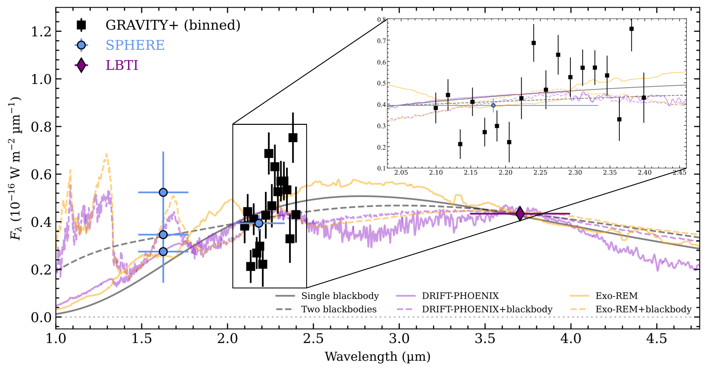
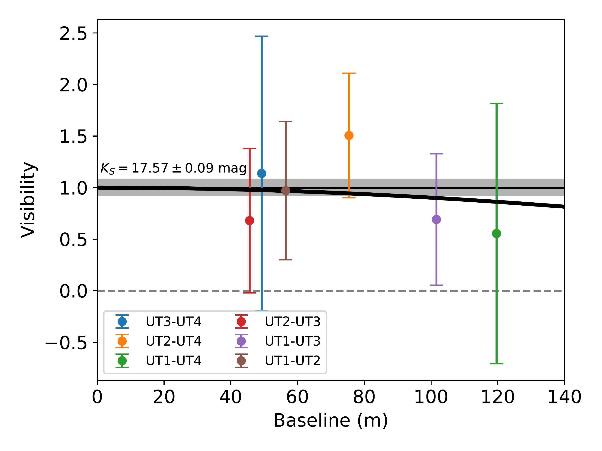
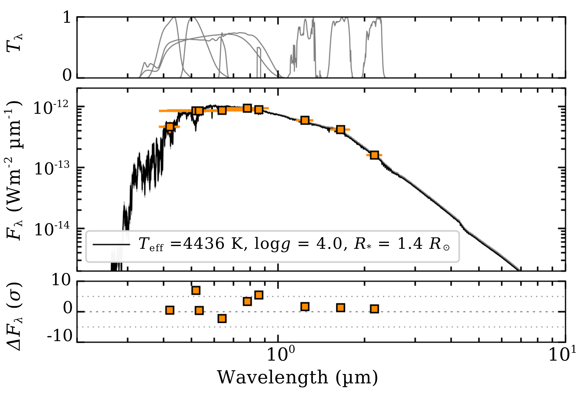

$\newcommand{\ensuremath}{}$
$\newcommand{\xspace}{}$
$\newcommand{\object}[1]{\texttt{#1}}$
$\newcommand{\farcs}{{.}''}$
$\newcommand{\farcm}{{.}'}$
$\newcommand{\arcsec}{''}$
$\newcommand{\arcmin}{'}$
$\newcommand{\ion}[2]{#1#2}$
$\newcommand{\textsc}[1]{\textrm{#1}}$
$\newcommand{\hl}[1]{\textrm{#1}}$
$\newcommand{\footnote}[1]{}$
$\newcommand{\MPE}{1}$
$\newcommand{\LIRA}{2}$
$\newcommand{\CotedAzur}{3}$
$\newcommand{\IPAG}{4}$
$\newcommand{\MPIA}{5}$
$\newcommand{\UCologne}{6}$
$\newcommand{\MPRadio}{7}$
$\newcommand{\ESOGarching}{8}$
$\newcommand{\USouthampton}{9}$
$\newcommand{\KUL}{10}$
$\newcommand{\FEUP}{11}$
$\newcommand{\UBerkley}{12}$
$\newcommand{\TUM}{13}$
$\newcommand{\CENTRA}{14}$
$\newcommand{\UCD}{15}$
$\newcommand{\UNAM}{16}$
$\newcommand{\CRAL}{17}$
$\newcommand{\UQ}{18}$
$\newcommand{\Galway}{19}$
$\newcommand{\Leiden}{20}$
$\newcommand{\NW}{21}$
$\newcommand{\Arizona}{22}$
$\newcommand{\ESOChile}{23}$
$\newcommand{\DIAS}{24}$
$\newcommand{\UDE}{25}$
$\newcommand{\Bern}{26}$
$\newcommand{\ESAUS}{27}$
$\newcommand{\Lund}{28}$
$\newcommand{\FCLab}{29}$
$\newcommand{\wtb}{WISPIT~2~b\xspace}$
$\newcommand{\arraystretch}{1.25}$

# A first look at the protoplanet $\wtb$ with VLTI/GRAVITY+$\thanks{\textcolor{black}{Based on observations collected at the European Southern Observatory under ESO programme 114.27UV.001}}$

<mark>Appeared on: 2026-10-16</mark> -  _Submitted to A&A, final round of editorial comments pending; Corresponding authors: Sydney Vach, Jens Kammerer_

G. Collaboration, et al. -- incl., <mark>M. Benisty</mark>, <mark>W. Brandner</mark>, <mark>P. Garcia</mark>, <mark>T. Henning</mark>, <mark>L. Kreidberg</mark>, <mark>J. Sauter</mark>

**Abstract:** Confirmed observations of young protoplanets actively undergoing the process of formation have remained rare to date. In this Letter, we present new insights into the nature of the recently identified protoplanet $\wtb$ \textcolor{black}{(age $\sim5$ Myr)} from VLTI/GRAVITY+ observations. Through the analysis of the spectral energy distribution (SED) and astrometry of $\wtb$ , with the inclusion of new GRAVITY+ data, we investigate the nature of the protoplanet's thermal emission and orbital properties. We performed an orbit fit with the inclusion of new high-precision GRAVITY+ astrometry to provide an updated orbital solution. We also analyzed the medium resolution GRAVITY+ $K$ band spectrum in combination with new VLT/SPHERE and literature photometry, exploring both the atmospheric properties and the constraints on the circumplanetary environment. Finally, we checked for any signal from a resolved circumplanetary disk in the GRAVITY+ data. We detected the protoplanet $\wtb$ at $\sim322$ mas separation from its host star. The new GRAVITY+ astrometry prefers an orbit \textcolor{black}{with a moderate eccentricity} . Analysis of the SED reveals an effective temperature in the 900 to 1300 K regime and \textcolor{black}{a slight preference for atmospheric models including clouds over pure blackbody emission} . While the GRAVITY+ observations do also not resolve a circumplanetary disk, we place an upper limit on the possible spatial extent of such a disk. The new GRAVITY+ observations independently confirm $\wtb$ as a self-luminous and point-like companion residing inside the gap of the transitional disk at $\sim60$ au from its host star. Further observations -- either at higher signal-to-noise ratio or at longer wavelengths -- are required to characterize the atmosphere and examine the presence of circumplanetary material from thermal emission of the dust.

**Figure 7. -** \textcolor{black}{Spectral energy distribution of $\wtb$. The VLT/SPHERE $H$ and $K_S$ band photometry are marked with blue circles. The LBTI/LMIRcam $L$ band photometry is marked with a purple diamond. The VLTI/GRAVITY+ binned spectrum is shown by the black squares. For comparison, we plot a single blackbody (solid gray line), two summed blackbodies (dashed gray line), and the two preferred atmospheric models, \texttt{DRIFT-PHOENIX} and \texttt{Exo-REM}, both with (dashed purple and orange lines respectively) and without (solid purple and orange lines respectively) the presence of a circumplanetary disk modeled by the addition of a blackbody.} (*fig:planet_sed*)

**Figure 4. -** Visibility of $\wtb$ as a function of the telescope pair baseline in meters. The curved black line is the best fit uniform circular disk model \textcolor{black}{(radius $\sim1.3$ mas)} to the observed visibilities for a bright disk, where the CPD dominates the observed flux. (*fig:vis*)

**Figure 1. -** BT-Settl-CIFIST stellar model atmosphere \textcolor{black}{reddened by $A_V = 0.17$ mag}(black line) fitted to the archival *Gaia* DR3, \textcolor{black}{Tycho-2}, and 2MASS photometry of WISPIT 2 (orange data points). The parameters of the best fitting model atmosphere are printed in the legend and agree well with those reported by \citet{VanCapelleveen:2025}. The top panel shows the filter transmission profiles of the photometric data points. The bottom panel shows the residuals between the data points and the best fitting model atmosphere. (*fig:stellar_model*)

