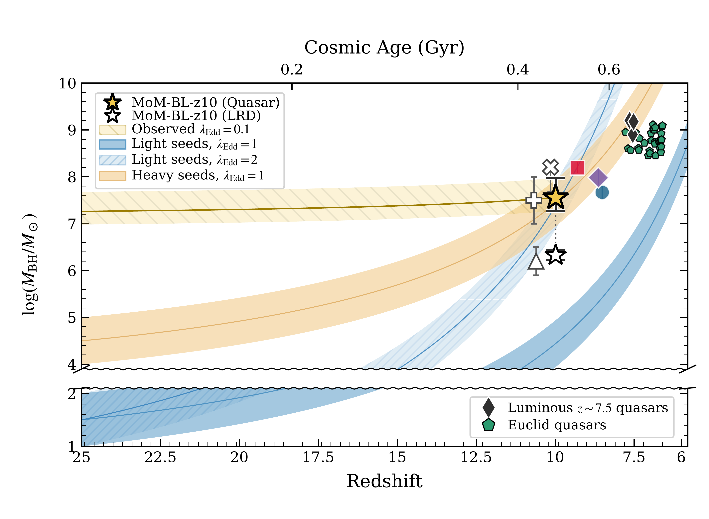
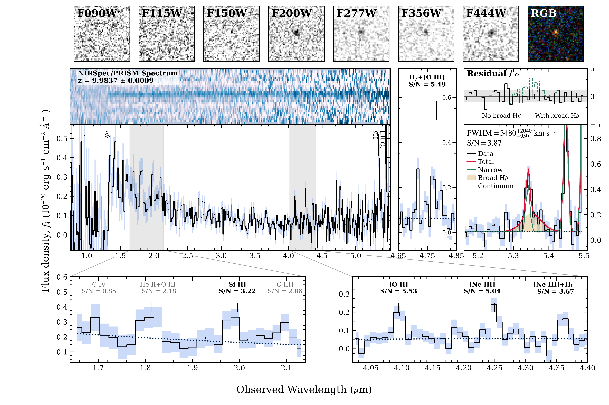
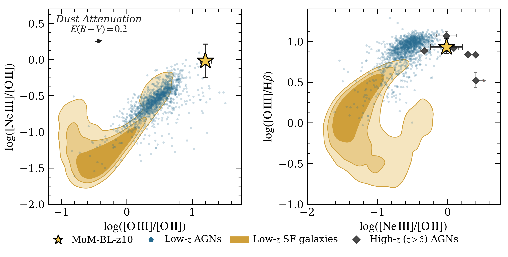

$\newcommand{\ensuremath}{}$
$\newcommand{\xspace}{}$
$\newcommand{\object}[1]{\texttt{#1}}$
$\newcommand{\farcs}{{.}''}$
$\newcommand{\farcm}{{.}'}$
$\newcommand{\arcsec}{''}$
$\newcommand{\arcmin}{'}$
$\newcommand{\ion}[2]{#1#2}$
$\newcommand{\textsc}[1]{\textrm{#1}}$
$\newcommand{\hl}[1]{\textrm{#1}}$
$\newcommand{\footnote}[1]{}$
$\newcommand{\vdag}{(v)^\dagger}$
$\newcommand\aastex{AAS\TeX}$
$\newcommand\latex{La\TeX}$
$\newcommand{\red}[1]{\textcolor{red}{#1}}$
$\newcommand{\rev}[1]{\textcolor{teal}{{#1}}}$
$\newcommand{\momblz}{MoM-BL-z10}$

# Discovery of a Broad-Line Active Galactic Nucleus at $z = 9.98$

<mark>Appeared on: 2026-10-22</mark> -  _14 pages, 5 figures, 1 table, submitted to ApJL, all comments are welcome_

X. Cai, et al. -- incl., <mark>A. d. Graaff</mark>

**Abstract:** The James Webb Space Telescope (JWST) has uncovered a previously unexplored population of faint active galactic nuclei (AGNs) in the early Universe.We present $\momblz$ at $z=9.9837\pm0.0009$ , identified through a systematic search for broad-line AGNs at $z\geq6$ using public JWST/NIRSpec PRISM spectra from the DAWN JWST Archive.The PRISM spectrum exhibits a broad component in H $\beta$ at $5.35 \micron$ .A narrow $+$ broad Gaussian fit yields a broad H $\beta$ detection at ${\rm S/N}=3.87$ , with ${\rm FWHM}=3480^{+2040}_{-950}$ km s $^{-1}$ and $L_{{\rm H}\beta,{\rm broad}}=1.25^{+0.33}_{-0.31}\times10^{42}$ erg s $^{-1}$ .The detection of [ Ne ${\sc iii}$ ] $\lambda3870$ and the high [ Ne ${\sc iii}$ ] / [ O ${\sc ii}$ ] and [ O ${\sc iii}$ ] /H $\beta$ ratios further support the AGN interpretation.Its rest-frame UV and optical continuum slopes, compact NIRCam morphology, and a tentative MIRI F770W detection suggest similarities to Little Red Dots (LRDs).The broad H $\beta$ detection enables the first virial SMBH mass estimate at $z\sim10$ .We derive $M_{\rm BH}=3.6^{+5.8}_{-1.7}\times10^7 M_\odot$ and $\lambda_{\rm Edd}=0.11^{+0.10}_{-0.07}$ using the standard single-epoch virial calibration and quasar bolometric correction.We also consider an alternative scenario adopting the LRD-specific bolometric correction and assuming $\lambda_{\rm Edd}=1$ , which yields $M_{\rm BH}=2.1^{+0.6}_{-0.5}\times10^6 M_\odot$ .Under either scenario, the inferred SMBH mass at a cosmic age of only 470 Myr highlights the challenge of rapid BH growth in the early Universe, suggesting super-Eddington accretion from a stellar-mass seed or a more massive seed.As the highest-redshift broad-line AGN identified to date, $\momblz$ provides a new observational benchmark for understanding the early growth of supermassive black holes.

**Figure 5. -** Illustrative black hole growth tracks of $\momblz$  as a function of redshift assuming continuous accretion at fixed Eddington ratios with 10\% radiative efficiency.
    The yellow star shows the fiducial virial SMBH mass of $\momblz$ , while the white star shows the LRD-based SMBH mass estimate assuming Eddington-limited accretion.
    The yellow stripe shows the backward extrapolation of the fiducial BH mass, assuming the observed Eddington ratio of $\lambda_\mathrm{Edd}=0.1$.
    The orange and blue stripes show the expected growth curves from a heavy ($10^{4-5} M_\odot$) and a light (10--100 $M_\odot$) seed BH, respectively, assuming continuous Eddington-limited accretion ($\lambda_{\rm Edd}=1$) beginning at $z=25$.
    The widths of these stripes correspond to their seed mass ranges.
    The lighter, hatched blue stripe shows the same light-seed track for a super-Eddington accretion case ($\lambda_{\rm Edd}=2$).
    Other symbols show known high-redshift quasars and AGNs in the literature; $z\sim 7.5$ luminous quasars \citep[diamonds;][]{wang2021j0313,banados2018j1342,yang2020j1007}, Euclid quasars \citep[pentagons;][]{yang2026}, and JWST AGNs shown in Figure \ref{fig:bhmass_luminosity} with the same symbols.
    UHZ1 is shifted by $\Delta z=+0.6$ from its spectroscopic redshift for clarity.
    For the Euclid quasars, black hole masses are estimated from their bolometric luminosities assuming $\lambda_{\rm Edd}=0.25$, the median value of the comparably luminous $z\sim6$ quasars  ([Onoue, et. al 2026](https://ui.adsabs.harvard.edu/abs/2026arXiv260909266O)) .
     (*fig:bh_growth_tracks*)

**Figure 2. -** JWST spectroscopy and imaging  of $\momblz$.
The top row shows $2\times2$ arcsec$^2$ cutout images in 7 NIRCam broadbands from F090W to F444W.
The rightmost panel shows a pseudo-color image (blue: F090W+F115W+F150W; green: F200W+F277W; red: F356W+F444W).
The middle panels show the 2D and 1D NIRSpec/PRISM spectra.
In the 2D spectrum, positive and negative signals are shown in blue and white, respectively.
The blue shaded region in the 1D spectrum indicates $1\sigma$ uncertainties.
The positions of Ly$\alpha$ and H$\beta$+[$\ion${O}{3}] are marked.
The right-hand panels show the H$\gamma$+[O {\sc iii}]$\lambda4364$ and the H$\beta$+[O {\sc iii}] complex regions.
In the H$\beta$+[O {\sc iii}] panel, we show the narrow+broad Gaussian fit to H$\beta$.
The upper inset shows the normalized residuals for fits with and without the broad H$\beta$ component.
The bottom panels show zoomed-in views of weaker emission-line features, with labels in black for detections with S/N $\geq3$ and in gray for features with S/N $<3$.
 (*fig:spectra*)

**Figure 4. -** The [O {\sc ii}]-FLR (left) and OHNO (right) diagnostics.
    The yellow star shows $\momblz$ , where we infer the [O {\sc iii}]$\lambda5008$ from the [O {\sc iii}]$\lambda4960$ flux by assuming a fiducial flux ratio of 2.98,  and only the narrow H$\beta$ component is used.
    The error bars reflect the propagated $1\sigma$ measurement uncertainties of the emission-line fluxes.
    An additional 0.20-dex uncertainty is added in quadrature to $\log([\mathrm{Ne III}]/[\mathrm{O II}])$ to account for possible blending with H$\eta$, H$\zeta$, and $\ion${He}{1} $\lambda3889$\citep[e.g.,][]{tripodi2025canucs}.
    Blue points show the SDSS AGN sample selected from BPT and [Ne {\sc v}]$\lambda3426$ emission in the Portsmouth SDSS galaxy-property catalogue  ([Feuillet, et. al 2024](https://ui.adsabs.harvard.edu/abs/2024ApJ...962..104F)) ; orange contours indicate 50, 70, and 90\% of the density of low-redshift BPT-selected MPA--JHU SF galaxies from the MPA--JHU catalogue of SDSS DR8 galaxy spectra  ([Brinchmann, et. al 2004](https://ui.adsabs.harvard.edu/abs/2004MNRAS.351.1151B), [Kauffmann, et. al 2003](https://ui.adsabs.harvard.edu/abs/2003MNRAS.341...33K)) .
    Other symbols represent high-redshift ($z>5$) JWST AGNs published in the literature  ([Trussler, et. al 2023](https://ui.adsabs.harvard.edu/abs/2023MNRAS.523.3423T), [Tripodi, et. al 2024](https://ui.adsabs.harvard.edu/abs/2024A&A...692A.184T), [\"Ubler, et. al 2024](https://ui.adsabs.harvard.edu/abs/2024MNRAS.531..355U), [Nandal, et. al 2025](https://ui.adsabs.harvard.edu/abs/2025ApJ...994L..11N), [Tripodi, et. al 2025](https://doi.org/10.1038/s41467-025-65070-x), [Backhaus, et. al 2024](https://ui.adsabs.harvard.edu/abs/2024ApJ...962..195B)) .
    The arrow in the left panel indicates the effect of dust attenuation corresponding to $E(B-V)=0.2$ mag, assuming the attenuation law of [Calzetti, et. al (2000)](https://ui.adsabs.harvard.edu/abs/2000ApJ...533..682C).
     (*fig:ohno*)

