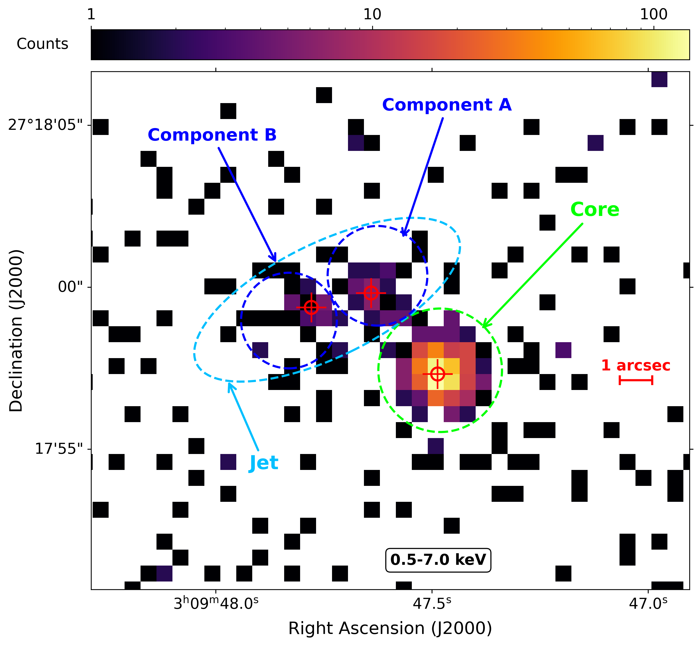
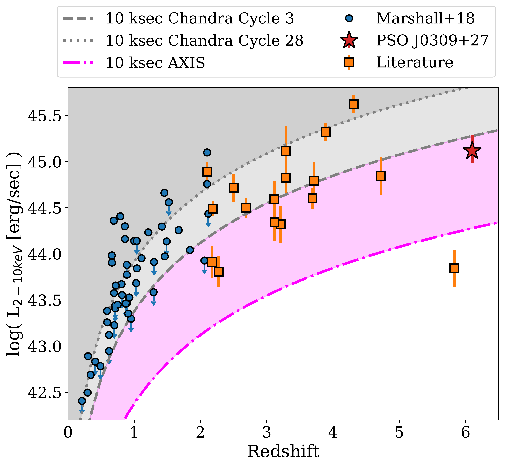
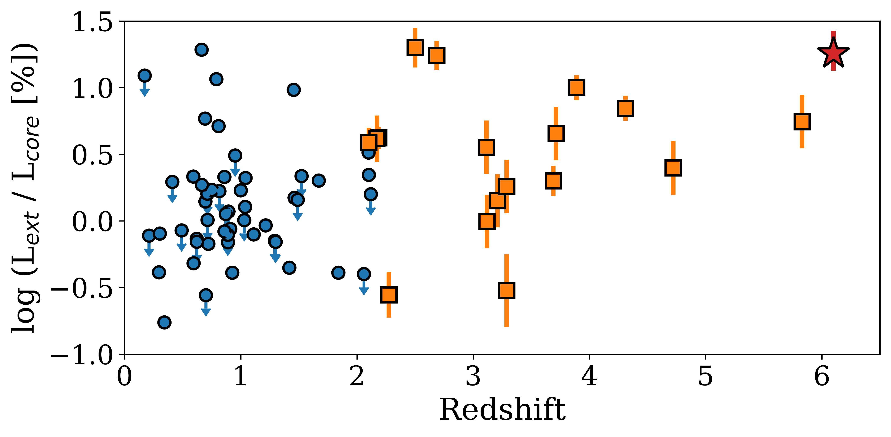
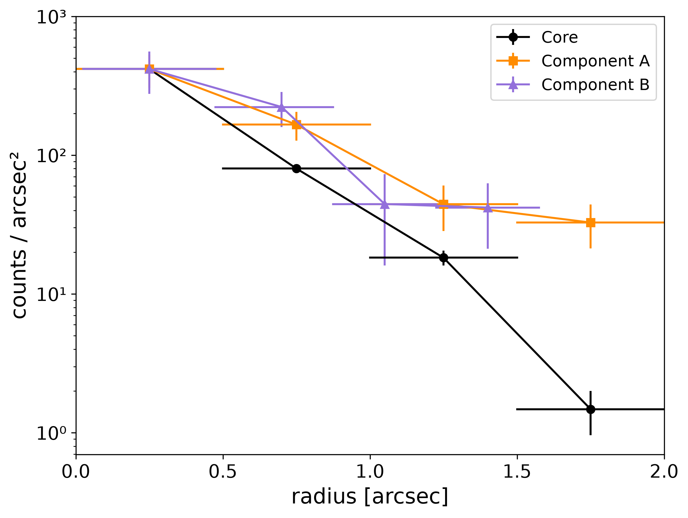

$\newcommand{\ensuremath}{}$
$\newcommand{\xspace}{}$
$\newcommand{\object}[1]{\texttt{#1}}$
$\newcommand{\farcs}{{.}''}$
$\newcommand{\farcm}{{.}'}$
$\newcommand{\arcsec}{''}$
$\newcommand{\arcmin}{'}$
$\newcommand{\ion}[2]{#1#2}$
$\newcommand{\textsc}[1]{\textrm{#1}}$
$\newcommand{\hl}[1]{\textrm{#1}}$
$\newcommand{\footnote}[1]{}$
$\newcommand{\arraystretch}{1.5}$

# The Deepest X-ray View of a Kiloparsec Scale Jet at $z=6.1$

<mark>Appeared on: 2026-10-23</mark> -  _Accepted for publication in Astronomy & Astrophysics (A&A) on 13 October 2026_

F. A. Meanti, et al. -- incl., <mark>S. Belladitta</mark>

**Abstract:** $_ Context:_$ The mechanism responsible for the high-energy emission observed in kiloparsec scale jets across cosmic time remains poorly understood. The relativistic jet associated with the $z=6.1$ AGN PSO J030947.49+271757.31 represents the highest- $z$ large-scale jet currently resolved in the X-rays and provides a unique laboratory to study the evolution of these structures. \ $_ Aim:_$ We present a study aimed at constraining the morphology and spectral properties the kpc-scale jet associated with PSO J030947.49+271757.31. In addition, we investigate the capabilities of future X-ray observatories for the study of extended jets. \ $_ Methods:_$ We obtained new dedicated observations of PSO J030947.49+271757.31 with the $_ Chandra X-ray Observatory_$ (for a total of 360 ksec combined with archival data). Thanks to the improvement of a factor of $\sim3$ in exposure time compared to previous studies, we spatially resolved the extended X-ray emission into two distinct components and performed spatially resolved spectral analyses of the different regions. \ $_ Results:_$ We confirmed the presence of extended X-ray emission of PSO J030947.49+271757.31 with significantly improved statistics and we identified two separate and slightly resolved components. The X-ray spectrum of the extended emission has a photon index of $\Gamma = 2.25^{+0.45}_{-0.44}$ , steeper than that of the core ( $\Gamma = 1.86\pm0.09$ ), and an extended-to-core luminosity ratio of $L_{\rm ext}/L_{\rm core}=18\%$ . Using the $_ Chandra_$ image as input, we performed simulations for next-generation X-ray facilities. An AXIS-like mission would increase the detected photon statistics by a factor of $\sim17$ compared to the current $_ Chandra_$ dataset. \ $_ Conclusions:_$ We resolved the kpc-scale jet associated with this $z=6.1$ AGN into two main components and constrained its spectral properties. This extended component corresponds to the most distant and one of the most X-ray-luminous large-scale jets currently known. Simulations show that future X-ray missions with arcsecond-scale angular resolution will not only enable significantly more detailed studies of systems like PSO J030947.49+271757.31, but will also reveal a population of fainter high-redshift jets currently beyond the reach of $_ Chandra_$ . \

**Figure 1. -** X-ray image of PSO J0309+27 in the $0.5$--$7.0 \mathrm{keV}$ energy band obtained from the full _Chandra_ dataset (total exposure: $360.2 \mathrm{ksec}$). The image is displayed using a logarithmic color scale representing counts per pixel. No spatial smoothing or exposure/flux normalization has been applied, in order to preserve the native angular resolution of the data and the intrinsic surface brightness distribution. The green dashed circle marks the extraction region adopted for the compact nuclear core. The blue dashed ellipses indicate the regions associated with Component A and Component B of the extended jet, while the cyan dashed ellipse encloses the total large-scale relativistic jet emission. Red crosses denote the photon-weighted centroids of the corresponding components. A $1"$ scale bar is shown for reference. North is up and East is left. (*fig:X-ray_image*)

**Figure 4. -** _ Top panel_: Luminosity in the 2-10 keV rest-frame energy band as a function of redshift of the extended X-ray jets currently known in the literature. Lines and shaded regions show the sensitivity of a 10 ksec exposure with _ Chandra_ at the start of the mission (Cycle 3; dashed gray line) and the current one (Cycle 28; dotted gray line) as well as a 10 ksec exposure with AXIS (dotted-dashed magenta line). _ Bottom panel_: Ratio of the extended-to-core luminosity ratio for the same jets reported in the above panel. (*fig:comparison_literature*)

**Figure 2. -** Radial surface brightness profiles of PSO J0309+27 in the $0.5$--$7.0 \mathrm{keV}$ energy band. The black curve corresponds to the core, while the orange dashed curve with squares and the light-blue dash-dotted curve with triangles show the profiles extracted for Component A and Component B, respectively. The radial binning for each component was chosen to balance the available photon statistics with the spatial sampling of the surface brightness distribution. A constant bin width of $0.5"$ was adopted for the Core and Component A, while flexible bin sizes of $0.35"$--$0.5"$ were used for Component B. The jet profiles have been normalized to the innermost bin of the core to facilitate comparison. Horizontal bars indicate the actual radial bin width, while vertical error bars represent $1\sigma$ Poissonian uncertainties. (*fig:radial_profile*)

