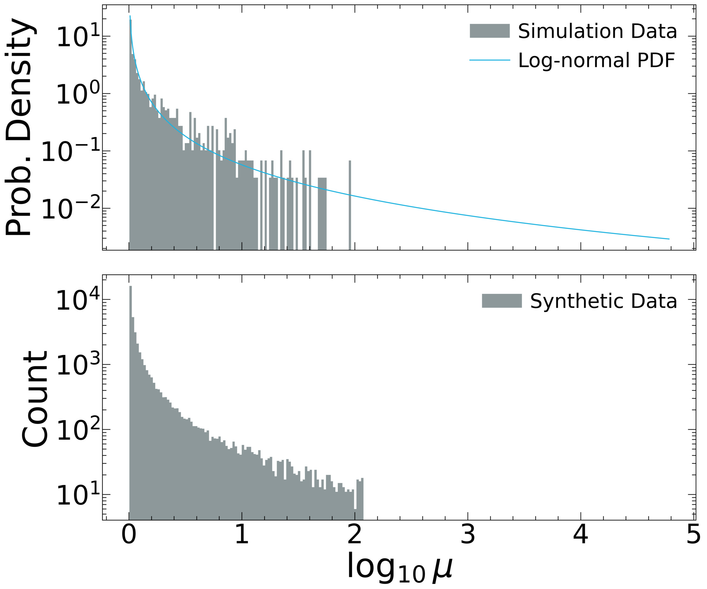
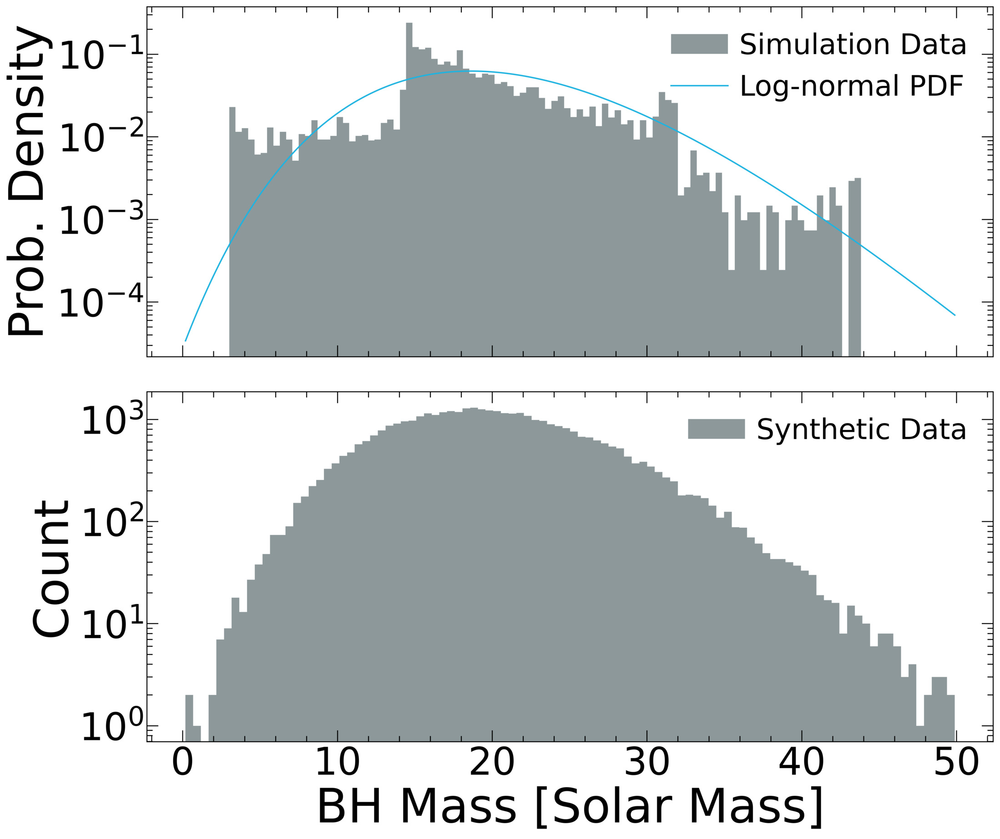
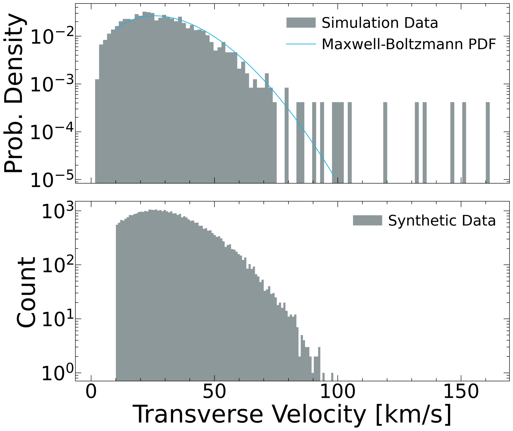
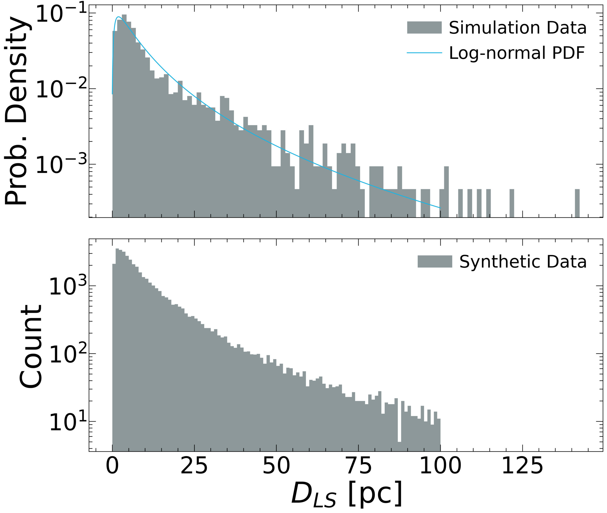
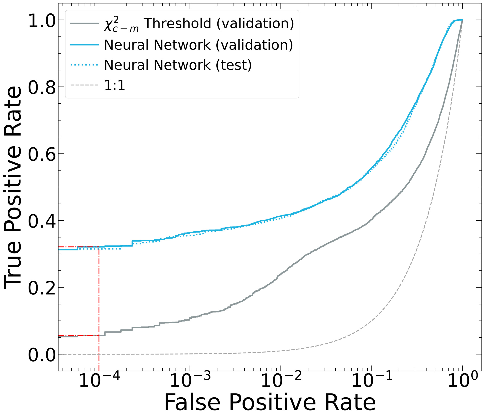
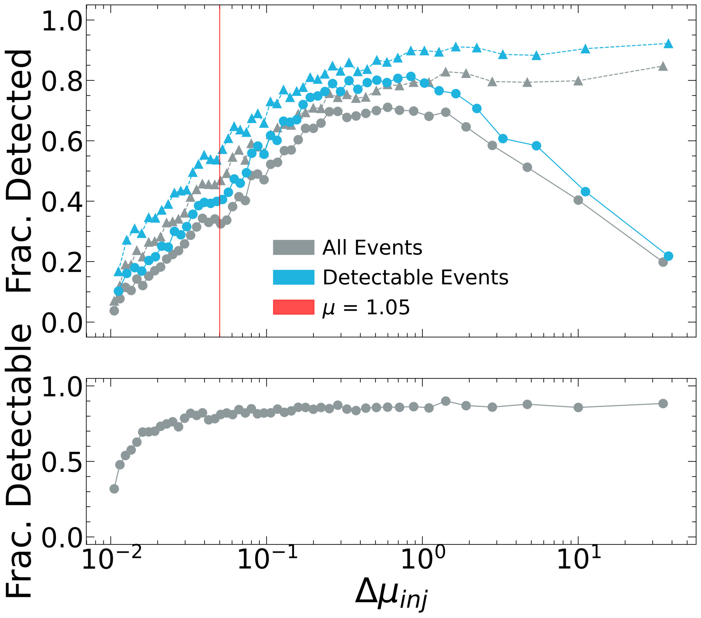

$\newcommand{\ensuremath}{}$
$\newcommand{\xspace}{}$
$\newcommand{\object}[1]{\texttt{#1}}$
$\newcommand{\farcs}{{.}''}$
$\newcommand{\farcm}{{.}'}$
$\newcommand{\arcsec}{''}$
$\newcommand{\arcmin}{'}$
$\newcommand{\ion}[2]{#1#2}$
$\newcommand{\textsc}[1]{\textrm{#1}}$
$\newcommand{\hl}[1]{\textrm{#1}}$
$\newcommand{\footnote}[1]{}$
$\newcommand{\vdag}{(v)^\dagger}$
$\newcommand\aastex{AAS\TeX}$
$\newcommand\latex{La\TeX}$
$\newcommand{\todo}[1]{{\textcolor{red}{TODO: #1}}}$
$\newcommand{\ocen}{\omega Cen}$
$\newcommand{\solmass}{\(\textup{M}_\odot\)}$
$\newcommand{◦ee}[1]{#1^{\circ}}$
$\newcommand{\synthdls}{7.26 pc}$
$\newcommand{\synthbhmass}{19.58 \solmass}$
$\newcommand{\synthpm}{1.16 mas/yr}$
$\newcommand{\thebibliography}{\DeclareRobustCommand{\VAN}[3]{##3}\VANthebibliography}$

# A 13 Year Black Hole Microlensing Survey in Omega Centauri

<mark>Appeared on: 2026-10-23</mark> -  _17 pages, 17 figures, submitted to MNRAS_

Z. Freeman, et al. -- incl., <mark>C. Clontz</mark>, <mark>N. Neumayer</mark>

**Abstract:** Star clusters are born with massive stars that leave behind a large population of stellar mass black holes. These black holes may account for a large fraction of binary black hole mergers seen in gravitational waves as the dense environment enables retention of black holes and the formation of binaries. However, direct measurements of stellar mass black holes in globular clusters are limited, with just a few found in binary systems thus far. In this paper, we examine the possibility of detecting black holes through microlensing in the Milky Way's most massive star cluster, $\omega$ Centauri. We take advantage of a unique dataset of nearly 200 single-band images taken over 13 years with the Hubble Space Telescope to look for the $\sim$ 1 year long events expected from microlensing of cluster stars by stellar mass black holes. We develop a novel cost function to fit the lensing signatures that we verify using synthetic events, quantifying our completeness. These synthetic events are based on a recent Monte Carlo simulation of $\omega$ Centauri. We also use these synthetic events to train a neural network to most efficiently distinguish observed lensing events. Application of this algorithm to our observed data, and subsequent visual follow-up, show no convincing candidate black hole lensing events. Based on analysis of the simulation data and our completeness, we find that no events would be expected in the data contrary to the expectations from earlier work. We release the photometric dataset used in this work for future use.

**Figure 14. -** In the top panels of this figure, simulation data that reached a maximum magnification greater than $1.01$ is shown with the best-fit PDF. Note that the magnification is shown as $\log_{10}{\mu}$ rather than $\ln{\mu}$ for visualization purposes. In the bottom panels, the distributions of the injected parameters for the 40,000 synthetic lightcurves can be seen. We enforce a minimum transverse velocity of 10 km/s and a maximum $D_{LS}$ of 100 pc to reduce the number of long duration synthetic microlensing events. (*fig:parameter_distributions*)

**Figure 12. -** A comparison of ROC curves between a neural network classifier, the blue lines, and the statistic threshold based classification (Section \ref{subsubsec:thresholding}), the gray line. We compare approaches using the validation set (solid lines) and show our best model (neural network) test set performance (dashed blue line) for completeness. The neural network's test set ROC curve is nearly identical to the validation set ROC curve. The vertical red dash-dot line marks a $0.01\%$ FPR, while the horizontal red dash-dot lines mark the statistic threshold based classification TPR ($5.6\%$) and neural network TPR ($32.13\%$). (*fig:roc_curve_nn*)

**Figure 8. -** In the top panel, we show the fraction of recovered events as a function of the injected baseline subtracted maximum magnification. The dashed lines with triangle markers represent events where the epoch of the event was correctly recovered, while the solid lines with circle markers represent where both the epoch was recovered and where the fit baseline subtracted maximum magnification was within 80\% of the injected baseline subtracted maximum magnification. The gray lines calculate the fraction of recovered events with respect to the total number of synthetic lightcurves (40,000) while the blue lines calculate the fraction of recovered events with respect to the subset of synthetic lightcurves considered to be detectable (31,640). Each line has 50 points; each point in the gray lines contains 800 synthetic lightcurves, while each point in the blue lines contains roughly 630 synthetic lightcurves. The injected baseline subtracted maximum magnification is the median value of the bin members. In the bottom panel, we show the fraction of events considered detectable as a function of the injected baseline subtracted maximum magnification. Each point contains 800 synthetic lightcurves. (*fig:magnification_completeness*)

