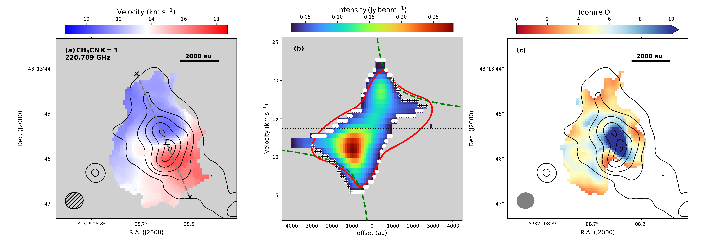
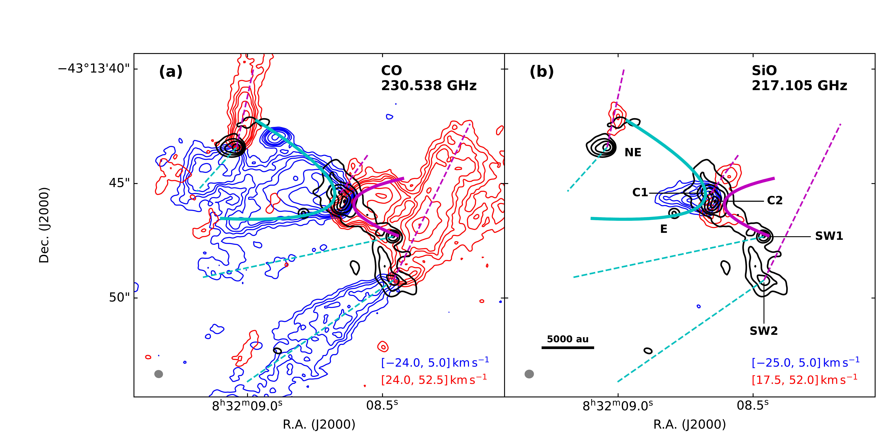
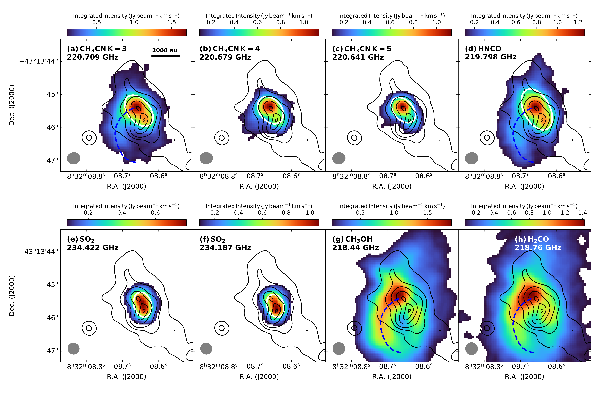

$\newcommand{\ensuremath}{}$
$\newcommand{\xspace}{}$
$\newcommand{\object}[1]{\texttt{#1}}$
$\newcommand{\farcs}{{.}''}$
$\newcommand{\farcm}{{.}'}$
$\newcommand{\arcsec}{''}$
$\newcommand{\arcmin}{'}$
$\newcommand{\ion}[2]{#1#2}$
$\newcommand{\textsc}[1]{\textrm{#1}}$
$\newcommand{\hl}[1]{\textrm{#1}}$
$\newcommand{\footnote}[1]{}$
$\newcommand{\rah}{\ensuremath{^{\rm h}}}$
$\newcommand{\ram}{\ensuremath{^{\rm m}}}$
$\newcommand{\ras}{\ensuremath{^{\rm s}}}$

# The ALMA-QUARKS survey: A Keplerian Circumbinary Disk Candidate in the High-mass Star-forming Region IRAS 08303--4303

<mark>Appeared on: 2026-10-23</mark> -  _24 pages, 11 figures, 5 tables. Accepted for publication in ApJ_

G. Lee, et al. -- incl., <mark>P. Garcia</mark>, <mark>F. Xu</mark>, <mark>Y. Zhang</mark>

**Abstract:** We present the ALMA Band 6 continuum and molecular line observations of IRAS 08303--4303, a high-mass star-forming region, with an angular resolution of $\sim$ 0 $\farcs$ 3 ( $\sim$ 700 au at the distance of 2.35 kpc).Six dense condensations are identified in the 1.3 mm continuum, and at least four of them are associated with molecular outflows.The estimated outflow parameters, particularly mass outflow rates $\geq10^{-4} M_{\sun} \mathrm{yr}^{-1}$ , suggest that the driving sources are high-mass young stellar objects.Two of the condensations are forming a wide protobinary system with a separation of $\sim$ 900 au.They reside within a single rotating structure, identified as a circumbinary disk which has a mass of about 2 $M_{\sun}$ .This structure is traced by multiple molecular lines and exhibits a Keplerian rotation pattern.Based on the Keplerian rotation assumption, the enclosed mass is derived to be between 32 and 61 $M_{\sun}$ : 22--43 $M_{\sun}$ for the primary and 10--18 $M_{\sun}$ for the secondary.The circumbinary disk is on the whole gravitationally stable, yet some parts with Toomre $Q < 2$ indicate potential fragmentation.Various molecular lines reveal a streamer-like structure connecting to the circumbinary disk, suggesting transfer of material from the envelope to the protobinary system through it.Despite the observational rarity of such circumbinary disks around high-mass YSOs, the high binary fraction among massive stars underscores their significance.This source, therefore, serves as a key laboratory for understanding the formation of high-mass binary systems.

**Figure 7. -** **(a)**\ce{CH3CN}$J=12\text{--}11 K=3$ line intensity-weighted velocity map.
    The image is masked below $5\sigma$.
    Black contours represent the distribution of 1.3 mm continuum emission.
    The black hatched ellipse in the lower-left corner indicates the size of the synthesized beam.
    **(b)** Position--velocity (PV) diagram along the gray dashed line in (a).
    The image is masked below $7\sigma$.
    The offset is measured from the black cross in (a), which marks the rotation center.
    Black crosses mark the data points from the $7\sigma$ emission edge used for fitting a pure Keplerian rotation using Keplerfit.
    The best-fit velocity model corresponds to a $61 M_\sun$ system and is shown as the green dashed lines.
    White dots mark the data points from the $7\sigma$ emission edge used for the combined velocity model of Keplerian rotation and free-fall motion.
    The red solid line shows the best-fit combined velocity model for a $32 M_\sun$ system.
    In both cases, the inclination angle is fixed at $55\arcdeg$.
    The dotted horizontal line indicates the systemic velocity, 13.7 $\mathrm{km} \mathrm{s^{-1}}$.
    **(c)** Distribution of the Toomre $Q$ parameter for $M_\mathrm{enc} = 32 M_\sun$, derived from the 1.3 mm continuum map and the temperature distribution in Appendix \ref{sec:appendixA}, using Equation \ref{eq:ToomreQ}.
     (*fig:diskkin*)

**Figure 4. -** **(a)** The CO $J=2\text{--}1$ line integrated intensity map.
    **(b)** The SiO $J=5\text{--}4$ line integrated intensity map.
    In both panels, blue and red contours depict the distributions of blue- and redshifted gas, with contour levels at [5, 10, 15, 20, 30, 50, 70, 100]$\sigma$.
    Black contours represent the 1.3 mm continuum emission distribution, with contour levels at [10, 20, 35, 50, 70, 90, 110, 130]$\sigma$.
    All continuum contours in this figure use the same levels as in subsequent figures.
    The integrated velocity ranges are presented in the bottom-right corner.
    The gray ellipse in the bottom-left corner indicates the synthesized beam size.
    The cyan and magenta lines/parabolas show the directions of the candidate outflow lobes.
     (*fig:outflow*)

**Figure 5. -** 
Integrated intensity maps (Moment 0) of 8 molecular transitions around C1 and C2 (color).
All images are masked below $5\sigma$.
Black contours represent the distribution of 1.3 mm continuum emission.
In panels (a)--(f), the open white ellipse near the peak of the emission shows the 2D Gaussian fitting result of the integrated intensity map, which corresponds to the FWHM of the circumbinary disk.
In panels (a), (d), (g), and (h), the blue dashed line marks the candidate streamer, tracing the emission ridge in the \ce{CH3OH} integrated intensity map.
The filled gray ellipse in the lower-left corner indicates the size of the synthesized beam.
 (*fig:mom0*)

