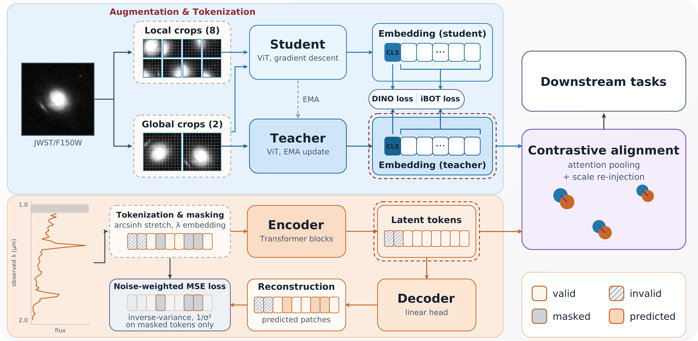
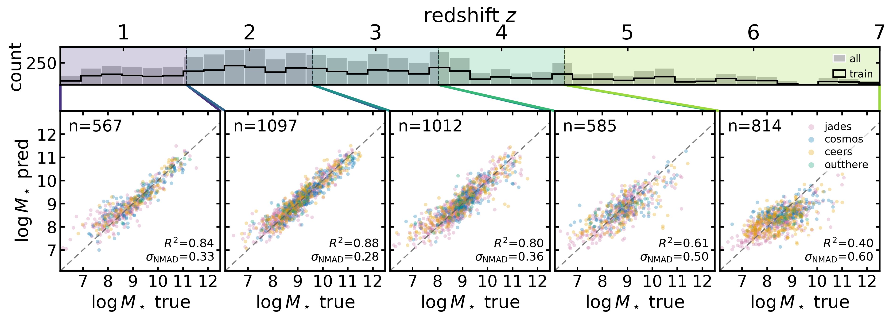
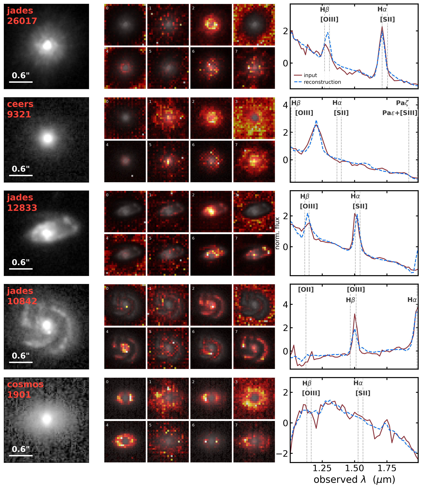

$\newcommand{\ensuremath}{}$
$\newcommand{\xspace}{}$
$\newcommand{\object}[1]{\texttt{#1}}$
$\newcommand{\farcs}{{.}''}$
$\newcommand{\farcm}{{.}'}$
$\newcommand{\arcsec}{''}$
$\newcommand{\arcmin}{'}$
$\newcommand{\ion}[2]{#1#2}$
$\newcommand{\textsc}[1]{\textrm{#1}}$
$\newcommand{\hl}[1]{\textrm{#1}}$
$\newcommand{\footnote}[1]{}$
$\newcommand{\citetext}[1]{(#1)}$
$\newcommand{\lowrespt}{\textsc{LowResPT}}$
$\newcommand{\todo}[1]{{\color{red}[TODO: #1]}}$
$\newcommand{\arrup}{\rlap{ \uparrow}}$
$\newcommand{\arrdown}{\rlap{ \downarrow}}$

# Self-Supervised Representation Learning for JWST Galaxy Images and Low Resolution Spectra

<mark>Appeared on: 2026-10-23</mark> -  _5 pages, 2 figures. Accepted for the NeurIPS 2026 RPS Workshop. Comments welcome. Detailed descriptions of the data, model training and additional benchmarks are included in the appendix (11 pages, 4 figures)_

Y. Cheng, et al. -- incl., <mark>M. Fouesneau</mark>

**Abstract:** A self-supervised multimodal model recovers galaxy stellar masses from sparse $*JWST*$ data that lack the multi-band coverage required by traditional SED fitting. We train on single-band F150W imaging paired with observed-frame $1$ -- $2 \mu$ m PRISM spectra and obtain a joint image-spectrum representation that recovers stellar mass at $1<z\le3$ with $R^2 \sim 0.9$ and $\sigma_{\mathrm{NMAD}} = 0.24$ dex; cross-modal CLIP alignment further raises single-modality performance by $\Delta R^2 = +0.04$ (imaging) and $+0.09$ (spectroscopy), narrowing the gap to joint-modality inference. The code and documentation are available at $\href{https://github.com/2003cy/neurips2026_ssl_jwst}{GitHub}$ .

**Figure 1. -** Top left: a ViT trained with DINOv2 by aligning teacher and student outputs from augmented views of one image. Bottom left: the spectrum encoder, a 1D autoencoder, tokenizes the input spectrum into overlapping flux patches (masked tokens shown as gray squares) and reconstructs them via a noise-weighted loss. Invalid tokens (hatched squares) are excluded end to end. Right: CLIP alignment after pre-training. The image and spectrum model outputs are attention-pooled, the scale is re-injected, and they are aligned with a contrastive objective. (*fig:model*)

**Figure 2. -** Stellar-mass linear probe on the CLIP-aligned image-spectrum embedding. Top: redshift distribution up to $z\sim7$ of the labeled pairs (gray) with the training half overlaid (black step) and the five evaluation bins shaded. Bottom: predicted versus catalog masses of the test set, colored by imaging survey; the probe is trained once and only its predictions are binned. Dashed line: one-to-one relation. The points are the test half of a single split (seed 42), whereas the quoted $R^2$ and $\sigma_{\mathrm{NMAD}}$ are the mean over the $40$ splits; their split-to-split standard deviations are at most $0.011$ and $0.009$ dex, and $0.7\%$ for the outlier fraction at $1<z\le3$. (*fig:mass*)

**Figure 3. -** Qualitative behavior of the two frozen encoders on five cross-matched objects, one per row. Left: the F150W cutout given to the image encoder, annotated with the imaging survey and the DJA spectrum identifier, with a $0.6"$ scale bar. Middle: the attention of the \texttt{[CLS]} token to the patch tokens in the final transformer block of the frozen teacher, shown separately for each of the eight heads; the heads specialize on different parts of the source and of the background. Right: the normalized, $\mathrm{arcsinh}$-stretched PRISM spectrum over the observed-frame $1$--$2 \mu$m window (dark red) with the spectrum-encoder reconstruction (blue, dashed), obtained by masking every three consecutive tokens in turn and predicting them from the remaining sequence; vertical lines mark the strong emission lines at the catalog redshift. (*fig:evaluation*)

