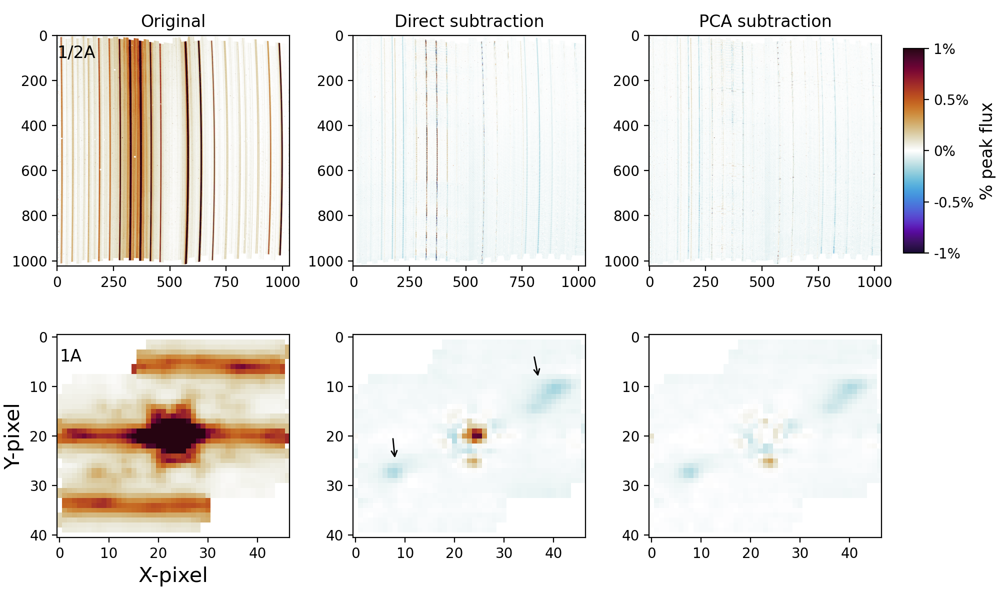
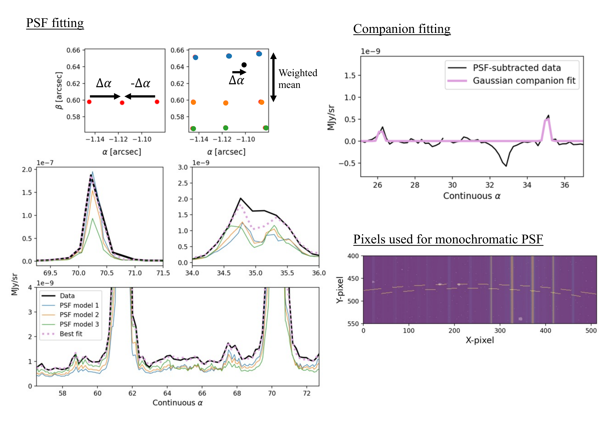
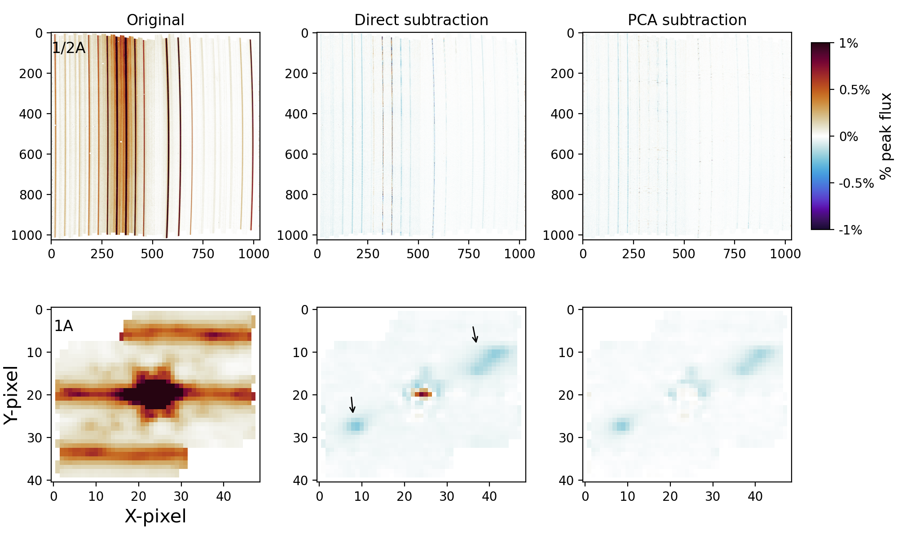

$\newcommand{\ensuremath}{}$
$\newcommand{\xspace}{}$
$\newcommand{\object}[1]{\texttt{#1}}$
$\newcommand{\farcs}{{.}''}$
$\newcommand{\farcm}{{.}'}$
$\newcommand{\arcsec}{''}$
$\newcommand{\arcmin}{'}$
$\newcommand{\ion}[2]{#1#2}$
$\newcommand{\textsc}[1]{\textrm{#1}}$
$\newcommand{\hl}[1]{\textrm{#1}}$
$\newcommand{\footnote}[1]{}$

# The MIRI/MRS Library: III. Detector-based optimal spectral extraction and high-contrast imaging applications

<mark>Appeared on: 2026-10-26</mark> -  _15 pages, 13 figures. Accepted for publication in A&A_

<mark>D. Gasman</mark>, et al.

**Abstract:** The James Webb Space Telescope (JWST) has now been operational for five years, and the associated data reduction pipelines have reached maturity. For the Mid-InfraRed Instrument (MIRI) Medium Resolution Spectrometer (MRS), one can generally get a good-quality spectrum by simply running the standard pipeline, especially for unresolved sources. However, users are starting to look deeper into the data, trying to detect the smallest features in the faintest objects, and find close companions. Following the lower level corrections we derived in Papers I and II in this series, we now introduce a novel way to extract MIRI/MRS spectra: from the detectors directly. Currently the most common way to analyse data from integral field spectrometers, such as the MRS, is to reconstruct a spectral cube from the detector images. Theoretically, detector-extracted spectra could reach higher signal-to-noise ratios (S/Ns), and better handle bad pixels. We applied the charge migration and fringe corrections derived in Papers I and II to generate stable and well-sampled point-spread function (PSF) models using the sub-pixel scan of calibration star 10 Lac observed in PID 3779 during Cycle 2. These PSFs were used in a detector-based optimal extraction algorithm building on past approaches, where the contributions per pixel were weighted by their noise properties and contribution to the total illumination. Furthermore, the PSF models were used to subtract the PSF of a bright central source from the detector, both by direct subtraction, and a principal component analysis (PCA) approach. We find that our optimal setup allows us to get a $>$ 1.5 times higher S/N on a faint source compared to the standard pipeline cube extraction. However, we approximately matched more involved cube processing, for which the extraction aperture is smaller and the background subtraction was performed more optimally. We were also able to subtract the PSF down to sub-percent levels, allowing us to extract spectra from faint companions. Currently, the high-contrast imaging extraction quality falls short of a cube-based extraction. The novel approach greatly improves on the current standard pipeline reduction, but it is only able to match the performance of more optimised cube processing.  We have not yet reached the fundamental noise limits. However, there are clear points of improvement that can be addressed using additional data. We demonstrate that detector-based processing of MIRI/MRS data has great potential for the characterisation of faint sources and close companions.

**Figure 10. -** Same as Fig. \ref{fig:star_subtr}, applied to an object known to host a companion (GQ Lup A\&B) at a separation of $\sim0$\farcs$7$.  We indicate the companion with a circle, which is visible at the percent level below the central PSF. (*fig:gqlup_subtr*)

**Figure 8. -** Demonstration of the PSF fitting process. On the left, we demonstrate the projection of the PSF models onto a calibration star by showing the details of a fit to a single wavelength bin. The grid points with the same $\beta$ are combined into one model (top left), yielding a single model per $\beta$ coordinate. The models are combined based on a weighted mean between $\beta$ coordinates and shifted in $\alpha$ until a best fit is found (bottom gallery). The top right shows an example of the per-slice gaussian fit of the companion. The number of slices to include can be set by the user, but for faint objects 1-2 slices is likely the best choice. Finally, the pixels used for the monochromatic PSFs shown here are highlighted in the bottom left corner. The yellow stripes overlaid on the original detector image constitute an iso-$\lambda$, or a single $\lambda$ coordinate. (*fig:fit_demo*)

**Figure 9. -** Performance of the different detector-based PSF subtraction methods, applied to a single calibration star ($\delta$ Umi).  The first row demonstrates the detector-based results for the different methods on sub-band A for a single dither, whereas the second row shows the results in the cube for band 1A. The first column presents the original data, the second column the residuals of direct subtraction using the detector-based models, and the third column the subtraction using PCA. The oversubtraction due to persistence is highlighted by the black arrows. We note that the cube panels present the median-collapsed cubes, in percent of the peak of the original data, whereas the detector-based results are a percent of the maximum flux in the image. Colourmap from [ and van der Velden (2020)](https://ui.adsabs.harvard.edu/abs/2020JOSS....5.2004V). (*fig:star_subtr*)

