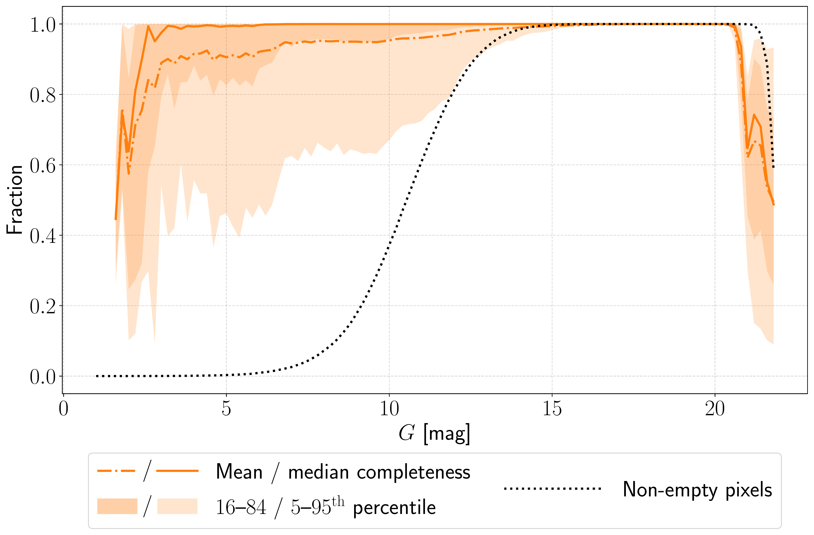
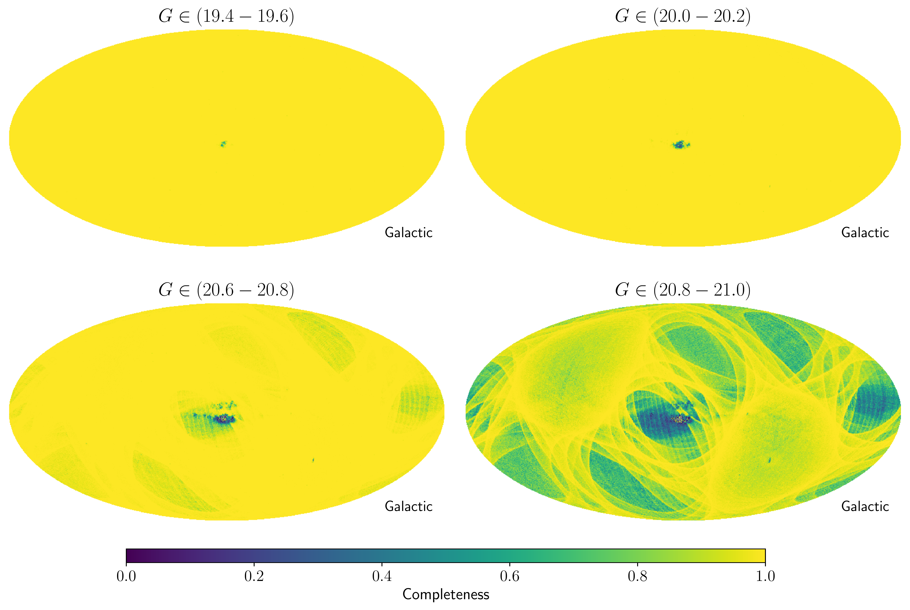
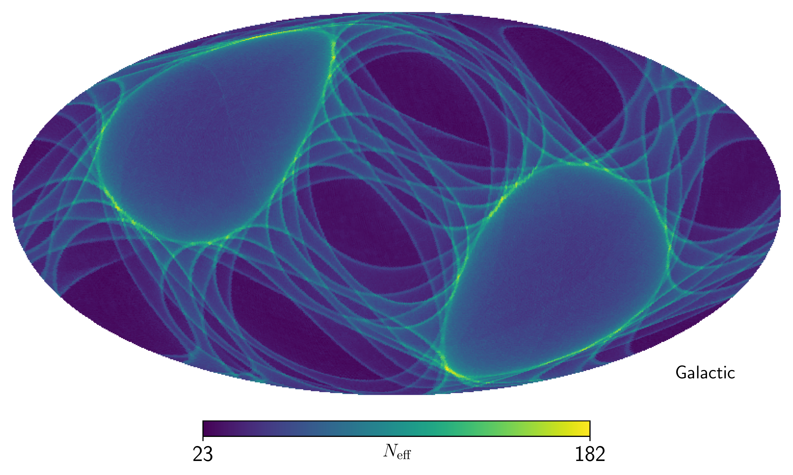

$\newcommand{\ensuremath}{}$
$\newcommand{\xspace}{}$
$\newcommand{\object}[1]{\texttt{#1}}$
$\newcommand{\farcs}{{.}''}$
$\newcommand{\farcm}{{.}'}$
$\newcommand{\arcsec}{''}$
$\newcommand{\arcmin}{'}$
$\newcommand{\ion}[2]{#1#2}$
$\newcommand{\textsc}[1]{\textrm{#1}}$
$\newcommand{\hl}[1]{\textrm{#1}}$
$\newcommand{\footnote}[1]{}$
$\newcommand\gdr[1]{\textit{Gaia}~DR#1\xspace}$
$\newcommand\gbp{\ensuremath{G_\mathrm{BP}}\xspace}$
$\newcommand\grp{\ensuremath{G_\mathrm{RP}}\xspace}$
$\newcommand\grvs{\ensuremath{G_\mathrm{RVS}}\xspace}$
$\newcommand\secref[1]{Sect.~\ref{#1}}$
$\newcommand\secsref[1]{Sects.~\ref{#1}}$
$\newcommand\secrefalt[1]{Section~\ref{#1}}$
$\newcommand\figref[1]{Fig.~\ref{#1}}$
$\newcommand\figsref[1]{Figs.~\ref{#1}}$
$\newcommand\figrefalt[1]{Figure~\ref{#1}}$
$\newcommand\figsrefalt[1]{Figures~\ref{#1}}$
$\newcommand\equref[1]{Eq.~\eqref{#1}}$
$\newcommand\equrefalt[1]{Equation~\eqref{#1}}$
$\newcommand\tabref[1]{Table~\ref{#1}}$
$\newcommand\tabsref[1]{Tables~\ref{#1}}$
$\newcommand\gaia{\textit{Gaia}\xspace}$
$\newcommand\gdr[1]{\gaia~DR#1\xspace}$
$\newcommand\edr[1]{\gaia~EDR#1\xspace}$
$\newcommand{\ruwe}{\texttt{ruwe}\xspace}$
$\newcommand{\cat}{\ensuremath{\mathcal{C}}}$
$\newcommand\@fieldName{\catcode`\_=\active \let~\_}$

# Forward model of the $\gdr{3}$ selection function

<mark>Appeared on: 2026-10-26</mark> -  _11 pages, 9 figures. Submitted to A&A_

A. Castro-Ginard, et al. -- incl., <mark>M. Fouesneau</mark>

**Abstract:** The completeness of an astronomical catalogue depends on its selection function, which is a combination of the observing strategy, instrumental characteristics, and intrinsic properties of the sources being observed. This is particularly complex for $\gaia$ , whose non-uniform scanning law and onboard prioritisation of bright sources in dense areas make its selection function vary strongly with celestial position and source brightness. We estimate the $\gdr{3}$ source catalogue selection function across the whole sky and over the full magnitude range, using only data from the $\gaia$ catalogue and knowledge of the nominal scanning law as provided by the $\gaia$ Observation Forecast Tool. We develop a hierarchical Bayesian model that estimates the number of times $\gaia$ scanned each celestial position jointly with the source detection efficiency, and fit it via Markov Chain Monte Carlo to the $1 806 196 447$ sources in $\gdr{3}$ with reported celestial positions, $G$ magnitudes, and astrometric matched transit counts. $\gdr{3}$ is essentially complete for $G \in (5,19.5)$ in the on-sky median. After that, the completeness decreases with magnitude according to the scanning law pattern combined with the imprint of crowded regions. The completeness is also lower at the very bright end of the survey, consistent with the known limitations on $\gaia$ observations of bright stars. We find an unexpected completeness increase beyond $G \sim 21$ , which we conclude is an artefact caused by extended sources, as confirmed by cross-matching against Euclid's Q1 catalogue. Our approach builds on previous efforts that use the understanding of the $\gaia$ survey strategy to model the survey selection function. Our model does not rely on a precise knowledge of the $\gaia$ scanning law, making it more robust, while retaining the capability of deriving an all-sky selection function without the need to extrapolate from limited external surveys providing `ground-truth'. Treating the scanning law as part of the inference process, and anchoring it to all $\gdr{3}$ sources of all magnitudes on a fine-grained grid on the sky, removes the need for an explicit crowding correction. The resulting selection function, valid everywhere where $\gaia$ data are available, is released as part of the GaiaUnlimited Python package.

**Figure 5. -** Sky-averaged selection function of the \gdr{3} catalogue as a function of $G$. The lines represent the on-sky mean (dash-dotted) and median (solid), with the shaded area showing the $5^{\rm th}$, $16^{\rm th}$, $84^{\rm th}$, and $95^{\rm th}$ percentiles. The black-dotted line shows the fraction of non-empty pixels contributing to the estimation of the selection function at each magnitude. (*fig:completeness-G*)

**Figure 8. -** All-sky maps in Galactic coordinates of the selection function at four different magnitude bins towards \gaia's faint end. From top-left to bottom-right: i) $G\in(19.4,19.6)$, ii) $G\in(20.0,20.2)$, iii) $G\in(20.6,20.8)$, and iv) $G\in(20.8,21.0)$. Completeness progressively drops with magnitude, affecting crowded regions first and regions with fewer scans second. The code to reproduce this plot is in Listing \ref{lst:magnitude-slices}. (*fig:magnitude-slices*)

**Figure 2. -** Sky map in Galactic coordinates of the posterior median $N_{\rm eff}$, the effective number of scans per HEALPix at level $7$ resolution. The code to reproduce this plot is in Listing \ref{lst:gaiaunlimited-scanning-law}. (*fig:scanning-law*)

