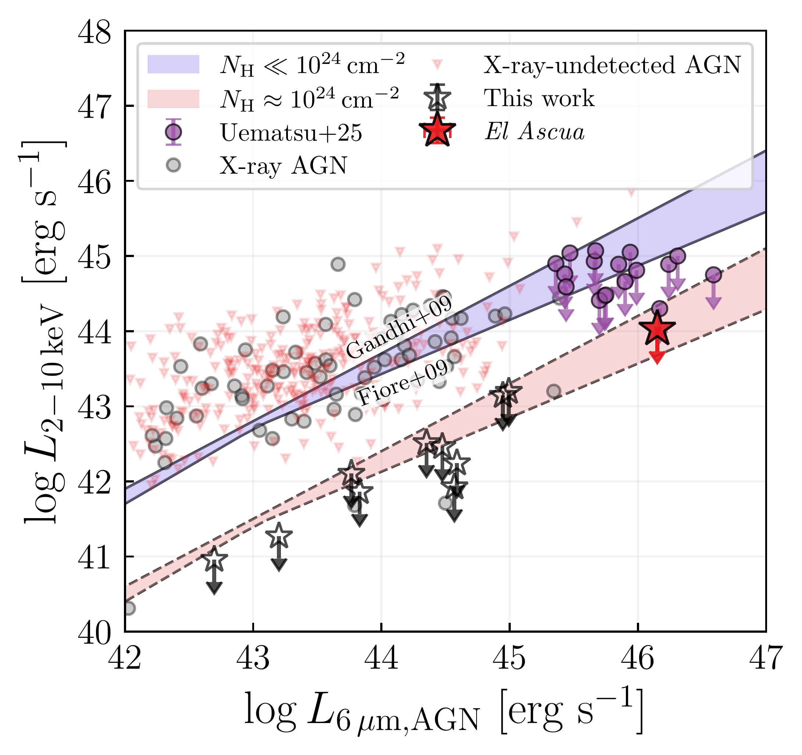
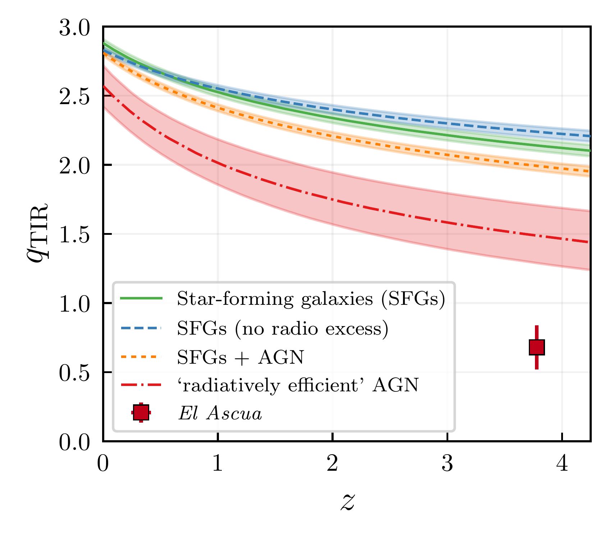
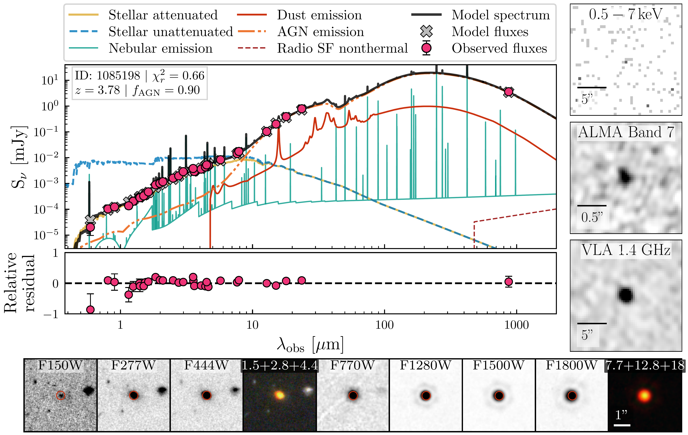

$\newcommand{\ensuremath}{}$
$\newcommand{\xspace}{}$
$\newcommand{\object}[1]{\texttt{#1}}$
$\newcommand{\farcs}{{.}''}$
$\newcommand{\farcm}{{.}'}$
$\newcommand{\arcsec}{''}$
$\newcommand{\arcmin}{'}$
$\newcommand{\ion}[2]{#1#2}$
$\newcommand{\textsc}[1]{\textrm{#1}}$
$\newcommand{\hl}[1]{\textrm{#1}}$
$\newcommand{\footnote}[1]{}$
$\newcommand\physrep{\ref@jnl{Phys.~Rep.}}$
$\newcommand\apjs{\ref@jnl{ApJS}}$
$\newcommand{\jcap}{\ref@jnl{JCAP}}$
$\newcommand{\vdag}{(v)^\dagger}$
$\newcommand\aastex{AAS\TeX}$
$\newcommand\latex{La\TeX}$
$\newcommand{\red}{\textcolor{red}}$
$\newcommand{\spacer}{\needspace{1\baselineskip}}$
$\newcommand{\hst}{\textit{HST}\xspace}$
$\newcommand{\jwst}{\textit{JWST}\xspace}$
$\newcommand{\nircam}{{NIRCam}\xspace}$
$\newcommand{\miri}{{MIRI}\xspace}$
$\newcommand{\numpy}{\code{NumPy}}$
$\newcommand{\scipy}{\code{SciPy}}$
$\newcommand{\matplotlib}{\code{matplotlib}}$
$\newcommand{\astropy}{\code{Astropy}}$
$\newcommand{\photutils}{\code{photutils}}$
$\newcommand{\cigale}{\code{CIGALE}}$
$\newcommand{\ie}{i.e.\xspace}$
$\newcommand{\eg}{e.g.\xspace}$
$\newcommand{\etc}{etc.\xspace}$
$\newcommand{\etal}{et al.\xspace}$
$\newcommand{\vs}{vs.\xspace}$
$\newcommand{\super}[1]{\ensuremath{^{\textrm{#1}}}}$
$\newcommand{\sub}[1]{\ensuremath{_{\textrm{#1}}}}$
$\newcommand{\CHECK}[1]{{\textcolor{orange}{#1}}}$
$\newcommand{\COMMENT}[1]{{\it \textcolor{blue}{(Comment: #1)}}}$
$\newcommand{\NOTE}[1]{\textcolor{blue}{(#1)}}$
$\newcommand{\highlight}[1]{\sethlcolor{yellow}\hl{#1}}$
$\newcommand{\response}[1]{{\bf \textcolor{red}{#1}}}$
$\newcommand{\IT}{{I\&T}\xspace}$
$\newcommand{\sectionfootnote}[2]{$
$  \newcommand{\thefootnote}{\fnsymbol{footnote}}$
$  \section[#1]{#1 ^\dagger}$
$  \footnotetext[2]{#2}$
$  \setcounter{footnote}{0}$
$  \newcommand{\thefootnote}{\arabic{footnote}}$
$}$
$\newcommand{\vect}[1]{\boldsymbol{#1}}$
$\newcommand{\roughly}{\ensuremath{ {\sim} } }$
$\newcommand{\gtr}{\ensuremath{ {>} } }$
$\newcommand{\less}{\ensuremath{ {<} } }$
$\newcommand{\doublehat}[1]{$
$    \settoheight{\dhatheight}{\ensuremath{\hat{#1}}}$
$    \addtolength{\dhatheight}{-0.35ex}$
$    \hat{\vphantom{\rule{1pt}{\dhatheight}}$
$    \smash{\hat{#1}}}}$
$\newcommand{\code}[1]{\texttt{#1}\xspace}$
$\newcommand{\dd}{\ensuremath{\rm d}}$
$\newcommand{\dex}{\unit{dex}}$
$\newcommand{\yr}{\unit{yr}}$
$\newcommand{\Gyr}{\unit{Gyr}}$
$\newcommand{\Myr}{\unit{Myr}}$
$\newcommand{\eV}{\unit{eV}}$
$\newcommand{\keV}{\unit{keV}}$
$\newcommand{\MeV}{\unit{MeV}}$
$\newcommand{\GeV}{\unit{GeV}}$
$\newcommand{\TeV}{\unit{TeV}}$
$\newcommand{\MB}{\unit{MB}}$
$\newcommand{\GB}{\unit{GB}}$
$\newcommand{\TB}{\unit{TB}}$
$\newcommand{◦ee}{\ensuremath{ ^{\circ}}\xspace}$
$\newcommand{◦ees}{◦ee}$
$\newcommand{\mas}{\unit{mas}}$
$\newcommand{\amin}{\unit{arcmin}}$
$\newcommand{\asec}{\unit{arcsec}}$
$\newcommand{\angstrom}{\unit{Å}}$
$\newcommand{\um}{\unit{\mum}}$
$\newcommand{\cm}{\unit{cm}}$
$\newcommand{\km}{\unit{km}}$
$\newcommand{\kms}{\km \second^{-1}}$
$\newcommand{\pc}{\unit{pc}}$
$\newcommand{\kpc}{\unit{kpc}}$
$\newcommand{\second}{\unit{s}}$
$\newcommand{\us}{\unit{\mus}}$
$\newcommand{\photons}{\unit{ph}}$
$\newcommand{\photon}{\unit{ph}}$
$\newcommand{\erg}{\unit{erg}}$
$\newcommand{\ergs}{\erg\;\second^{-1}}$
$\newcommand{\sr}{\unit{sr}}$
$\newcommand{\Msolar}{\unit{M_\odot}}$
$\newcommand{\Msun}{M_\odot}$
$\newcommand{\Msunyr}{\Msun\yr^{-1}}$
$\newcommand{\Lsolar}{\unit{L_\odot}}$
$\newcommand{\Lsun}{L_\odot}$
$\newcommand{\Lstar}{\unit{L_{*}}}$
$\newcommand{\Lum}{\ensuremath{ L }\xspace}$
$\newcommand{\Dsun}{\unit{D_\odot}}$
$\newcommand{\Dgc}{\ensuremath{D_{GC}}\xspace}$
$\newcommand{\Rgc}{\ensuremath{R_{GC}}\xspace}$
$\newcommand{\cmcubes}{\ensuremath{\cm^{3}\second^{-1}}\xspace}$
$\newcommand{\magn}{\unit{mag}}$
$\newcommand{\mmag}{\unit{mmag}}$
$\newcommand{\e}{\unit{e^{-}}}$
$\newcommand{\rms}{\unit{rms}}$
$\newcommand{\pix}{\unit{pix}}$
$\newcommand{\rmspix}{\unit{rms/pix}}$
$\newcommand{\ermspix}{\e \rmspix}$
$\newcommand{\Mv}{\ensuremath{M_{V}}\xspace}$
$\newcommand{\secref}[1]{Section~\ref{sec:#1}}$
$\newcommand{\appref}[1]{Appendix~\ref{app:#1}}$
$\newcommand{\tabref}[1]{Table~\ref{tab:#1}}$
$\newcommand{\tabrefs}[2]{Tables~\ref{tab:#1} and \ref{tab:#2}}$
$\newcommand{\figref}[1]{Figure~\ref{fig:#1}}$
$\newcommand{\figrefs}[2]{Figures~\ref{fig:#1} and \ref{fig:#2}}$
$\newcommand{\eqnref}[1]{Equation~\eqref{eqn:#1}}$
$\newcommand{\bandvar}[2][]{$
$  \ifthenelse{\isempty{#1}}{\var{#2}}{\var{#2\_#1}}$
$}$
$\newcommand{\spreadmodel}[1][]{\bandvar[#1]{spread\_model}}$
$\newcommand{\spreaderrmodel}[1][]{\bandvar[#1]{spreaderr\_model}}$
$\newcommand{\wavgspreadmodel}[1][]{\bandvar[#1]{wavg\_spread\_model}}$
$\newcommand{\classstar}[1][]{\bandvar[#1]{class\_star}}$
$\newcommand{\magauto}[1][]{\bandvar[#1]{mag\_auto}}$
$\newcommand{\magpsf}[1][]{\bandvar[#1]{mag\_psf}}$
$\newcommand{\magerrpsf}[1][]{\bandvar[#1]{magerr\_psf}}$
$\newcommand{\flags}[1][]{\bandvar[#1]{flags}}$
$\newcommand{\LCDM}{\ensuremath{\rm \Lambda CDM}\xspace}$
$\newcommand{\modulus}{\ensuremath{m - M}\xspace}$
$\newcommand{\mM}{\modulus}$
$\newcommand{\ra}{{\ensuremath{\alpha_{2000}}}\xspace}$
$\newcommand{\dec}{{\ensuremath{\delta_{2000}}}\xspace}$
$\newcommand{\age}{{\ensuremath{\tau}}\xspace}$
$\newcommand{\metal}{{\ensuremath{Z}}\xspace}$
$\newcommand{\major}{\ensuremath{a_h}\xspace}$
$\newcommand{\nobjs}{{sixteen}\xspace}$
$\newcommand{\feh}{{\ensuremath{\rm[Fe/H]}}\xspace}$
$\newcommand{\ellip}{\ensuremath{\epsilon}\xspace}$
$\newcommand{\PA}{\ensuremath{\mathrm{P.A.}}\xspace}$
$\newcommand{\TS}{\ensuremath{\mathrm{TS}}\xspace}$
$\newcommand{\ngmix}{\code{ngmix}}$
$\newcommand{\SWARP}{\code{SWarp}}$
$\newcommand{\swarp}{\SWARP}$
$\newcommand{\SExtractor}{\code{SExtractor}}$
$\newcommand{\sextractor}{\SExtractor}$
$\newcommand{\PSFex}{\code{PSFex}}$
$\newcommand{\Astromatic}{\code{Astromatic}}$
$\newcommand{\HEALPix}{\code{HEALPix}}$
$\newcommand{\healpix}{\HEALPix}$
$\newcommand{\healpy}{\code{healpy}}$
$\newcommand{\DAOPHOT}{\code{DAOPHOT}}$
$\newcommand{\PARSEC}{\code{PARSEC}}$
$\newcommand{\mangle}{\code{mangle}}$
$\newcommand{\emcee}{\code{emcee}}$
$\newcommand{\ugali}{\code{ugali}}$
$\newcommand{\simple}{\code{simple}}$
$\newcommand{\var}[1]{\ensuremath{\texttt{\MakeUppercase{#1}}}\xspace}$
$\newcommand{\nside}{\code{nside}}$
$\newcommand{\prior}{\ensuremath{\mathcal{P}}\xspace}$
$\newcommand{\Prob}{\ensuremath{\mathcal{P}}\xspace}$
$\newcommand{\ProbJ}{\ensuremath{\mathcal{P}(J)}\xspace}$
$\newcommand{\like}{\ensuremath{\mathcal{L}}\xspace}$
$\newcommand{\plike}{\like_p\xspace}$
$\newcommand{\jlike}{\ensuremath{L}\xspace}$
$\newcommand{\pjlike}{\jlike_p\xspace}$
$\newcommand{\pseudolike}{ {\tilde{\like}} \xspace}$
$\newcommand{\loglike}{\ensuremath{\log\like}\xspace}$
$\newcommand{\logpseudolike}{\ensuremath{\log\pseudolike}\xspace}$
$\newcommand{\lnlike}{\ensuremath{\ln\like}\xspace}$
$\newcommand{\lnpseudolike}{\ensuremath{\ln\pseudolike}\xspace}$
$\newcommand{\given}{\ensuremath{  |  }\xspace}$
$\newcommand{\likefn}[2]{\ensuremath{ \like(#1 \given #2) }\xspace}$
$\newcommand{\plikefn}[2]{\ensuremath{ \plike(#1 \given #2) }\xspace}$
$\newcommand{\jlikefn}[2]{\ensuremath{ \jlike(#1 \given #2) }\xspace}$
$\newcommand{\data}{ \ensuremath{ \mathcal{D} }\xspace }$
$\newcommand{\param}{\ensuremath{{\theta}}\xspace}$
$\newcommand{\params}{\ensuremath{\vect{\theta}}\xspace}$
$\newcommand{\sig}{\ensuremath{\mu}\xspace}$
$\newcommand{\bkg}{\ensuremath{\eta}\xspace}$
$\newcommand{\interest}{\ensuremath{\vect{\sig}}\xspace}$
$\newcommand{\nuisance}{\ensuremath{\vect{\bkg}}\xspace}$
$\newcommand{\signal}{\sig}$
$\newcommand{\pvalue}{\textit{p}-value\xspace}$
$\newcommand{\pdf}{PDF\xspace}$
$\newcommand{\uspatial}{\ensuremath{u_s}}$
$\newcommand{\ucolor}{\ensuremath{u_c}}$
$\newcommand{\Jlike}{\ensuremath{\like_{J}}\xspace}$
$\newcommand{\Jsigma}{\ensuremath{\sigma_{i}}\xspace}$
$\newcommand{\Jtrue}{\Ji}$
$\newcommand{\Jobs}{\barJi}$
$\newcommand{\logtenJtrue}{\logtenJi}$
$\newcommand{\logtenJobs}{\barlogtenJi}$
$\newcommand{\Ji}{\ensuremath{J_i}\xspace}$
$\newcommand{\barJi}{\ensuremath{ {\overline{J_i}} }\xspace}$
$\newcommand{\logJi}{\ensuremath{{\log{(J_i)}}}\xspace}$
$\newcommand{\barlogJi}{\ensuremath{ {\overline{\log{(J_i)}}} }\xspace}$
$\newcommand{\logtenJi}{\ensuremath{{\log_{10}{(J_i)}}}\xspace}$
$\newcommand{\barlogtenJi}{\ensuremath{ {\overline{\log_{10}{(J_i)}}} }\xspace}$
$\newcommand{\ScienceTools}{\code{ScienceTools}}$
$\newcommand{\Sourcelike}{\code{Sourcelike}}$
$\newcommand{\gtlike}{\code{gtlike}}$
$\newcommand{\pointlike}{\code{pointlike}}$
$\newcommand{\Gtlike}{\code{Gtlike}}$
$\newcommand{\gtobssim}{\code{gtobssim}}$
$\newcommand{\DMFIT}{\code{DMFIT}}$
$\newcommand{\Pythia}{\code{Pythia}}$
$\newcommand{\GALPROP}{\code{GALPROP}}$
$\newcommand{\DM}{\ensuremath{\mathrm{DM}}}$
$\newcommand{\mDM}{\ensuremath{m_\DM}\xspace}$
$\newcommand{\mLSP}{\ensuremath{m_\LSP}\xspace}$
$\newcommand{\mChi}{\ensuremath{m_\chi}\xspace}$
$\newcommand{\sigmav}{\ensuremath{\langle \sigma v \rangle}\xspace}$
$\newcommand{\sigmavmax}{\ensuremath{\sigmav_{\max}}\xspace}$
$\newcommand{\sigmavT}{\ensuremath{\sigmav_{\rm T}}\xspace}$
$\newcommand{\tsigmav}{\ensuremath{\sigmav R^{2}}\xspace}$
$\newcommand{\LSP}{\ensuremath{\chi}\xspace}$
$\newcommand{\PhiPP}{\ensuremath{\Phi_{\rm PP}}\xspace}$
$\newcommand{\uubar}{\ensuremath{u \bar u}\xspace}$
$\newcommand{\ddbar}{\ensuremath{d \bar d}\xspace}$
$\newcommand{çbar}{\ensuremath{c \bar c}\xspace}$
$\newcommand{\ssbar}{\ensuremath{s \bar s}\xspace}$
$\newcommand{\bbbar}{\ensuremath{b \bar b}\xspace}$
$\newcommand{\ttbar}{\ensuremath{t \bar t}\xspace}$
$\newcommand{\ww}{\ensuremath{W^{+}W^{-}}\xspace}$
$\newcommand{\zz}{\ensuremath{Z^{0}Z^{0}}\xspace}$
$\newcommand{\gluglu}{\ensuremath{gg}\xspace}$
$\newcommand{\ee}{\ensuremath{e^{+}e^{-}}\xspace}$
$\newcommand{\mumu}{\ensuremath{\mu^{+}\mu^{-}}\xspace}$
$\newcommand{\tautau}{\ensuremath{\tau^{+}\tau^{-}}\xspace}$
$\newcommand{\relic}{\ensuremath{3\times10^{-26}\cm^{3}\second^{-1}}\xspace}$
$\newcommand{\Jfactor}{J-factor\xspace}$
$\newcommand{\Jfactors}{J-factors\xspace}$
$\newcommand{\JFactor}{J-Factor\xspace}$
$\newcommand{\Rmax}{\ensuremath{R_{V_{\rm max}}}\xspace}$
$\newcommand{\Vmax}{\ensuremath{V_{\rm max}}\xspace}$
$\newcommand{\rs}{\ensuremath{ r_{\rm s} }\xspace}$
$\newcommand{\rhos}{\ensuremath{ \rho_0 }\xspace}$
$\newcommand{\alphahalf}{\ensuremath{ \alpha_{\rm h} }\xspace}$
$\newcommand{\ahalf}{ \alphahalf }$
$\newcommand{\rhalf}{\ensuremath{ r_{\rm h} }\xspace}$
$\newcommand{\Mhalf}{\ensuremath{ M_{\rm h} }\xspace}$
$\newcommand{\Mtidal}{\ensuremath{M_{\rm tidal}}\xspace}$
$\newcommand{\alphas}{\ensuremath{ \alpha_{\rm s} }\xspace}$
$\newcommand{\boost}{\ensuremath{\mathcal{B}}\xspace}$
$\newcommand{\vdisp}{\ensuremath{\sigma_\star}\xspace}$
$\newcommand{\ctagn}{{CT AGN}\xspace}$
$\newcommand{\one}{{\textit{el Ascua}}\xspace}$
$\newcommand{\thefootnote}{\fnsymbol{footnote}}$
$\newcommand{\thefootnote}{\arabic{footnote}}$

# _El Ascua_: An ultra-luminous, radio-loud, Compton-thick AGN at $z\sim 3.8$ hiding in plain sight revealed by MINERVA multi-band MIRI observations

<mark>Appeared on: 2026-10-27</mark> -  _Submitted to ApJL. 12 pages (including references), 3 figures, 1 table. Comments welcome!_

A. P. Cloonan, et al. -- incl., <mark>M. Sharma</mark>, <mark>A. d. Graaff</mark>

**Abstract:** Heavily dust-obscured active galactic nuclei (AGN) are crucial for understanding supermassive black hole growth. Using multi-band MIRI photometry from the MINERVA survey, we report the discovery in the UDS field of an extremely mid-infrared bright Compton-thick AGN (CT AGN) at $z \sim 3.8$ , _el Ascua_ (the Ember). The AGN and/or its host galaxy is detected at 870 $\mu$ m with ALMA and at 1.4 GHz with the VLA. With UV-to-radio spectral energy distribution modeling, we estimate that the dusty host galaxy has a stellar mass of $\log\left( M_\star / M_\odot \right)=10.82 \pm 0.57$ and a star formation rate of ${\rm{SFR}} =157 \pm 8  \Msunyr$ , and we confirm the presence of a powerful dusty AGN with an intrinsic accretion luminosity of $\log\left( L_{\rm{acc}} /\ergs \right)=47.12 \pm 0.58$ . CT obscuration is revealed by comparing the upper limit on the X-ray luminosity over $2-10  {\rm{keV}}$ with the $6  {\rm\mu{m}}$ mid-IR AGN luminosity. We additionally find evidence for a radio excess by comparing its total IR-to-radio ratio to those of typical star-forming galaxies and radio-quiet AGN, implying that _el Ascua_ could be a rare radio-loud CT AGN. With an extremely high ratio between black hole accretion rate and SFR, the AGN is likely nearing the peak of a deeply obscured phase of black hole growth before AGN feedback blows away the obscuring material. Our work demonstrates the power of MIRI to reveal heavily obscured AGN missing from our supermassive black hole census.

**Figure 1. -** The discovery of a remarkably mid-IR bright ($L_{6 \rm \mu m,AGN} $\gtr$sim 10^{46} \rm erg\; s^{-1}$) $\ctagn$ candidate ($\one$; red star) from a larger sample of $\ctagn$(shown with black stars). This plot shows the observed X-ray luminosity as a function of the intrinsic 6 $\mu$m AGN luminosity as obtained from SED fitting. The log-linear relation for unobscured (or Compton-thin) AGN is shown in light blue, as a shaded region between two different estimates from [Gandhi, et. al (2009)](https://ui.adsabs.harvard.edu/abs/2009A&A...502..457G) and [Fiore, et. al (2009)](https://ui.adsabs.harvard.edu/abs/2009ApJ...693..447F). X-ray detected AGN in UDS which were detected with MINERVA MIRI imaging are shown as gray dots which roughly follows the shaded region for unobscured AGN.
    The relation for AGN with absorption of $N_H \approx 10^{24} \rm cm^{-2}$ is shown in light red, and it corresponds to a normalization factor of $\approx 20$ fainter in the X-ray luminosity  ([Lansbury, et. al 2015](https://ui.adsabs.harvard.edu/abs/2015ApJ...809..115L)) . A sample of obscured candidate AGN in the COSMOS field are shown as purple dots  ([Uematsu, et. al 2025](https://ui.adsabs.harvard.edu/abs/2025ApJ...979..168U)) . (*fig:L6Lx*)

**Figure 2. -** The observed ratio for $\one$ between SF-driven IR luminosity and the 1.4 GHz radio power, measured with $\cigale$, is consistent with an AGN-driven radio excess. We present empirical curves from [Delhaize, et. al (2017)](https://ui.adsabs.harvard.edu/abs/2017A&A...602A...4D) for the ratio $q_{\rm TIR}(z)$ as a function of redshift in different source populations. Star-forming galaxies are shown in blue and green, while all sources are shown in orange and `radiatively efficient' AGN are shown in red. We note that this population of radiatively efficient AGN are mostly radio-quiet  ([Delvecchio, et. al 2017](https://ui.adsabs.harvard.edu/abs/2017A&A...602A...3D), [Smol\vci\'c, et. al 2017](https://ui.adsabs.harvard.edu/abs/2017A&A...602A...2S)) . (*fig:radio*)

**Figure 3. -** The best-fit SED from $\cigale$ and image cutouts in _JWST_ filters, _Chandra_$0.5-2 \rm keV$, ALMA Band 7, and VLA 1.4 GHz. We also present a NIRCam RGB image using F150W (1.5 $\mu$m), F277W (2.8 $\mu$m), and F444W (4.4 $\mu$m); and a MIRI RGB using F770W (7.7 $\mu$m), F1280W (12.8 $\mu$m), and F1800W (18 $\mu$m). Both the SED and the _JWST_ cutouts show a luminous mid-IR AGN and dust-attenuated starlight in the rest-UV and optical. The ALMA Band 7 map shows compact cold dust emission, and the AGN is undetected by _Chandra_. The mid-IR brightness combined with the inferred X-ray flux upper limit suggest CT obscuration. We also find a radio excess at 1.4 GHz with our updated measurement of the total IR luminosity. This excess is likely AGN-driven, meaning that $\one$ may be a rare radio-loud $\ctagn$. (*fig:sed1*)

