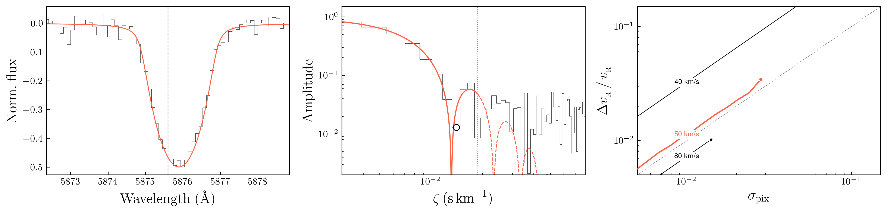
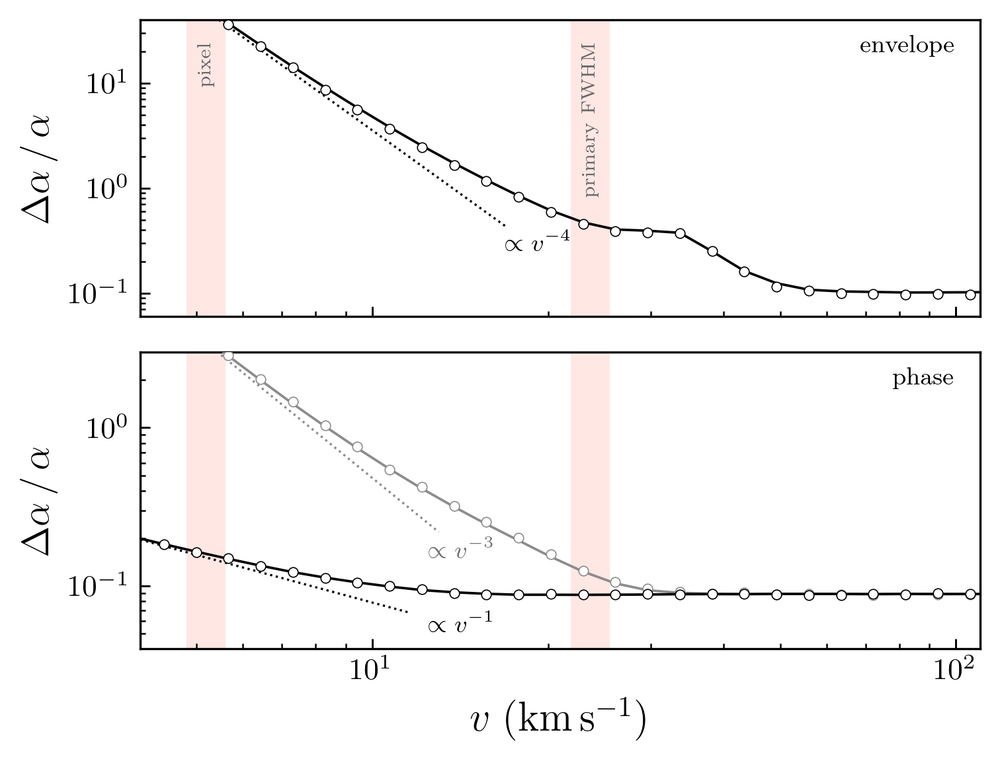
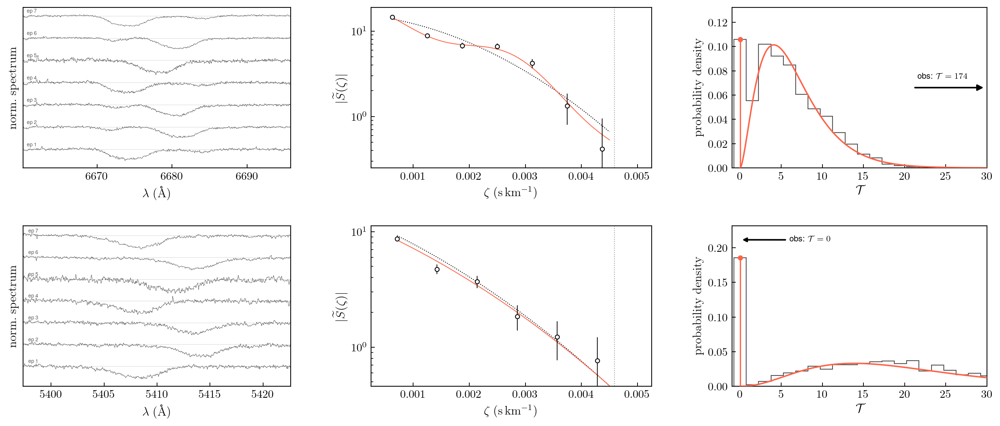

$\newcommand{\ensuremath}{}$
$\newcommand{\xspace}{}$
$\newcommand{\object}[1]{\texttt{#1}}$
$\newcommand{\farcs}{{.}''}$
$\newcommand{\farcm}{{.}'}$
$\newcommand{\arcsec}{''}$
$\newcommand{\arcmin}{'}$
$\newcommand{\ion}[2]{#1#2}$
$\newcommand{\textsc}[1]{\textrm{#1}}$
$\newcommand{\hl}[1]{\textrm{#1}}$
$\newcommand{\footnote}[1]{}$
$\newcommand{\add}[1]{\textcolor{blue}{#1}}$
$\newcommand{\del}[1]{\textcolor{red}{\sout{#1}}}$
$\newcommand{\vdag}{(v)^\dagger}$
$\newcommand\aastex{AAS\TeX}$
$\newcommand\latex{La\TeX}$
$\newcommand{\pker}[1]{U^{({\textsc{#1})}}}$
$\newcommand{\pspc}[1]{f^{({\textsc{#1})}}}$
$\newcommand{\tpK}[1]{\tilde{K}^{({\textsc{#1})}}}$
$\newcommand{\tpKg}[1]{\tilde{K}_{\gamma}^{({\textsc{#1})}}}$
$\newcommand{\tpKG}[1]{\tilde{K}_{\textsc{g}}^{({\textsc{#1})}}}$
$\newcommand{\tpKr}[1]{\tilde{K}_{\rm rot}^{({\textsc{#1})}}}$
$\newcommand{\tpker}[1]{\tilde{U}^{({\textsc{#1})}}}$
$\newcommand{\tpspc}[1]{\tilde{f}^{({\textsc{#1})}}}$

# Faint Companions to  Hot Stars: Spectroscopic Detection Sensitivity and Implications for Survey Design

<mark>Appeared on: 2026-10-27</mark> -  _Accepted for publication in A&A_

<mark>S. Shahaf</mark>, et al. -- incl., <mark>H.-W. Rix</mark>, <mark>J. Müller-Horn</mark>

**Abstract:** Searches for black holes in binaries must distinguish genuinely dark companions from faint luminous stars. This is particularly challenging for massive hot stars. Their masses can exceed those of typical stellar black holes, while their spectra contain only a few broad lines.We develop a Fourier-domain method that converts isolated, broadened spectral lines into calibrated constraints on faint companions. In Fourier space, Doppler shifts are encoded in the phase, while the line profile defines a smooth amplitude envelope. A faint secondary introduces an oscillatory perturbation to the otherwise smooth log-amplitude. Expanding this perturbation to first order in the secondary-to-primary line-depth ratio, $\alpha$ , allows it to be profiled against the smooth baseline in a likelihood-ratio test with the single-star model.Because the model is analytic and nearly linear, its sensitivity can be evaluated transparently for individual spectra and at survey scale. It can be applied to single or multiple epochs without requiring full spectral disentangling.At small velocity separation $v$ , the companion signal becomes degenerate with the smooth single-star profile. For the Fourier log-amplitude, the fractional uncertainty scales as $\Delta\alpha/\alpha \propto v^{-4}$ . If the primary velocity is known, the Fourier phase provides a more favorable detection channel whose sensitivity scales as $v^{-1}$ .We demonstrate the method on archival FEROS spectra of the massive binary CPD $-41^\circ$ 7742. We detect the known secondary in He I $6678$ Å and obtain a stringent non-detection in He II $5411$ Å, where its contribution is expected to be negligible.The same framework yields local detection efficiencies as functions of line-depth ratio, velocity separation, noise, and instrumental setup. These can be combined across lines, epochs, and targets to construct survey selection functions for spectroscopic black-hole searches, including those enabled by SDSS-V and Gaia.

**Figure 5. -** Simulated recovery of $v\sin i$ from a single line in the Fourier domain. Left: Rotationally broadened absorption line with $v_{r}=50$, $v_{g}=10$, $v_\gamma=10 \mathrm{km s^{-1}}$, and $\epsilon=0.5$. The high-resolution profile is shown in red; the black step curve shows sampling at $5 \mathrm{km s^{-1}}$ with Gaussian noise $\sigma_{\rm pix}=0.02$. The vertical dashed line marks the nominal line center. Middle: Normalized Fourier amplitude of the noisy spectrum and fitted broadening kernel. The fit gives $v_{r}\simeq49 \mathrm{km s^{-1}}$. Only modes below the fixed limit $\zeta\le0.02 \mathrm{s km^{-1}}$(dotted line) are fitted; this range includes the first zero and the first sidelobe of the rotational kernel, where the sensitivity to $v_{r}$ resides (Appendix \ref{app: expected precision}). The model is dashed beyond the limit. The first log-amplitude minimum is marked by an open circle. Choosing this position as the first zero of the Bessel function in equation (\ref{eq: rotational kernel}) would imply $v_{r}\simeq46 \mathrm{km s^{-1}}$ using the correct limb-darkening coefficient. {Right:} Fractional precision $\Delta v_{r}/v_{r}$ as a function of per-pixel noise. Black curves show the Cramér--Rao bounds for $v\sin i=40$ and $80 \mathrm{km s^{-1}}$ lines, at fixed equivalent width, and the red curve shows an empirical estimate for $v_{r}=50 \mathrm{km s^{-1}}$. Curves terminate where fewer than $7$ Fourier modes of the noise-free model exceed a signal-to-noise ratio of $3$. The gray dotted line marks a one-to-one relation for reference.  (*fig: line example*)

**Figure 2. -** Fractional depth-ratio error as a function of velocity separation for the two Fourier-domain channels. Both panels use the same parameters as the example in Figure \ref{fig: double line example}; only the relative velocity $v$ is varied. At each plotted separation, $v$ is held fixed while $\alpha$ is fitted. The curves therefore show conditional precision and do not include the look-elsewhere effect associated with a velocity search. Top: log-amplitude channel. The analytic bound agrees with the Monte Carlo scatter and follows the expected $v^{-4}$ scaling at small separations. Bottom: phase channel. The black curves show the optimistic case in which the primary rest velocity is known, giving the $v^{-1}$ scaling. The gray curves show the result when the primary velocity is fitted. The fitted phase slope then absorbs the leading companion term, and the uncertainty follows the $v^{-3}$ scaling. Solid curves show the analytic bounds, open markers show the Monte Carlo scatter, and dotted lines mark the asymptotic scalings. The shaded vertical bands indicate the pixel sampling scale and the FWHM of the primary line. Values $\Delta\alpha/\alpha \gtrsim 1$ mark the practical non-detection. (*fig: precision curve*)

**Figure 7. -** Companion-detection diagnostic applied to the FEROS spectra of CPD$-$41$^\circ$ 7742. The top row shows He I $6678 { Å}$, where both components are expected to contribute to the line profile. The bottom row shows He II $5411 {\rm Å}$, which should be dominated by the primary. Left: locally normalized spectra from individual epochs, vertically offset. Middle: Fourier amplitudes used in the fit of the third epoch. The red curve is the best-fit two-component model, and the dotted curve is the corresponding single-star model obtained by setting $\alpha=0$ while keeping the fitted primary profile fixed. The vertical dotted line marks the Fourier-frequency cutoff used in the fit. The error bars include the empirical noise rescaling from the single-star injection--recovery test. Right: empirical null distribution of the detection statistic $\mathcal{T}$(black histogram; 2500 single-star injection--recovery trials), used to compute an approximate tail probability under the single-star model. The fitted null distributions, defined in equation (\ref{eq: chernoff-like}), are shown in red. The vertical stem marks the point-mass component at $\mathcal{T}=0$, corresponding to trials for which the best-fitting amplitude has $\alpha<0$. The continuous curve shows the Gamma distribution fitted to the positive-$\mathcal{T}$ tail, corresponding to trials with $\alpha>0$. The fitted values of the mixture weight and Gamma shape and scale are listed in Table \ref{tab:feros_detection}. The arrow marks the observed value of $\mathcal{T}$.  (*fig: FEROS example*)

