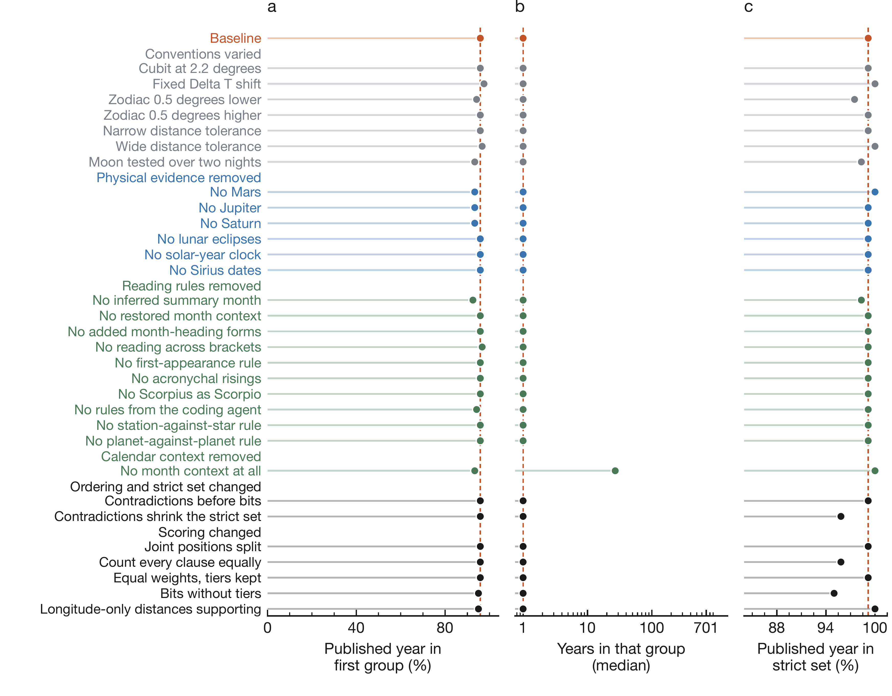
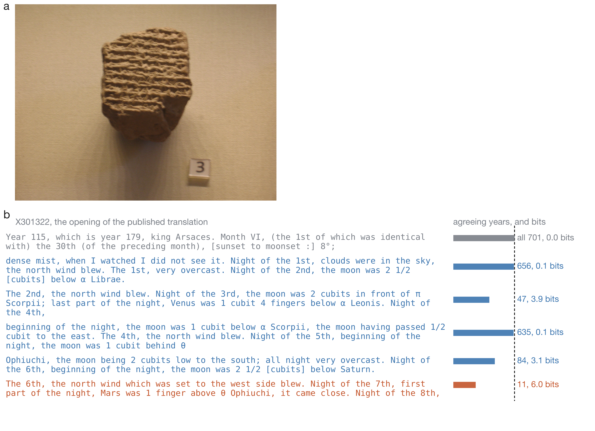
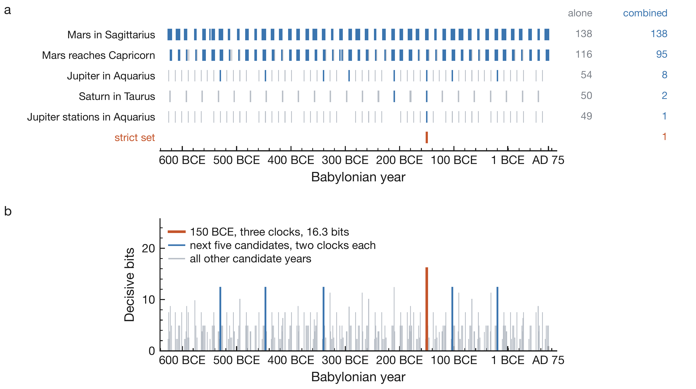

$\newcommand{\ensuremath}{}$
$\newcommand{\xspace}{}$
$\newcommand{\object}[1]{\texttt{#1}}$
$\newcommand{\farcs}{{.}''}$
$\newcommand{\farcm}{{.}'}$
$\newcommand{\arcsec}{''}$
$\newcommand{\arcmin}{'}$
$\newcommand{\ion}[2]{#1#2}$
$\newcommand{\textsc}[1]{\textrm{#1}}$
$\newcommand{\hl}[1]{\textrm{#1}}$
$\newcommand{\footnote}[1]{}$
$\newcommand{\DefineJournalAbbreviation}[2]{$
$	\begingroup$
$		\jabbrv@newcommandine@diacritic$
$		\expandafter\newcommand\csname journal@abbrv@#1\endcsname{$
$			\begingroup$
$				\jabbrv@normal@diacritic$
$				#2$
$			\endgroup$
$			\@gobble@space@false$
$			\journal@abbrv@period$
$		}$
$	\endgroup$
$}$
$\newcommand{\DefineJournalException}[2]{$
$	\begingroup$
$		\jabbrv@newcommandine@diacritic$
$		\expandafter\newcommand\csname journal@exception@#1\endcsname{$
$			\begingroup$
$				\jabbrv@normal@diacritic$
$				#2$
$			\endgroup$
$			\@gobble@space@false$
$		}$
$	\endgroup$
$}$
$\newcommand{\DefineJournalPartialAbbreviation}[2]{$
$	\begingroup$
$		\jabbrv@newcommandine@diacritic$
$		\expandafter\newcommand\csname journal@partial@abbrv@#1\endcsname{$
$			\begingroup$
$				\jabbrv@normal@diacritic$
$				#2$
$			\endgroup$
$			\@gobble@space@false$
$			\journal@abbrv@period$
$		}$
$	\endgroup$
$}$
$\newcommand{\DefineSpuriousJournalWord}[1]{$
$	\expandafter\newcommand\csname{ journal@abbrv@#1}\endcsname{\journal@output@space}$
$}$
$\newcommand{\JournalTitle}[1]{$
$	\@abbreviate@journal@true$
$	\global\@end@period@false$
$	\begingroup$
$		\jabbrv@newcommandine@diacritic$
$		\enewcommand\journal@fulltitle{#1}$
$		\ifcsname journal@exception@#1\endcsname$
$			\csname journal@exception@#1\endcsname$
$			\global\@abbreviate@journal@false$
$		\fi$
$	\endgroup$
$	\if@abbreviate@journal@$
$		\begingroup$
$			\@gobble@space@true$
$			\@special@period@false$
$			\jabbrv@newcommandine@diacritic$
$			\jabbrv@reset@word@count$
$			\expandafter\journal@char@loop$
$				#1$
$			\journal@char@stop$
$		\endgroup$
$	\fi$
$	\@jrnl@eat@period@groupskip$
$}$
$\newcommand{\chg}[1]{\ifmarkchanges\textcolor{red}{#1}\else#1\fi}$
$\newcommand{\journalname}{\ifPNAS\textbf{PNAS}\hspace{7pt}\fi}$
$\newcommand{\jabbrv@for@loop}[5][1]{$
$	\setcounter{#2}{#3}$
$	\ifnum#4\relax$
$		#5$
$		\addtocounter{#2}{#1}$
$		\jabbrv@for@loop[#1]{#2}{\value{#2}}{#4}{#5}$
$	\fi$
$}$
$\newcommand{\dbltopfraction}{0.8}$
$\newcommand\normalsize{$
$   \@setfontsize\normalsize\@xpt\@xipt$
$   \abovedisplayskip 10\p@ \@plus2\p@ \@minus5\p@$
$   \abovedisplayshortskip \z@ \@plus3\p@$
$   \belowdisplayshortskip 6\p@ \@plus3\p@ \@minus3\p@$
$   \belowdisplayskip \abovedisplayskip$
$   \let\@listi\@listI}$
$\newcommand{\topfraction}{0.85}$
$\newcommand{\textfraction}{0.1}$
$\newcommand{\floatpagefraction}{0.85}$
$\newcommand{\thefigure}{S\arabic{figure}}$
$\newcommand{\thetable}{S\arabic{table}}$
$\newcommand{\theequation}{S\arabic{equation}}$
$\newcommand{\theHequation}{S\arabic{equation}}$
$\newcommand{\arraystretch}{1.15}$
$\newcommand{\arraystretch}{1.15}$
$\newcommand\jabbrv{@one@word@title}$
$\newcommand\journal{@abbrv@period@noperiod}$
$\newcommand\journal{@abbrv@period@period}$
$\newcommand\journal{@abbrv@period}$
$\newcommand\jabbrv{@newcommandine@diacritic}$
$\newcommand\jabbrv{@normal@diacritic}$
$\newcommand\journal{@char@stop $
$}$
$\newcommand{\@}{journal@space}$
$\newcommand{\@}{journal@space@}$
$\newcommand{\@}{journal@gobble#1}$
$\newcommand{\@}{journal@character#1}$
$\newcommand\journal{@char@loop}$
$\newcommand\jabbrv{@strlen@stop $
$}$
$\newcommand\jabbrv{@strlen#1}$
$\newcommand\jabbrv{@strlen@#1}$
$\newcommand\jabbrv{@gobble@stop $
$}$
$\newcommand\jabbrv{@gobble@ending#1#2#3}$
$\newcommand\jabbrv{@gobble@ending@#1}$
$\newcommand\journal{@output@abbrv@partial}$
$\newcommand\journal{@output@space}$
$\newcommand\journal{@output@abbrv}$
$\newcommand\jabbrv{@reset@word@count}$
$\newcommand\jabbrv{@step@word@count}$
$\newcommand\journal{@char@loop@}$
$\newcommand{\@}{jrnl@eat@period#1}$
$\newcommand{\@}{jrnl@eat@period@groupskip}$
$\newcommand{\@}{jrnl@eat@period@groupskip@}$
$\newcommand\jabbrv{@comma $
$	}$
$\newcommand\jabbrv{@comma}$
$\newcommand{\`}{@GRAVEACCENT@}$
$\newcommand{\'}{@ACUTEACCENT@}$
$\newcommand{\^}{@CIRCUMFLEX@}$
$\newcommand{\"}{@UMLAUT@}$
$\newcommand{\=}{@MACRONACCENT@}$
$\newcommand{\~}{@TILDE@}$
$\newcommand{\aa}{@RINGa@}$
$\newcommand{Å}{@RINGA@}$
$\newcommand{\ae}{@aeDIPHTHONG@}$
$\newcommand{\AE}{@AEDIPHTHONG@}$
$\newcommand{\c}{@CEDILLA@}$
$\newcommand{\o}{@SLASHo@}$
$\newcommand{\O}{@SLASHO@}$
$\newcommand{\oe}{@oeDIPHTHONG@}$
$\newcommand{\OE}{@OEDIPHTHONG@}$
$\newcommand{\ss}{@ESZETT@}$
$\newcommand{\t}{@TIE@}$
$\newcommand{\v}{@CARON@}$
$\newcommand{\&}{@AND@}$
$\newcommand\J{@C}$
$\newcommand\csname{ journal@abbrv@#1}$
$\newcommand$
$\newcommand$
$\newcommand$
$\newcommand$
$\newcommand$
$\newcommand$

# Automated, auditable dating of the Babylonian Astronomical Diaries with language models and astronomical tools

<mark>Appeared on: 2026-10-27</mark> -  _15 pages, 6 figures, 7 tables, including the SI Appendix. Code, data and interactive page: this https URL and this https URL_

L. C. D. Pinheiro, et al. -- incl., <mark>Y.-S. Ting</mark>

**Abstract:** The Babylonian Astronomical Diaries record the sky over nearly six centuries. Many tablets are broken and have lost their date formula. Experts dated many of them one tablet at a time in the standard edition, Astronomical Diaries and Related Texts from Babylonia (ADART). They used the recorded sky and other evidence, such as year formulas and royal names. Our system automates the astronomical part for all tablets with the same rules. A rule-based parser turns the recorded observations into clauses, short statements with fixed fields. A language model checks them against the text and adds observations that the parser missed. Astronomical tools test the clauses in all 701 years from 626 BCE to AD 75. The system ranks the years by how well they agree with the clauses. The system withholds published dates until its results are final, and the output lists the passages and computed positions behind each candidate year. On 120 dated tablets, the years tied at the top of the ranking include the published year in 96 \% of cases. For 86 of them, this top group is a single year, the published year in 84. In 119 of the 120, the reported candidate set contains it. For 56 undated entries of ADART IV, the system gives ranked candidate years. For each tablet, the results show how far astronomy alone narrows the year. An interactive page at $\url{https://tingyuansen.github.io/Babylonian_Dating/}$ follows each tablet and links the code, protocol and results.

**Figure 1. -** Sensitivity of the benchmark for the 120 records with decisive clauses, with the baseline values as dashed orange lines. (a) Published year in the first group, with all tied groups kept. (b) Median number of years in that group, on a logarithmic axis. (c) Published year in the strict set, on an axis that starts above zero. Each row changes one convention, removes one rule or clock, or changes one scoring policy. Group headers mark the six kinds of change, and section S7 defines each row. The row "Fixed Delta T shift" shifts ephemeris time, separately from the three eclipse trials of the baseline. (*fig:ablation*)

**Figure 4. -** A diary tablet and the information in its clauses. (a) ADART I no. $-322$B (British Museum, BM 45962), a diary for 323/322 BCE that records the death of Alexander the Great. Photograph by Shaunnol, Wikimedia Commons, public domain. (b) The opening of X301322 from ADART III, one tablet line per row, colored orange for a decisive and blue for a supporting clause. Square brackets mark text that Sachs and Hunger restored. Each log-scaled bar shows the number $n$ of years that agree with the row's strongest clause, labeled with $\log_2(701/n)$ bits (Eq. \ref{eq:weight} gives the scoring). Gray rows hold unscored text, and their bars reach all 701 years (dashed line) at 0 bits. (*fig:diary*)

**Figure 5. -** Five decisive clauses of X301492 narrow the candidates to one year. (a) Gray ticks mark the years that each clause agrees with on its own. Blue ticks mark the running intersection, and the counts of both are at the right. The orange row is the strict set computed from $K$ and $I_D$, the single year 150 BCE. (b) Decisive bits $I_D$ of each candidate year. 150 BCE agrees with three clocks, and the five years with the next highest $I_D$ agree with two each. (*fig:tablet*)

