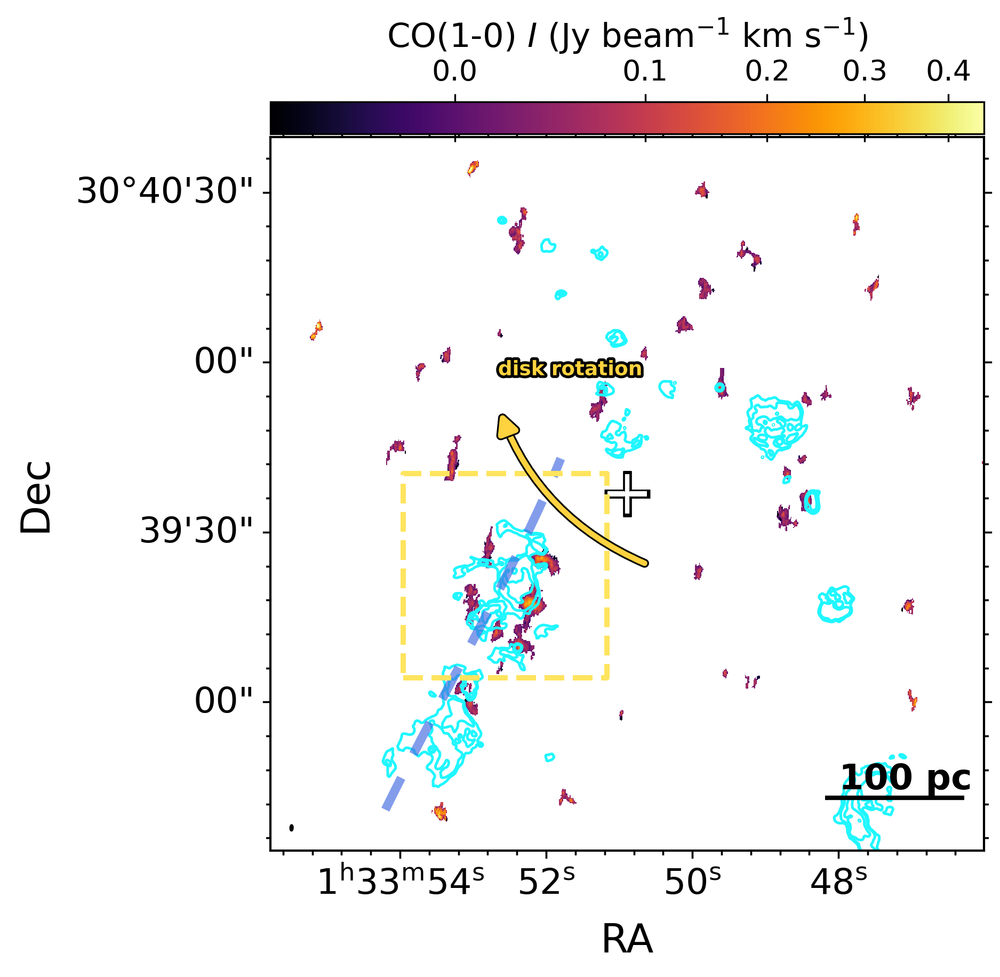
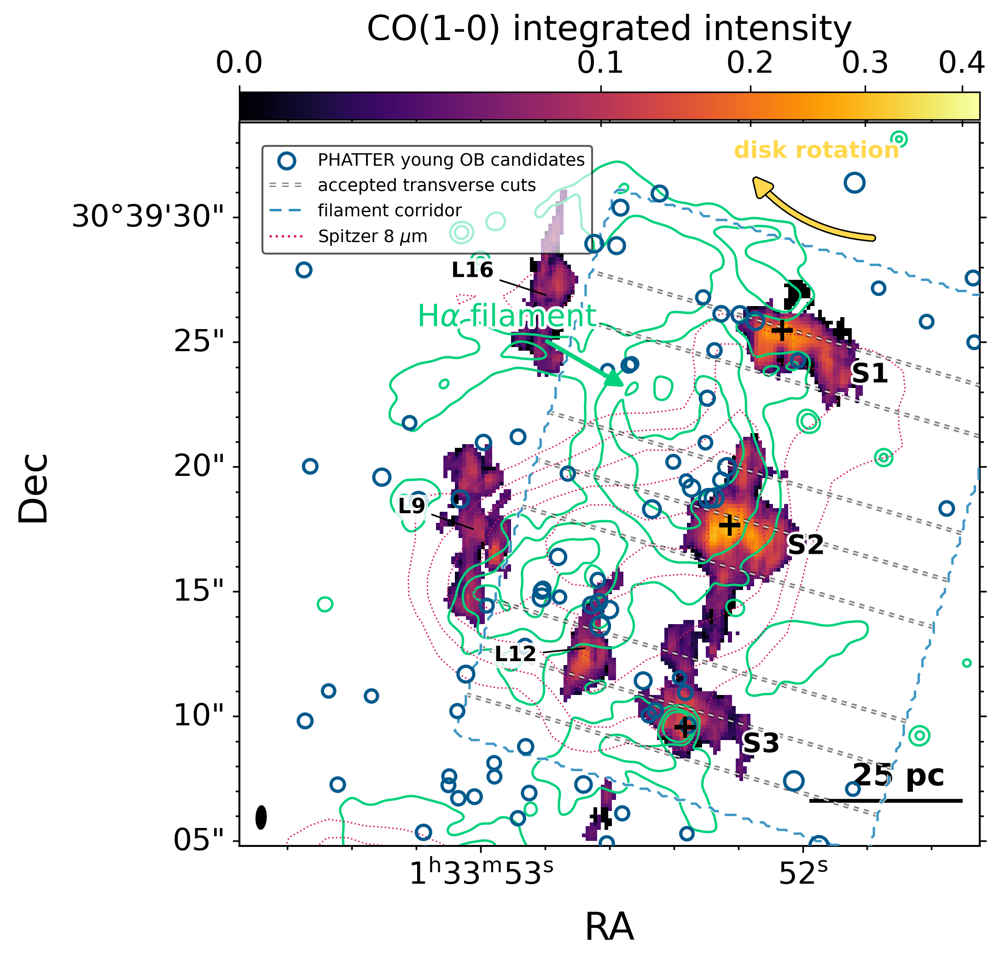
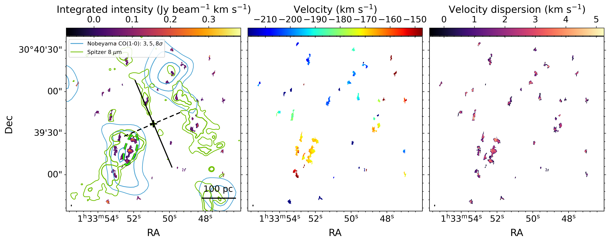
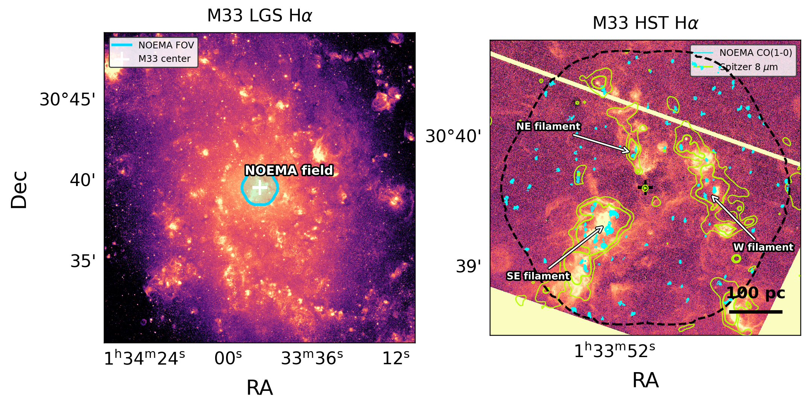

$\newcommand{\ensuremath}{}$
$\newcommand{\xspace}{}$
$\newcommand{\object}[1]{\texttt{#1}}$
$\newcommand{\farcs}{{.}''}$
$\newcommand{\farcm}{{.}'}$
$\newcommand{\arcsec}{''}$
$\newcommand{\arcmin}{'}$
$\newcommand{\ion}[2]{#1#2}$
$\newcommand{\textsc}[1]{\textrm{#1}}$
$\newcommand{\hl}[1]{\textrm{#1}}$
$\newcommand{\footnote}[1]{}$
$\newcommand{\vdag}{(v)^\dagger}$
$\newcommand\aastex{AAS\TeX}$
$\newcommand\latex{La\TeX}$
$\newcommand{\kms}{\ensuremath{\mathrm{km s^{-1}}}}$
$\newcommand{\co}{\rm^{12}CO(1--0) }$
$\newcommand{\thefigure}{A\arabic{figure}}$
$\newcommand{\theHfigure}{A\arabic{figure}}$
$\newcommand{\thefigure}{B\arabic{figure}}$
$\newcommand{\theHfigure}{B\arabic{figure}}$
$\newcommand{\thefigure}{C\arabic{figure}}$
$\newcommand{\theHfigure}{C\arabic{figure}}$
$\newcommand{\thetable}{D\arabic{table}}$
$\newcommand{\theHtable}{D\arabic{table}}$

# NOEMA Observations of the Center of M33: A Parsec-scale Molecular Filament and an Ordered Gas--Star-Formation Sequence

<mark>Appeared on: 2026-10-27</mark> -  _11 figures, 1 table. Accepted for publication in The Astronomical Journal_

Z. Li, et al. -- incl., <mark>S. Jiao</mark>

**Abstract:** We present NOEMA CO(1--0) observations of the inner $\sim$ 500 pc of M33 at a resolution of $0.91"\times0.37"$ ( $3.7\times1.5$ pc), resolving the compact molecular gas structures and revealing their relation to recent massive star formation. The most prominent structure is a southeastern molecular filament (SE filament) that extends 76 pc along its principal axis, is 23 pc wide, and contains three CO-bright knots. Across eight independent transverse cuts, the adjacent H $\alpha$ ridge is displaced preferentially to one side of the principal CO ridge by a median $\(10.0^{+0.9}_{-1.4}\)$ pc. Young OB candidates are more closely associated with H $\alpha$ than with compact CO. The filament shows little velocity change along its length but a resolved gradient across its minor axis.Its elongated morphology, transverse kinematics, and ordered CO--H $\alpha$ distribution are consistent with locally asymmetric molecular-gas compression and subsequent massive star formation. Across the wider field, 23 well-measured compact clumps have a median radius of 2.67 pc and a median velocity dispersion of 2.15 $\kms$ . Their linewidth and apparent virial-parameter distributions show no clear difference between the SE filament and the rest of the field. Although the local spiral potential and pattern speed remain unconstrained, the observations provide a resolved view of a compression-compatible molecular-to-ionized-gas sequence in the center of M33.

**Figure 4. -** _Left:_ NOEMA CO(1--0) integrated intensity with HST H$\alpha$ contours (cyan). The yellow rectangle marks the region enlarged in the right panel. The cross marks the adopted M33 center, and the curved yellow arrow shows the projected clockwise disk rotation \citep{2018MNRAS.479.2505K}. The semi-transparent blue dashed curve is a schematic inner-arm guide through the southeastern multi-tracer ridge, not a fitted or previously cataloged spiral-arm locus. _Right:_ Enlarged view of the SE filament. Colors show CO(1--0), green contours show H$\alpha$, and blue circles mark young OB candidates from PHATTER \citep{2021ApJS..253...53W}. Circle size scales with F475W brightness. The curved yellow arrow indicates the projected disk rotation, the blue dashed outline marks the filament corridor used in the analysis, and the short gray dashed lines show the accepted transverse cuts. The three bright knots S1--S3 are marked with crosses. L9, L12, and L16 label neighboring SoFiA structures; L12 and L9 are discussed in Appendix \ref{append:spectra}, while L16 is excluded based on its distinct morphology.
     (*fig:offset*)

**Figure 2. -** NOEMA CO(1--0) moment maps derived within the SoFiA mask. From left to right, the panels show integrated intensity (m0), intensity-weighted velocity (m1), and velocity dispersion (m2). In the left panel, the black cross marks the adopted M33 center; the solid and dashed black lines show the projected disk major axis (PA \(=23^\circ\) east of north) and minor axis, respectively. The schematic axis of the proposed central stellar bar (PA $\sim 114^\circ$; \citealp{2023ApJ...957....3S}) is approximately aligned in projection with M33's disk minor axis (PA $\sim 113^\circ$).
    Blue contours in the left panel show the Nobeyama CO(1--0) integrated intensity at \(3\sigma\), \(5\sigma\), and \(8\sigma\), where \(\sigma=0.74 {\rm K km s^{-1}}\); the Nobeyama resolution is 19.3$\arcsec$. The Spitzer 8 $\mu$m contours are the same as those in Figure \ref{fig:fov}. The black ellipse at the lower left shows the NOEMA synthesized beam. The dashed green ellipse outlines the SE filament analyzed in Sections \ref{subsec:offset} and \ref{subsec:filkin}. (*fig:moments*)

**Figure 1. -** Global context and local morphology of the central NOEMA
    field. Left: Local Group Galaxy Survey H$\alpha$ image of M33
    \citep{2006AJ....131.2478M,2007AJ....134.2474M}. The cyan outline marks the NOEMA field, and the cross marks the adopted M33 center.
    Right: continuum-subtracted HST H$\alpha$ image of the NOEMA field. Cyan contours show NOEMA CO(1--0) integrated intensity with levels \(0.04, 0.07, 0.12, 0.20, 0.32 {\rm Jy beam^{-1} km s^{-1}}\), yellow contours show Spitzer/IRAC 8 $\mu$m emission at \(7.4\) and \(11.1 {\rm MJy sr^{-1}}\)\citep{2009ApJ...703..517D}, and the black dashed curve marks the NOEMA footprint. The arrows indicate three prominent filamentary ridges, identified by their projected locations as the southeastern (SE), northeastern (NE), and western (W) filaments; the SE filament is the structure analyzed in detail in this work.
     (*fig:fov*)

