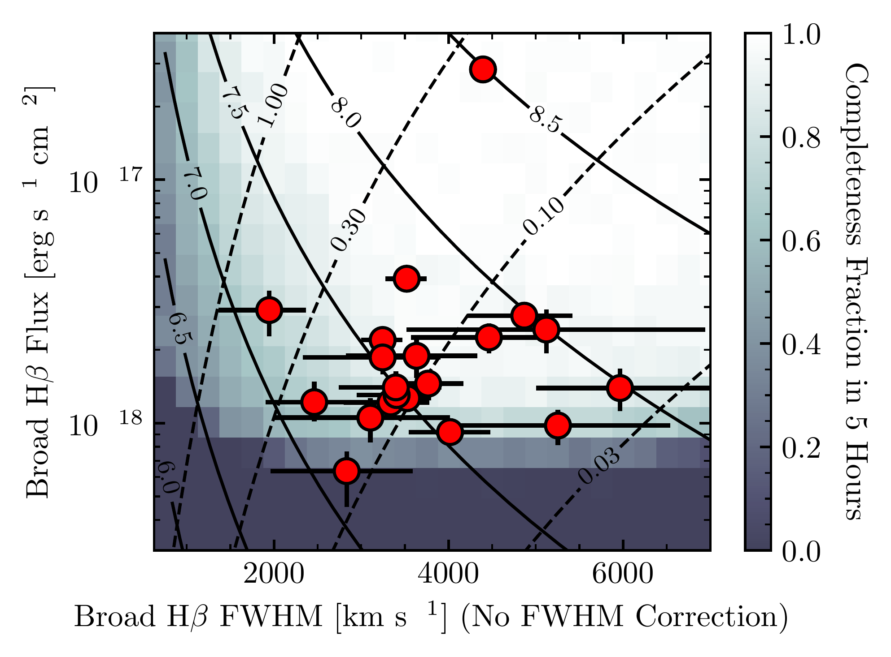
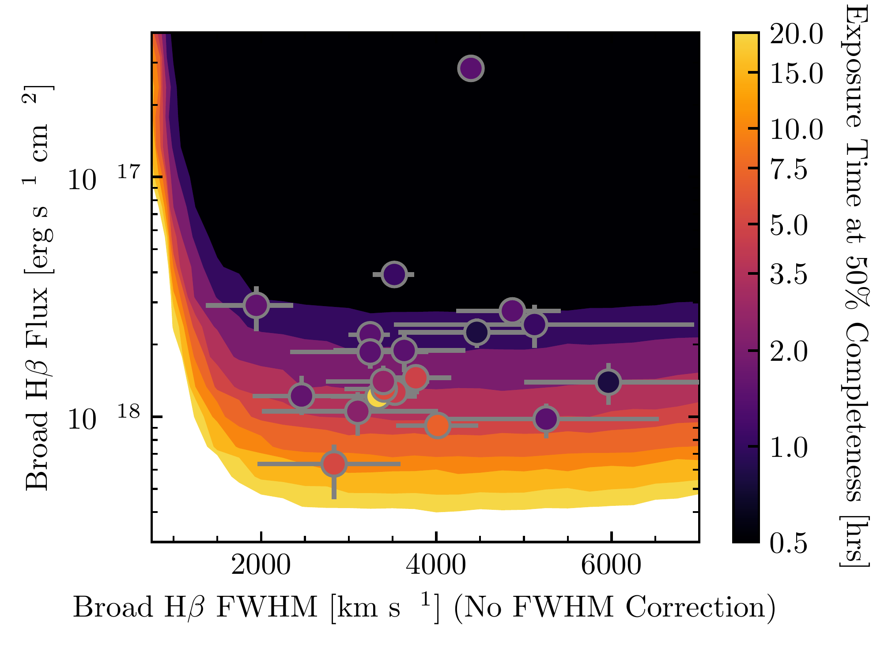
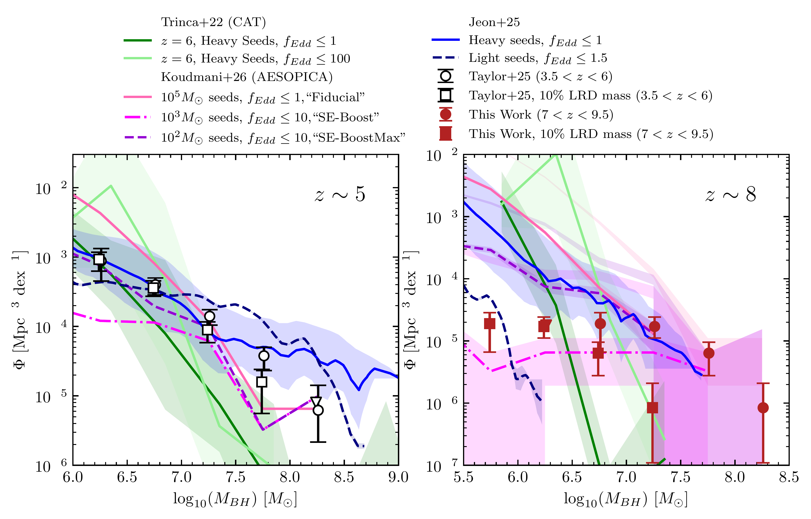
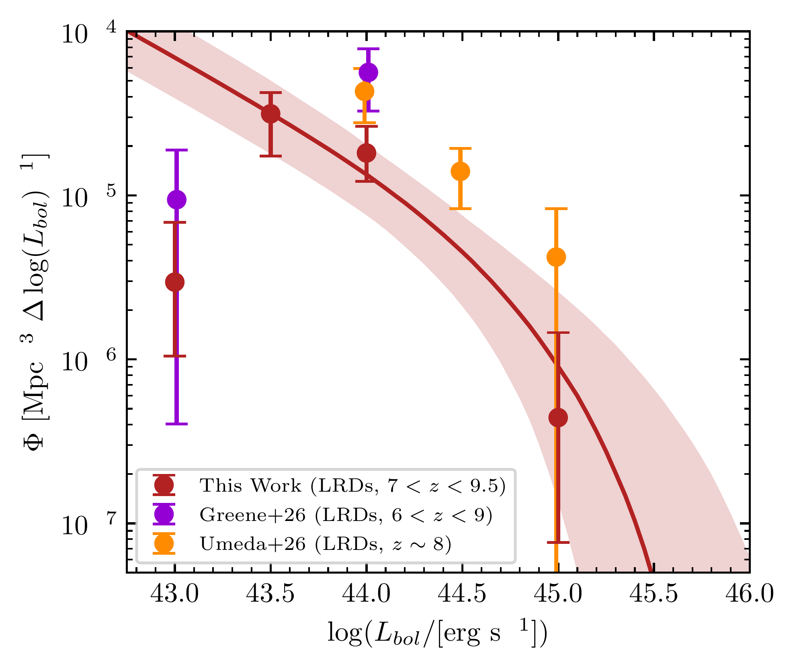
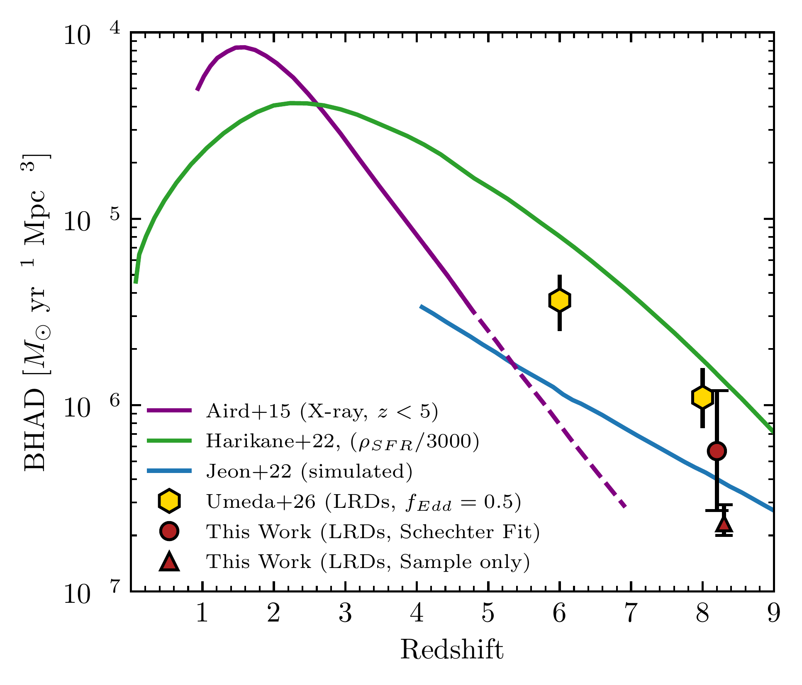

$\newcommand{\ensuremath}{}$
$\newcommand{\xspace}{}$
$\newcommand{\object}[1]{\texttt{#1}}$
$\newcommand{\farcs}{{.}''}$
$\newcommand{\farcm}{{.}'}$
$\newcommand{\arcsec}{''}$
$\newcommand{\arcmin}{'}$
$\newcommand{\ion}[2]{#1#2}$
$\newcommand{\textsc}[1]{\textrm{#1}}$
$\newcommand{\hl}[1]{\textrm{#1}}$
$\newcommand{\footnote}[1]{}$
$\newcommand\latex{La\TeX}$
$\newcommand{\per}{\ensuremath{^{-1}}}$
$\newcommand{\persq}{\ensuremath{^{-2}}}$
$\newcommand{\Ha}{H\ensuremath{\alpha}}$
$\newcommand{\Hb}{H\ensuremath{\beta}}$
$\newcommand{\mbh}{\ensuremath{M_{\textrm{BH}}}}$
$\newcommand{\betauv}{\ensuremath{\beta_{\textrm{UV}}}}$
$\newcommand{\betaopt}{\ensuremath{\beta_{\textrm{opt}}}}$
$\newcommand{\red}[1]{\textcolor{red}{#1}}$
$\newcommand{\jwst}{\textit{JWST}}$
$\newcommand{\bhmf}{black hole mass function}$
$\newcommand{\lbol}{\ensuremath{L_{\textrm{bol}}}}$

# Little Red Dots with Broad H$\beta$ Lines Reveal the Black Hole Mass Function at $7<z<9.5$

<mark>Appeared on: 2026-10-29</mark> -  _24 pages, 9 figures, 6 tables. Submitted to ApJ_

A. J. Taylor, et al. -- incl., <mark>F. Walter</mark>

**Abstract:** We present a systematic search for broad $\Hb$ emission at $7<z<9.5$ in 21,770 $\jwst$ /NIRSpec PRISM spectra drawn from four blank fields and six lensing clusters with photometry spanning 1942 arcmin $^2$ . We find a sample of 20 sources with statistically significant broad- $\Hb$ emission, including 13 new sources. Our entire sample has colors and morphologies consistent with little red dots (LRDs), compared to only 37 \% of broad-line emitters at $3.5<z<6$ . Interpreting the broad-lines as indicators of Broad-line Active Galactic Nuclei (BLAGN), we infer black hole masses of $4.2\times10^{6}-2.1\times10^{8}$ $M_{\odot}$ . We calculate completeness corrections and construct the $\bhmf$ at $z\sim8$ . The normalization of the $\bhmf$ rises by $\approx1.0$ dex from $z\sim8-5$ , consistent with average black hole growth at $f_{\textrm{Edd}}\approx0.1$ . Comparing with cosmological simulations, the $z\sim8$ $\bhmf$ requires heavy ( $10^5$ $M_{\odot}$ ) seeds or super-Eddington accretion onto light or intermediate mass seeds to match its normalization.  Finally, we infer bolometric luminosities for the sample and construct a bolometric luminosity function. We integrate over this luminosity function to derive a black hole accretion density (BHAD) of $4.8^{+5.8}_{-2.6}\times10^{-7} M_{\odot} \textrm{yr}^{-1} \textrm{Mpc}^{-3}$ , showing broad agreement with previous photometric work, but disagreement with previous X-ray models, reinforcing the idea that BLAGN are more common in the early universe than previously expected.

**Figure 1. -** _Upper Panel_: Completeness (colored shading) for a five hour PRISM exposure as a function of broad-$\Hb$  flux and broad-$\Hb$  FWHM at $z=8.5$. Solid overplotted lines are contours of logarithmic black hole mass (in solar masses) \citep[as computed with][]{greene05}, and dashed overplotted lines are contours of Eddington ratio (assuming unattenuated Case B recombination [$\Ha$ /$\Hb$$=2.86$] and a 130$\times$ bolometric correction from $\Ha$  flux to bolometric luminosity). Our sample is highly detection complete above $10^{7.5}$$M_{\odot}$, and is consistent with Eddington ratios $\leq1$. _Lower panel_: Contours of exposure time corresponding to 50\% completeness in broad-$\Hb$  flux and broad-$\Hb$  FWHM space at $z=8.5$. Here, both contours and colored points (the BLAGN sample) are colored by exposure time. Points that are a darker shade than their overlapping contours are objects with significantly lower completeness, while objects with lighter shades than overlapping contours are highly complete. As expected, increased exposure times offer sensitivity to fainter line fluxes, and have little to no effect on FWHM sensitivity. (*fig:detcompleteness*)

**Figure 9. -** This work's observed $\bhmf$ s compared to literature models from [Trinca, et. al (2022)](https://ui.adsabs.harvard.edu/abs/2022MNRAS.511..616T), [Jeon, et. al (2025)](https://ui.adsabs.harvard.edu/abs/2025ApJ...988..110J), and [Koudmani, et. al (2026)](https://ui.adsabs.harvard.edu/abs/2026arXiv260726177K) at $z\sim5$(left panel) and $z\sim8$(right panel). Here we plot the models using $10^2$ $M_{\odot}$, $10^3$ $M_{\odot}$, and $10^5$ $M_{\odot}$ seeds from [Koudmani, et. al (2026)](https://ui.adsabs.harvard.edu/abs/2026arXiv260726177K), models from [Jeon, et. al (2025)](https://ui.adsabs.harvard.edu/abs/2025ApJ...988..110J) at $5<z<6$ and $7<z<10$ that use heavy seeds limited to Eddington accretion rates and light seeds permitted to accrete at super-Eddington rates, and models from [Trinca, et. al (2022)](https://ui.adsabs.harvard.edu/abs/2022MNRAS.511..616T) that use heavy seeds with both an Eddington limited model, and a super-Eddington-permitted model.
Eddington limited light seeds curves for all three simulations do not produce black holes with $\mbh$$>10^6 M_{\odot}$, and are thus excluded from these figures. This suggests that heavy seeding (solid curves) and/or highly super-Eddington accretion is necessary and prevalent at high redshifts to match observations, regardless of the treatment of LRD mass.  (*fig:bhmf_sim*)

**Figure 7. -** Left panel: The $L_{\textrm{bol}}$ luminosity function for the full $z\sim8$\Hb -emitter sample computed using the [Greene, et. al (2026)](https://ui.adsabs.harvard.edu/abs/2026ApJ...996..129G)$L_{\textrm{bol}}/L_{5100}$ correction, as well as recent literature results from LRDs. This luminosity function falls off rapidly at $L_{\textrm{bol}}\sim10^{45}$ erg s$\per$  and appears to extend in a power-law-like manner to lower luminosities (omitting the lowest luminosity highly incomplete data point). The red curve and shaded region shows the median and 68\% confidence interval Schechter function fit to the most luminous three data points from this work. Right panel: The BHAD as a function of redshift. We also overplot the cosmic star-formation rate density from [Harikane, et. al (2022)](https://ui.adsabs.harvard.edu/abs/2022ApJS..259...20H) re-normalized by a factor of 3000 to match the BHAD at $z\sim3$ as a point of reference. Our detected BLAGN sample produces a result that broadly agrees with a photometric LRD sample from [Umeda, et. al (2026)](https://ui.adsabs.harvard.edu/abs/2026ApJ...999..183U). This sample was initially introduced in [Akins, et. al (2025)](https://ui.adsabs.harvard.edu/abs/2025ApJ...991...37A) using non-LRD specific assumptions and was reprocessed with LRD-specific corrections by [Umeda, et. al (2026)](https://ui.adsabs.harvard.edu/abs/2026ApJ...999..183U). We find good agreement with the BHAD derived from the $M_{H,L}=10^8 M_{\odot}$ models of [Jeon, Bromm and Finkelstein (2022)](https://ui.adsabs.harvard.edu/abs/2022MNRAS.515.5568J), a simulation in which BHs are seeded and grow within atomic cooling halos. We note that our data are likely a lower limit on the true BHAD, as they do not account for obscured, non-broad-line AGN. (*fig:Lbollf*)

