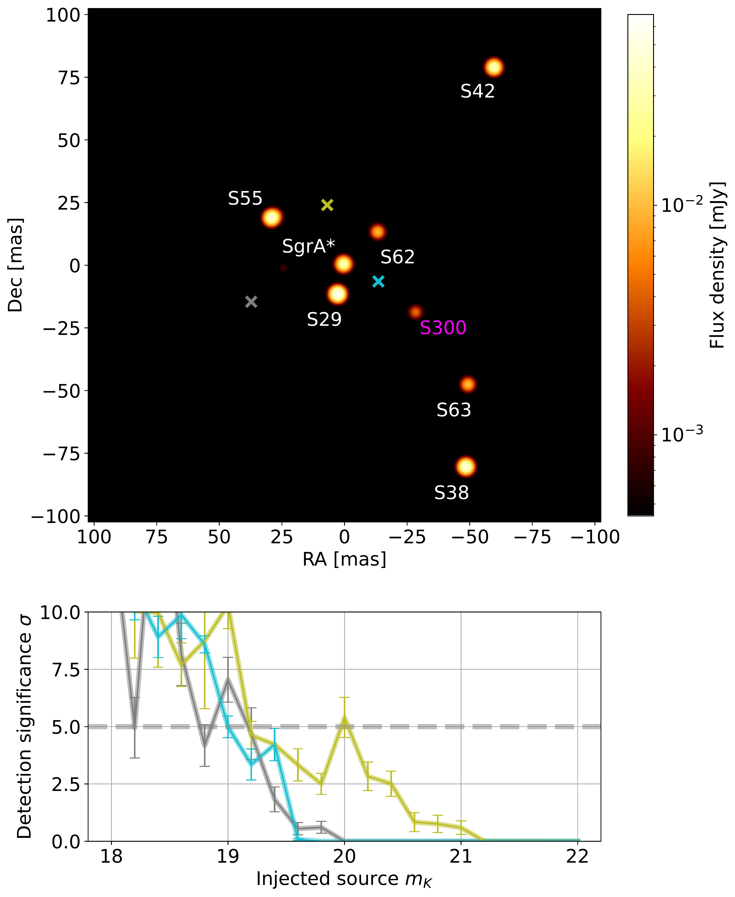
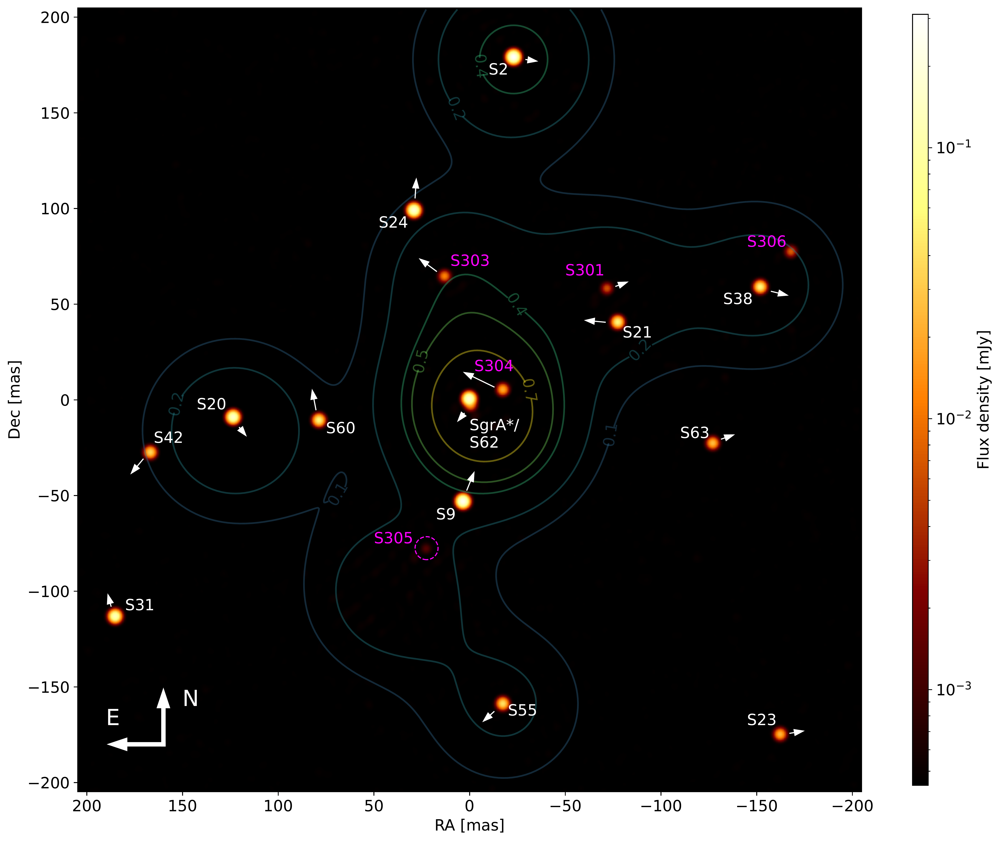

$\newcommand{\ensuremath}{}$
$\newcommand{\xspace}{}$
$\newcommand{\object}[1]{\texttt{#1}}$
$\newcommand{\farcs}{{.}''}$
$\newcommand{\farcm}{{.}'}$
$\newcommand{\arcsec}{''}$
$\newcommand{\arcmin}{'}$
$\newcommand{\ion}[2]{#1#2}$
$\newcommand{\textsc}[1]{\textrm{#1}}$
$\newcommand{\hl}[1]{\textrm{#1}}$
$\newcommand{\footnote}[1]{}$
$\newcommand{\MPE}{1}$
$\newcommand{\LIRA}{2}$
$\newcommand{\CotedAzur}{3}$
$\newcommand{\IPAG}{4}$
$\newcommand{\MPIA}{5}$
$\newcommand{\UCologne}{6}$
$\newcommand{\ESOGarching}{7}$
$\newcommand{\USouthampton}{8}$
$\newcommand{\KUL}{9}$
$\newcommand{\FEUP}{10}$
$\newcommand{\UBerkley}{11}$
$\newcommand{\TUM}{12}$
$\newcommand{\CENTRA}{13}$
$\newcommand{\UCD}{14}$
$\newcommand{\UNAM}{15}$
$\newcommand{\CRAL}{16}$
$\newcommand{\KAVLI}{17}$
$\newcommand{\ESOSantiago}{18}$
$\newcommand{\USM}{19}$
$\newcommand{\RUN}{20}$
$\newcommand{\MPA}{21}$
$\newcommand{\LMU}{22}$
$\newcommand{\GCA}{23}$
$\newcommand{\UPV}{24}$
$\newcommand{\ECO}{25}$
$\newcommand{\arraystretch}{1.5}$

# GRAVITY-RESOLVE: \\A comprehensive image reconstruction tool for \\Galactic Center observations with GRAVITY

<mark>Appeared on: 2026-10-30</mark> -  _Submitted to Astronomy & Astrophysics (A&A) on October 24, 2026_

K. A. E. Dayem, et al. -- incl., <mark>W. Brandner</mark>, <mark>P. Garcia</mark>, <mark>L. Kreidberg</mark>, <mark>J. Sauter</mark>

**Abstract:** Stars orbiting the supermassive black hole SgrA* in the Galactic Center serve to probe effects predicted by general relativity in the weak field regime. One of the effects, the Lense-Thirring precession, is a result of the black hole's angular momentum (spin), and observations of this precession could potentially constrain the spin. The precession's steep drop-off with distance makes the spin hard to measure, and until recently, no star has been found, within currently accessible magnitudes, with an orbit tight and eccentric enough to be sensitive to this effect. It is therefore interesting to increase the limiting magnitude to find faint yet undiscovered stars. We aim to improve and extend the imaging capabilities of the GRAVITY beam combiner instrument of ESO's VLTI with respect to reconstruction software in the Galactic Center. We revise and develop the image reconstruction code GRAVITY-RESOLVE $\text{G}^{\text{R}}$ , which has been specifically developed to reconstruct stars in the Galactic Center with GRAVITY. The main objectives are to increase the limiting magnitude in GRAVITY images, reduce its computational runtime, and allow for a joint reconstruction of multiple, spatially separate datasets/pointings on sky. We present a comprehensively revised model of the Galactic Center, including a time-dependent model of the flux density of SgrA*, which invokes its measured temporal power spectrum. We enable the image reconstruction of complex visibilities, allowing us to make use of GRAVITY's full potential, reducing noise in images and referencing multiple pointings to each other. This opens the door to mosaicking in near-infrared (NIR) interferometry. The code is restructured to resemble the model's internal hierarchy, allowing for an easy swap of the underlying object model to apply it to other scientific cases. We apply $\text{G}^{\text{R}}$ to recent GRAVITY data, featuring the implemented GRAVITY-faint mode as part of GRAVITY+, the upgrade of GRAVITY. We reconstruct visibility phases and amplitudes and present the first GRAVITY image reconstructed with $\text{G}^{\text{R}}$ from these quantities. We demonstrate NIR mosaicking with $\text{G}^{\text{R}}$ by jointly reconstructing nine separately acquired datasets of 2025 into a single image on a scale of $\simeq\SI{3390}{AU}\times\SI{3390}{AU}$ , corresponding to $\SI{409.6}{mas}\times\SI{409.6}{mas}$ . With dedicated injection tests of point sources into GRAVITY data, we estimate the limiting magnitude to be $m_{\text{K}} \simeq 20.0$ within a radius of $\SI{25}{mas}$ around the field center when reconstructing from closure phases and visibility amplitudes. We report on the discovery of two new faint stars in the Galactic Center: S303 and S304. Finally, we find a decrease in computational runtime by a factor of at least $\sim10$ . With $\text{G}^{\text{R}}$ , we demonstrate GRAVITY's capabilities for NIR imaging. We show that $\text{G}^{\text{R}}$ is a fast, precise, and deep image reconstruction tool for Galactic Center observations, enabling the discovery of even more faint stars.

**Figure 2. -** Performance test of $\text{G}^{\text{R}}$ on conventional GRAVITY data.\\_Upper panel:_ Mean image from 10 reconstructions of the GRAVITY dataset for 29 May 2021. The faint star S300, first discovered in 2022, is routinely inferred in nine out of 10 reconstructions with high significance and in one reconstruction with low significance.\ _Lower panel:_ Detection significance of artificially injected sources for three different positions (turquoise, yellow, grey crosses) injected in the object model of the upper image, plotted against the K-band magnitude of the respective injected source. $\text{G}^{\text{R}}$ is able to recover sources up to $m_{\text{K}}=\SI{20.0} $. See subsection \ref{subsection_performance_test} for details. Statistical errors on the detection significance are derived from jackknife resampling. (*fig_injection_map*)

**Figure 9. -** Conceptual overview of the mosaic forward model implemented in $\text{G}^{\text{R}}$. An instance of the object model $\mathcal{S}^{*}$ is shifted to match the center of the respective pointing $\boldsymbol{\sigma}_{n}$ and the instrument response of GRAVITY is applied to it. The likelihood is computed for the response of each pointing, and the corresponding likelihoods are subsequently summed. For details, see subsection \ref{subsection_mosaicing}. (*fig_Mosaic_model*)

**Figure 10. -** First interferometric mosaic in the NIR, reconstructed with $\text{G}^{\text{R}}$ from 88 GRAVITY+ exposures of the Galactic Center, acquired in August 2025 (Tab. \ref{tab_mosaic_dataset}). In this mosaic, nine spatially separated datasets have been reconstructed jointly into a single image at a scale of $\SI{409.6}{mas}\times\SI{409.6}{mas}$, or $\simeq\SI{3390}{AU}\times\SI{3390}{AU}$ with a resolution of $\SI{0.8}{mas}$ per pixel. We explicitly modeled all white-labeled stars with a parameterized model, while the magenta-labeled stars have been inferred by a non-parameterized model. These sources are faint, yet undiscovered stars in the Galactic Center (except for S301), of which S303 and S304 could be found consistently across multiple observing seasons. S305 and S306 are currently being followed up on. The white arrows indicate the relative proper motions of the stars in the field of view. The contours depict the theoretical relative sensitivity within the image representing the throughput profile of GRAVITY's single-mode fibers weighted with the square root of the number of used exposures for the respective pointing. (*fig_Mosaic*)

