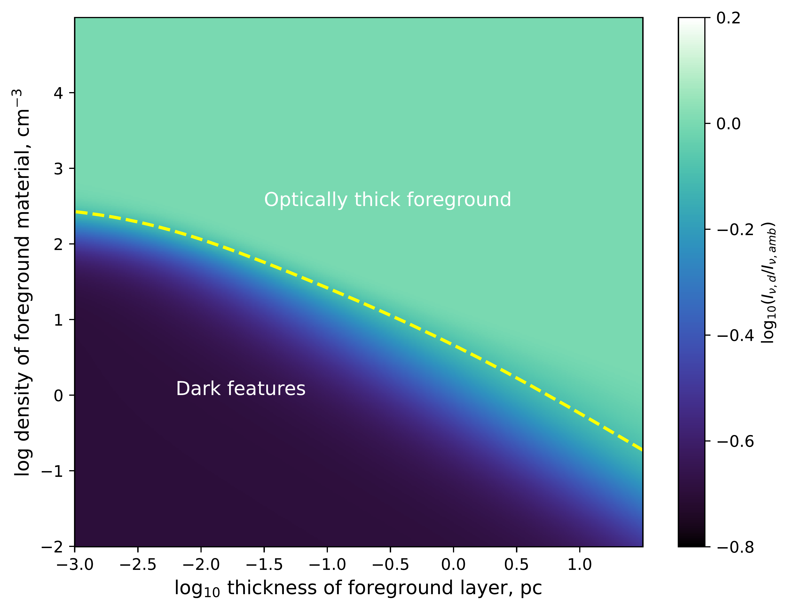
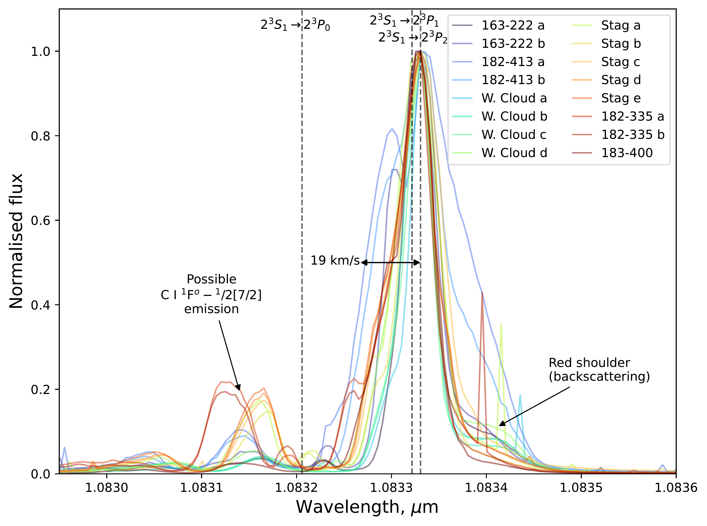

$\newcommand{\ensuremath}{}$
$\newcommand{\xspace}{}$
$\newcommand{\object}[1]{\texttt{#1}}$
$\newcommand{\farcs}{{.}''}$
$\newcommand{\farcm}{{.}'}$
$\newcommand{\arcsec}{''}$
$\newcommand{\arcmin}{'}$
$\newcommand{\ion}[2]{#1#2}$
$\newcommand{\textsc}[1]{\textrm{#1}}$
$\newcommand{\hl}[1]{\textrm{#1}}$
$\newcommand{\footnote}[1]{}$
$\newcommand{\HII}{\mbox{H {\footnotesize II}}}$
$\newcommand{\thebibliography}{\DeclareRobustCommand{\VAN}[3]{##3}\VANthebibliography}$

# A VLT/CRIRES+ study of helium 1.083$\mu$m absorption features towards the inner Orion Nebula 

<mark>Appeared on: 2026-11-03</mark> -  _Accepted for publication in MNRAS_

T. J. Haworth, et al. -- incl., <mark>M. McCaughrean</mark>

**Abstract:** JWST NIRCam F115W observations towards the inner Orion Nebula revealed a diverse array of previously unknown dark features. The most likely cause was absorption or suppressed emission of the helium 1.083 $\mu$ m triplet which lies in that filter. We have obtained VLT/CRIRES+ high-resolution spectrographic observations over a selection of different dark targets, confirming that the features are indeed explained by a reduction in the flux of the helium 1.083 $\mu$ m triplet, a reduction that is fairly uniform across the line. The Orion Nebula is a blister H ii region, with a dense, bright ionised layer on the far side from the observer near the Orion A molecular cloud and lower density gas elsewhere. Using a simple radiative transfer model, we show that dark features arise when emission from the dense layer is absorbed by intermediate density helium (e.g. in clumps, globules, or winds from objects like proplyds) on the near side of the dense layer.

**Figure 11. -** Normalised CRIRES+ spectra integrated along the slit for one pointing towards each of our seven targets. The blue dotted line is the full spectrum, while the orange solid line is the CRIRES+ spectrum multiplied by the throughput of the F115W filter (green dashed line). The insets show an expanded view of the [S iii] and He i triplet lines. The inset image shows the target and slit orientation. The full set of integrated spectra along the slit for all pointings is shown in Appendix \ref{sec:allFullSpectra}.  (*fig:fullSpectrumAll*)

**Figure 6. -** The ratio of the emergent intensity from a LOS intersecting a 1000 au thick region with a density of $10^3$ cm$^{-3}$ to that from the ambient medium as a function of the density and thickness of the foreground layer. There are two regimes: one in which the foreground medium is optically thick and one in which the bright background is attenuated by the overdensity. The dashed line denotes the transition between the  two regimes.  (*fig:RTSolResults*)

**Figure 2. -** {The helium triplet line profile for all slits across our main targets, excluding HH 510. Each spectrum has been aligned such that the peak is at the $2^3S_1\rightarrow2^3P_2$ transition. The three vertical dashed lines show the vacuum rest frame wavelengths of the helium triplet. In all cases, there is a red shoulder due to back scattering. In 182-335, there is a hint of emission from the `near ionised layer' (NIL; see main text) offset by around 15--20 km s$^{-1}$ (see the 19 km s$^{-1}$ scale bar), but this is generally not the case. The smaller feature offset by about 0.2 nm ($2\times10^{-4} \mu$m) from the peak is possibly attributed to the CI $^1{\rm F}^0-1/2[7/2]$ transition emitted from the background PDR and is unlikely to be telluric as the offset from the main helium feature is independent of the barycentric correction.} (*fig:detailedLook*)

