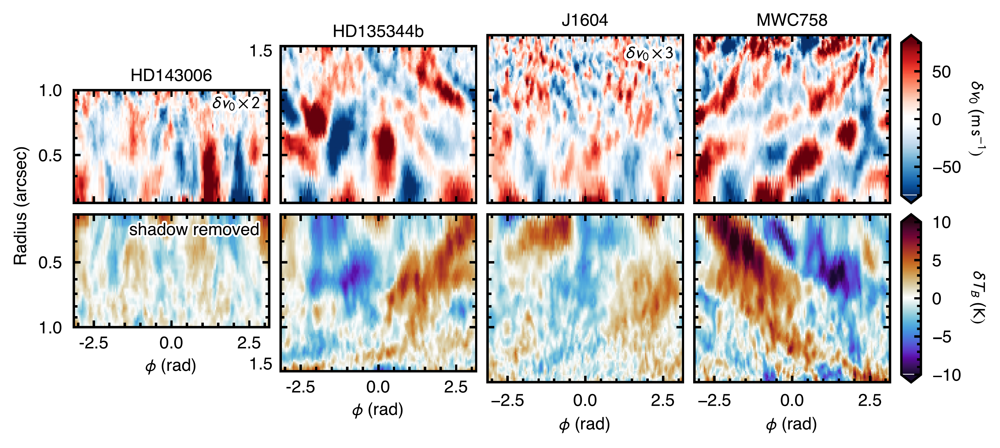
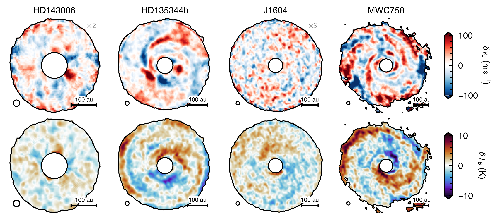
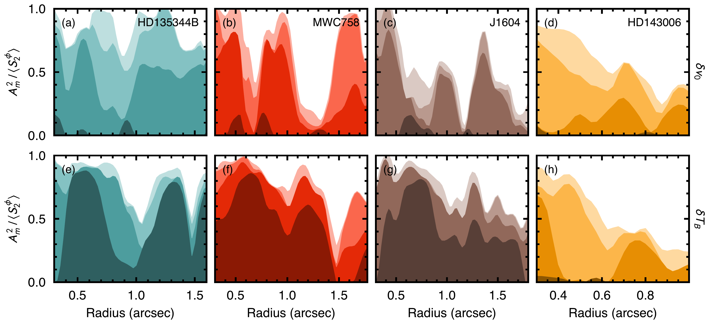

$\newcommand{\ensuremath}{}$
$\newcommand{\xspace}{}$
$\newcommand{\object}[1]{\texttt{#1}}$
$\newcommand{\farcs}{{.}''}$
$\newcommand{\farcm}{{.}'}$
$\newcommand{\arcsec}{''}$
$\newcommand{\arcmin}{'}$
$\newcommand{\ion}[2]{#1#2}$
$\newcommand{\textsc}[1]{\textrm{#1}}$
$\newcommand{\hl}[1]{\textrm{#1}}$
$\newcommand{\footnote}[1]{}$
$\newcommand{\arraystretch}{1.1}$

# exoALMA XXV: A Statistical Analysis of Gaseous Substructure in Low-Inclination Disks

<mark>Appeared on: 2026-11-03</mark> -  _Accepted to exoALMA ApJL Focus Issue_

R. Teague, et al. -- incl., <mark>M. Benisty</mark>, <mark>M. Flock</mark>

**Abstract:** Protoplanetary disks exhibit complex structure in both their gas dynamics and their temperature. Characterizing it has proven challenging, owing to the mismatch between the observed complexity and the relatively simple semi-analytical models typically used to interpret it. To augment these analyses, we apply the second-order structure function to the velocity and temperature perturbations of four low-inclination sources from the exoALMA program, each measured against a noise-only null built from the data themselves. All exhibit correlated structure. Its radial correlation length is limited by the beam in every case, which excludes non-axisymmetric structure on radial scales larger than ${\sim}1.5$ pressure scale heights. In three of the four disks the structure is instead resolved and elongated in azimuth, by factors of $1.6$ -- $2.3$ , as expected of small-scale perturbations sheared out by Keplerian rotation. We further introduce two statistics that characterize spiral structure without tracing an arm crest: a $*modal power*$ spectrum, measuring the periodicity of the azimuthal structure, and a $*winding contrast*$ , measuring the radial dependence of its phase. The velocity residuals of three disks are significantly wound. MWC 758 is the only source in which the winding is coherent across the disk and shared by the temperature field. Its trailing $m=1$ temperature structure is consistent with the illumination of a warp, while its velocity field carries small-scale, sheared structure that could redistribute angular momentum. Because neither statistic requires a crest, both extend a quantitative description of winding to the flocculent regime, where a spiral cannot be parameterized.

**Figure 5. -** Velocity (top) and temperature (bottom) residuals for the four disks shown in a polar projection. Note that the bottom row is flipped upside down. The inner radius for all panels is $0$\farcs$3$, twice the beam major axis and the radial axis is shown in log-space to highlight logarithmic spiral structure. The velocity residuals for HD 143006 and J1604 have been inflated by a factor of two and three, respectively, to make them visible with this color scale. (*fig:polar_residuals*)

**Figure 4. -** The on-sky projection of the velocity residuals (top) and peak brightness temperature residuals (bottom) for the four sources. The black circle in the lower left shows the $0$\farcs$15$ CLEAN beam and the scale bar in the lower right shows 100 au. Note that for HD 143006 and J1604, the velocity residuals have been inflated by a factor of two and three, respectively, such that they are visible, while additionally HD 143006 has had its shadow removed in the peak brightness temperature residual. All maps are masked where the peak brightness temperature drops below 7 K. All four disks rotate clockwise on the sky bar HD 135344B, which rotates counter-clockwise \citep[][see Table \ref{tab:sources}]{Izquierdo_ea_2025}. (*fig:onsky_residuals*)

**Figure 6. -** Modal power as a function of radius for each source and both channels. The y-axis shows the fraction of the total azimuthal variance at a given radius that can be accounted for by $m = 1 - 4$ modes. Darker swathes represent lower-order terms. The top row shows the velocity residual channel, while the bottom shows the peak intensity channel. $m=1$ modes appear to be more prevalent in the intensity channel than the velocity as the $m=1$ modes were subtracted as part of the background model as described in Section \ref{sec:substructures:velocity}. (*fig:modal_power_radial*)

