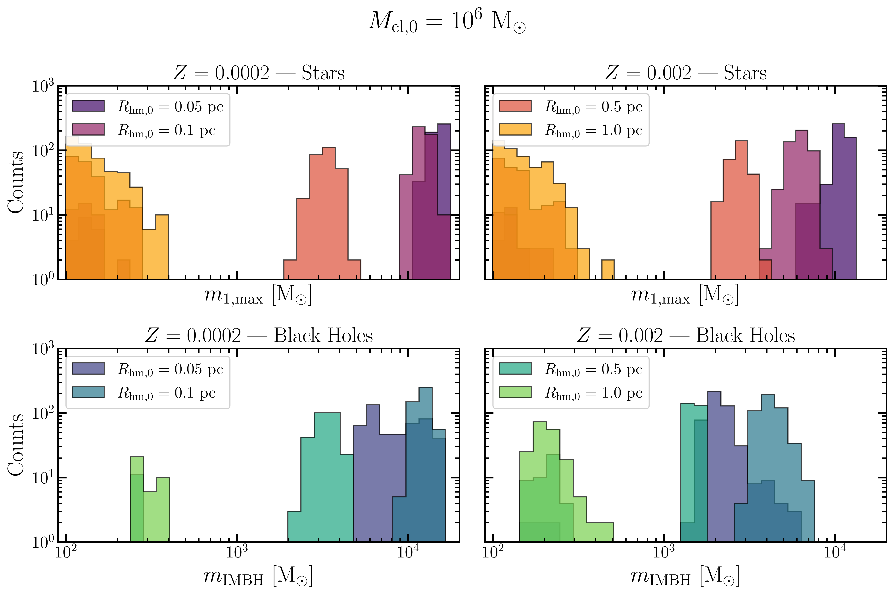
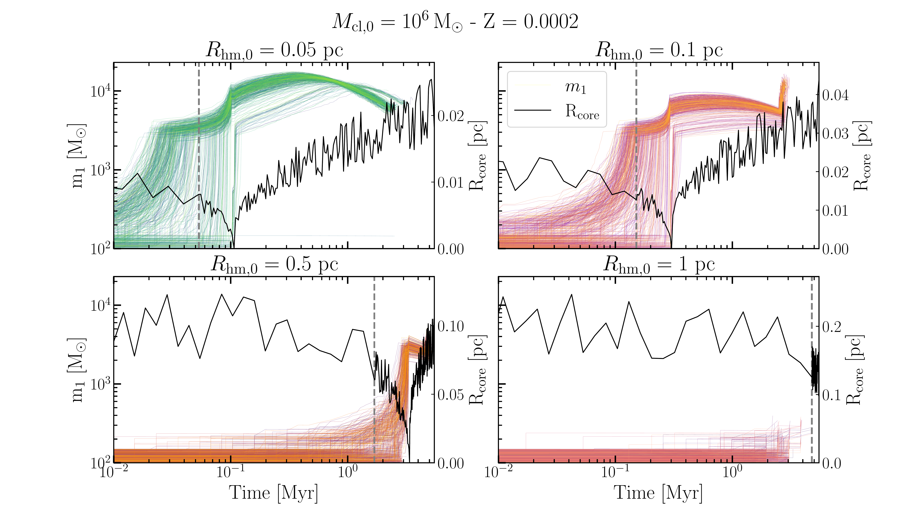
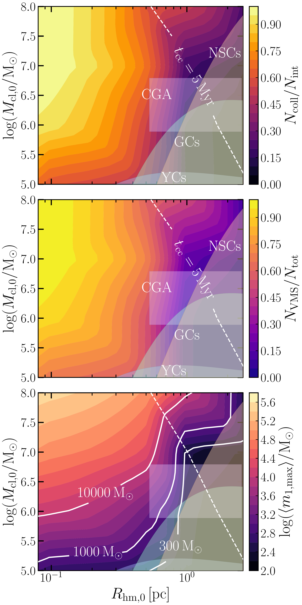

$\newcommand{\ensuremath}{}$
$\newcommand{\xspace}{}$
$\newcommand{\object}[1]{\texttt{#1}}$
$\newcommand{\farcs}{{.}''}$
$\newcommand{\farcm}{{.}'}$
$\newcommand{\arcsec}{''}$
$\newcommand{\arcmin}{'}$
$\newcommand{\ion}[2]{#1#2}$
$\newcommand{\textsc}[1]{\textrm{#1}}$
$\newcommand{\hl}[1]{\textrm{#1}}$
$\newcommand{\footnote}[1]{}$
$\newcommand{\Ms}{{\rm M}_\odot}$
$\newcommand{\kms}{{\rm ~km}~{\rm s}^{-1}}$
$\newcommand{\df}{{\rm df}}$
$\newcommand{\bh}{{\rm BH}}$
$\newcommand{\ns}{{\rm NS}}$
$\newcommand{\co}{{\rm CO}}$
$\newcommand{\gws}{{\rm GW190814}}$
$\newcommand{\yrgpc}{{\rm ~yr}^{-1}{\rm ~Gpc}^{-3}}$
$\newcommand{\lvk}{{\rm LVC}}$
$\newcommand{\gw}{{\rm GW}}$
$\newcommand{\mer}{{\rm mer}}$
$\newcommand{\der}{{\rm d}}$
$\newcommand{\smbh}{{\rm SMBH}}$
$\newcommand{\imbh}{{\rm IMBH}}$
$\newcommand{\ARGdf}{\texttt{ARGdf}}$
$\newcommand{\archain}{\texttt{ARCHAIN}}$
$\newcommand{\himri}{{\rm HIMRI}}$
$\newcommand{\hor}{{\rm hor}}$
$\newcommand{\snr}{{\rm S/N}}$
$\newcommand{\obs}{{\rm obs}}$
$\newcommand{\gc}{{\rm GC}}$
$\newcommand{\Log}{{\rm Log}}$
$\newcommand{\inn}{{\rm in}}$
$\newcommand{\out}{{\rm out}}$
$\newcommand{\as}[1]{\textcolor{red}{\it{\textbf{[AS: #1]}}} }$
$\newcommand{\fil}[1]{\textcolor{green}{[Filippo: #1]}}$
$\newcommand{\sevn}{\textsc{sevn}}$
$\newcommand{\starfall}{\texttt{STARfall}}$
$\newcommand{\ham}{{\rm HM}}$
$\newcommand{\dragon}{\textsc{Dragon-II}}$
$\newcommand{\bpop}{\texttt{B-POP}}$
$\newcommand{\arraystretch}{1.6}$
$\newcommand{\arraystretch}{1.0}$
$\newcommand{\arraystretch}{1.9}$
$\newcommand{\arraystretch}{1.9}$

# The STARfall pathway: forging intermediate-mass black holes through stellar collisions in dense star clusters

<mark>Appeared on: 2026-11-04</mark> -  _22 pages, 15 figures, 3 tables_

F. Simonato, et al. -- incl., <mark>S. Torniamenti</mark>

**Abstract:** Intermediate-mass black holes (IMBHs, $10^2 < m_{\rm BH}/\text{M}_{\odot} < 10^5$ ) are elusive objects falling between stellar-mass and supermassive black holes, whose origin is still highly uncertain. These objects may possibly form from the collapse of very massive stars (VMSs, $m_*\geq 150 \Ms$ ) assembled through stellar collisions in compact and fast evolving star clusters. We investigate the formation of VMSs and IMBH seeds via repeated mergers and collisions as a function of cluster initial conditions, assessing the implications for globular clusters and dense high-redshift systems. We develop $\starfall$ , a semi-analytic tool that follows the evolution of a massive stellar binary via binary-single interactions, mergers, collisions, and stellar evolution, while consistently accounting for the host cluster evolution. Our results suggest that clusters with central densities $> 10^6 \Ms \text{pc}^{-3}$ undergo a catastrophic series of stellar collisions, or "starastrophe", on timescales $< 3$ Myr. Through this process, VMSs rapidly grow in mass and eventually collapse into IMBHs with masses of up to $10^3$ – $10^4 \Ms$ , despite the effects of intense stellar winds. Applying our results to the compact stellar clusters observed in the Cosmic Gems Arc, we find that these environments could promote the formation of IMBHs within this mass range. Similarly, our models suggest that some Milky Way globular clusters may have hosted IMBH seeds with comparable natal masses. Finally, applying our framework to Little Red Dots, we find that, despite their longer core-collapse timescales, their inferred core densities can still support the formation of IMBHs in the same mass interval. Our models show that VMS assembly requires two essential ingredients: short core-collapse times and large central densities. In the explored density range, $> 10^6 \Ms \text{pc}^{-3}$ , VMSs attain masses up to $10^3-10^5 \Ms$ . Compared to observed systems, our model suggest that clusters in the Cosmic Gems Arcs and several Galactic globular clusters could have nurtured VMSs that directly collapsed to IMBHs with masses $10^3-10^4 \Ms$ .

**Figure 9. -** Stellar mass distribution (upper panels) and IMBH mass distribution (lower panels) for clusters with mass $M_{\rm cl,0} = 10^6 $\Ms$$ and half-mass radius $R_{\rm hm,0}$ in the range $0.05$–$1$ pc. The left (right) panels correspond to metallicity $Z = 0.0002$($Z = 0.002$). (*fig:histo_vms_imbh*)

**Figure 8. -** Mass growth of VMSs (colored lines) in clusters of $M_{\rm cl,0} = 10^6  $\Ms$$ and $R_{\rm hm,0} = 0.05, 0.1,0.5,1$ pc. Black lines represent the evolution of the cluster core radius. The vertical gray dashed lines mark the beginning of the core-collapse phase. (*fig:vms_mass_growth*)

**Figure 2. -** Contour plots in the $M_{\rm cl}$–$R_{\rm hm}$ plane at $Z = 0.002$ showing, from top to bottom: the number of collisions over the total number of interactions, $N_{\rm coll}/N_{\rm int}$; the number of VMSs with mass $m_* \geq 300 $\Ms$$ over the total number of simulated binaries, $N_{\rm VMS}/N_{\rm tot}$; the mean maximum stellar mass. In all panels, the shaded regions indicate the typical ranges of $R_{\rm hm}$ and $M_{\rm cl}$ for clusters in the Cosmic Gems Arc (CGA), young clusters (YCs) from [Messa, et. al (2026)](https://ui.adsabs.harvard.edu/abs/2026A&A...705A.173M), and globular clusters (GCs), and nuclear star clusters (NSCs) from [Paiella, et. al (2026)](https://ui.adsabs.harvard.edu/abs/2026A&A...708A.200P). The dashed line marks clusters with a core-collapse timescale $t_{\rm cc} = 5$ Myr. All cluster properties are considered at the present known age. (*fig:contour_coll_vms_growth*)

