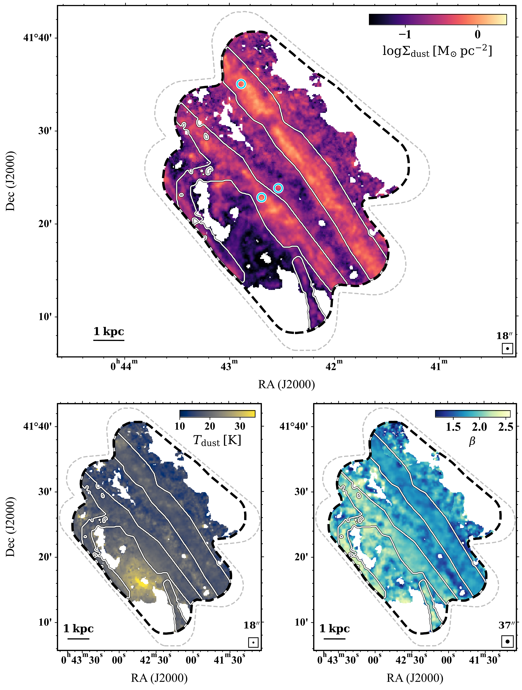
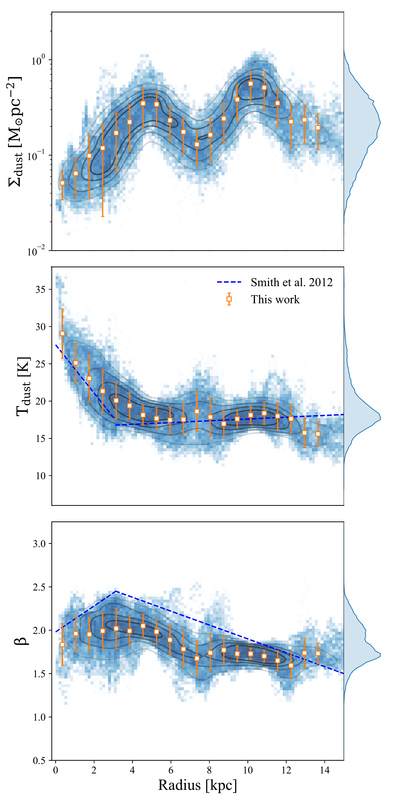
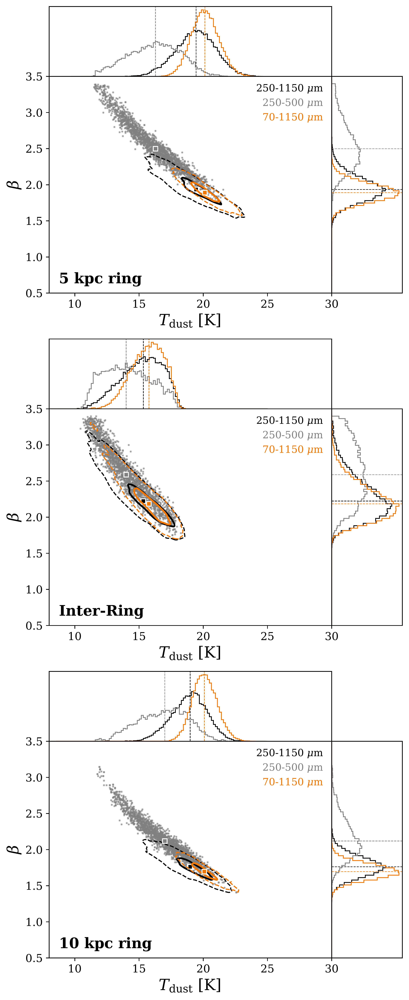

$\newcommand{\ensuremath}{}$
$\newcommand{\xspace}{}$
$\newcommand{\object}[1]{\texttt{#1}}$
$\newcommand{\farcs}{{.}''}$
$\newcommand{\farcm}{{.}'}$
$\newcommand{\arcsec}{''}$
$\newcommand{\arcmin}{'}$
$\newcommand{\ion}[2]{#1#2}$
$\newcommand{\textsc}[1]{\textrm{#1}}$
$\newcommand{\hl}[1]{\textrm{#1}}$
$\newcommand{\footnote}[1]{}$
$\newcommand{\Nthresh}{\mbox{N_{\rm threshold}}}$
$\newcommand{\ee}[1]{\mbox{  \times 10^{#1}}}$
$\newcommand{\av}{\mbox{A_{\rm V}}}$
$\newcommand{\mdense}{M_{\mbox{\scriptsize sgb}}}$
$\newcommand{\brevise}[1]{{\footnotesize \color{magenta}[HBLrevised: #1]}}$
$\newcommand{\pin}{\mathcal{PI} }$
$\newcommand{\mle}{\mathcal{MLE} }$
$\newcommand{\mae}{\mathcal{MAE} }$
$\newcommand\purple{#1 }$
$\newcommand\red{#1 }$
$\newcommand\blue{#1 }$
$\newcommand\zy{#1 }$
$\newcommand\Htwo{ H_2 }$
$\newcommand\cmt{ cm^{-3} }$
$\newcommand\Msgb{ M_{\rm sgb} }$
$\newcommand\reference{#1 }$

# Constraining Dust Properties Along the Minor Axis of Andromeda

<mark>Appeared on: 2026-11-04</mark> -  _15 pages, 12 figures. Accepted for publication in A&A_

<mark>S. Jiao</mark>, et al. -- incl., <mark>H. Beuther</mark>, <mark>K. Doi</mark>, <mark>J. d. Brok</mark>, <mark>F. Xu</mark>, <mark>S. D. Reyes-Reyes</mark>

**Abstract:** Previous studies of dust emission in M31 based primarily on $_ Herschel_$ data have reported inconsistent radial trends in the dust emissivity index ( $\beta$ ), partly due to limited wavelength coverage and the intrinsic $T_{\rm dust}$ – $\beta$ degeneracy. We aim to improve the constraints of $\beta$ determinations and obtain the spatial surface density and temperature distributions at GMC scales in M31 by extending the spectral coverage into the millimeter regime and by quantifying the impact of wavelength coverage on the $T_{\rm dust}$ – $\beta$ degeneracy. We present new IRAM 30m NIKA2 1.15 mm observations along the minor axis of M31 at an angular resolution of $11"$ , corresponding to $\sim$ 40 pc at the distance of M31.These data are used with $_ Herschel_$ and JCMT SCUBA-2 maps to perform pixel-by-pixel single-component modified blackbody fitting. Including the 850 $\mu$ m and 1.15 mm data helps reduce the $T_{\rm dust}$ – $\beta$ degeneracy and yields an average emissivity index of $\beta \approx 1.8$ , systematically lower than values derived from far-infrared–only analyses.Radial analysis shows higher $\beta$ values in the 5 kpc ring compared to the 10 kpc ring.The elevated $\beta$ values in the inner 5 kpc may be linked to changes in dust composition, potentially associated with enhanced starlight heating in this region. Millimeter wavelength coverage is important for improving $\beta$ constraints in M31.The lower $\beta$ values inferred from the 250--1150 $\mu$ m SED fitting suggest possible variations in dust emissivity and highlight the importance of sampling the long-wavelength SED slope in nearby galaxies.

**Figure 10. -** 
The distribution of dust surface density (18$"$ angular resolution), temperature (18$"$ angular resolution), and $\beta$(37$"$ angular resolution) obtained from the iterative SED fits using 250--1150 $\mu$m data.
The gray dashed line delineates the field of view of the new NIKA2 observations, while the black dashed contour corresponds to the 2 mJy beam$^{-1}$ sensitivity limit of the NIKA2 1.15 mm data.
The white contours trace the spiral-arm mask from [Jiao, et. al (2026)](https://ui.adsabs.harvard.edu/abs/2026ApJS..282...39J).
The cyan circles in the dust surface density map mark the three example positions used for the SED comparisons in Section \ref{subsec:T-beta}. (*fig:sed_maps*)

**Figure 1. -** 
Results from the 250--1150 $\mu$m band iterative SED fits for each pixel plotted vs. radius.
The blue points show the fitted value for each pixel, while the yellow squares represent averages in 700 pc bins.
The corresponding yellow error bars represent the standard deviation within each bin.
The dashed blue lines represent the fitted relationships from the HELGA II  ([Smith, et. al 2012](https://ui.adsabs.harvard.edu/abs/2012ApJ...756...40S)) .
The histograms on the right side show the dust surface density, dust temperature, and $\beta$ distribution of the map region shown in Figure \ref{fig:sed_maps}. (*fig:ori_sed_high_nh2*)

**Figure 2. -** 
Joint posterior distributions of $T_{\rm dust}$ and $\beta$ derived from SED fitting with different band coverages.
The black and orange contours represent fits using the 250-1150 $\mu$m band and 70-1150 $\mu$m band respectively.
Solid and dashed contours correspond to the 0.5 and 0.9 density levels.
The case using 250-500 $\mu$m bands is shown as gray scatter points.
Marginal posterior distributions of $T_{\rm dust}$ and $\beta$ are shown in the top and right panels.
Colored dashed lines and square markers indicate the median values of each distribution. (*fig:T-beta*)

