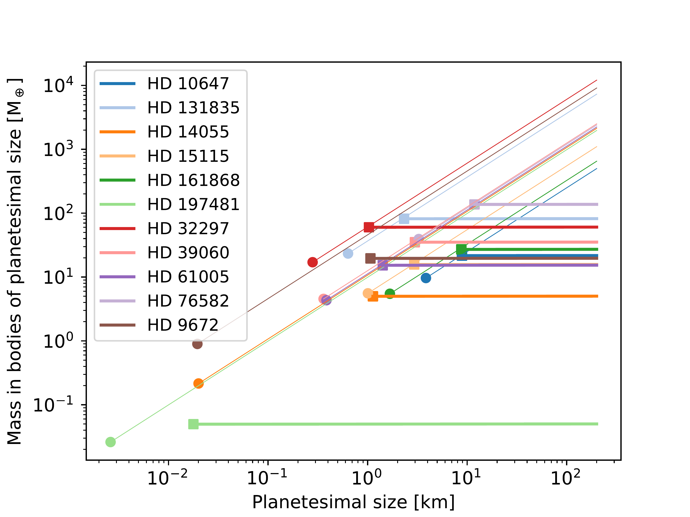
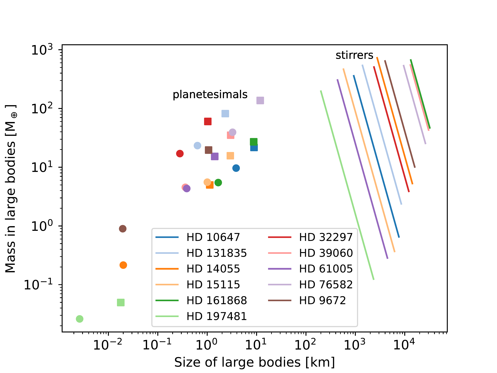
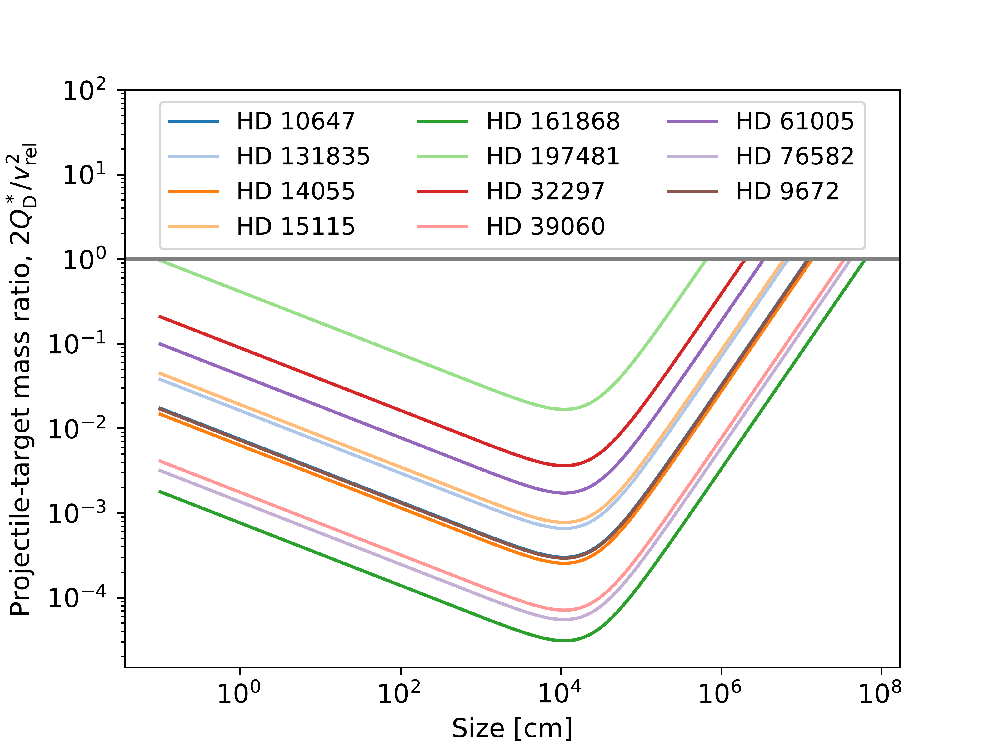

$\newcommand{\ensuremath}{}$
$\newcommand{\xspace}{}$
$\newcommand{\object}[1]{\texttt{#1}}$
$\newcommand{\farcs}{{.}''}$
$\newcommand{\farcm}{{.}'}$
$\newcommand{\arcsec}{''}$
$\newcommand{\arcmin}{'}$
$\newcommand{\ion}[2]{#1#2}$
$\newcommand{\textsc}[1]{\textrm{#1}}$
$\newcommand{\hl}[1]{\textrm{#1}}$
$\newcommand{\footnote}[1]{}$

# The ALMA survey to Resolve exoKuiper belt Substructures (ARKS): XII. Constraints on large bodies embedded in discs

<mark>Appeared on: 2026-11-04</mark> -  _accepted for publication in A&A_

M. R. Jankovic, et al. -- incl., <mark>T. Henning</mark>

**Abstract:** The ALMA survey to Resolve exoKuiper belt Substructures (ARKS) presents detailed constraints on structure and properties of a sample of 24 debris discs at millimetre wavelengths, including measurements of vertical thicknesses for a subsample of discs. We estimated sizes and total masses of large bodies that feed collisional cascades producing the observed millimetre dust in 11 ARKS discs with a well constrained vertical thickness. Separately, we estimated the sizes and total masses of large bodies that could be gravitationally stirring these discs, assuming that such stirring is the origin of the vertical thickness. We used a semi-analytic particle-in-a-box collisional model and a semi-analytic model of stirring through gravitational scattering. We accounted for the dependence of collisional damping efficiency on the average collision velocity. We find that planetesimals feeding the collisional cascades are less than 20 km in size, while the total masses in the planetesimals are lower than 200 M $_\oplus$ . There is a good agreement between minimum disc masses inferred from millimetre and infrared observations. The hypothetical stirrers are always larger in size than the planetesimals, but they do not necessarily contain most of the disc mass. In agreement with previous work, the observed dust masses can be explained by steady-state collisional models with reasonable disc masses. The measured vertical scale-heights can be explained by gravitational stirring from embedded large bodies of reasonable properties. However, more advanced models are needed to address the observed non-Gaussian vertical profiles, along with the dependence of disc scale-height on particle size and stellocentric distance.

**Figure 3. -** Planetesimal sizes feeding the cascades assuming primordial power-law size distribution with slope $q_{\rm p}=3$(circles) and its extrapolation up to 200 km (thin lines), and likewise for $q_{\rm p}=4$(squares and thick lines), plotted against the corresponding mass inside unit log bin of size around the planetesimal size. For a size distribution with slope $q_{\rm p}=4$ there is equal mass in each log bin of size. (*fig:m_pl*)

**Figure 5. -** Joint constraints on sizes of planetesimals feeding the collisional cascades (circles for $q_{\rm p}=3$ and squares for $q_{\rm p}=4$, the same as in Fig. \ref{fig:m_pl}) and on the stirrers exciting particles' inclinations (solid lines). The constraints on the stirrers show plausible combinations of their total mass and their individual size, and not a size distribution. These constraints account for collisional damping of mm-sized dust in discs in which it is estimated to be efficient. (*fig:together*)

**Figure 1. -** Critical projectile-to-target mass ratio as function of target size for the discs in our sample, obtained using Eqs. (\ref{eq:v_rel}), (\ref{eq:crit_mass_ratio}), and (\ref{eq:q_d_star}), and using data provided in Table \ref{table:data}. The horizontal gray line indicates where $2 Q_{\rm D}^*/v_{\rm rel}^2 = 1$.  (*fig:crit_ratio*)

