

$\newcommand{\ensuremath}{}$
$\newcommand{\xspace}{}$
$\newcommand{\object}[1]{\texttt{#1}}$
$\newcommand{\farcs}{{.}''}$
$\newcommand{\farcm}{{.}'}$
$\newcommand{\arcsec}{''}$
$\newcommand{\arcmin}{'}$
$\newcommand{\ion}[2]{#1#2}$
$\newcommand{\textsc}[1]{\textrm{#1}}$
$\newcommand{\hl}[1]{\textrm{#1}}$
$\newcommand{\footnote}[1]{}$
$\newcommand{\vdag}{(v)^\dagger}$
$\newcommand\aastex{AAS\TeX}$
$\newcommand\latex{La\TeX}$
$\newcommand{\orcid}[1]{\protect\href{https://orcid.org/#1}{\protect\includegraphics[width=8pt]{orcid.png}}}$
$\newcommand{\mum}{ {\mu{\rm m}}}$

# ReveaLLAGN 2: Exploring the Nuclear Gas and Stellar Kinematics of Nearby LLAGN with JWST/NIRSpec IFU

<mark>Appeared on: 2026-11-05</mark> -  _Accepted for publication in Astronomy & Astrophysics_

<mark>A. Dumont</mark>, et al. -- incl., <mark>N. Neumayer</mark>

**Abstract:** $_ Context:_$ Low-luminosity active galactic nuclei (LLAGN) represent the most common mode of black hole accretion in the local Universe, yet their nuclear structure, stellar and gas kinematics remain poorly constrained at parsec scales. $_ Aims:_$ We investigate the nuclear regions of eight nearby representative LLAGN, the ReveaLLAGN sample: M87, M104, M94, M81, NGC 1052, NGC 4258, NGC 5128 and NGC 4395. Using the high spatial resolution of the Near Infrared Spectrograph (NIRSpec) integral field unit on the James Webb Space Telescope (JWST), we probe the stellar, molecular hydrogen, hydrogen recombination, and high ionization coronal lines kinematics and their spatial distribution, exploring how detectability and spatial distributions of these lines vary across different Eddington ratios. $_ Methods:_$ After cleaning  the JWST/NIRSpec data of point-spread-function sinusoidal artifacts, we spatially binned the data to increase its signal-to-noise. We fit the binned spectra using ${\sc pPXF}$ with stellar templates and several gas emission lines, including $H_2$ molecular lines, $H_2$ recombination lines (Pa $\alpha$ and Br $\gamma$ ), and coronal lines such as [ Si VI ] , [ Mg IV ] , and [ Ar VI ] , adopting a Gaussian profile to derive their kinematics. $_ Results:_$ The stellar line-of-sight velocity maps reveal a slowly rotating disk in the nuclei of all our targets, characterized by an anti-correlation with the $h_3$ Gauss–Hermite moment. The stellar velocity dispersion rises toward the central black hole. Only in M104 and M94 does the velocity dispersion display a more intricate pattern that departs from a simple disk configuration, indicating the presence of multiple kinematic components in these galaxies. Across the sample, the gas distribution and kinematics exhibit rotation that is frequently decoupled from the stellar rotation, and often visually aligned with the radio jet, presenting broader velocity dispersions along the jet direction. Line-ratio maps of $H_2$ 1–0 S(1) to Br $\gamma$ indicate that the dominant excitation mechanism is photoionization by the central AGN, with mechanical heating from shocks becoming important only at higher Eddington rations. $_ Conclusions:_$ Across the ReveaLLAGN sample, we observe slow, disk-like stellar rotation that is decoupled from the gas kinematics, suggesting that the stellar gravitational potential is largely decoupled from the current accretion state. The gas kinematics are more diverse across the targets, with several sources showing kinematic features spatially associated with the radio jets. Across the sample, we detect coronal lines in all LLAGN when using nuclear-aperture spectra. However, no major dependence on Eddington ratio is found, except in the brightness of the coronal lines, which are sufficiently bright to obtain spatially resolved kinematics only in the highest-Eddington-ratio sources, NGC 5128 and NGC 4395.

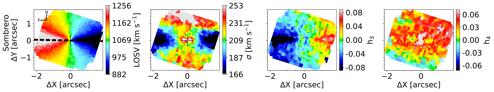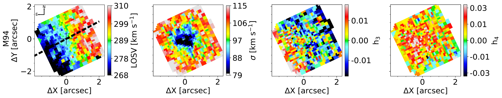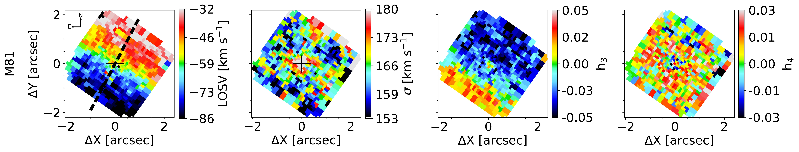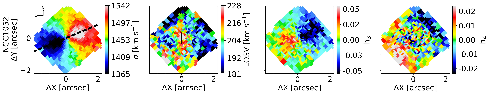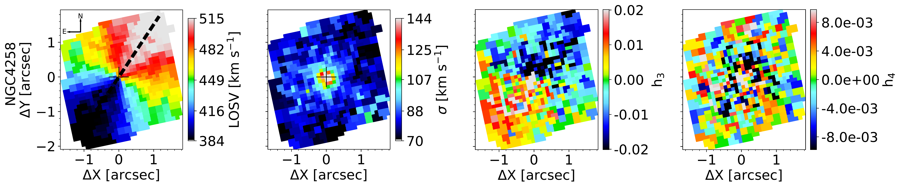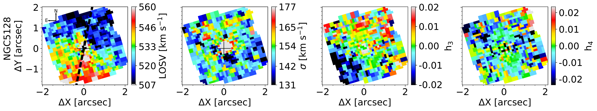

**Figure 3. -** ReveaLLAGN stellar kinematic maps for the first four velocity moments: velocity, velocity dispersion, $h_3$, and $h_4$. The maps are oriented north up and east to the left. The dashed black line shows the best fit stellar kinematic PA.  (*fig:stellar_kinematic_maps*)

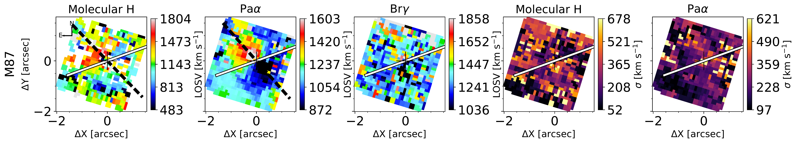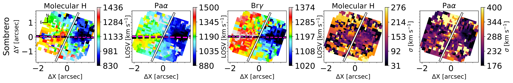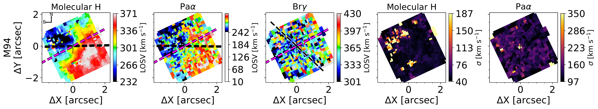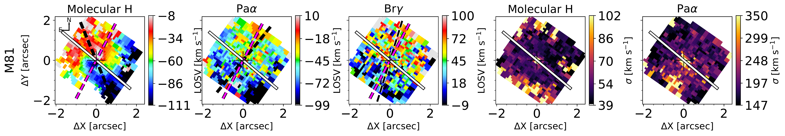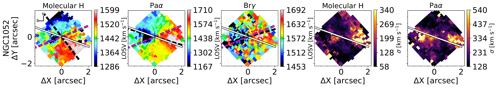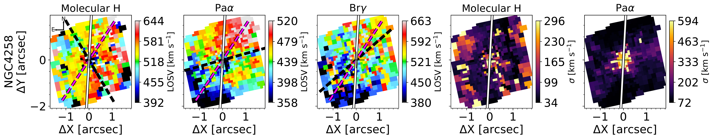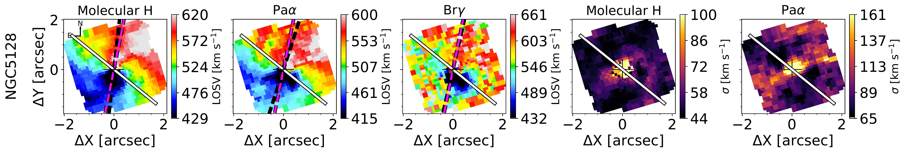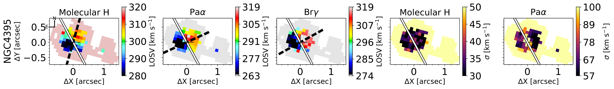

**Figure 4. -** kinematics maps of the molecular Hydrogen $H_2$ and Hydrogen recombination lines Pa$\alpha$ and Br$\gamma$. The first three panels show the LOS velocity and the last two the velocity dispersion. The dashed black line shows the best-fit gas kinematic PA. The solid white line marks the direction of the radio jet. **The dashed fuchsia line shows the stellar kinematic PA.** (*fig:gas_kinematic_maps*)

**Figure 5. -** Flux and line ratio maps. The left three panels show the flux maps for the $H_2$ 1-0 S(1),$Pa\alpha$, and Br$\gamma$ lines. The right two panels show the $H_2$/Br$\gamma$ line ratio map and a colorized version highlighting the different excitation mechanism. Values of $H_2$/Br$\gamma \leq 0.4$(blue) indicate star forming regions,  $0.4<$ $H_2$/Br$\gamma \leq 2.0$ low-AGN excitation (orange), $2.0<$ $H_2$/Br$\gamma \leq 6.0$ high-AGN and $H_2$/Br$\gamma$ above 6.0 shock excitation (green). The white line shows the direction of the radio jet. (*fig:flux_maps*)

