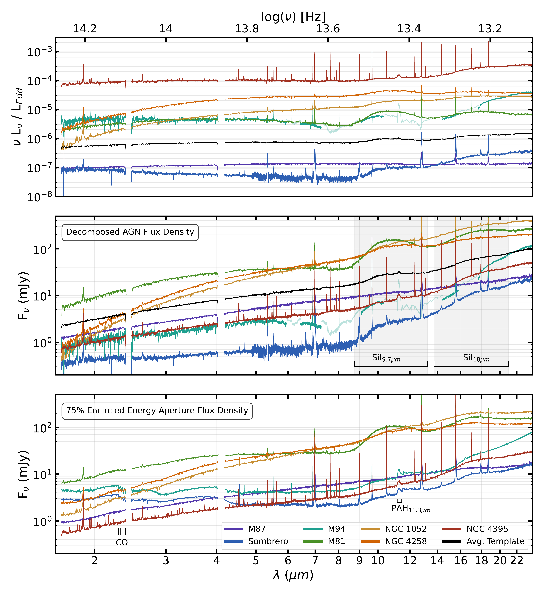
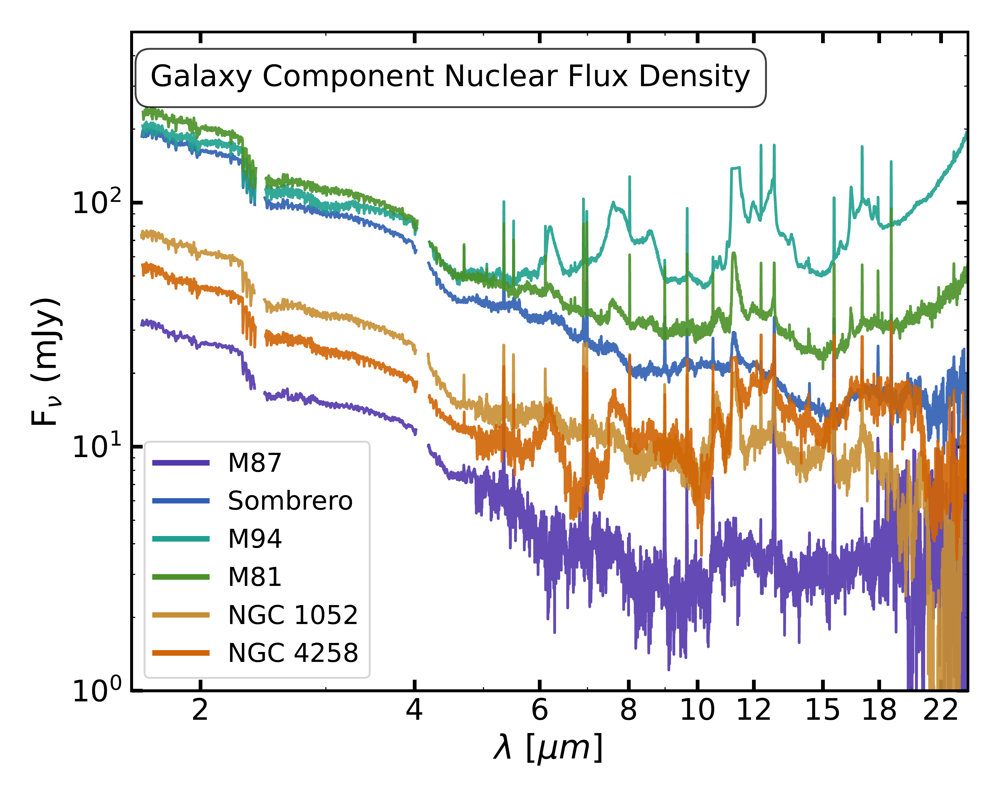
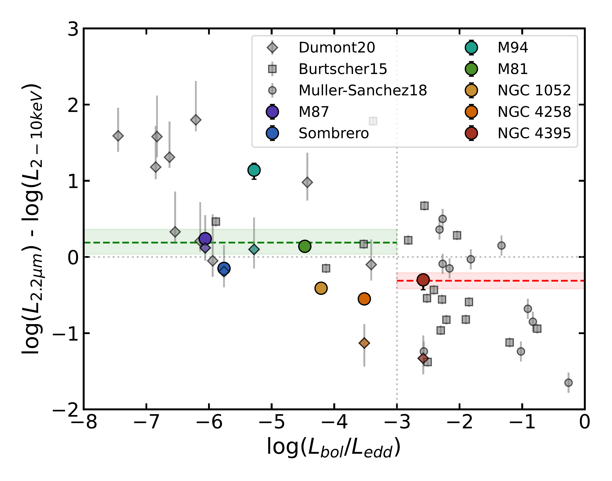

$\newcommand{\ensuremath}{}$
$\newcommand{\xspace}{}$
$\newcommand{\object}[1]{\texttt{#1}}$
$\newcommand{\farcs}{{.}''}$
$\newcommand{\farcm}{{.}'}$
$\newcommand{\arcsec}{''}$
$\newcommand{\arcmin}{'}$
$\newcommand{\ion}[2]{#1#2}$
$\newcommand{\textsc}[1]{\textrm{#1}}$
$\newcommand{\hl}[1]{\textrm{#1}}$
$\newcommand{\footnote}[1]{}$
$\newcommand\latex{La\TeX}$
$\newcommand{\sersic}{Sérsic}$
$\newcommand{\thebibliography}{\DeclareRobustCommand{\VAN}[3]{##3}\VANthebibliography}$

# ReveaLLAGN 3: Revealing the Infrared Spectral Energy Distributions of Low Luminosity AGN

<mark>Appeared on: 2026-11-05</mark> - 

D. Ohlson, et al. -- incl., <mark>A. Dumont</mark>

**Abstract:** The spectral energy distributions of active galactic nuclei (AGN) provide valuable information on the emission mechanisms taking place in their inner regions. Here we use the James Webb Space Telescope to study the near and mid-infrared spectral energy distributions of seven nearby low-luminosity active galaxy nuclei from 1.7 to 24 $\mu$ m. We cleanly separate the AGN spectrum by performing spatial fits of the two-dimensional images across all wavelengths. We then compare these clean unresolved spectra to aperture-based spectra and show that they effectively remove galaxy contamination. Comparing our infrared measurements to X-ray emission, we find that low-luminosity AGN have enhanced near-infrared emission relative to more luminous AGN, a trend that correlates with radio-loudness, while their mid-infrared-to-X-ray ratios are comparable. A majority of our targets show strong compact silicate emission suggesting the presence of warm dust on parsec scales in these systems.We also quantify the near- and mid-infrared power-law slopes and colors of low-luminosity AGN. In the near-infrared we find AGN of all luminosities have similar spectral slopes and colors, however in the mid-infrared, we find low-luminosity AGN typically have steeper slopes and redder colors than more luminous AGN. Both the strong silicate emission and steep mid-infrared slopes disagree with existing models for low-luminosity AGN spectral energy distributions.

**Figure 11. -** Nuclear Spectra from the ReveaLLAGN targets, comparing the results of our decomposed point-source AGN against those from a background-subtracted nuclear aperture.
    *Top* -- Eddington-normalized luminosity of the unresolved AGN components, resulting from fitting and extraction methods described in \S\ref{sec:fit}.
    *Middle* -- Unresolved AGN component flux density within 1.7" aperture.
    *Bottom* -- Nuclear spectra extracted using the methods of [Goold, et. al (2026)](https://ui.adsabs.harvard.edu/abs/2026arXiv260116977G). Despite background subtraction and aperture correction, contamination from surrounding host-galaxy emission is still apparent throughout the bottom panel, most notably at the CO bandhead absorption at $\rm \sim2.3 \mu m$ visible in Sombrero, M94, NGC4258, and M81 and also shortwards of 5 $\mu$m where the slope flattens relative to our decomposed AGN spectra, especially in M94 and Sombrero. Contamination from the nuclear host-galaxy flux in aperture-extracted spectra shows the importance of decoupling the AGN and galaxy components to extract accurate LLAGN continua. We include an average LLAGN IR spectrum template in black, made using our decomposed AGN spectra. Visible jumps in flux throughout the spectrum of M94 result from the separate models used to account for extreme PAH emission, represented in the top two panels by a more transparent line and (*fig:spectra*)

**Figure 2. -** Host galaxy component spectra in the 1.7$"$ nuclear region. CO bandheads are clearly visible for all included targets at $\sim$2.3 $\mu$m. PAH features are well modeled for multiple galaxies, most notably M94, which necessitate special fitting methods as described in \S\ref{subsec:specialgalaxies}. We exclude NGC 4395 from our figure because its simplified galaxy emission requires fewer functions and is nonexistent in some channels. (*fig:galspec*)

**Figure 3. -** Ratio of integrated 2.2 $\mu$m and 2–10 keV X-ray luminosities vs Eddington ratio. Small points show data from [Dumont, et. al (2020)](https://ui.adsabs.harvard.edu/abs/2020ApJ...888...19D)(diamonds), [Burtscher, et. al (2015)](https://ui.adsabs.harvard.edu/abs/2015A&A...578A..47B)(squares), and [M\"uller-S\'anchez, et. al (2018)](https://ui.adsabs.harvard.edu/abs/2018ApJ...858...48M)(circles). Eddington ratios for comparison targets are calculated using black hole masses from [Bi, Feng and Ho (2020)](https://ui.adsabs.harvard.edu/abs/2020ApJ...900..124B). The dashed horizontal green line shows the mean flux ratio for all data points where log($\rm L_{Bol}/L_{Edd}$)$\leq$-3, and the red line for those $>$-3. Shaded regions show $1\sigma$ errors calculated with bootstrapping. Our measurements support previous results suggesting a NIR flux excess for LLAGN. (*fig:nirxr*)

