

$\newcommand{\ensuremath}{}$
$\newcommand{\xspace}{}$
$\newcommand{\object}[1]{\texttt{#1}}$
$\newcommand{\farcs}{{.}''}$
$\newcommand{\farcm}{{.}'}$
$\newcommand{\arcsec}{''}$
$\newcommand{\arcmin}{'}$
$\newcommand{\ion}[2]{#1#2}$
$\newcommand{\textsc}[1]{\textrm{#1}}$
$\newcommand{\hl}[1]{\textrm{#1}}$
$\newcommand{\footnote}[1]{}$
$\newcommand{\vdag}{(v)^\dagger}$
$\newcommand\aastex{AAS\TeX}$
$\newcommand\latex{La\TeX}$
$\newcommand{\todo}[1]{\textcolor{red}{[#1]}}$
$\newcommand{\um}{\text{ \textmu m\xspace}}$
$\newcommand{\pcc}{ cm^{-3}}$
$\newcommand{\teff}{\text{T}_\mathrm{eff}}$
$\newcommand{\logg}{log (\text{g})}$
$\newcommand{\lbol}{\text{L}_\mathrm{bol}}$
$\newcommand{\mjup}{\text{M}_\mathrm{J}}$
$\newcommand{\msun}{\text{M}_\mathrm{\odot}}$
$\newcommand{\rjup}{\text{R}_\mathrm{J}}$
$\newcommand{\rsun}{\text{R}_\mathrm{\odot}}$
$\newcommand{\lsun}{\text{L}_\mathrm{\odot}}$
$\newcommand{\jhu}{Department of Physics \& Astronomy, Johns Hopkins University, 3400 N. Charles Street, Baltimore, MD 21218, USA}$
$\newcommand{\stsci}{Space Telescope Science Institute, 3700 San Martin Dr, Baltimore, MD 21218, USA}$
$\newcommand{\uofm}{Department of Astronomy, University of Michigan, 1085 S. University Ave, Ann Arbor, MI 48109, USA}$
$\newcommand{\IAedinburgh}{Institute for Astronomy, University of Edinburgh, Royal Observatory, Blackford Hill, Edinburgh, EH9 3HJ, UK}$
$\newcommand{\CESedinburgh}{Centre for Exoplanet Science, University of Edinburgh, Edinburgh, EH9 3HJ, UK}$
$\newcommand{\exeter}{Department of Physics and Astronomy, University of Exeter, Stocker Road, Exeter EX4 4QL, UK}$
$\newcommand{\marseille}{Laboratoire d'Astrophysique de Marseille, 38 Rue Fréderic Joliot Curie, 130013 Marseille, France}$
$\newcommand{\toronto}{Department of Astronomy and Astrophysics, University of Toronto, 50 St. George Street, Toronto, ON M5S 3H4, Canada}$
$\newcommand{\mitkavli}{MIT Kavli Institute for Astrophysics and Space Research, Massachusetts Institute of Technology, Cambridge, MA 02139, USA}$
$\newcommand{\UnivDiegoPortales}{Instituto de Estudios Astrofísicos, Facultad de Ingeniería y Ciencias, Universidad Diego Portales, Av. Ejército Libertador 441, Santiago, Chile}$
$\newcommand{\yems}{Millennium Nucleus on Young Exoplanets and their Moons (YEMS)}$
$\newcommand{\padova}{INAF-Osservatorio Astronomico di Padova, Vicolo dell'Osservatorio 5, Padova, Italy, 35122-I}$
$\newcommand{\ucsd}{Department of Astronomy \& Astrophysics, University of California San Diego, La Jolla, CA 92093, USA}$
$\newcommand{\AstrobioCenter}{Astrobiology Center, 2-21-1 Osawa, Mitaka, Tokyo 181-8588, Japan}$
$\newcommand{\mpia}{Max Planck Institute for Astronomy, Königstuhl 17, 69117 Heidelberg, Germany}$
$\newcommand{\stockholm}{Department of Astronomy, Stockholm University, Stockholm, SE-10691, Sweden}$
$\newcommand{\cambridge}{Institute of Astronomy, University of Cambridge, Madingley Road, Cambridge, CB3 0HA, UK}$
$\newcommand{\amnh}{Department of Astrophysics, American Museum of Natural History, Central Park West at 79th Street, NY 10024, USA}$
$\newcommand{\umd}{Center for Space Sciences and Technology, University of Maryland, Baltimore County, 1000 Hilltop Circle, Baltimore, MD 21250, USA}$
$\newcommand{\gsfcAstro}{Astrophysics Science Division, NASA-GSFC, 8800 Greenbelt Rd, Greenbelt, MD 20771, USA}$
$\newcommand{\gsfcCresst}{Center for Research and Exploration in Space Science and Technology, NASA-GSFC, 8800 Greenbelt Rd, Greenbelt, MD 20771, USA}$
$\newcommand{\CentroAstrobio}{Centro de Astrobiología (CAB, CSIC-INTA), Camino Bajo del Castillo s/n, 28692 Villanueva de la Cañada, Madrid, Spain}$
$\newcommand{\sfsu}{Department of Physics and Astronomy, San Francisco State University, 1600 Holloway Ave., San Francisco, CA 94132, USA}$
$\newcommand{\esa}{European Space Agency (ESA), ESA Office, Space Telescope Science Institute, 3700 San Martin Drive, Baltimore, MD 21218, USA}$
$\newcommand{\ucsc}{Department of Astronomy \& Astrophysics, University of California, Santa Cruz, 1156 High Street, Santa Cruz, CA 95064}$
$\newcommand{\ciera}{Center for Interdisciplinary Exploration and Research in Astrophysics (CIERA), Northwestern University, 1800 Sherman Avenue, Evanston, IL 60201, USA}$
$\newcommand{\uvic}{Department of Physics and Astronomy University of Victoria 3800 Finnerty Road Elliott Building, Room 207. Victoria BC V8P 5C2, Canada}$
$\newcommand{\thefigure}{A.\arabic{figure}}$
$\newcommand{\thetable}{A.\arabic{table}}$
$\newcommand{\thefigure}{A.\arabic{figure}}$
$\newcommand{\theHfigure}{A.\arabic{figure}}$
$\newcommand{\thetable}{A.\arabic{table}}$
$\newcommand{\theHtable}{A.\arabic{table}}$
$\newcommand{\thefigure}{B.\arabic{figure}}$
$\newcommand{\theHfigure}{B.\arabic{figure}}$
$\newcommand{\thetable}{B.\arabic{table}}$
$\newcommand{\theHtable}{B.\arabic{table}}$
$\newcommand{\thefigure}{C.\arabic{figure}}$
$\newcommand{\theHfigure}{C.\arabic{figure}}$
$\newcommand{\thetable}{C.\arabic{table}}$
$\newcommand{\theHtable}{C.\arabic{table}}$
$\newcommand{\thefigure}{D.\arabic{figure}}$
$\newcommand{\theHfigure}{D.\arabic{figure}}$
$\newcommand{\thetable}{D.\arabic{table}}$
$\newcommand{\theHtable}{D.\arabic{table}}$

# The JWST Early Release Science Program for Direct Observations of Exoplanetary Systems IX: A Multi-Wavelength Framework for Source Characterization in JWST Coronagraphic Imaging of the HIP 65426 System

<mark>Appeared on: 2026-11-06</mark> -  _Accepted for publication in ApJL, 26 pages_

E. L. Bruinsma, et al. -- incl., <mark>T. Henning</mark>

**Abstract:** We present an updated analysis of the JWST coronagraphic imaging data of the HIP 65426 system. We aim to search for and characterize potential planetary companions as well as provide updated astrometry and photometry for the known exoplanet HIP 65426 b following updates to the JWST and spaceKLIP pipelines. Our measured photometry and astrometry show significant differences to those in [Carter, et. al (2023)](http://dx.doi.org/10.3847/2041-8213/acd93e) but are consistent to within $2.2\sigma$ in separation, $1.5\sigma$ in position angle, and $3.7\sigma$ in flux. Our results indicate that pipeline updates have changed the photometry and astrometry significantly in some filters, especially in terms of observed flux. We see the greatest changes in separation in F444W and F1550C, position angle in F250M, and flux in F250M, F300M, F410M, F1140C, and F1550C. The SED of HIP 65426 b remains consistent with a young, giant planet best fit by models with a cloudy atmosphere and an effective temperature estimate of $\sim$ 1436 K. Using both NIRCam and MIRI data, we identified 21 candidate companion sources in addition to the known planet. Of the 21 sources, 13 were attributed to astrophysical sources with eight background stars, four galaxies, one unknown, and zero planets. While one of these sources was detected in [Chauvin, et. al (2017)](http://dx.doi.org/10.1051/0004-6361/201731152) , the remaining point sources were undetected in previous ground-based observations, which makes this work an initial epoch of astrometry for these objects. One galaxy in particular appears as a point source in MIRI but is highly extended in NIRCam and exposes a potential drawback to single-epoch MIRI imaging in a blind search for companions.

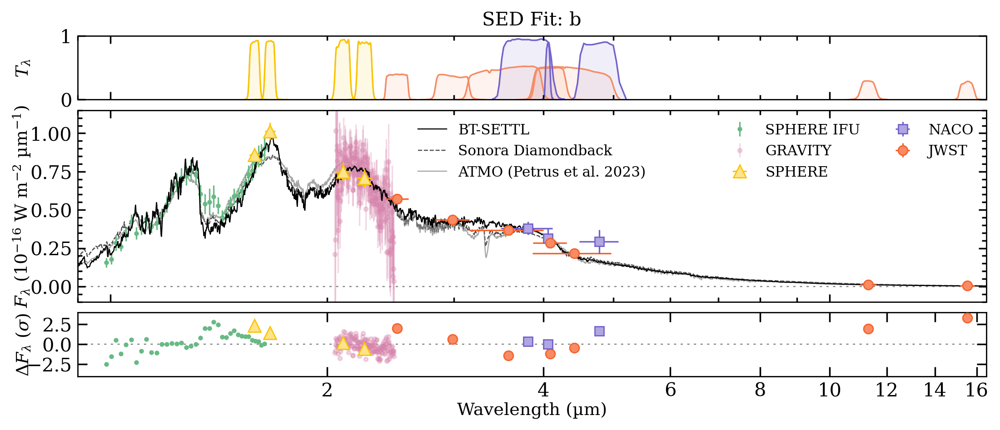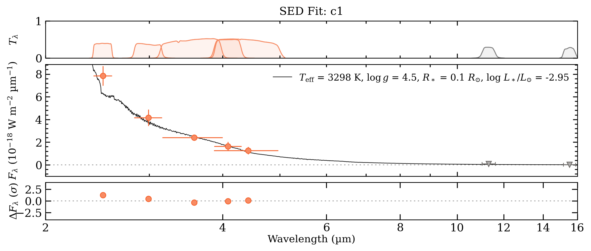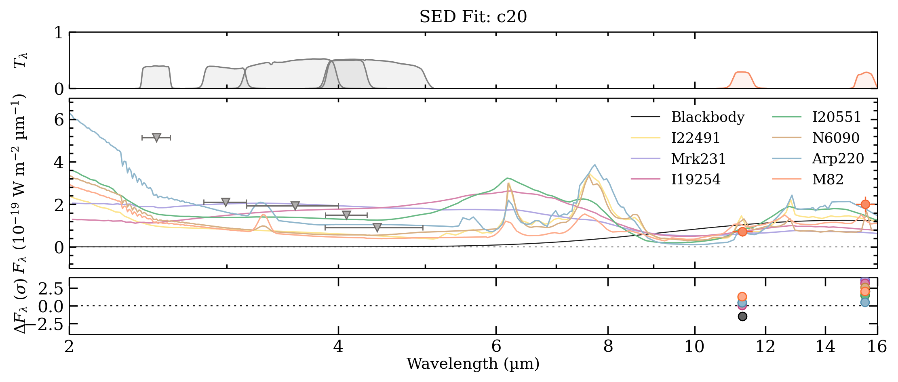

**Figure 12. -** Example SED fits for each type of object. For each panel, the top is the bandpasses of the photometric data points, the middle is the data plotted alongside the best-fit models, and the bottom is the residuals of each data point relative to the best-fit model. $3\sigma$ upper-limits are shown in grey.
  **Top: **SED of HIP 65426 b, using data from JWST, VLT/SPHERE  ([Chauvin, et. al 2017](http://dx.doi.org/10.1051/0004-6361/201731152)) , VLTI/GRAVITY  ([Blunt, et. al 2023](https://arxiv.org/abs/2310.00148)) , and VLT/NACO  ([Cheetham, et. al 2019](https://ui.adsabs.harvard.edu/abs/2019A&A...622A..80C)) , plotted alongside the best-fit BT-SETTL ($\teff$$=1436^{+13}_{-12}$ K, $\logg$$=3.64\pm0.02$ dex, and $\text{R}_\text{p}=1.43\pm{0.03}$ $\rjup$), Sonora Diamondback ($\teff$$=1210^{+9}_{-7}$ K, $\logg$$=3.76\pm0.06$ dex, and $\text{R}_\text{p}=1.86\pm{0.03}$ $\rjup$), and ATMO  ([Petrus, et. al 2023](https://ui.adsabs.harvard.edu/abs/2023A&A...670L...9P)) ($\teff$$=1376\pm14$ K, $\logg$$=3.87^{+0.07}_{-0.08}$ dex, and $\text{R}_\text{p}=1.50\pm{0.03}$ $\rjup$).
  **Middle: **Example SED of a background star (c1) plotted alongside the best-fit BT-SETTL model, which yields $\teff$$=3298^{+447}_{-572}$ K, $\logg$$=4.5^{+0.64}_{-0.62}$ dex, and $\text{R}=0.10^{+0.007}_{-0.008}$ $\rsun$.
  **Bottom: **Example SED of a background galaxy (c20) plotted alongside the best-fit blackbody and galaxy templates.  (*fig:seds_main*)

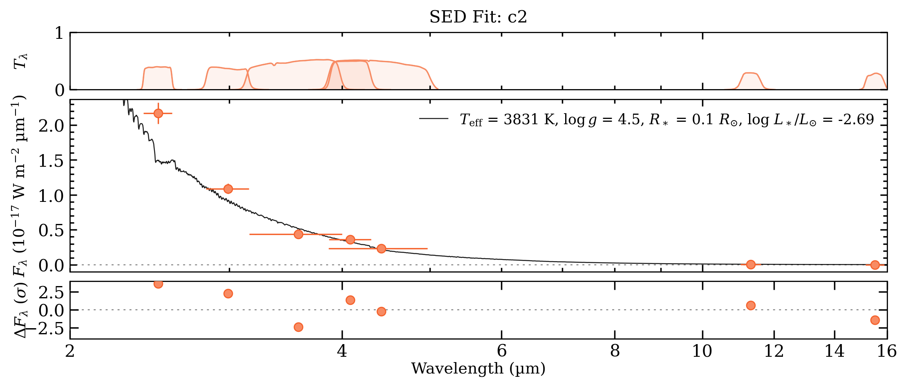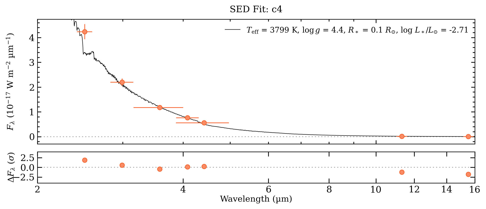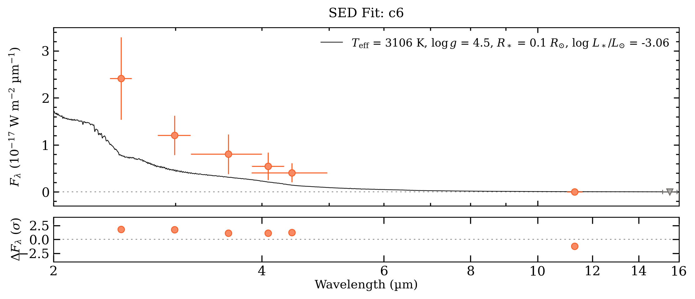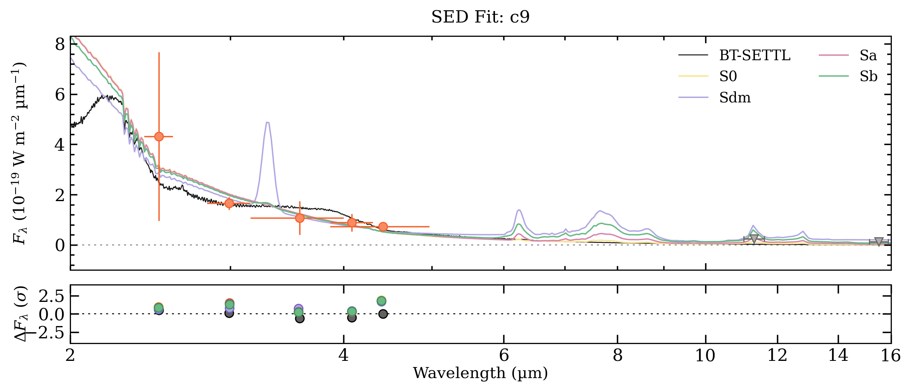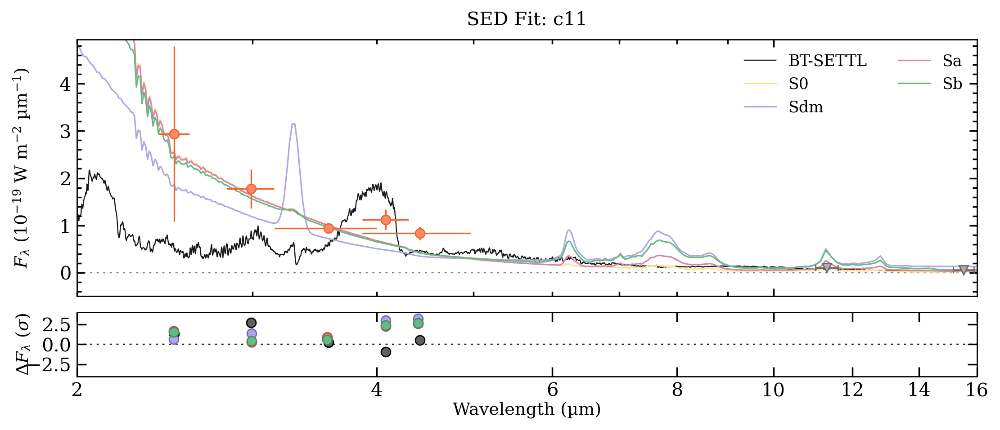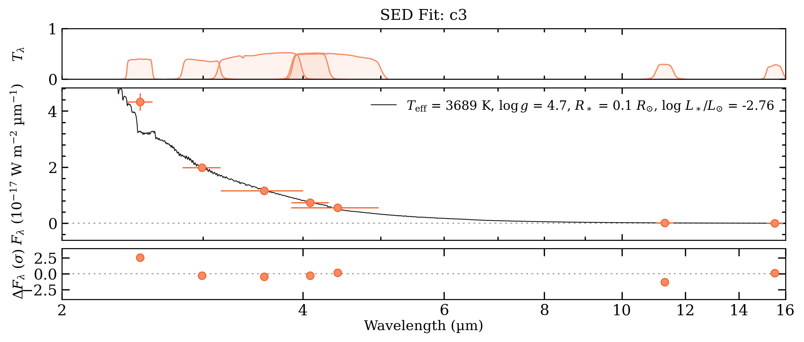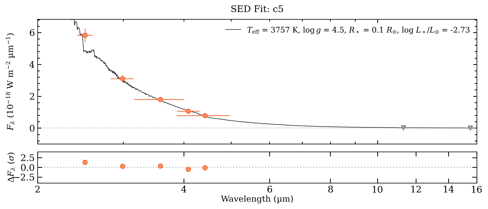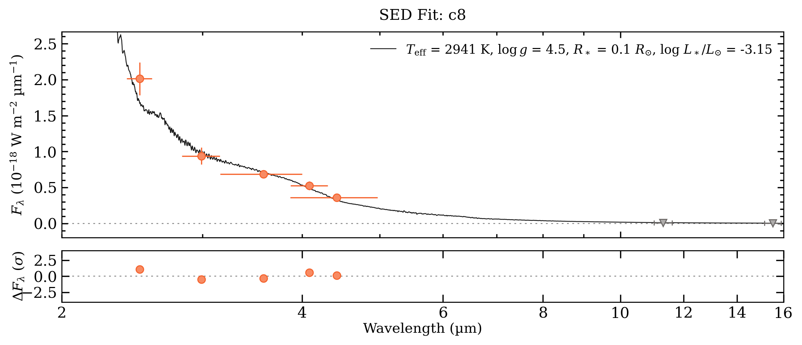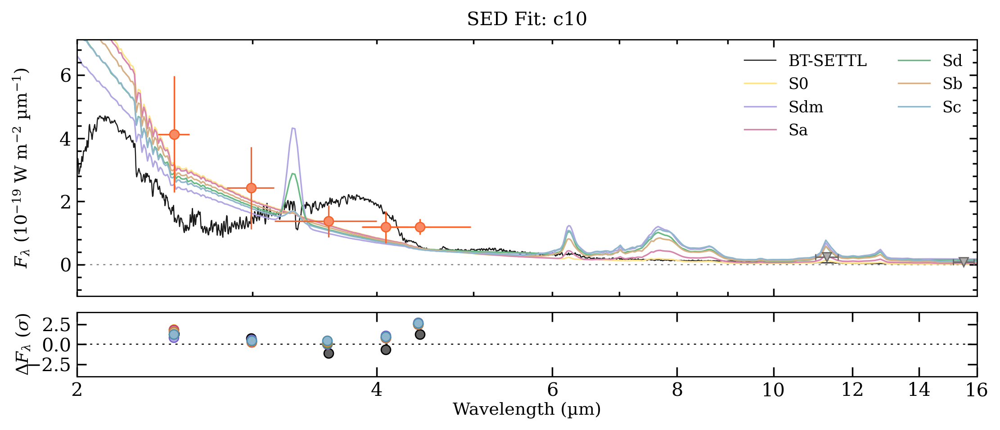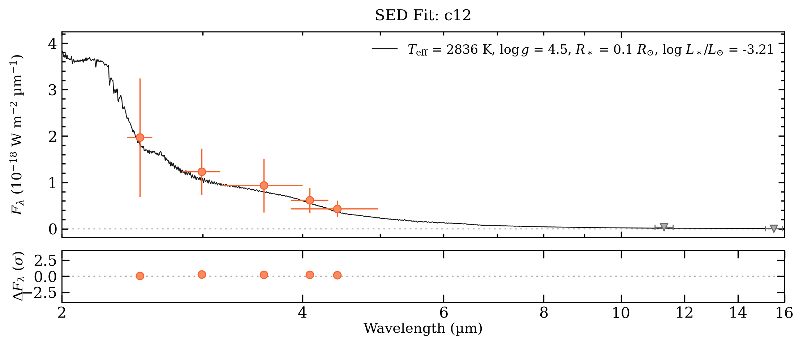

**Figure 2. -** SED fits for all vetted point-sources not included in Figure \ref{fig:seds_main}. The JWST photometric points are plotted in orange with the best-fit BT-Settl models in black. c9, c10, and c11 also contain the best-fit galaxy SED templates. The residuals for each data point are shown in the bottom panel of each plot. 3$\sigma$ upper-limits are shown in grey. (*fig:seds_others*)

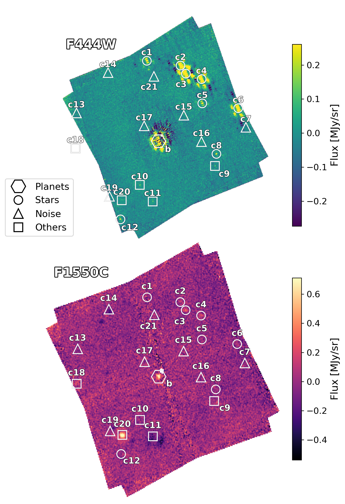

**Figure 10. -** Subtracted images for the NIRCam F444W (top) and MIRI F1550C (bottom) filters. The images are oriented with North pointing up and East pointing left. All candidate companions pre-vetting are marked with white markers. Not all sources were detected in all filters, so some markers appear empty.  (*fig:sources_f444_f1550*)

