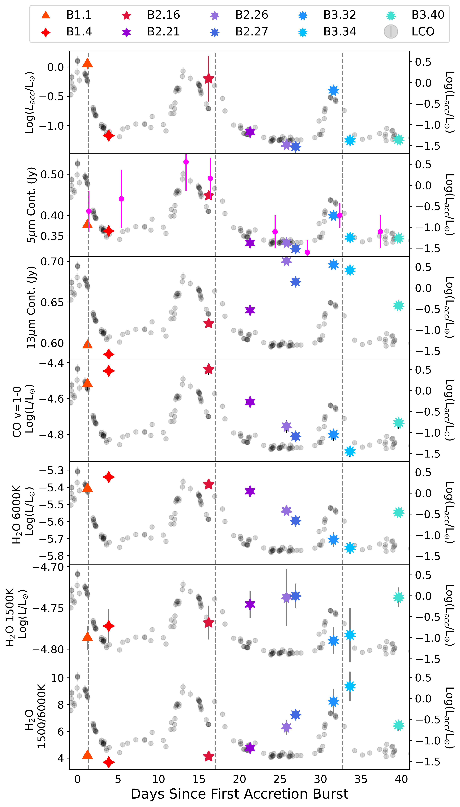
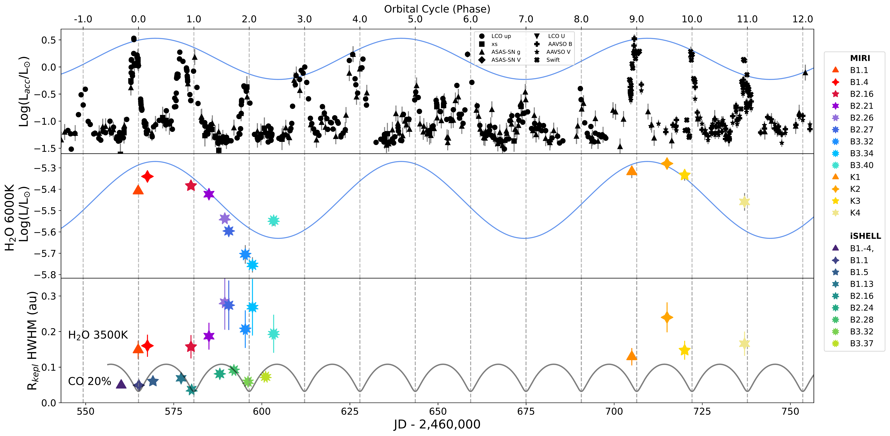
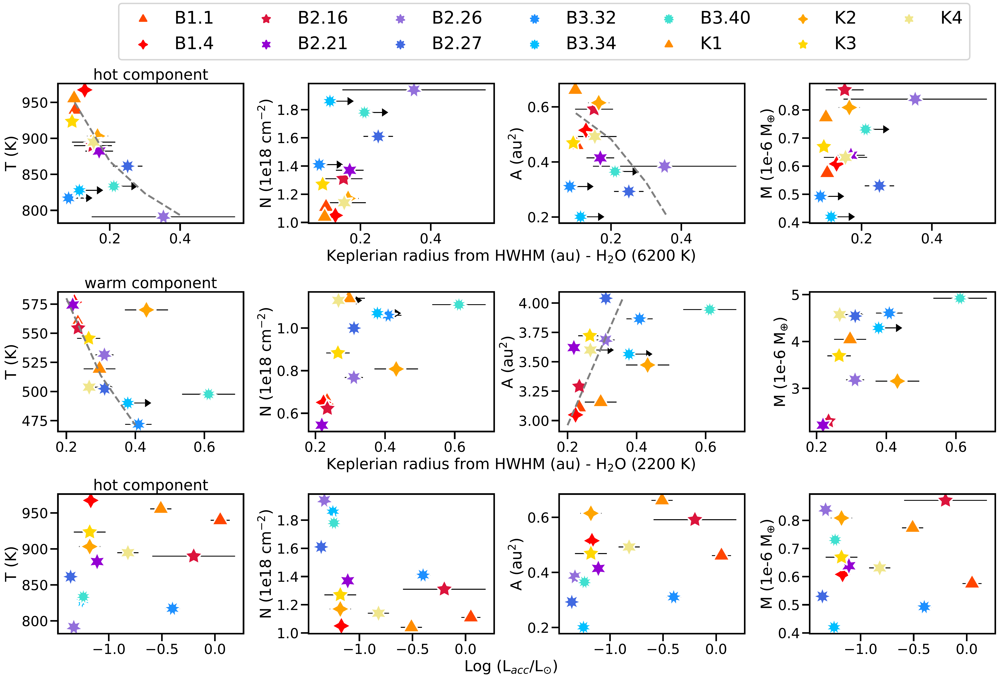

$\newcommand{\ensuremath}{}$
$\newcommand{\xspace}{}$
$\newcommand{\object}[1]{\texttt{#1}}$
$\newcommand{\farcs}{{.}''}$
$\newcommand{\farcm}{{.}'}$
$\newcommand{\arcsec}{''}$
$\newcommand{\arcmin}{'}$
$\newcommand{\ion}[2]{#1#2}$
$\newcommand{\textsc}[1]{\textrm{#1}}$
$\newcommand{\hl}[1]{\textrm{#1}}$
$\newcommand{\footnote}[1]{}$
$\newcommand{\vdag}{(v)^\dagger}$
$\newcommand\aastex{AAS\TeX}$
$\newcommand\latex{La\TeX}$
$\newcommand{\jwst}{{\it JWST}}$
$\newcommand{\swift}{{\it Swift}}$
$\newcommand{\lacc}{L_{acc} }$
$\newcommand{\mic}{\mum }$

# Coordinated Space and Ground Monitoring of Accretion Bursts in a Protoplanetary Disk: \ MIRI and iSHELL observe the long-term modulation of gas within a small inner disk cavity

<mark>Appeared on: 2026-11-06</mark> -  _Accepted for publication on ApJ_

J. Hyden, et al. -- incl., <mark>M. Benisty</mark>

**Abstract:** DQ Tau is a TTauri eccentric binary with pulsed accretion bursts regulated by its $\sim 16$ -day orbital period. We have monitored this system with seven instruments from ground and space over 40 days. We present results on molecular gas variability from nine JWST-MIRI and nine IRTF-iSHELL epochs over three sequential accretion bursts with accretion luminosity pulses increasing by factors of $\sim 9$ --80. A fundamental new measurement from this analysis is the line broadening of CO (from iSHELL) and $\ce{H2O}$ (from MIRI) lines, which we use to estimate Keplerian radii and their variability in parallel to the line luminosity. This unprecedented dataset clearly shows that the molecular emission does not react like HI and the 5- $\mu$ m continuum with each accretion burst: the line luminosity and width of all hot molecular gas tracers decrease over $\sim30$ --35 days, consistent with an emitting region decreasing in temperature and mass as it recedes to larger radii within the $\sim 0.2$ --0.4 au inner cavity perturbed by the binary. The infrared molecular spectrum of DQ Tau is affected more by disk dynamics then by chemical changes triggered by variable accretion, supporting model expectations for chemical relaxation timescales that are much longer than the duration of these accretion bursts ( $\gg 10$ days). The variability observed in all tracers in this study is consistent with a scenario where gas mass builds up near the disk edge to modulate the burst peak intensity and gas density in the inner cavity every $\sim4$ --5 orbital periods. The origin of this modulation is still unclear.

**Figure 1. -**  Light curves of the HI-derived accretion luminosity (Appendix \ref{app: updated_Lacc_relations}), 5$\mu$m and 13$\mu$m dust continuum flux, and different molecular lines tracing gas at different temperatures \citep[from hotter gas with the 6000 K lines to colder gas with the 1500 K lines, see][]{banz25}. The vertical dashed lines indicate the three periastron orbital phases. The accretion luminosity light curve measured with LCO \cite[from][]{Tofflemire25} is reported in grey using the second y axis to the right. The colored (red to blue) markers indicate the JWST-MIRI data. The magenta points in the 5 $\mu$m continuum panel show the fluxes measured in iSHELL spectra and reported in Table \ref{tab: miri_epochs}. (*fig: line_var*)

**Figure 16. -** Overview of our proposed interpretation to reconcile all the observables with a longer-term modulation of molecular gas near the inner disk edge during this monitoring campaign. The top panel displays the full $\lacc$ time series collected in our program and in \citet{kospal25}, along with a sinusoidal curve to mark the tentative longer-term periodicity ($\sim 5 P_{bin}$) in the burst peak amplitude discussed in the text. The middle and lower panels show, as representative examples from the analysis in this work, the 6000 K water luminosity and the Keplerian radii for the FW20\% CO and 3500 K water lines, including for the later epochs from \citet{kospal25}. The barycenter distance of the primary is shown in the bottom plot for reference to the gas emission radii, illustrating how the high-velocity CO gas is temporarily pulled inward at the second and third periastron. (*fig: disc+cartoon*)

**Figure 15. -** Slab model fit results (from Figure \ref{fig: BestTNRM}) for the hot component (top) and warm component (middle) of water, shown as a function of the Keplerian radii independently measured from the line broadening (from Figure \ref{fig: Kepl radii}). The dashed curves in the temperature plots show power-law profiles with indices of -0.13 (hot component) and -0.3 (warm component), while the area plots show the expected trends from disk annuli that shrink (hot component) or expand with time (warm component), see text for details. The additional four epochs taken in 2026 (labeled K1 through 4) and published in \citet{kospal25} are included for comparison and agree with the values and trends found in our program. The plot in the bottom shows the hot component results as a function of $\lacc$; contrary to what reported in \citet{kospal25} based on 4 epochs, there is no correlation between the water temperature and $\lacc$. (*fig: Slab_results_+radii*)

