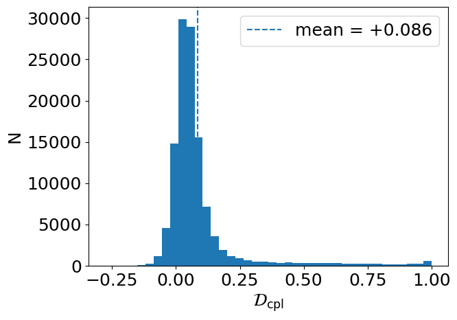
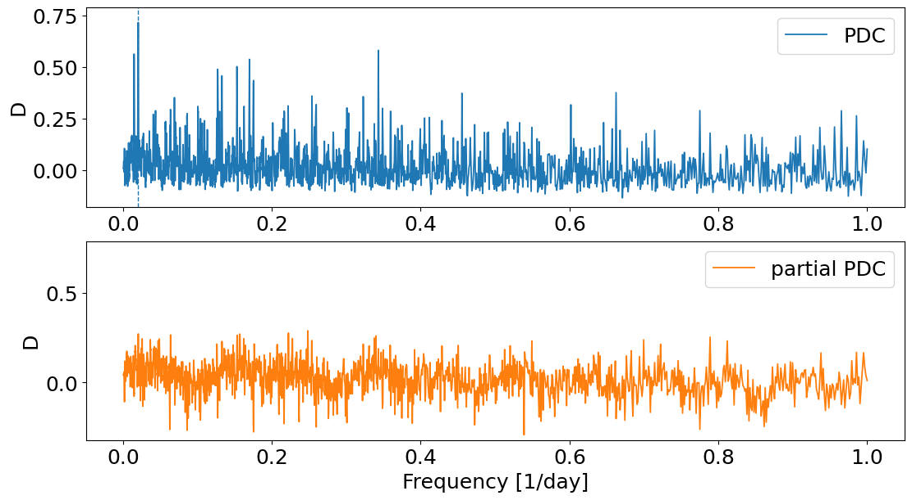
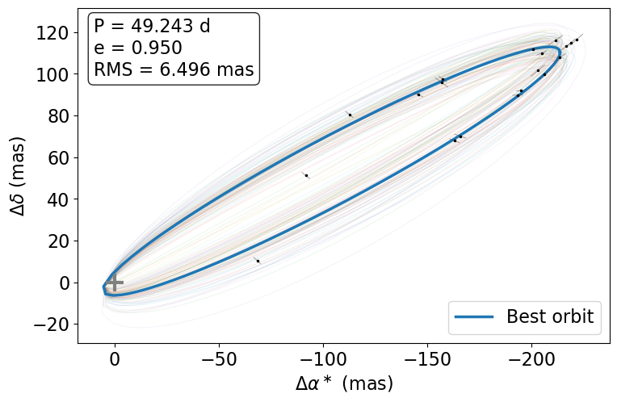

$\newcommand{\ensuremath}{}$
$\newcommand{\xspace}{}$
$\newcommand{\object}[1]{\texttt{#1}}$
$\newcommand{\farcs}{{.}''}$
$\newcommand{\farcm}{{.}'}$
$\newcommand{\arcsec}{''}$
$\newcommand{\arcmin}{'}$
$\newcommand{\ion}[2]{#1#2}$
$\newcommand{\textsc}[1]{\textrm{#1}}$
$\newcommand{\hl}[1]{\textrm{#1}}$
$\newcommand{\footnote}[1]{}$
$\newcommand\mtrx{#1}$
$\newcommand\vctr{#1}$

# Mitigating scanning-induced systematics in _Hipparcos_ and implications for _Gaia_ astrometry

<mark>Appeared on: 2026-11-06</mark> -  _6 pages, 5 figures. Accepted for publication in Astronomy & Astrophysics_

A. Binnenfeld, et al. -- incl., <mark>S. Shahaf</mark>, <mark>H.-W. Rix</mark>

**Abstract:** Space-based astrometric missions such as _Hipparcos_ and _Gaia_ rely on one-dimensional scanning strategies that couple the measured signals with both observation times and scanning geometry. This coupling can introduce spurious periodicities and complicate their interpretation. We present a non-parametric extension of the phase-distance correlation (PDC) periodogram that quantifies and reduces dependence on scan geometry at the period-search stage. Using _Hipparcos_ data, we identified recurrent periodicities associated with characteristic scanning-law timescales and showed that they are strongly suppressed by the scan-angle-controlled statistic. We then applied the method to _Gaia_ Data Release 4 (DR4) prerelease epoch astrometry, where a recurrent $\sim$ 54-day feature is suppressed across multiple sources while independently known orbital signals remain detectable. The method provides a diagnostic of scan-angle dependence and a way to mitigate its impact on period searches. These results are particularly relevant for _Gaia_ DR4, where public epoch astrometry will enable large-scale searches for companions ranging from exoplanets to dormant black holes.

**Figure 1. -** Distribution of $\mathcal{D}_{\mathrm{cpl}}$ for all _Hipparcos_ sources. The catalog has a mean of 0.09 and standard deviation of 0.15, with an evident tail indicating a subset of sources showing strong dependence on scan angle. (*fig:ast_part_dist*)

**Figure 2. -** Standard (top) and partial (bottom) PDC periodograms for HIP 29616. A prominent peak at $f=0.0204 {\rm d}^{-1}$, corresponding to $P\simeq49.1$ days, is clearly visible in the standard PDC, consistent with a repeating signal driven by scan-angle systematics. This feature is effectively suppressed in the partial PDC. (*fig:ast_part_example1*)

**Figure 3. -** 
Best-fit astrometric orbit for HIP 29616 at the spurious $P\simeq49$ d period. The blue curve shows the best-fitting solution, and the along-scan measurements are overplotted. The faint curves show 80 realizations obtained by varying the fitted linear orbit coefficients within their estimated uncertainties, while keeping $P$, $e$, and $\tau$ fixed. The best-fitting solution has $P=49.243$ d, reaches the imposed eccentricity limit at $e=0.950$, and has an RMS residual of $6.496$ mas.
 (*fig:data29616_1*)

