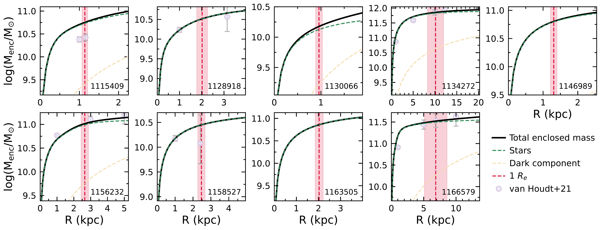
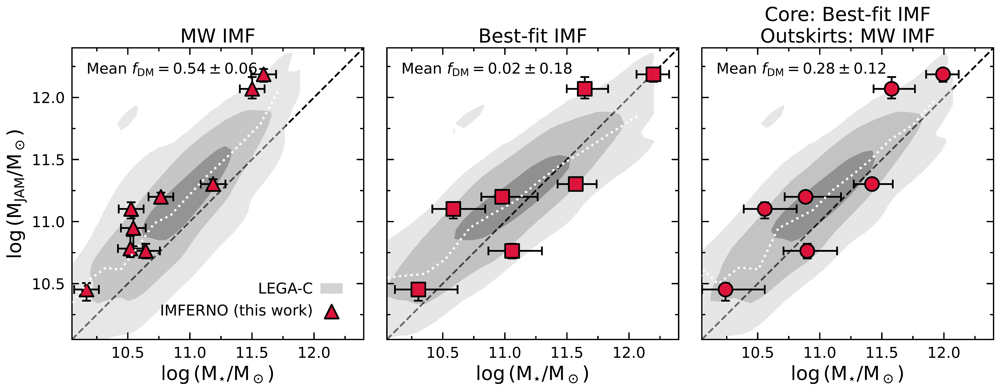
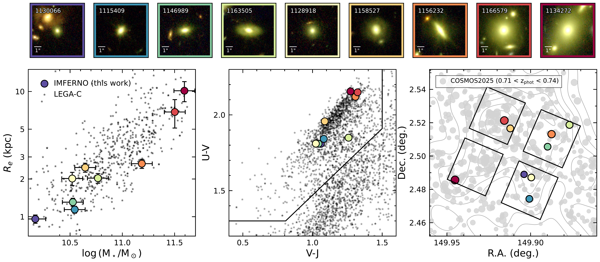

$\newcommand{\ensuremath}{}$
$\newcommand{\xspace}{}$
$\newcommand{\object}[1]{\texttt{#1}}$
$\newcommand{\farcs}{{.}''}$
$\newcommand{\farcm}{{.}'}$
$\newcommand{\arcsec}{''}$
$\newcommand{\arcmin}{'}$
$\newcommand{\ion}[2]{#1#2}$
$\newcommand{\textsc}[1]{\textrm{#1}}$
$\newcommand{\hl}[1]{\textrm{#1}}$
$\newcommand{\footnote}[1]{}$
$\newcommand{\red}{\textcolor{red}}$
$\newcommand{\dd}{\ensuremath{\mathrm{d}}}$
$\newcommand{\msafit}{{\sc msafit}}$
$\newcommand{\ppxf}{{\sc ppxf}}$
$\newcommand{\vobsi}{V_{i,{\rm obs}}}$
$\newcommand{\sigmaobsi}{\sigma_{v,i,{\rm obs}}}$
$\newcommand{\kms}{km~s^{-1}}$
$\newcommand{\vsigma}{(V/\sigma)_{r_e}}$
$\newcommand{\arraystretch}{1.1}$
$\newcommand{\arraystretch}{1.1}$
$\newcommand{\arraystretch}{1.35}$

# Jeans Dynamical Constraints on the IMF in Massive Quiescent Galaxies at $z\sim0.7$ from JWST/NIRSpec

<mark>Appeared on: 2026-11-09</mark> -  _Resubmitted to A&A after minor revisions; 15 pages, 6 figures (excluding appendices)_

M. Slob, et al. -- incl., <mark>A. d. Graaff</mark>

**Abstract:** We present dynamical masses for nine massive quiescent galaxies at $z\sim0.7$ from the JWST-IMFERNO program, measured from ultra-deep ( $\sim32$ hr), spatially resolved NIRSpec/MSA spectroscopy combined with NIRCam imaging. The most massive of these galaxies have previously been found to have a bottom-heavy initial mass function (IMF), based on measurements of dwarf-sensitive absorption features. Here, we examine whether the stellar masses inferred for these IMFs are consistent with the dynamical masses of these galaxies. We derive the dynamical masses by including Jeans Anisotropic Modelling within a forward-modelling framework that accounts for instrumental optics, source morphology, and geometric effects. We compare the resulting dynamical masses to the stellar masses for different IMF assumptions. A Milky Way IMF produces physically plausible dynamical-to-stellar mass ratios but implies central dark matter fractions ( $f_{\rm DM,1R_e}=0.54\pm0.06$ ) that are a factor $\sim2$ higher compared to local ETGs and simulations. When uniformly applying the IMF that was measured from absorption features, the mean dark matter fraction becomes low ( $f_{\rm DM,1R_e}=0.02\pm0.18$ ), and the stellar masses exceed the dynamical mass at $2\sigma$ significance for two out of seven galaxies in the sample. When we adopt the measured IMF only in the central $R_e$ and use a MW IMF in the outskirts, we find realistic dark matter fractions ( $f_{\rm DM,1R_e}=0.28\pm0.12$ ) and consistent dynamical masses. These results support a scenario where the cores of the most massive quiescent galaxies at $z\sim0.7$ had a bottom-heavy IMF, similar to those observed in the centres of local early-type galaxies. Our results are consistent with an inside-out growth scenario, in which size and mass growth of massive galaxies proceeds after quenching through minor mergers, leaving the bottom-heavy cores mostly intact.

**Figure 9. -** Enclosed total mass as a function of intrinsic radius for the best-fit JAM models of the galaxies in our sample. The red dashed line indicates $1R_e$, the limit used to calculate the JAM masses in this work. The green dashed line indicates the stellar contribution to the mass, and the yellow dashed line indicates the DM contribution. The grey data-points show the enclosed masses from JAM models derived from the VLT/VIMOS LEGA-C spectra \citep{JvanHoudt2021}, where available. (*fig:mass_growth_curve*)

**Figure 10. -** vJAM dynamical masses versus stellar masses, calculated using a \citet{PKroupa2001} IMF (left panel), the best-fit IMF from \citet{CCheng2026}(middle panel), and a radially varying IMF (right panel). The IMFERNO galaxies from our sample are shown as the red data points. The contours show the distribution of all quiescent galaxies in the LEGA-C survey, corrected for the relevant IMF using a relation between IMF mismatch parameter and velocity dispersion from \citet{TTreu2010}. We also show the running mean of the LEGA-C population as the dotted white line. The dashed line indicates a one-to-one relation, where points below this line fall in the unphysical regime.  (*fig:mjam_mstar*)

**Figure 5. -** Top panels: 8"$\times$8" NIRCam RGB cutouts from COSMOS-Web imaging \citep{CCasey2023} for the galaxies in our sample, ordered by size. The colours of the panels correspond to the points in the bottom panels. Bottom left panel: stellar mass vs. size in NIRCam F150W for the galaxies in our sample (coloured points). We also show mass vs. HST F160W sizes for the population of LEGA-C galaxies from which our sample was selected (black stars). Bottom centre panel: rest-frame $U-V$ vs. $V-J$ colours for our sample (coloured points), and the general population of LEGA-C galaxies (black stars). We indicate the quiescent galaxy selection box, defined by \citet{AMuzzin2013b}. Bottom right panel: Location in the sky of the galaxies in our sample, with the NIRSpec/MSA footprint shown in black. We show all galaxies in COSMOS2025 with $0.71<z_{\rm phot}<0.74$ as gray points, with the corresponding density contours in the background. The relative sizes of the COSMOS2025 markers are proportional to their stellar mass. (*fig:sample_overview*)

