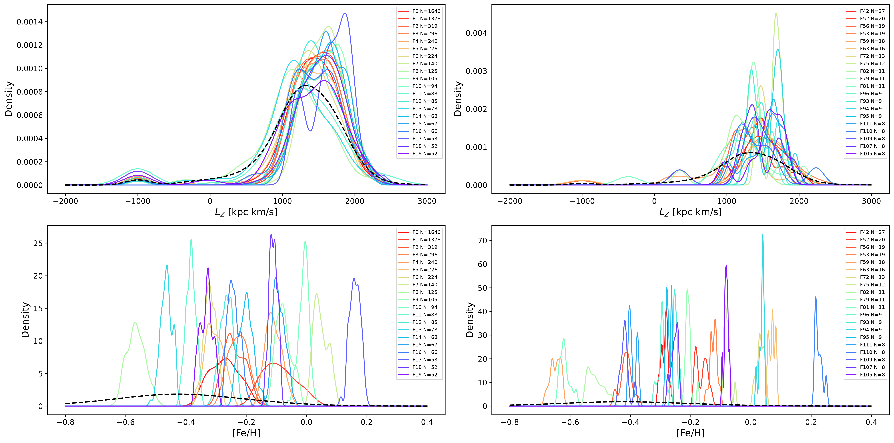
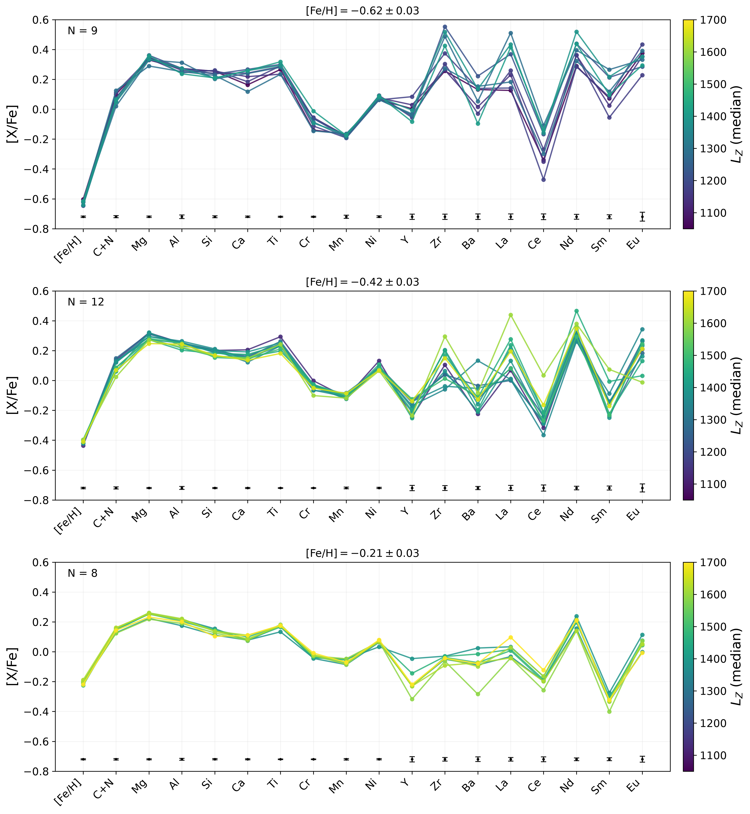

$\newcommand{\ensuremath}{}$
$\newcommand{\xspace}{}$
$\newcommand{\object}[1]{\texttt{#1}}$
$\newcommand{\farcs}{{.}''}$
$\newcommand{\farcm}{{.}'}$
$\newcommand{\arcsec}{''}$
$\newcommand{\arcmin}{'}$
$\newcommand{\ion}[2]{#1#2}$
$\newcommand{\textsc}[1]{\textrm{#1}}$
$\newcommand{\hl}[1]{\textrm{#1}}$
$\newcommand{\footnote}[1]{}$
$\newcommand{\vdag}{(v)^\dagger}$
$\newcommand\aastex{AAS\TeX}$
$\newcommand\latex{La\TeX}$

# Identifying Chemically Coherent Stellar Families in the Galactic High-$\alpha$ Disk with Low-Resolution Spectroscopy

<mark>Appeared on: 2026-11-09</mark> -  _21 pages, 14 figures, accepted to ApJ_

T. Wu, et al. -- incl., <mark>M. Zhang</mark>

**Abstract:** Identification of chemical substructures in the Galactic high- $\alpha$ disk provides valuable insight into its formation history. In this work, we demonstrate the capability of low-resolution spectroscopy for this purpose by applying DBSCAN clustering to 87,275 red giants in the high- $\alpha$ disk using 18 elemental abundances derived from LAMOST low-resolution spectra ( $R\lesssim1800$ ). We assess the effectiveness of this approach by comparing the clustering results from the low-resolution data with those obtained by applying the same procedure to high-resolution survey abundances and to mock catalogs. These comparisons suggest that, despite the relatively large uncertainties in individual elemental abundances derived from low-resolution spectra, the astrophysical coherence among different elements provides sufficient information to identify chemically coherent families that may share similar enrichment histories without necessarily sharing a common birth environment. After scanning the parameter space of the DBSCAN procedure and merging the results from different parameter combinations, we identify 133 candidate chemical families containing 4,642 unique stars (5.3 \% of the high- $\alpha$ disk sample). These families exhibit diverse multi-element abundance patterns, with particularly prominent differences in neutron-capture elements at nearly identical [ Fe/H ] values. These families therefore offer new constraints on the diversity of chemical enrichment pathways and on the assembly history of the high- $\alpha$ disk.

**Figure 10. -** The distributions of angular momentum $L_Z$(top panels) and metallicity [Fe/H](bottom panels) for the identified chemical families. The left panels show non-isolated families (with $W_{L_{z}}\geq500$$\mathrm{kpc km s^{-1}}$), while the right panels show isolated families (with $W_{L_{z}}<500$$\mathrm{kpc km s^{-1}}$). Colors indicate individual families, sorted from largest (red) to smallest (purple). The dashed black curves represent the stars not assigned to any cluster.  (*fig:lz_feh_kde*)

**Figure 11. -** Median chemical abundance patterns of the identified families in three selected [Fe/H] bins. Each line represents the chemical pattern of each family and is color-coded by median angular momentum $L_Z$.
        The x-axis shows the 18 elemental abundances adopted in this work, including light elements to neutron-capture species. The black error bars represent the typical uncertainties of the family median abundances within each metallicity bin. The number of identified families in each metallicity bin is indicated in the top-left corner of each panel. (*fig:lzfehpatterns*)

**Figure 12. -** Distribution of the angular momentum $L_z$ for the identified chemical families in the high-dimensional abundance space. Each colored curve represents the kernel density distribution of $L_z$ for an individual chemical family after the hierarchical merging procedure. Different panels display different subsets of chemical families for clarity. Many families exhibit relatively compact and distinct $L_z$ distributions, suggesting that chemically coherent structures identified in abundance space may also retain characteristic dynamical properties. Several families show broad or multi-peaked $L_z$ distributions, indicating possible dynamical mixing, radial migration, or the presence of chemically similar but dynamically complex populations. (*fig:lz_dis*)

