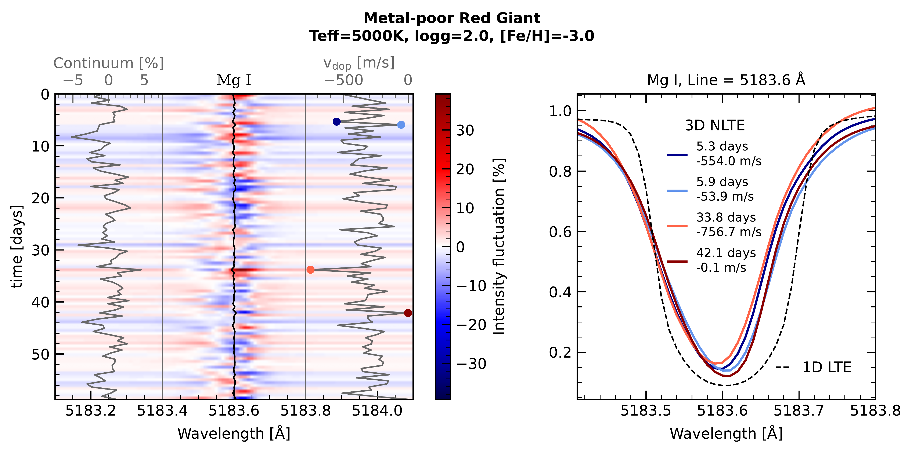
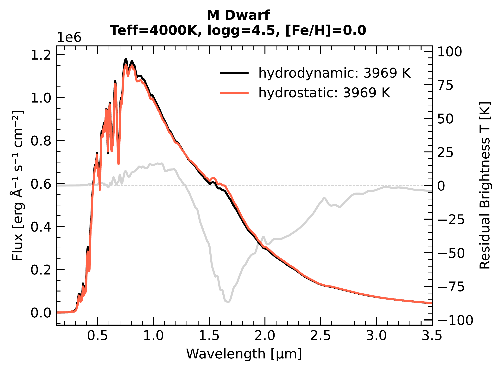
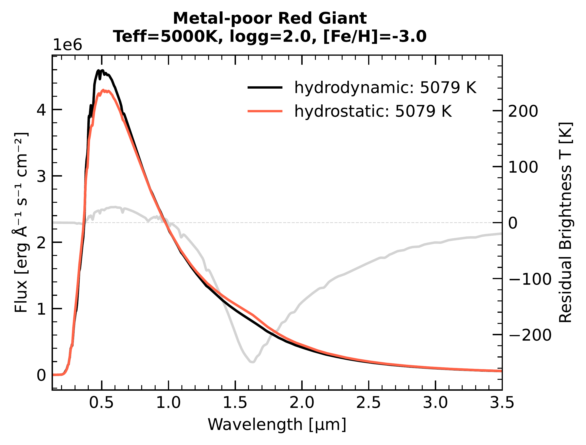
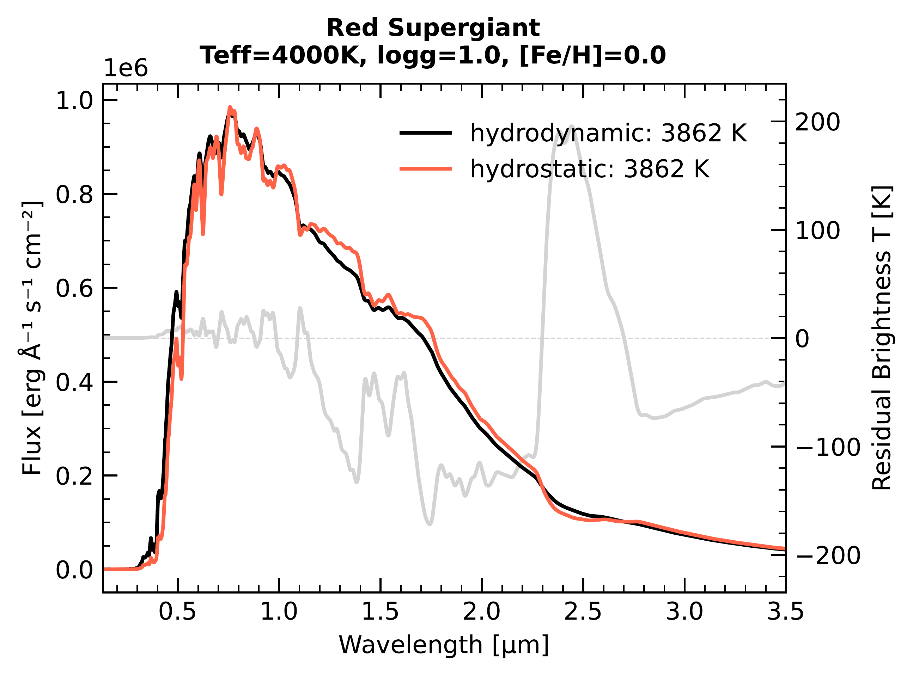
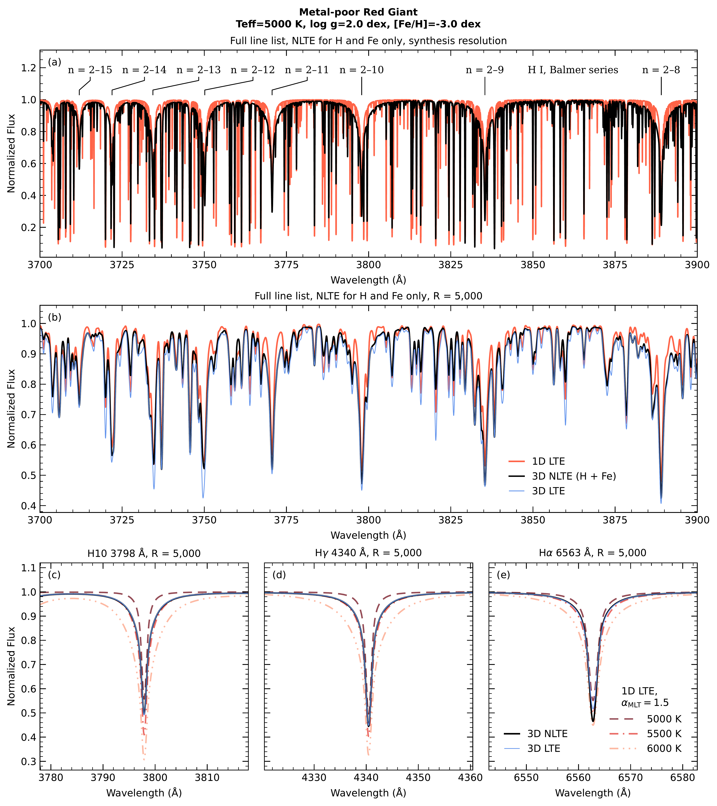

$\newcommand{\ensuremath}{}$
$\newcommand{\xspace}{}$
$\newcommand{\object}[1]{\texttt{#1}}$
$\newcommand{\farcs}{{.}''}$
$\newcommand{\farcm}{{.}'}$
$\newcommand{\arcsec}{''}$
$\newcommand{\arcmin}{'}$
$\newcommand{\ion}[2]{#1#2}$
$\newcommand{\textsc}[1]{\textrm{#1}}$
$\newcommand{\hl}[1]{\textrm{#1}}$
$\newcommand{\footnote}[1]{}$
$\newcommand{\pltscale}{0.7}$
$\newcommand{\spc}[2]{#1 \textsc{\romannumeral #2}\xspace}$
$\newcommand{\Multi}{\texttt{MULTI}\xspace}$
$\newcommand{\MultiD}{\texttt{MULTI3D}\xspace}$
$\newcommand{\Dispatch}{\texttt{DISPATCH}\xspace}$
$\newcommand{\Must}{\texttt{M3DIS}\xspace}$
$\newcommand{\Mdis}{\texttt{M3DIS}\xspace}$
$\newcommand{\Turb}{\texttt{TurbospectrumNLTE}\xspace}$
$\newcommand{\Code}{\texttt{OpenMULTI3D}\xspace}$
$\newcommand{\Stagger}{\texttt{STAGGER}\xspace}$
$\newcommand{\Cobold}{\texttt{CO5BOLD}\xspace}$
$\newcommand{\Marcs}{\texttt{MARCS}\xspace}$
$\newcommand{\Muram}{\texttt{MURAM}\xspace}$
$\newcommand{\Bifrost}{\texttt{BIFROST}\xspace}$
$\newcommand{\UOP}{\texttt{UOP}\xspace}$
$\newcommand{\Balder}{\texttt{BALDER}\xspace}$
$\newcommand{\Teff}{T_{\text{eff}}\xspace}$
$\newcommand{\stellarparams}[3]{T_{\text{eff}}=\SI{#1}{K}, \log g=#2, \mathrm{[Fe/H]}=#3}$
$\newcommand{\rom}[1]{\MakeUppercase{\romannumeral #1}}$
$\newcommand{\arraystretch}{1.4}$

# The OpenMULTI3D stellar analysis package: A 3D non-LTE spectrum synthesis code for AFGKM-type stars   \ within the DISPATCH framework

<mark>Appeared on: 2026-11-09</mark> -  _Accepted for publication in A&A. 22 pages, 12 figures, 9 tables. Code available at this https URL_

<mark>R. Hoppe</mark>, et al. -- incl., <mark>M. Bergemann</mark>, <mark>P. Eitner</mark>, <mark>N. Storm</mark>

**Abstract:** Upcoming large spectroscopic surveys such as WEAVE, 4MOST, and SDSS-V will provide millions of high-resolution stellar spectra. This motivates the development of efficient codes to perform three-dimensional (3D) non-local thermodynamic equilibrium (non-LTE) radiative transfer (RT) calculations, in order to meet the requirements on efficiency and data analysis quality set by these surveys. We present a new open access 3D non-LTE spectrum synthesis code $\Code$ , based on its predecessor $\MultiD$ , which was never released. This code can be used to compute large grids of spectra of AFGKM-type stars and will aid the exploitation of large-scale spectroscopic surveys such as 4MOST. We summarise the main input micro- and macro-physics of the code, describe its numerical implementation and provide selected test cases. The outputs of the code are compared with standard results in the literature, including the NLTE departure coefficients in 1D and 3D, the 3D NLTE abundance corrections, 3D synthetic spectral energy distributions for three types of stars, and 3D NLTE Balmer-line profiles of a metal-poor red giant. We also demonstrate how the code can be used to compute time-dependent spectra of stars, which may be relevant in precision stellar physics and analyses of exoplanet spectra. $\Code$ offers an accessible and efficient platform for high-fidelity stellar analysis in the era of large-scale spectroscopic surveys.

**Figure 8. -** The left panel shows the time-variability of a 3D NLTE Mg line profile for a series of $\sim100$ snapshots, presented for a typical metal-poor red giant. The starting time is past the relaxation time ($\Teff$ convergence) of the atmospheric model. The intensity fluctuations are measured with respect to the time averaged mean. The first grey inset in the left panel shows the intensity fluctuation of the continuum only. The second grey inset shows the Doppler shift of the line core, which is also shown in wavelength space by the black solid line in the centre of the plot. The right panel shows the mean line profile and highlights the line profiles from two selected snapshots responsible for the minimum and maximum Doppler shifts. (*fig:time_rgb*)

**Figure 1. -** SED test calculation of a typical M dwarf, metal-poor red giant and red supergiant computed in 1D and 3D LTE using $\Code$. The spectra have been convolved to a resolution of $R = 100$ for easier visual comparison. The legend states the effective temperature of the spectra from direct integration. (*fig:sed_3d*)

**Figure 7. -** Synthetic spectra of a metal-poor red giant. The 3D spectra are computed from a single snapshot of an $\Mdis$ model atmosphere, and the 1D LTE spectra come from $\Marcs$ models. (a) The 3700--3900 Å region at the synthesis resolution, computed with the line lists from Table \ref{tab:line_lists} in 1D LTE (red) and 3D NLTE (black) where only H and Fe are treated in NLTE. The labels give the principal quantum numbers of the lower and upper levels of the Balmer lines. (b) The same spectra convolved to $R = 5000$, with 3D LTE added (blue). (c--e) H10, H$\gamma$ and H$\alpha$ at $R = 5000$, computed with hydrogen lines only. 3D NLTE (black) and 3D LTE (blue) are compared with 1D LTE on $\Marcs$ models of 5000, 5500 and 6000 K (red). (*fig:balmer*)

