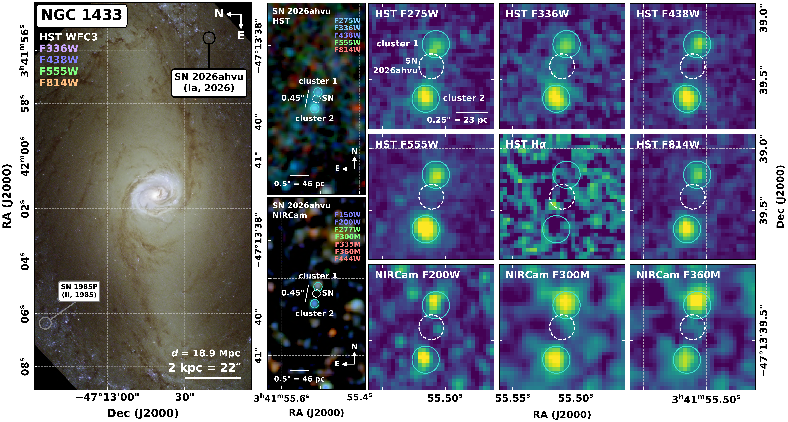
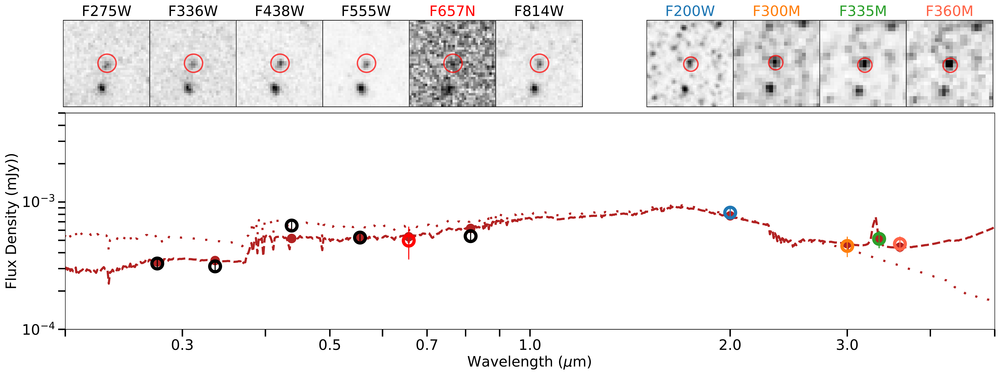
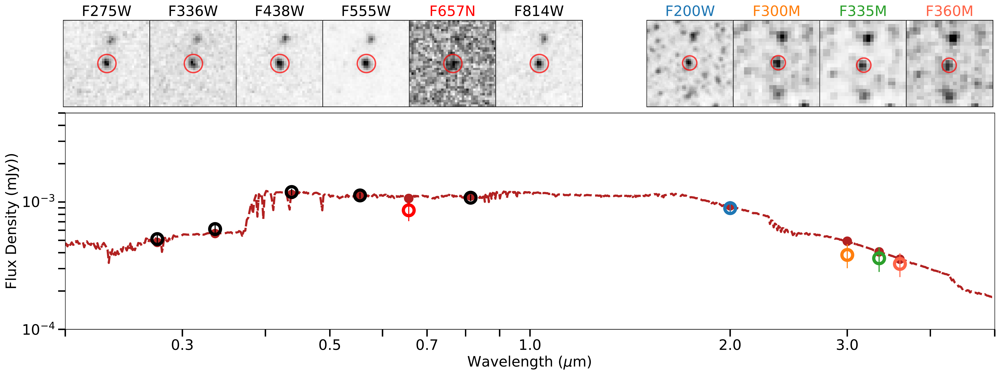

$\newcommand{\ensuremath}{}$
$\newcommand{\xspace}{}$
$\newcommand{\object}[1]{\texttt{#1}}$
$\newcommand{\farcs}{{.}''}$
$\newcommand{\farcm}{{.}'}$
$\newcommand{\arcsec}{''}$
$\newcommand{\arcmin}{'}$
$\newcommand{\ion}[2]{#1#2}$
$\newcommand{\textsc}[1]{\textrm{#1}}$
$\newcommand{\hl}[1]{\textrm{#1}}$
$\newcommand{\footnote}[1]{}$
$\newcommand{\vdag}{(v)^\dagger}$
$\newcommand\aastex{AAS\TeX}$
$\newcommand\latex{La\TeX}$
$\newcommand\Msun{M_{\odot}\xspace}$
$\newcommand\msunpc{M_{\odot} pc^{-2}}$
$\newcommand\atomh{\ion{H}{1}\xspace}$
$\newcommand\molh{H_2\xspace}$
$\newcommand\cmcube{cm^{-3}\xspace}$
$\newcommand\kms{km s^{-1}\xspace}$
$\newcommand\todo[1]{\textcolor{red}{#1}}$
$\newcommand\blank{\textcolor{purple}{XX}\xspace}$
$\newcommand\blankcite{\textcolor{orange}{[cite]}\xspace}$
$\newcommand\densitymodelone{\Sigma_g=10 \msunpc\xspace}$
$\newcommand\densitymodeltwo{\Sigma_g=30 \msunpc\xspace}$
$\newcommand{\sn}{SN 2026ahvu}$

# SN 2026ahvu in NGC 1433 May Be a Prompt Type Ia Supernova with a Delay Time Under 100 Myr

<mark>Appeared on: 2026-11-09</mark> -  _10 pages, 2 figures, 1 table. Submitted to ApJL_

S. K. Sarbadhicary, et al. -- incl., <mark>J. G. Lobos</mark>, <mark>E. Schinnerer</mark>

**Abstract:** $\sn$ is a Type Ia supernova (SN) that occurred in the nearby galaxy NGC 1433. Using archival Hubble and JWST imaging from the PHANGS survey, we show that the SN lies within 0.19 $"$ and 0.26 $"$ of two UV-bright star clusters. This $0.19/0.26"$ separation corresponds to $8/11$ pc ( $17/24$ pc) at the reported distances of $9.1$ and $18.9$ Mpc, respectively. The probability of finding an unrelated Type Ia SN this close to a cataloged star cluster by chance is only $\sim$ 0.4 \% . Thus, $\sn$ is likely the first Type Ia SN that can be associated with relatively young star clusters in a nearby galaxy. From spectral energy distribution fitting using HST+JWST (or HST-only) data, we find that the clusters have age estimates of $37_{-5}^{+3}$ ( $57_{-9}^{+14}$ ) Myr and $95_{-13}^{+15}$ ( $88_{-12}^{+14}$ ) Myr. Association with either cluster would mean that $\sn$ should be considered a prompt SN Ia and provide one of the most concrete measurements to date of a prompt Ia delay time. The median age of the younger star cluster is close to the minimum possible delay time for SN Ia progenitors. If the SN is indeed associated with the younger cluster, it would imply that Type Ia SNe can occur almost immediately after white dwarf formation. If the SN is associated with the older cluster, this discovery still presents the first example of a prompt Type Ia SN with delay time under 100 Myr.

**Figure 1. -** **Location of $\sn$ in NGC 1433.**_Left:_ HST/WFC3 color image of the bar and nuclear ring of NGC 1433 (credit: ESA/Hubble \& NASA; F336W, F438W, F555W and F814W), rotated by 90$^\circ$. The black circle marks the TNS position of $\sn$(Type Ia). The grey circle marks SN 1985P (Type II), another historical SN in this galaxy within our 5$'$ footprint. The scale bar is $\approx 1$ kpc at $9.1$ Mpc or $\approx 2$ kpc ($22"$) at $d = 18.9$ Mpc. _Middle:_$2.5" \times 5"$ north-up color cutouts centered on $\sn$, from HST/UVIS (top; F275W+F336W, F438W, F555W, F814W) and JWST/NIRCam (bottom; F150W+F200W, F277W+F300M, F335M+F360M+F444W). The dashed white circle shows the $\sim$1$\sigma$($0.1"$) positional uncertainty of $\sn$. The cyan circles mark the two candidate host star clusters, $0.19"$ north (cluster 1) and $0.26"$ south (cluster 2) of the SN. The clusters are $0.45"$ apart, $\approx 20$ pc at 9.1 Mpc or 41 pc at 18.9 Mpc. _Right:_$1" \times 1"$ single-band cutouts on a common north-up grid, in order of wavelength: HST UV--optical, continuum-subtracted HST H$\alpha$, and JWST/NIRCam. Each panel uses an asinh stretch from $-1\sigma$ to its peak, clipped to 5--30$\sigma$. The markers are the same as in the middle panels, and the scale bar is $0.25"$(11 or 23 pc, respectively). Both clusters are detected from the UV to $\sim$4.4 $\mu$m. Neither cluster shows H$\alpha$ emission, and neither is detected by MIRI (not shown): the clusters lie in a gap between dust/PAH filaments. (*fig:fig1*)

**Figure 2. -** Observed SED (open circles with error bars, see Table \ref{tab:photandfit}) with their best-fit modeled spectra (dashed dark red line) for Cluster 1 (top) and Cluster 2 (bottom). Solid dark red points show the modeled fluxes in each filter. The dotted line in Cluster 1 indicates the modeled intrinsic stellar continuum, without dust absorption or emission. Note the divergence of Cluster 1's NIR modeled spectrum from the pure stellar continuum, indicating that there must be some hot dust present. Best fit ages and masses are reported in Table \ref{tab:photandfit}, along with 16-84\% confidence ranges. The presence of bright near-UV emission in both clusters leads to fitted ages $\lesssim 100$ Myr and suggests that $\sn$ is a prompt SN Ia if it is associated with either cluster. (*fig:clustersed*)

