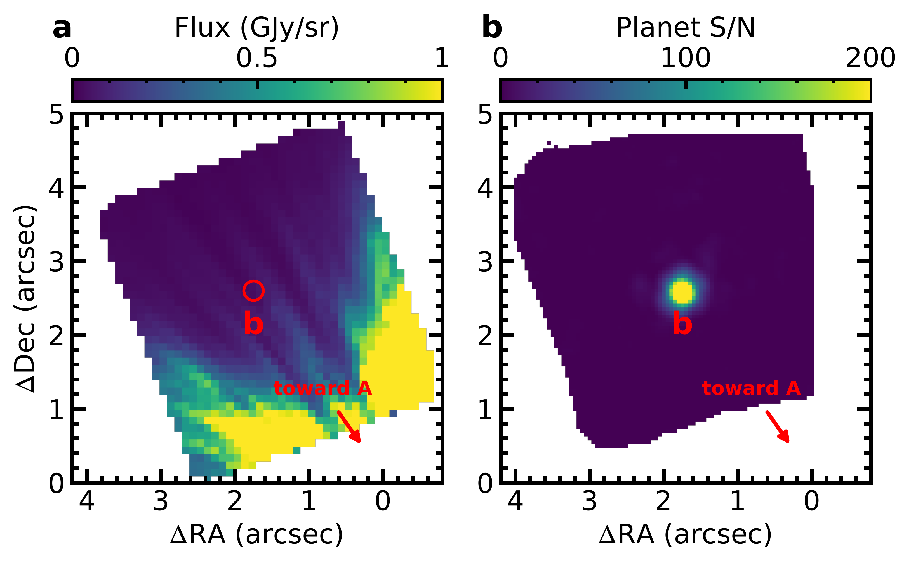
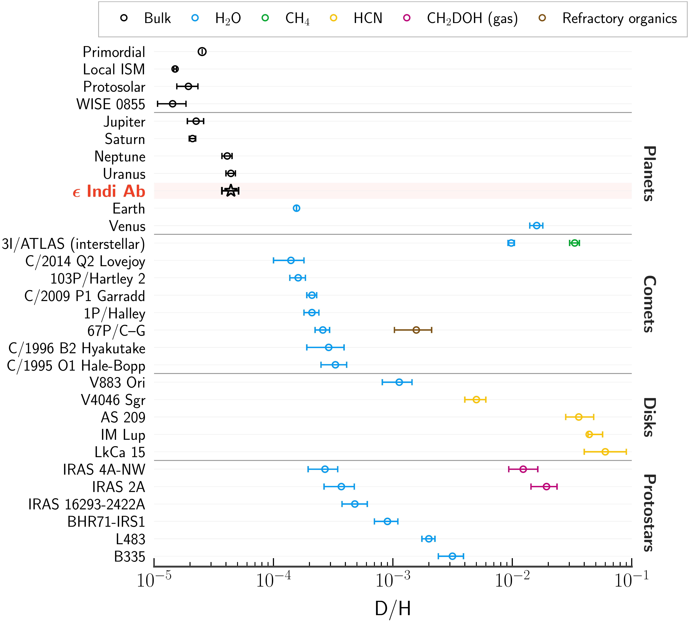

$\newcommand{\ensuremath}{}$
$\newcommand{\xspace}{}$
$\newcommand{\object}[1]{\texttt{#1}}$
$\newcommand{\farcs}{{.}''}$
$\newcommand{\farcm}{{.}'}$
$\newcommand{\arcsec}{''}$
$\newcommand{\arcmin}{'}$
$\newcommand{\ion}[2]{#1#2}$
$\newcommand{\textsc}[1]{\textrm{#1}}$
$\newcommand{\hl}[1]{\textrm{#1}}$
$\newcommand{\footnote}[1]{}$
$\newcommand{\pcc}{ cm^{-3}}$
$\newcommand{\Rstar}{\ensuremath{R_{\star}}\xspace}$
$\newcommand{\msini}{\ensuremath{m \sin I}\xspace}$
$\newcommand{\ms}{\ensuremath{\mathrm{m} \mathrm{s}^{-1}}\xspace}$
$\newcommand{\masyr}{\ensuremath{\mathrm{mas} \mathrm{yr}^{-1}}\xspace}$
$\newcommand{\Me}{\ensuremath{M_{\oplus}}\xspace}$
$\newcommand{\Rj}{\ensuremath{R_{\rm{Jup}}}\xspace}$
$\newcommand{\Mj}{\ensuremath{M_{\rm{Jup}}}\xspace}$
$\newcommand{\kms}{km~s^{-1}\xspace}$
$\newcommand{\Rsun}{\ensuremath{R_{\odot}}\xspace}$
$\newcommand{\Msun}{\ensuremath{M_{\odot}}\xspace}$
$\newcommand{\Lsun}{L_\odot}$
$\newcommand{\Teff}{\ensuremath{T_\mathrm{eff}}\xspace}$
$\newcommand{\logg}{\ensuremath{\log{g}}\xspace}$
$\newcommand{\lbollsun}{\ensuremath{\log(L_\mathrm{bol}/\Lsun)}}$
$\newcommand\refname{References and Notes}$
$\newcommand{\fnum@figure}{\textbf{Figure \thefigure}}$
$\newcommand{\fnum@table}{\textbf{Table \thetable}}$
$\newcommand{\Re}{\ensuremath{R_{\oplus}}\xspace}$
$\newcommand{\thefigure}{S\arabic{figure}}$
$\newcommand{\thetable}{S\arabic{table}}$
$\newcommand{\theequation}{S\arabic{equation}}$
$\newcommand{\thepage}{S\arabic{page}}$
$\newcommand\scititle{$
$	The deuterium-rich atmosphere of a mature super-Jupiter$
$}$

# $\bfseries$ $\boldmath$ $\scititle$

<mark>Appeared on: 2026-11-10</mark> -  _Under review_

J. W. Xuan, et al. -- incl., <mark>Y. Zhang</mark>, <mark>E. Matthews</mark>

**Abstract:** $\bfseries$ $\boldmath$ The deuterium-to-hydrogen ratio (D/H) has provided key insights into the origin and evolution of the Solar System. Using the James Webb Space Telescope, we detected deuterated methane at $48\sigma$ in a mature giant exoplanet, $\epsilon$ Ind Ab. We measure the planet's D/H ratio to be $(4.4\pm0.7)\times10^{-5}$ , which is similar to those of Uranus and Neptune but about twice those of Jupiter, Saturn, and the protosolar nebula. $\epsilon$ Ind Ab's heavy elements (C, O, N, and S) are uniformly enriched to a level similar to Jupiter's. These measurements require $\epsilon$ Ind Ab to have accreted solids with $\rm D/H\gtrsim1\%$ , at least 30 times more deuterium-rich than typical Solar System comets. Such D/H values are found in the interstellar comet 3I/ATLAS and in organic molecules in star-forming regions, indicating that $\epsilon$ Ind Ab accreted pristine solids formed in a very cold environment.

**Figure 1. -** **Detection of $\epsilon$ Ind Ab with moderate-resolution mode of JWST/NIRSpec IFU in the $3-5 \mu$m spectral range.****a,** The median spectral cube for one of the two NIRSpec rolls from the standard JWST pipeline before starlight subtraction. Here, the stellar diffraction pattern dominates the image. The host star $\epsilon$ Ind A is just outside the field of view of the IFU, and the red arrow marks its direction. **b,** S/N map for $\epsilon$ Ind Ab combining the two NIRSpec rolls and both NIRSpec detectors. Summed over all wavelength channels, the planet is detected with a S/N of approximately 600.
 (*fig:detection*)

**Figure 2. -** **Detection of $CH_3$D in $\epsilon$ Ind Ab.****a,** A segment of the NIRSpec spectrum (black). The best-fit full model including all species is in blue, and the best-fit model from a separate retrieval that excludes $CH_3$D opacity is in orange. The difference between the blue and orange models is due to $CH_3$D; we mark locations of $CH_3$D lines with red dashed lines and arrows. **b,** The residuals after subtracting the best-fit model without $CH_3$D from the data (black), plotted against the $CH_3$D-only model (red). A cross-correlation analysis between the residuals and $CH_3$D model indicates a detection $\rm S/N\approx48$ for $CH_3$D in $\epsilon$ Ind Ab's atmosphere. Equivalent plots to panel b for other species are shown in figure \ref{fig:other_detections}.
 (*fig:spectrum*)

**Figure 3. -** **D/H measurements in various astrophysical environments, including planets, comets, circumstellar disks, and protostars.** The black markers indicate estimates of bulk D/H, either measured directly from atomic or molecular hydrogen or inferred from other molecules with appropriate corrections ($CH_3$D/$CH_4$ for $\epsilon$ Ind Ab and WISE 0855). The other colors denote D/H in specific molecular tracers, and do not represent bulk D/H: $H_2$O (blue), $CH_4$(teal), HCN (yellow), gas-phase deuterated methanol, $CH_2$DOH (magenta), and refractory organics (brown). Data sources: primordial value \cite{Cooke2018}; WISE 0855 \cite{Rowland2024}; local ISM, Solar System planets, most Solar System comets, and protostars, from a published compilation \cite{Nomura2023}; 3I/ATLAS \cite{Cordiner2026,2026arXiv260320445R}; 67P/Churyumov--Gerasimenko, using updated values \cite{Mandt2024,Paquette2021}; V883 Ori \cite{Tobin2023}; HCN in other protoplanetary disks \cite{Huang2017}.
 (*fig:dtoh*)

