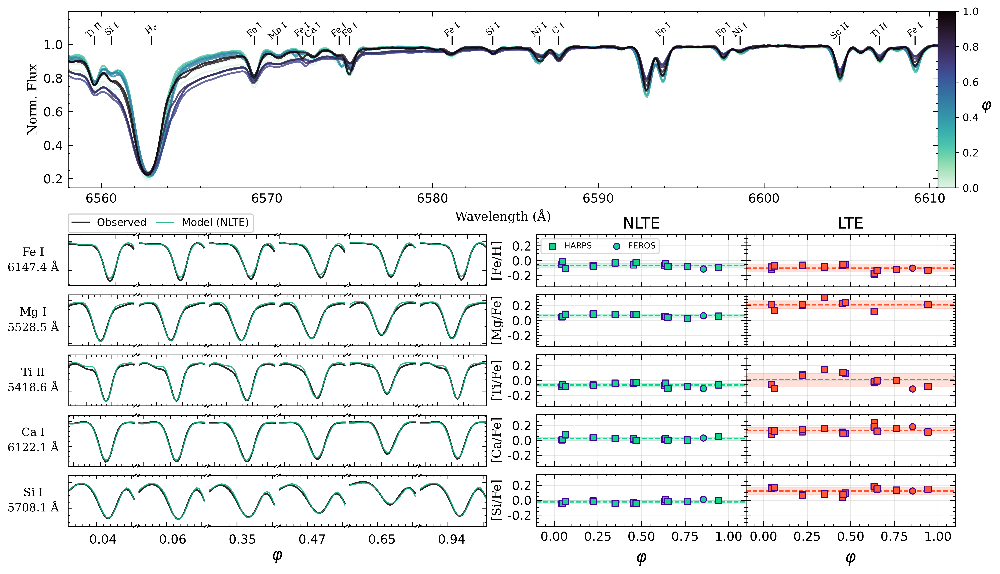
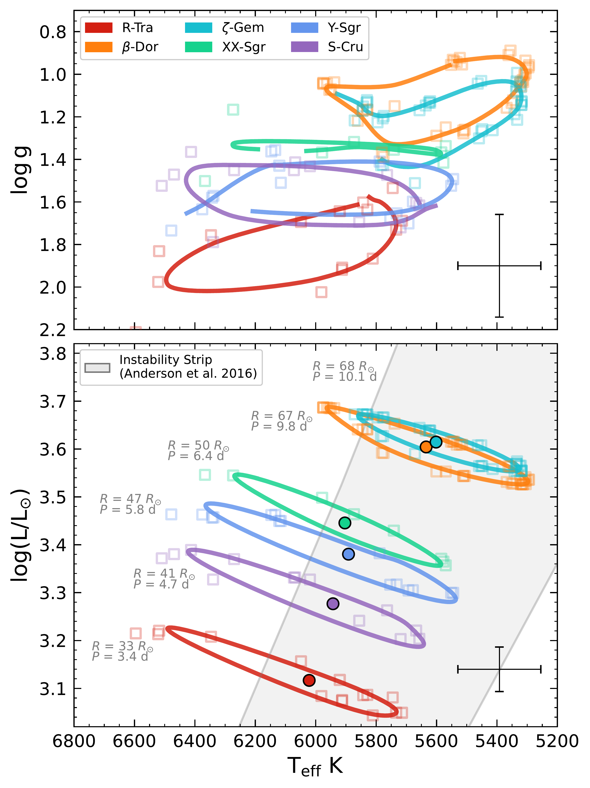
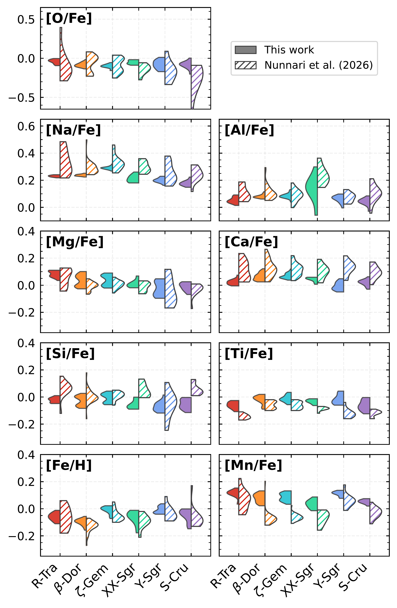

$\newcommand{\ensuremath}{}$
$\newcommand{\xspace}{}$
$\newcommand{\object}[1]{\texttt{#1}}$
$\newcommand{\farcs}{{.}''}$
$\newcommand{\farcm}{{.}'}$
$\newcommand{\arcsec}{''}$
$\newcommand{\arcmin}{'}$
$\newcommand{\ion}[2]{#1#2}$
$\newcommand{\textsc}[1]{\textrm{#1}}$
$\newcommand{\hl}[1]{\textrm{#1}}$
$\newcommand{\footnote}[1]{}$
$\newcommand{\gradientpm}[2]{\makebox[3.3em][r]{#1}\ensuremath{ \pm }\makebox[3.3em][l]{#2}}$
$\newcommand{\gradientci}[3]{\makebox[3.3em][r]{#1}\ensuremath{ _{-#2}^{+#3}}}$
$\newcommand{\vdag}{(v)^\dagger}$
$\newcommand\aastex{AAS\TeX}$
$\newcommand\latex{La\TeX}$
$\newcommand{\hnot}{\mathrm{H}_{0}}$
$\newcommand{\hnotsp}{\mathrm{H}_{0}  }$
$\newcommand{\angstrom}{\mbox{\normalfontÅ}}$
$\newcommand{\chisq}{\chi^{2}}$
$\newcommand{\ironab}{\left[\mathrm{Fe} / \mathrm{H}\right] }$
$\newcommand{\teff}{T_{\rm eff}  }$
$\newcommand{\Gbp}{\mathrm{G}_{\mathrm{BP}}  }$
$\newcommand{\Grp}{\mathrm{G}_{\mathrm{RP}}  }$
$\newcommand{\Gbpnosp}{\mathrm{G}_{\mathrm{BP}}}$
$\newcommand{\Grpnosp}{\mathrm{G}_{\mathrm{RP}}}$
$\newcommand{\Rsun}{R_{\odot} }$
$\newcommand{\logg}{\log{g} }$
$\newcommand{\vmic}{\mathrm{V}_{\mathrm{mic}}  }$
$\newcommand{\vbrd}{\rm{V}_{\rm{brd}}  }$
$\newcommand{\teffnospace}{T_{\rm eff}}$
$\newcommand{\loggnospace}{\log{g}}$
$\newcommand{\vmicnospace}{\mathrm{V}_{\mathrm{mic}}}$
$\newcommand{\vbrdnospace}{\rm{V}_{\rm{brd}}}$
$\newcommand{\arraystretch}{0.90}$
$\newcommand{\arraystretch}{1.00}$
$\newcommand{\arraystretch}{0.90}$
$\newcommand{\arraystretch}{0.90}$

# Classical Cepheids in the 4MOST era: I. Methodology for 4MOST variable stars and NLTE abundance gradients in the Milky Way.

<mark>Appeared on: 2026-11-10</mark> -  _24 pages, 19 figures, Accepted for publication by A&A_

R. Albarracín, et al. -- incl., <mark>M. Bergemann</mark>, <mark>N. Storm</mark>, <mark>G. Guiglion</mark>, <mark>A. Dimoff</mark>

**Abstract:** Classical Cepheids (CCs) are key distance indicators and tracers of young stellar populations in the Milky Way. Their period-luminosity-metallicity (PLZ) relation also makes them calibrators of the Hubble constant $H_0$ . Despite their importance, chemical composition, especially non-LTE (NLTE) effects, remains a significant source of systematics in PLZ applications. In preparation for the large sample of CCs expected from the 4MIDABLE-HR (4MOST Consortium Survey 4: Milky Way Disc and Bulge High-Resolution) survey, we present a method for deriving Cepheid atmospheric parameters and chemical abundances in NLTE. Using the Payne artificial neural network (ANN) trained on NLTE spectra, we derive atmospheric parameters and abundances for 17 elements: O, Na, Mg, Al, Si, Ca, Ti, Mn, Fe, Co, Ni, Sr, Y, Ba, Eu in NLTE and C and Cr in LTE. We apply the new method to archival spectra of Cepheids and derive radial chemical gradients in the Milky Way. We derive robust NLTE stellar parameters and abundances for Cepheids spanning a broad metallicity range, from $\sim -0.87   \rm{dex}$ to $\sim +0.35   \rm{dex}$ . For stars with multi-epoch spectra, we find that NLTE abundances are consistent across the pulsation cycle, whereas LTE values show larger dispersions and biases. The resulting abundance distributions and gradients align well with Galactic disk expectations from chemical evolution models. We confirm that the gradients flatten in the outer disk beyond $R_{\rm GC} \sim 15 \mathrm{kpc}$ and provide the first NLTE gradients for Co, Ni, Y, and Eu. We show that our NLTE astrophysical analysis yields robust solutions for atmospheric parameters and chemical abundances across spectra at the resolving power of 4MOST-HR. This enables large, homogeneous studies with upcoming surveys such as 4MOST 4MIDABLE-HR and provides a solid basis for tightening constraints on Galactic chemical evolution models and Cepheid distance-scale work.

**Figure 16. -** Multi-epoch spectra of CC R TrA in NLTE and LTE. Top: Portion of the spectra in the vicinity of the $\rm{H}_{\alpha}$ line; the colors indicate the normalized spectra at different pulsation phases. Lines present in our line list are overplotted. Bottom left: Line profiles of key diagnostic features across phase, with the observed spectra shown in black and the best-fitting model in green. Bottom right: Phase dependent abundances for a selection of elements. Light green points on the left represent NLTE abundances for the phases available, while red points on the right correspond to LTE abundances. The NLTE results demonstrate stable solutions in spite of the stellar variability. Only measurements with both stellar parameters and abundances lying within the grid limits are displayed. Dashed lines indicate phase-averaged values, and the shaded regions denote the standard deviation of abundances in NLTE (green) and LTE (red). (*fig:CalibMuliphase*)

**Figure 3. -** $\teff$nospace -$\logg$nospace  diagram (top) and $\teff$nospace -luminosity diagram (bottom) of selected CCs with multiphase observations. Squares show the parameters derived from individual spectra, solid lines represent the Fourier fits to the phase progression of $\teff$nospace , $\logg$nospace , and luminosity. The gray region shows the instability strip from [Anderson, et. al (2016)](https://ui.adsabs.harvard.edu/abs/2016A&A...591A...8A) for a solar-metallicity star with a rotation rate equal to half the critical angular velocity, as defined by [Georgy, et. al (2013)](https://ui.adsabs.harvard.edu/abs/2013A&A...553A..24G). Filled circles show the average positions of the stars in the HR diagram across phase. Crosses show the typical uncertainties in $\teff$nospace , $\logg$nospace , and luminosity. (*fig:multiphase_5_show*)

**Figure 4. -** Abundance histograms for the 6 CCs shown in Fig. \ref{fig:multiphase_5_show}, obtained in NLTE in this work (solid) and reported by [Nunnari, et. al (2026)](https://ui.adsabs.harvard.edu/abs/2026A&A...708A..17N)(hatched) for the spectra common to both studies. Each panel shows the NLTE abundance distribution of an individual element, shown in the top left. (*fig:multiphase_5_abundances*)

