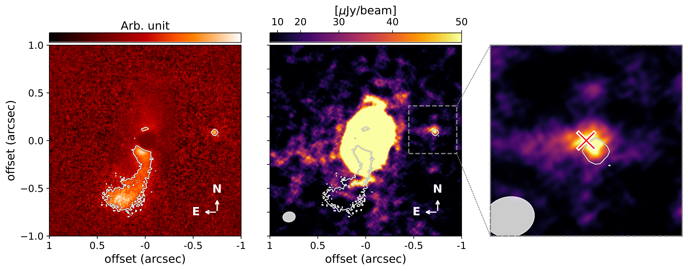
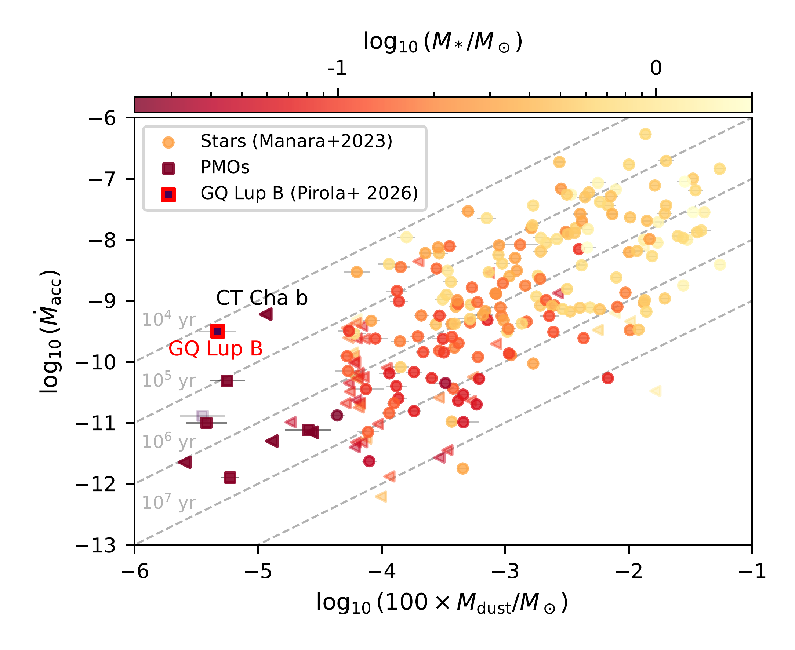
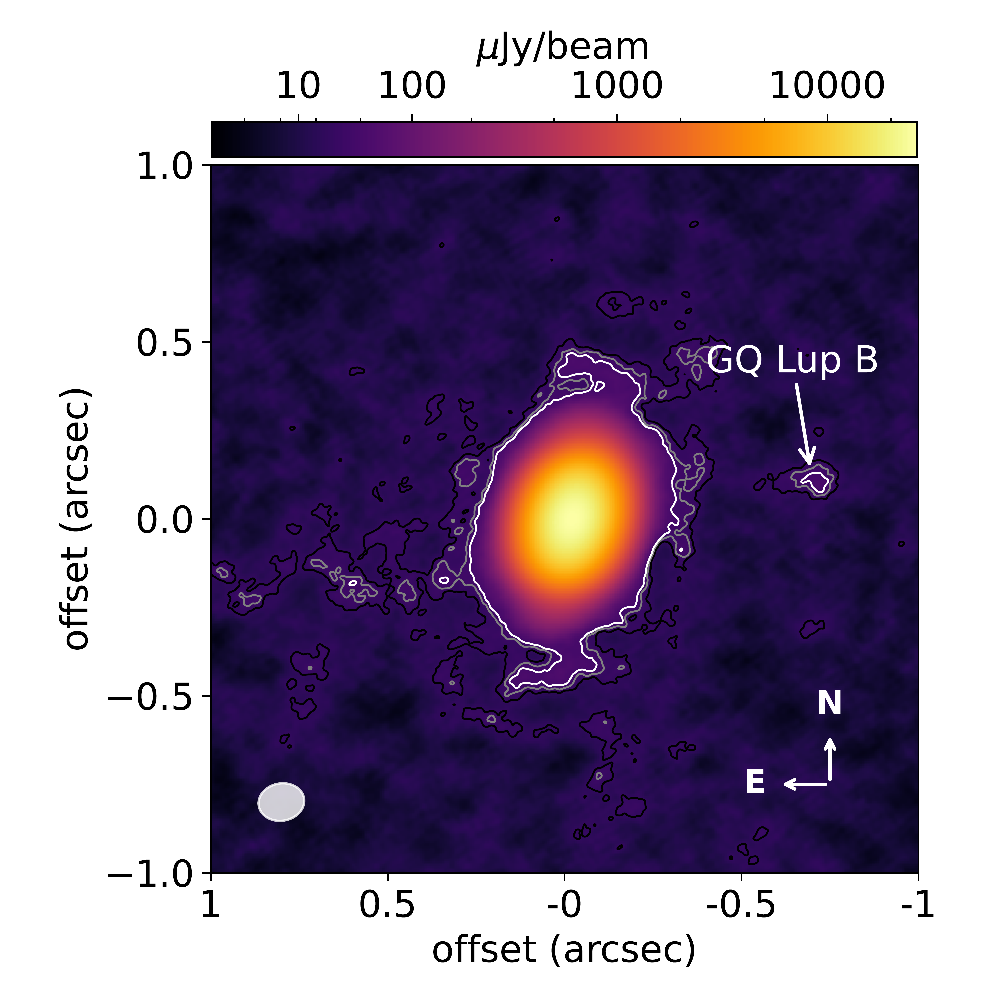

$\newcommand{\ensuremath}{}$
$\newcommand{\xspace}{}$
$\newcommand{\object}[1]{\texttt{#1}}$
$\newcommand{\farcs}{{.}''}$
$\newcommand{\farcm}{{.}'}$
$\newcommand{\arcsec}{''}$
$\newcommand{\arcmin}{'}$
$\newcommand{\ion}[2]{#1#2}$
$\newcommand{\textsc}[1]{\textrm{#1}}$
$\newcommand{\hl}[1]{\textrm{#1}}$
$\newcommand{\footnote}[1]{}$
$\newcommand{\vdag}{(v)^\dagger}$
$\newcommand\aastex{AAS\TeX}$
$\newcommand\latex{La\TeX}$
$\newcommand{\tnote}[1]{\textnormal{ [\textit{#1}]}}$
$\newcommand\TPT@dopara{\let\item\TPT@paraitem\par\noindent}$
$\newcommand\TPT@paraitem{[}$

# ALMA detection of continuum emission from GQ Lup B

<mark>Appeared on: 2026-11-10</mark> -  _12 pages, 11 figures, 2 tables including appendices. Accepted for publication in A&A_

P. Pirola, et al. -- incl., <mark>M. Benisty</mark>

**Abstract:** GQ Lup B is a massive (10-40 M $_{\text{Jup}}$ ) companion orbiting the young T-Tauri star GQ Lup A at a projected distance of $\sim$ 110 au (0.7"). It is outside the circumprimary ${disk in the submm continuum}$ , but its ${\sim} 63^\circ$ inclined orbit intersects the primary's gas disk twice per period.We report a 5.8 $\sigma$ detection of continuum emission at the location of GQ Lup B, obtained with the Atacama Large Millimeter/submillimeter Array (ALMA) at 0.89 mm (band 7). We associate this emission with a dusty disk around the companion, already detected by VLT/NACO and JWST/MIRI in the mid-Infrared. To date, this is the third disk observed at mm wavelengths around ${a companion spanning the brown dwarf and planetary mass regimes}$ , following PDS 70 c, a gas giant embedded in the parent circumstellar disk, and SR 12 c, a planetary-mass companion at 1200 au from the primary.We retrieve a point source with peak intensity $54.5\pm9.4 \mu\rm Jy  beam^{-1}$ , co-spatial with GRAVITY astrometry.The emission is spatially unresolved, ${placing}$ an upper limit on the source radius of 2.3 au ${(from a synthesized beam of $\sim 29\times25$ mas). For comparison, this is smaller than 1/3 of the Hill's radius (3-5 au for GQ Lup B, depending on the assumed mass), the theoretical upper limit for circum-planetary disks.}$ Assuming optically thin thermal emission from mm-size grains ${in a disk-like structure}$ , we infer a mass of 0.0032 M $_\oplus$ , while the optically thick limit yields an emission radius of 0.2 au. ${Assuming a gas to dust ratio of 100, our results indicate a very low disk mass to accretion rate ratio, of the order of $\sim10^4$ years, analogously to the highest accretors in the stellar mass regime. In the case of GQ Lup B, this can be explained by its periodic crossings of the circumprimary disk, which could deliver a substantial amount of gas to the companion's disk over a long timescale.}$

**Figure 9. -** _ Left:_  scattered light image of GQ Lup taken with VLT/SPHERE  ([Holstein, et. al 2021]()) . A white contour (at 40\% of the peak of the image) serves as a reference for the other panels. The single spiral arm visible in the southern part of the image is attributed to the companion, which appears in the right side of the image. Although useful for spatial comparison, the apparent polarized flux of GQ Lup B is caused by the subtraction of the stellar component, as explained in the original paper  ([Holstein, et. al 2021]()) .
    _ Center:_ saturated version of the continuum image from Fig. \ref{fig:continuum_fullscale}, where the color scale has been limited to a range of 0 to $50 \mu\rm Jy \rm  beam ^{-1}$. The dashed gray square, with sides of $0.5"$, is centered on GQ Lup B.
    _ Right:_ zoomed-in view of the same region as in the central panel: the red X marks the companion's position from GRAVITY {on 2023/3/8  ([Venkatesan, et. al 2025]()) , while the white contour} represents the scattered light contour. (*fig:continuumvsscattered*)

**Figure 11. -** Accretion rates for disks around stars (circles) and planetary-mass objects (squares, the same discussed in Fig. \ref{fig:fvsmass}), against dust mass estimates (Eq \ref{eq:Mthin}, T=20 K) multiplied by 100 to account for the gas mass. Triangles represent upper limits. The color scale here accounts for the mass of the disk host, while dashed gray lines represent depletion timescales. (*fig:mdustvsmdot*)

**Figure 1. -** 890$ \mu$m continuum image of GQ Lup (robust=2, beam $\sim 0.13 \times 0.11"$). The contours represent the 3,4, and 5$\sigma$ contours. Given the very high dynamic range of the image (${\sim} 2900$), we used an Asinh normalization of the color scale. (*fig:continuum_fullscale*)

