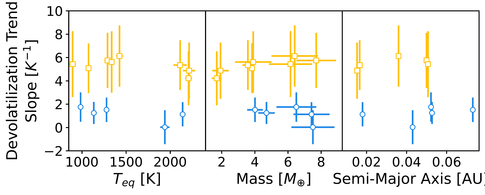
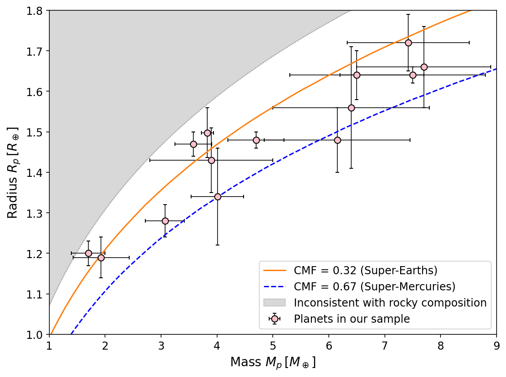
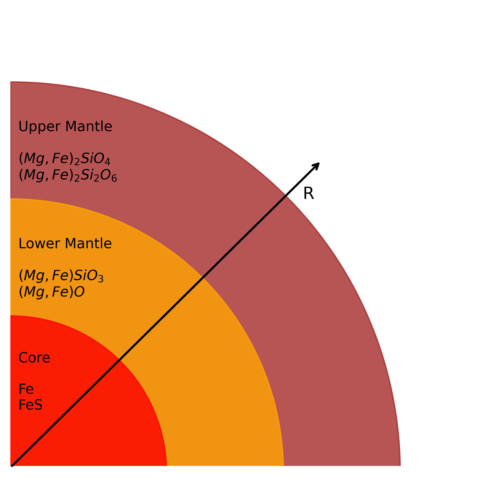

$\newcommand{\ensuremath}{}$
$\newcommand{\xspace}{}$
$\newcommand{\object}[1]{\texttt{#1}}$
$\newcommand{\farcs}{{.}''}$
$\newcommand{\farcm}{{.}'}$
$\newcommand{\arcsec}{''}$
$\newcommand{\arcmin}{'}$
$\newcommand{\ion}[2]{#1#2}$
$\newcommand{\textsc}[1]{\textrm{#1}}$
$\newcommand{\hl}[1]{\textrm{#1}}$
$\newcommand{\footnote}[1]{}$

# The compositional link between rocky exoplanets and their host stars is consistent with Earth-like devolatilization

<mark>Appeared on: 2026-11-10</mark> -  _15 pages, 9 figures, 7 tables. Accepted for publication in Astronomy & Astrophysics_

<mark>Y. Reinarz</mark>, L. Acuña-Aguirre, H. S. Wang

**Abstract:** Previous work found a higher bulk iron-to-silicon (Fe/Si) ratio in rocky exoplanets relative to their host star, traditionally explained by iron enrichment. An alternative explanation is devolatilization of the planetary abundance ratios with respect to the host star, where volatile elements such as oxygen and sulfur are progressively depleted compared to more refractory elements such as iron and magnesium, as in Earth. In this work, we explore whether these elemental molar ratios are consistent with a devolatilization trend. We revisit the estimation of the core mass fraction of 14 rocky exoplanets with masses between 0.5 and 10 Earth masses, focusing on planets where stellar abundances of Fe, Si, Mg, O, and S are available from stellar spectroscopy in the literature. We use interior structure retrievals with two independent forward models, the Marseille Super-Earth Interior model and pyExoInt, to estimate compositional parameters, including elemental molar ratios, from mass and radius measurements. We find that 8 out of 14 exoplanets in our sample present an Earth-like devolatilization trend, while only one planet shows a 1:1 relationship between the planetary and the stellar abundances. This suggests that devolatilization offers a plausible explanation for the observed non-1:1 relation. The two interior models are in good agreement on the devolatilization trend, demonstrating that our derived trends are robust. The main limiting factor in constraining refractory compositions between rocky planets and their host star is the small sample with constrained host stellar abundances and the lack of variety in orbital distances. The _PLATO_ mission will help solve this problem by extending the sample of characterized rocky planets to orbital periods of up to one year. The variety in refractory elemental ratio trends may be indicative of a wide diversity in bulk composition, outgassing and other mantle properties relevant for habitability.

**Figure 9. -** Correlation between the devolatilization trend slope calculated with MSEI and key planetary parameters: orbital distance, equilibrium temperature, and planet mass. The blue circles represent planets whose host stars have abundances available for all the elements in our forward model, including S. The orange squares represent planets whose host star lacks a measured S abundance.  (*fig:corr*)

**Figure 4. -** Mass-radius diagram of the planets in our sample with respective errors. For comparison purposes we show MSEI forward models for CMF = 0.32 and CMF = 0.67, representing Super-Earths and Super-Mercuries respectively. The gray shaded region indicates the part of the mass-radius diagram corresponding to compositions less dense than the pure-mantle threshold, the lowest-density composition possible for a rocky planet. By selecting planets outside this gray area, we rule out planets whose density is inconsistent with a rocky interior without a gas layer (e.g. H$_{2}$O, H$_{2}$). (*fig:MR_diagram_Sample*)

**Figure 1. -** Schematic view of the interior model. (*fig:interior_model*)

