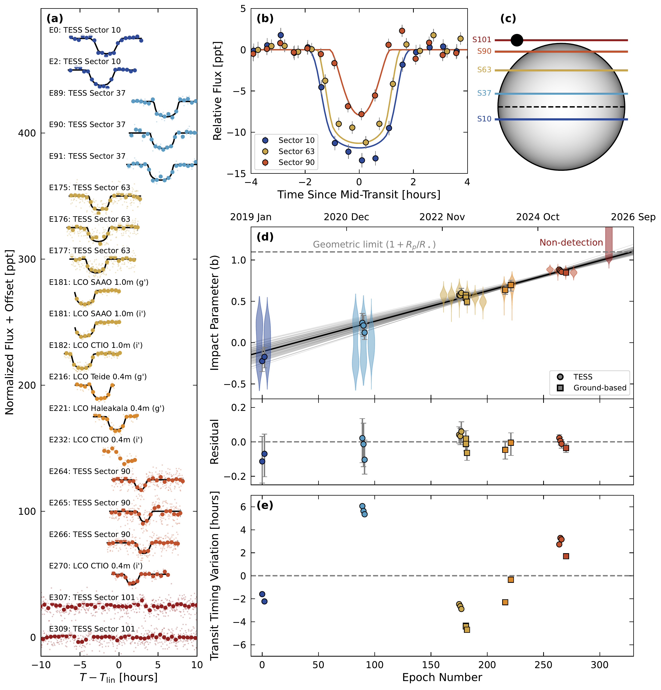
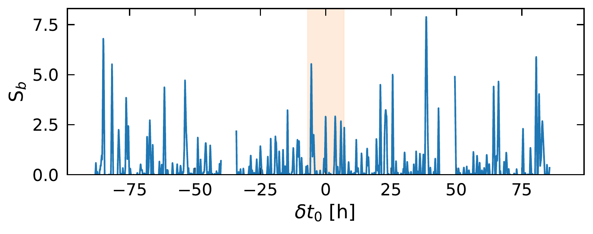
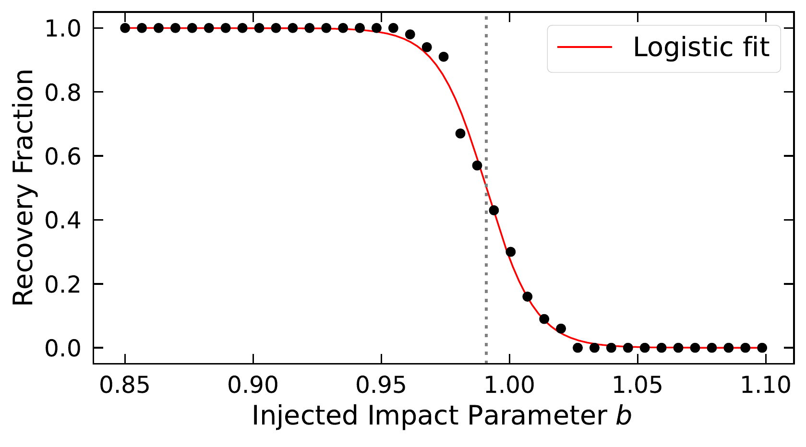
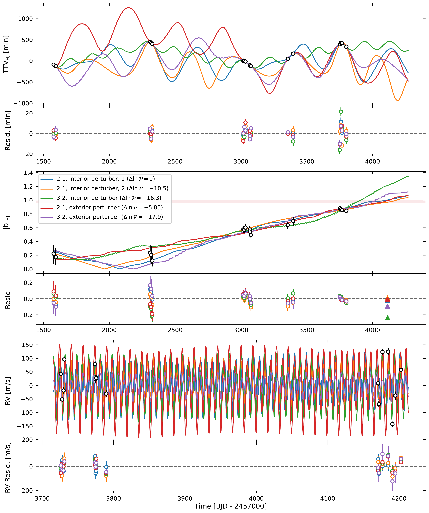

$\newcommand{\ensuremath}{}$
$\newcommand{\xspace}{}$
$\newcommand{\object}[1]{\texttt{#1}}$
$\newcommand{\farcs}{{.}''}$
$\newcommand{\farcm}{{.}'}$
$\newcommand{\arcsec}{''}$
$\newcommand{\arcmin}{'}$
$\newcommand{\ion}[2]{#1#2}$
$\newcommand{\textsc}[1]{\textrm{#1}}$
$\newcommand{\hl}[1]{\textrm{#1}}$
$\newcommand{\footnote}[1]{}$
$\newcommand{\Kepler}{\textit{Kepler}\xspace}$
$\newcommand{\TESS}{TESS\xspace}$
$\newcommand{\Gaia}{\textit{Gaia}\xspace}$
$\newcommand{\Exofast}{\texttt{EXOFASTv2}\xspace}$
$\newcommand{\exoplanet}{\texttt{exoplanet}\xspace}$
$\newcommand{\TTVFast}{\texttt{TTVFast}\xspace}$
$\newcommand{\bjdtdb}{\ensuremath{\mathrm{BJD}_\mathrm{TDB}}\xspace}$
$\newcommand{\Rstar}{\ensuremath{R_{\star}}\xspace}$
$\newcommand{\Mstar}{\ensuremath{M_{\star}}\xspace}$
$\newcommand{\rhostar}{\ensuremath{\rho_{\star}}\xspace}$
$\newcommand{\Rjup}{\ensuremath{R_\mathrm{J}}\xspace}$
$\newcommand{\Mjup}{\ensuremath{M_\mathrm{J}}\xspace}$
$\newcommand{\Rearth}{\ensuremath{R_\oplus}\xspace}$
$\newcommand{\Mearth}{\ensuremath{M_\oplus}\xspace}$
$\newcommand{\Rsun}{\ensuremath{R_\odot}\xspace}$
$\newcommand{\Msun}{\ensuremath{M_\odot}\xspace}$
$\newcommand{\Rp}{\ensuremath{R_p}\xspace}$
$\newcommand{\Mp}{\ensuremath{M_p}\xspace}$
$\newcommand{\rhop}{\ensuremath{\rho_p}\xspace}$
$\newcommand{\Teff}{\ensuremath{T_\mathrm{eff}}\xspace}$
$\newcommand{\logg}{\ensuremath{\log{g}}\xspace}$
$\newcommand{\feh}{\ensuremath{\mathrm{[Fe/H]}}\xspace}$
$\newcommand{\vsini}{\ensuremath{v\sin{i}}\xspace}$
$\newcommand{\vmac}{\ensuremath{v_\mathrm{mac}}\xspace}$
$\newcommand{\jit}{\ensuremath{\sigma_{\mathrm{jit}}\xspace}}$
$\newcommand{\tcirc}{\ensuremath{\tau_{\mathrm{circ}}\xspace}}$
$\newcommand{\Prot}{\ensuremath{P_{\mathrm{rot}}\xspace}}$
$\newcommand{\Porb}{\ensuremath{P_{\mathrm{orb}}\xspace}}$
$\newcommand{\ecosw}{\ensuremath{e\cos{\omega}\xspace}}$
$\newcommand{\esinw}{\ensuremath{e\sin{\omega}\xspace}}$
$\newcommand{\secosw}{\ensuremath{\sqrt{e}\cos{\omega}\xspace}}$
$\newcommand{\sesinw}{\ensuremath{\sqrt{e}\sin{\omega}\xspace}}$
$\newcommand{\imut}{\ensuremath{i_\mathrm{mut}\xspace}}$
$\newcommand{\ms}{\ensuremath{\mathrm{m} \mathrm{s}^{-1}}\xspace}$
$\newcommand{\msday}{\ensuremath{\mathrm{m} \mathrm{s}^{-1} \mathrm{day}^{-1}}\xspace}$
$\newcommand{\kms}{\ensuremath{\mathrm{km} \mathrm{s}^{-1}}\xspace}$
$\newcommand{\gcc}{\ensuremath{\mathrm{g} \mathrm{cm}^{-3}}\xspace}$
$\newcommand{\peryr}{\ensuremath{\mathrm{yr}^{-1}}\xspace}$
$\newcommand{\vdag}{(v)^\dagger}$
$\newcommand\aastex{AAS\TeX}$
$\newcommand\latex{La\TeX}$
$\newcommand{\ticnum}{204698337}$
$\newcommand\input@path{{tables/}{figures/}}$

# A TESS Disappearing Act: The Vanishing Transits of TOI-2535 b

<mark>Appeared on: 2026-11-12</mark> -  _5 figures, 17 pages + appendices. Published in ApJ Letters. Animated schematic for one possible system architecture available at this https URL_

Samuel~W.~Yee, et al. -- incl., <mark>T. Henning</mark>

**Abstract:** Planetary transits require a fortuitous alignment between a planet’s orbit and our line of sight, but dynamical interactions can render this geometric coincidence only temporary.We report the discovery of the hot Jupiter TOI-2535 b, the first confirmed planet orbiting a single star whose transits have been directly observed to disappear.Over seven years of photometry from NASA's Transiting Exoplanet Survey Satellite (TESS), the planet's transit chord traversed and eventually moved off the stellar disk entirely, with an impact parameter changing at the rate of $\dot{b} = 0.16 \peryr$ .The transit mid-times also show significant departures of $\pm 6$ hours from a linear ephemeris.Joint modeling of the transit timing and duration variations (TTVs and TDVs) and NEID radial-velocity data indicates the presence of a nearby, mutually inclined ( $\imut \gtrsim 5^\circ$ ) planetary perturber, with the TDV being primarily due to precession of the planets' orbital planes.Our dynamical modeling reveals that the perturber is likely of Saturn-mass or greater and in a mean-motion resonance with TOI-2535 b, making this an unusual system that contains two short-period giant planets.The TDVs measured for TOI-2535 brepresent one of the most extreme examples of planet-planet interactions driving orbital evolution on human timescales.

**Figure 9. -** **(a):** TESS and ground-based transit observations of TOI-2535 b, phased to the best-fit linear ephemeris. Larger circles show the data binned to 1800s cadence. Transits are arranged chronologically with the earliest at the top, labeled by their epoch number. The best-fit model from our light curve fitting (\S\ref{sec:light_curve_analysis}) is shown in black. For reference, data from TESS Sector 101 are shown, with no obvious transit events throughout the full range of orbital phases spanned by the observed TTV amplitude.
**(b):** TESS transits from sectors 10, 63, and 90. Each sector's observations have been phase-folded and shifted to the best-fit local ephemeris, removing the TTVs, and binned to 1800s.
**(c):** Schematic showing the movement of the transit chord across the stellar disk. Each line represents the median impact parameter measured in each TESS sector. The dark circle shows the relative size of the planet to the star.
**(d):** Measured impact parameters for each transit. The violin plots show the posterior distribution of $b$ at each epoch, with the width representing the probability density. For clarity, the individual distributions have been offset horizontally.  The solid black line shows the median result from fitting the inferred impact parameters with a linear trend (\S\ref{ssec:nodal_precession}), while the light gray lines show 100 draws from the posterior distribution for this linear fit. The points with error bars show the median and 1$\sigma$ uncertainties on the _unsigned_ impact parameter $|b|$, under the assumption that the transit chord in Sector 10 is on the opposite hemisphere from those in the later sectors, as implied by the linear model.
**(e):** Extracted transit times of TOI-2535 b, after subtracting the best-fit linear ephemeris. Note that the per-transit timing uncertainties (2--3 minutes) are too small to be visible on this scale.
 (*fig:combined_panel*)

**Figure 1. -** **Top:** Transit detection statistic $S_b$ as a function of phase offset relative to the time predicted by a linear ephemeris. We expect that any transits of TOI-2535 b should have $|\delta T_c| < 6$ hours, corresponding to the shaded region.
    **Bottom:** Recovery fraction of injected transits with different impact parameters (black points), along with a fit of a logistic curve to these points (red line).
     (*fig:s101_nondetection*)

**Figure 11. -** Predicted transit times, impact parameters, and radial velocities for representative system architectures close to the 2:1 and 3:2 period commensurabilities. All of the plotted models produce reasonably good fits to the data, with log posterior probabilities within 20 of each other. The colored points in the residual panels show the residuals with respect to the corresponding model; with the RV residuals having error bars inflated by adding the best-fit jitter term in quadrature.
In the middle panel, the red shaded region denotes the non-detection constraint from Sector 101.
 (*fig:ttv_models*)

