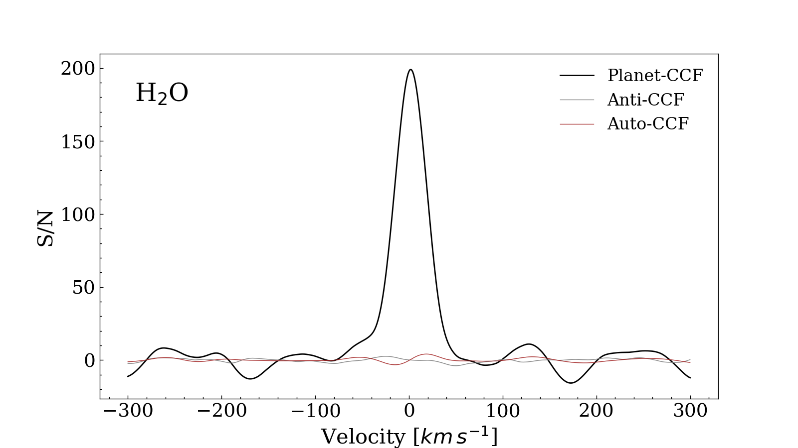
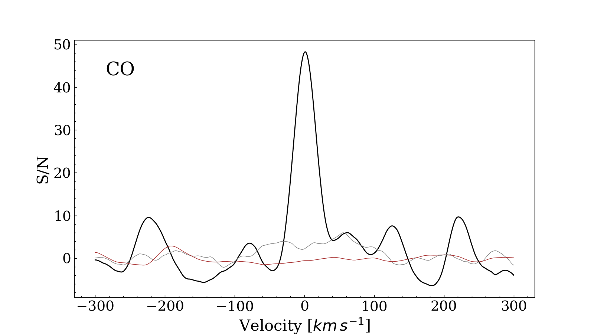
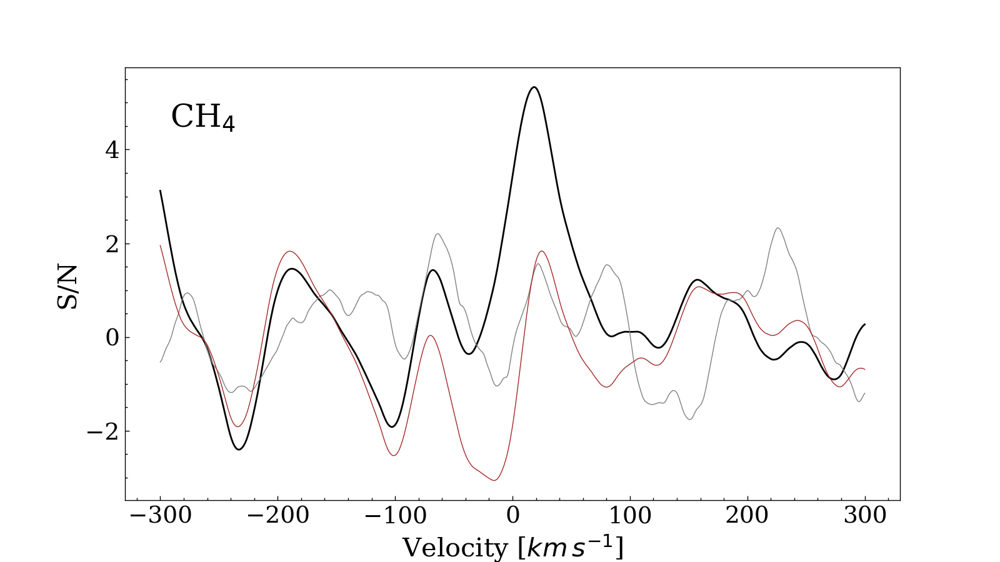
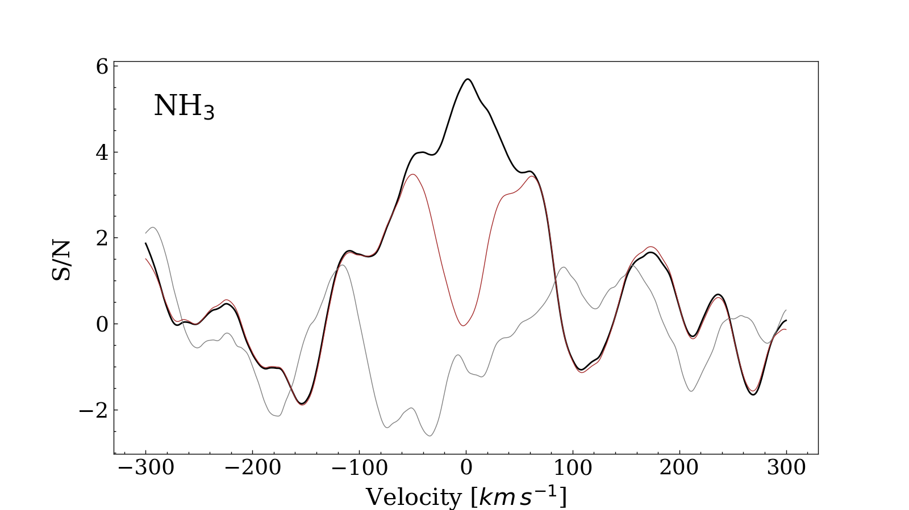
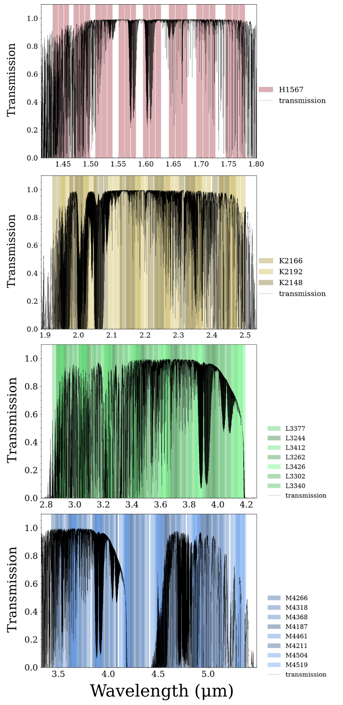
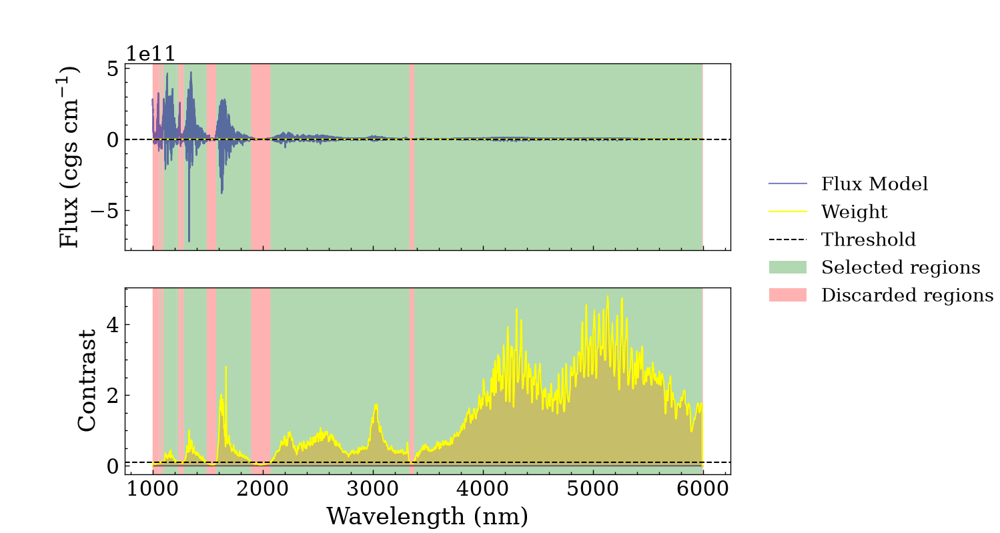

$\newcommand{\ensuremath}{}$
$\newcommand{\xspace}{}$
$\newcommand{\object}[1]{\texttt{#1}}$
$\newcommand{\farcs}{{.}''}$
$\newcommand{\farcm}{{.}'}$
$\newcommand{\arcsec}{''}$
$\newcommand{\arcmin}{'}$
$\newcommand{\ion}[2]{#1#2}$
$\newcommand{\textsc}[1]{\textrm{#1}}$
$\newcommand{\hl}[1]{\textrm{#1}}$
$\newcommand{\footnote}[1]{}$
$\newcommand{\Pic}{\beta~Pic\xspace}$
$\newcommand{\water}{H_2O\xspace}$
$\newcommand{\ammonia}{NH_3\xspace}$
$\newcommand{\methane}{CH_{4}\xspace}$

# Signatures of $\methane$ and $\ammonia$ in the atmosphere of $\beta$ Pictoris b

<mark>Appeared on: 2026-11-13</mark> -  _Accepted for publication in Astronomy & Astrophysics. 7 pages, 3 figures_

A. Barone, et al. -- incl., <mark>P. Molliere</mark>

**Abstract:** $\beta$ Pictoris is a nearby (19.7 pc), young ( $\sim$ 24 Myr), bright ( $V = 3.85$ ) planetary system hosting three directly imaged planets. Previous high-resolution spectroscopy of $\Pic$ b has detected $\water$ and CO, but not $\methane$ or $\ammonia$ . Combining observations across a broad wavelength range has been shown to maximise sensitivity to such weak molecular signals. We searched for previously undetected molecular species in the atmosphere of $\Pic$ b using high-resolution near-infrared spectra. We combined 44 CRIRES+ spectral settings covering the H, K, L, and M bands and cross-correlated the extracted planetary spectra with molecular templates. For species with uncertain detectability, we weighted the observations by their molecular information content and data quality, independent of the measured candidate-species cross-correlation functions. We recover $\water$ and CO at cross-correlation S/N values of approximately 200 and 50, respectively. We additionally identify tentative $\methane$ and $\ammonia$ signals near the expected radial velocity of $\Pic$ b, with S/N values of approximately 5.3 and 5.7. Equivalent extractions at the same projected separation on the opposite side of the star show no comparable peaks. We classify the $\methane$ and $\ammonia$ signals as tentative because their cross-correlation S/N values do not fully account for possible residual systematics. If confirmed, these would be the first detections of both species in the atmosphere of $\Pic$ b.

**Figure 3. -** Cross-correlation functions of $\Pic$ b with an $\water$(upper-left panel), CO (upper-right panel), $\methane$(bottom-left panel), and $\ammonia$(bottom-right panel). The black lines are the cross-correlation functions at $\Pic$ b's location; the grey lines are the corresponding functions at the same projected separation on the opposite side of the star; meanwhile, the brown lines show the residuals after subtraction of the scaled model autocorrelation from the planetary CCF.
     (*fig: CCFs*)

**Figure 1. -** From top to bottom: spectral ranges covered by detector orders in the grating settings used for this analysis, divided into H, K, L and M bands, respectively. The observations cover almost all of the four bands. The overplotted black line is the fractional atmospheric transmission. These plots were generated using \texttt{CRIRESViz}$\footnote$mark (*fig: Orders*)

**Figure 2. -** The upper panel shows, in blue, the simulated planetary flux containing $\methane$ and produced using \texttt{petitRadTRANS}. The model is baseline-subtracted. The bottom panel shows the planetary contrast, in yellow, derived from the upper panel and used in the cross-correlation procedure. The black dashed line represents the threshold (i.e. 0.1 in contrast space) used to select the regions containing information. The green areas denote where the model's gradient exceeds the threshold (selected regions), while the red ones are discarded regions. (*fig: threshold*)

