

$\newcommand{\ensuremath}{}$
$\newcommand{\xspace}{}$
$\newcommand{\object}[1]{\texttt{#1}}$
$\newcommand{\farcs}{{.}''}$
$\newcommand{\farcm}{{.}'}$
$\newcommand{\arcsec}{''}$
$\newcommand{\arcmin}{'}$
$\newcommand{\ion}[2]{#1#2}$
$\newcommand{\textsc}[1]{\textrm{#1}}$
$\newcommand{\hl}[1]{\textrm{#1}}$
$\newcommand{\footnote}[1]{}$
$\newcommand{\tinier}{\fontsize{7.5pt}{7.5pt}\selectfont}$
$\newcommand{\purple}[1]{\textcolor{purple}{#1}}$
$\newcommand{\orange}[1]{\textcolor{orange}{#1}}$
$\newcommand{\red}[1]{\textcolor{black}{#1}}$
$\newcommand{\tom}[1]{\textcolor{purple}{#1}}$
$\newcommand{\phil}[1]{\textcolor{orange}{#1}}$
$\newcommand{\phildone}[1]{\textcolor{black}{#1}}$
$\newcommand{\black}[1]{\textcolor{black}{#1}}$
$\newcommand{\blue}[1]{\textcolor{blue}{#1}}$
$\newcommand{\comments}[1]{\textcolor{black}{#1}}$
$\newcommand{\fixed}[1]{\textcolor{black}{#1}}$
$\newcommand{\old}{^{\star}}$
$\newcommand{\gradeA}{\num{6073}\xspace}$
$\newcommand{\gradeB}{\num{8999}\xspace}$
$\newcommand{\gradeC}{\num{9010}\xspace}$
$\newcommand{\gradeX}{\num{2580}\xspace}$
$\newcommand{\gradeAB}{\num{15072}\xspace}$
$\newcommand{\gradeABC}{\num{24082}\xspace}$
$\newcommand{\gradeABCX}{\num{26662}\xspace}$
$\newcommand{\dspl}{84\xspace}$
$\newcommand{\discs}{1000\xspace}$
$\newcommand{\lqso}{300\xspace}$
$\newcommand{\angelosmodels}{\num{9538}\xspace}$
$\newcommand{\randoms}{\num{50000}\xspace}$
$\newcommand{\drtwo}{\num{60000}\xspace}$
$\newcommand{\ews}{\num{110000}\xspace}$
$\newcommand{\dronearea}{\num{2000}\xspace}$
$\newcommand{\experts}{\num{67}\xspace}$
$\newcommand{\knownA}{\num{417}\xspace}$
$\newcommand{\knownB}{\num{161}\xspace}$
$\newcommand{\knownC}{\num{55}\xspace}$
$\newcommand{\stellarmass}{\logten (M_\ast /M_\odot) = 11.39^{+0.29}_{-0.33}\xspace}$
$\newcommand{\ssfr}{\log_{10}(\textrm{sSFR/yr}^{-1}) = -11.25^{+0.57}_{-0.37}\xspace}$
$\newcommand{\photoz}{0.68 ^{+0.33}_{-0.29}\xspace}$
$\newcommand{\thetaE}{0.85 ^{+0.44}_{-0.24}\xspace}$
$\newcommand{\orcid}[1]{ \orcidlink{#1}}$
$\newcommand{\linenumbers}[0]\usepackage$
$\newcommand{\thefigure}{A.\arabic{figure}}$
$\newcommand{\thefigure}{A.\arabic{figure}}$
$\newcommand{\thefigure}{B.\arabic{figure}}$
$\newcommand{\thefigure}{C.\arabic{figure}}$
$\newcommand{\thefigure}{C.\arabic{figure}}$

# Euclid Data Release 1 (DR1): Euclid Lens Identification Pipeline and Scientific Exploration (ECLIPSE) A: Strong lens catalogue overview$\thanks{Results in this paper were obtained with the help of the volunteers of the Space Warps project whose contributions are individually acknowledged on the Space Warps\href{https://www.zooniverse.org/projects/aprajita/space-warps-esa-euclid/about/team}{`The Team'} webpage and in Appendix \ref{app:sw}.}$

<mark>Appeared on: 2026-11-13</mark> -  _28 pages. Submitted to A&A as part of the Special Issue "Euclid First Data Release"_

E. Collaboration, et al. -- incl., <mark>T. Harvey</mark>, <mark>K. Jahnke</mark>

**Abstract:** We present $\fixed{\gradeAB}$ high-confidence strong lens candidates in Euclid Data Release 1 (DR1), spanning $\fixed{\dronearea}$ deg $^2$ . These comprise $\fixed{\gradeA}$ grade A (`sure lens') and $\fixed{\gradeB}$ grade B (`probable lens') systems, which we publish alongside a further $\fixed{\gradeC}$ grade C (`possible lens') candidates.With more high-confidence candidates than all previous catalogues combined, this sample establishes a large, homogeneous data set of galaxy-scale strong lenses with high-resolution imaging, transforming strong lensing from a field of rare discoveries to a robust statistical tool for astrophysics and cosmology.Of the roughly 900 million sources in DR1, we searched the 68 million passing our catalogue selection using a bespoke discovery pipeline that synthesises scores from $\fixed{five}$ machine-learning models with visual classifications from around 7000 citizen scientists and $\fixed{\experts}$ strong lensing experts.Beyond classical Einstein rings, our catalogue includes $\fixed{\dspl}$ candidate double-source-plane lenses and over $\fixed{\discs}$ candidate disc lenses, two exotic classes with few previously known examples, as well as several hundred candidate lensed AGN and quasars.We deliver automated lens models for the combined grade A+B systems, and photometric redshifts and stellar population properties for the deflector galaxies, providing immediate science-ready data products.We find $\comments{that}$ the majority of the deflector galaxies are massive and quiescent, with $\comments{stellar masses of}$ $\red{\stellarmass}$ $\comments{(assuming a Salpeter initial mass function; the range corresponding to the$16$th--$84$th percentiles)}$ .The $\comments{deflector galaxies span a range of photometric redshifts ($z=$ \red{\photoz})}$ , extending to higher redshifts than previous ground-based lens samples, and $\comments{the lenses have}$ a $\comments{typical}$ Einstein radius of $\red{\thetaE}$ arcsec.Extrapolating by area, we expect over $\num{100000}$ high-confidence strong lens $\comments{candidates}$ in the Euclid Wide Survey.

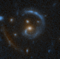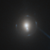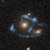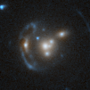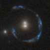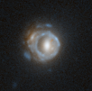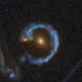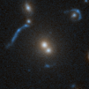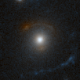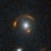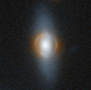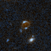

**Figure 6. -** Selection of more unusual lenses in DR1. (*fig:misc2*)

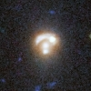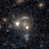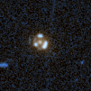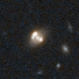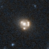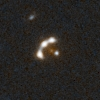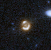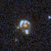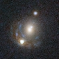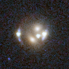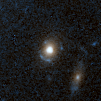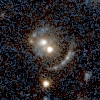

**Figure 5. -** Candidate lensed and lensing AGN, selected through crossmatches with external AGN catalogues and independent evidence of nuclear activity (Acevedo Barroso et al., in prep.; Moustakas et al., in prep.). (*fig:lqso*)

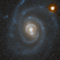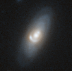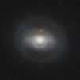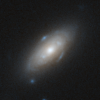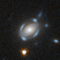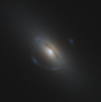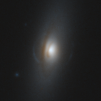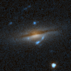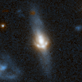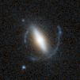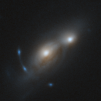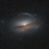

**Figure 4. -** Striking examples of lensing by disc galaxies. (*fig:discs*)

