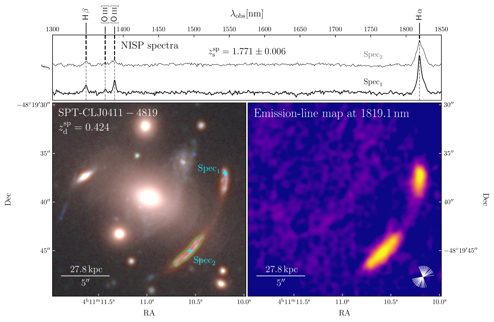
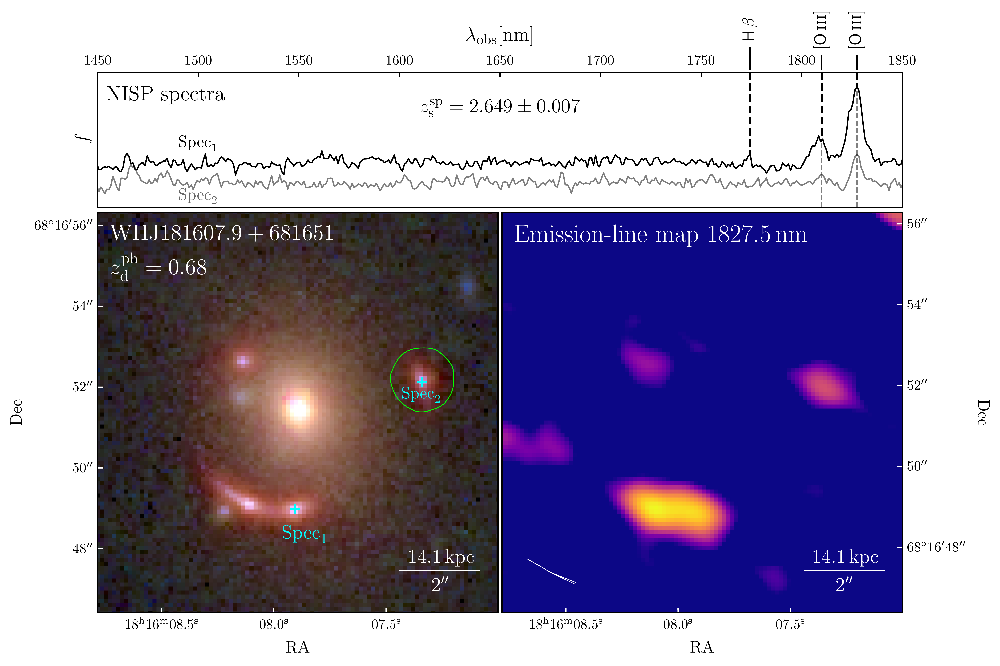
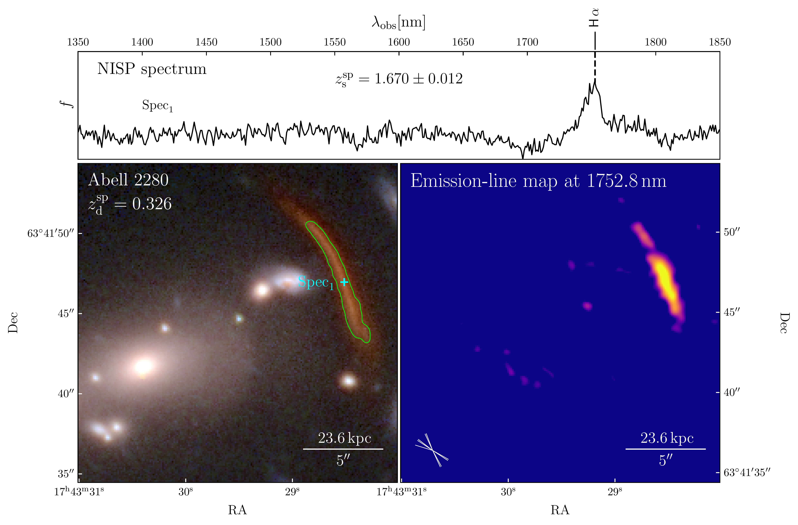

$\newcommand{\ensuremath}{}$
$\newcommand{\xspace}{}$
$\newcommand{\object}[1]{\texttt{#1}}$
$\newcommand{\farcs}{{.}''}$
$\newcommand{\farcm}{{.}'}$
$\newcommand{\arcsec}{''}$
$\newcommand{\arcmin}{'}$
$\newcommand{\ion}[2]{#1#2}$
$\newcommand{\textsc}[1]{\textrm{#1}}$
$\newcommand{\hl}[1]{\textrm{#1}}$
$\newcommand{\footnote}[1]{}$
$\newcommand{\Sec}{Sect. }$
$\newcommand{\Fig}{Fig. }$
$\newcommand{\Eq}{Eq. }$
$\newcommand{ç}[1]{{\color{blue}{#1}}}$
$\newcommand{\rev}[1]{{\color{red}{#1}}}$
$\newcommand{\eprint}[2][]{$
$  \if!#1!#2\else#1\arxivprefixesep\ignorespaces#2\fi$
$}$
$\newcommand{\thefigure}{A.1}$
$\newcommand{\mydash}{-}$

# Euclid Data Release 1 (DR1): NISP spectroscopy of gravitational arcs and multiple images

<mark>Appeared on: 2026-11-13</mark> -  _Paper intended for the A&A Special Issue "Euclid First Data Release". 15 pages, 5 figures_

E. Collaboration, et al. -- incl., <mark>K. Jahnke</mark>

**Abstract:** Applications of strong gravitational lensing in astrophysics andcosmology critically depend on building reliable strong lensing models, which require accurate measurements of on-sky positions of multiple images and of the redshifts of the background sources from which they originate. In this context, $\Euclid$ is a unique facility, as it simultaneously provides high-resolution multi-band photometric imaging and slitless spectroscopy for an unprecedentedly large sample of gravitational lenses, most of which are newly discovered. In this work, we exploit $\Euclid$ slitless spectroscopic data to determine the redshifts of four spatially extended lensed sources, and to reconstruct emission-line images.  Specifically, two of the target sources are lensed into giant arcs by the massive galaxy clusters SPT-CLJ0411 $-$ 4819 ( $z_\mathrm{d}=0.424$ , where "d" denotes the lensing deflector) and Abell 2280 ( $z_\mathrm{d}=0.326$ ). The third system is a quadruply imaged active galactic nucleus (AGN) candidate strongly lensed by a massive galaxy at $z_\mathrm{d}=0.68$ , while the fourth is a galaxy-scale Einstein ring produced by a lens galaxy at $z_\mathrm{d}=0.235$ . This work represents a proof of concept for the exploitation of $\Euclid$ slitless spectroscopic data in the study of strong gravitational lensing, providing one of the first determinations of spectroscopic redshifts for strongly lensed features from NISP spectra. These results demonstrate the feasibility of applying the same methodology to the very large sample of gravitational lenses that $\Euclid$ has started to discover and is expected to identify over the course of the mission.

**Figure 1. -** \Euclid data of the galaxy cluster SPT-CLJ0411$-$4819 at $z_\mathrm{d}^\mathrm{sp}=0.424\pm0.006$, which lenses a background source with a measured \Euclid spectroscopic redshift of $z_\mathrm{s}^\mathrm{sp}=1.771\pm0.006$ into a giant gravitational arc. _ Bottom-left:_ RGB image of the cluster obtained by combining \Euclid photometric bands (\HE, \YE, \JE, and \IE) using the $\text$tt{azulero} code  (Basset_Azulero) . The spatial scale corresponding to \ang{;;5} refers to the deflector redshift. The green polygon corresponds to the aperture used to measure the magnitude of the gravitational arc in different bands and the associated uncertainty, as described in Appendix \ref{sc:PhotometricRedshift}. _ Bottom-right:_ Emission-line map at 1819.1 nm, showing the \ha emission associated with the arc. The map is obtained by combining 38 \Euclid dispersed spectroscopic images; the corresponding dispersion directions are indicated by the white segments in the bottom-right corner of the panel. The map, oversampled at the native pixel scale of the \IE filter (\ang{;;0.1}), is smoothed with a Gaussian kernel with a standard deviation of two pixels (\ang{;;0.2}). _ Top:_ Stacked \Euclid NISP-S spectra (in arbitrary units) extracted at two positions, "$\mathrm{Spec_1}$" and "$\mathrm{Spec_2}$’’, marked by cyan crosses in the RGB image. The spectral extraction is performed over a spatial aperture of three NISP pixels (corresponding to \ang{;;0.9}), oriented perpendicular to the dispersion direction of each exposure and centered on each extraction position.  (*fig:SPT-CLJ0411-4819*)

**Figure 3. -** Same as $\Fig$\ref{fig:SPT-CLJ0411-4819} for the WHJ181607.9$+$681651 system. The lens galaxy at $z_\mathrm{d}^\mathrm{ph}=0.68\pm0.04$, located at the centre of the RGB cutout in the bottom-left panel, produces four red multiple images of a background source with a measured \Euclid spectroscopic redshift of $z_\mathrm{s}^\mathrm{sp}=2.649\pm0.007$. Three emission lines, identified as the [$\ion${O}{iii}] doublet and possibly \hb, are detected in the \Euclid "$\mathrm{Spec_1}$" spectrum of the lensed source (black 1D-spectrum in the top panel). Only the stronger component of the [$\ion${O}{iii}] doublet is detected in "$\mathrm{Spec_2}$", displayed in light grey, at a lower signal-to-noise ratio. Both spectra were obtained by stacking three \Euclid spectroscopic exposures. The [$\ion${O}{iii}] emission from the four multiple images is visible in the emission-line map. (*fig:J181607*)

**Figure 2. -** Same as $\Fig$\ref{fig:SPT-CLJ0411-4819} for the galaxy cluster Abell 2280 at $z_\mathrm{d}^\mathrm{sp}=0.326\pm0.002$. A source with a measured \Euclid spectroscopic redshift of $z_\mathrm{s}^\mathrm{sp}=1.670\pm0.012$ is lensed into the red giant arc visible in the RGB cutout in the bottom-left panel. For this system, the top panel shows a single spectrum, extracted at the position marked by the cyan cross in the bottom-left panel and obtained by stacking nine \Euclid spectroscopic exposures. (*fig:Abell2280*)

