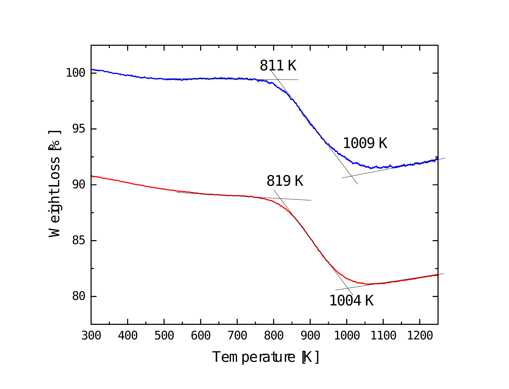
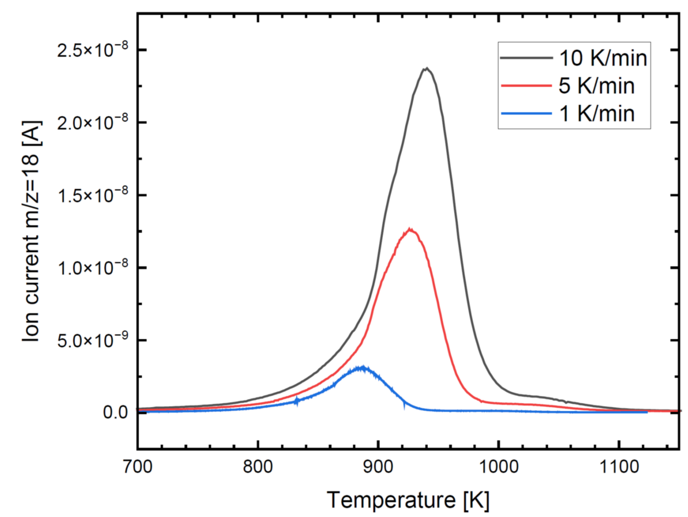
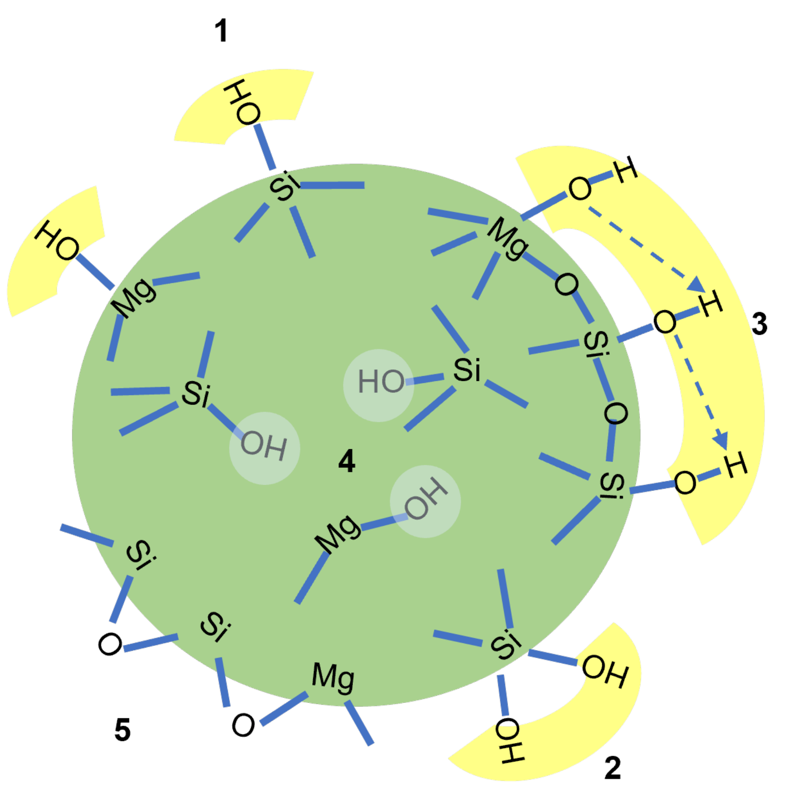

$\newcommand{\ensuremath}{}$
$\newcommand{\xspace}{}$
$\newcommand{\object}[1]{\texttt{#1}}$
$\newcommand{\farcs}{{.}''}$
$\newcommand{\farcm}{{.}'}$
$\newcommand{\arcsec}{''}$
$\newcommand{\arcmin}{'}$
$\newcommand{\ion}[2]{#1#2}$
$\newcommand{\textsc}[1]{\textrm{#1}}$
$\newcommand{\hl}[1]{\textrm{#1}}$
$\newcommand{\footnote}[1]{}$
$\newcommand{\url}[1]{\href{#1}{#1}}$
$\newcommand{\dodoi}[1]{doi:~\href{http://doi.org/#1}{\nolinkurl{#1}}}$
$\newcommand{\doeprint}[1]{\href{http://ascl.net/#1}{\nolinkurl{http://ascl.net/#1}}}$
$\newcommand{\doarXiv}[1]{\href{https://arxiv.org/abs/#1}{\nolinkurl{https://arxiv.org/abs/#1}}}$
$\newcommand{\vdag}{(v)^\dagger}$
$\newcommand{\myemail}{skywalker@galaxy.far.far.away}$
$\newcommand\natexlab{#1}$

# Desorption of water from cosmic silicates

<mark>Appeared on: 2026-11-13</mark> - 

C. Jäger, D. Köhler, <mark>T. Henning</mark>, F. Langenhorst

**Abstract:** Recent JWST and ALMA observations of protoplanetary disks have identified    water reservoirs in the inner regions of the disks. This would provide terrestrial planets forming therein access to a water reservoir. In situ formation of water molecules on grain surfaces was proposed as one possible formation process in the PDS 70 system, but transport by small silicate particles coupled to the gas could be another mechanism. Laboratory experiments on the thermally induced desorption of water molecules from different water-containing silicates at elevated temperatures provide another possibility for the enrichment of water molecules in the inner disk. Physically and chemically bound water in silicates can be released upon annealing processes. Water that is physically bound undergoes desorption at temperatures up to 473 K. In contrast, chemically bound water in form of different silanol or Mg-OH groups in amorphous silicates or phyllosilicates, can be released at higher temperatures, ranging from 773 to 923 K. The relevant temperatures are sufficient to trigger the solid-state recrystallization of amorphous silicates to Mg-rich orthopyroxene and olivine. The existence of these crystalline silicates has been substantiated through Spitzer and JWST-MIRI observations. Based on the experimental results, we postulate that the desorption of bound hydroxyl groups may serve as a mechanism for the formation of the water reservoir at temperatures up to 900 K, much  higher than the water sublimation temperature of 100 to 200 K.

**Figure 7. -** A comparison of the desorption temperatures determined for the Serpentinite Erbendorf measured at  ambient pressure (blue curve) and 1$\times$10$^{-3}$ mbar (red curve, shifted by -10\%). (*Tg_vgl*)

**Figure 9. -** DEGAS data of the Erbendorf serpentinite for m/z = 18 ($H_2$O) at three different heating rates (1 K, 5 K, and 10 K min$^{-1}$). The peak maxima shift clearly to higher temperature for higher heating rate.
 (*MS_2*)

**Figure 1. -** Possible structural characteristics of chemisorbed water in amorphous magnesium silicates. It can be distinguished between isolated (1), geminal (2), vicinal (3), and internal hydroxyl groups in amorphous magnesium silicate. The dashed lines represent hydrogen bonds between adjacent surface OH groups. After the removal of chemisorbed OH, typical siloxan or bridging oxygen groups remain on the surface or internally. (*hydroxyl*)

