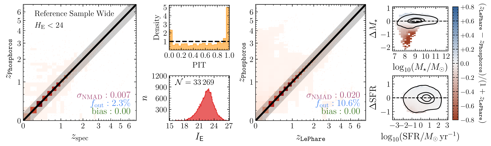
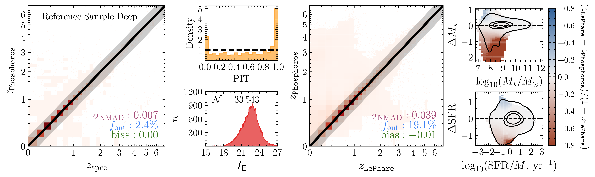
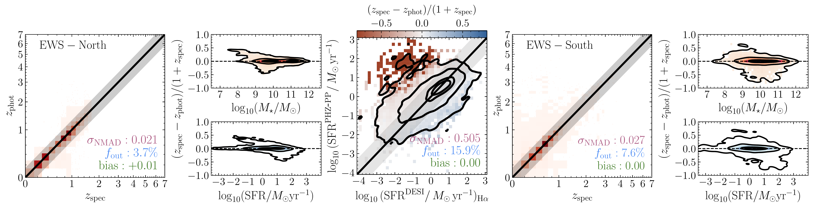
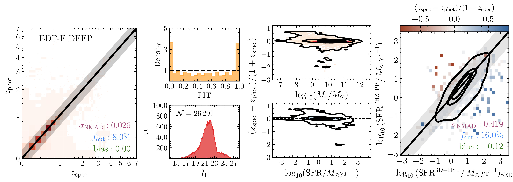
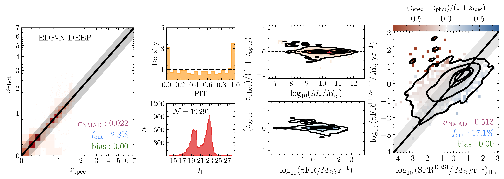

$\newcommand{\ensuremath}{}$
$\newcommand{\xspace}{}$
$\newcommand{\object}[1]{\texttt{#1}}$
$\newcommand{\farcs}{{.}''}$
$\newcommand{\farcm}{{.}'}$
$\newcommand{\arcsec}{''}$
$\newcommand{\arcmin}{'}$
$\newcommand{\ion}[2]{#1#2}$
$\newcommand{\textsc}[1]{\textrm{#1}}$
$\newcommand{\hl}[1]{\textrm{#1}}$
$\newcommand{\footnote}[1]{}$
$\newcommand{\afme}[1]{ {\color{teal}(\it AE: #1)}}$
$\newcommand{\nnpz}{\texttt{NNPZ}}$
$\newcommand{\phosphoros}{\texttt{Phosphoros}}$
$\newcommand{\sfr}{\logten \mathrm{SFR}}$
$\newcommand{\logMsun}{\logten M_\odot}$
$\newcommand{\logMsunyr}{\logten(M_\odot \mathrm{yr}^{-1})}$
$\newcommand{\Mstarwun}{\logten(M_{\ast}/M_\odot)}$
$\newcommand{\sfrwun}{\logten (\mathrm{SFR}/M_\odot \mathrm{yr}^{-1})}$
$\newcommand{\orcid}[1]{ \orcidlink{#1}}$
$\newcommand{\linenumbers}[0]\usepackage$
$\newcommand{\arraystretch}{1.2}$

# Euclid Data Release 1 (DR1): The PHZ processing function for the physical properties of galaxies.

<mark>Appeared on: 2026-11-13</mark> -  _13 pages, 8 figures. Paper intended for the A\&A Special Issue "Euclid First Data Release''_

E. Collaboration, et al. -- incl., <mark>K. Jahnke</mark>

**Abstract:** $\Euclid$ is a European Space Agency mission mapping the extragalactic sky, aiming to provide the most-accurate 3D view of the Universe at optical and near-infrared wavelengths, by measuring the photometric redshifts of billions of galaxies. Within the Euclid Consortium, this task is executed by the PHZ Organisation Unit. PHZ takes as input the multi-wavelength photometry of $\Euclid$ and ground-based data, and returns as output the source classification, photometric redshifts for the $\Euclid$ core science (i.e., cosmology), and photometric redshifts plus physical parameters and absolute magnitudes for non-cosmological science. As part of the first Euclid Data Release (DR1), we describe the details of the DR1 pipeline for non-cosmological science, along with the released data products, and their validation. The non-cosmological science data products are obtained with $\nnpz$ , a nearest-neighbour algorithm developed within PHZ that infers the properties of each target galaxy from its closest matches, in colour--magnitude space, within a reference sample of galaxies with known redshifts and physical parameters. We built this reference sample from $\Euclid$ observations of COSMOS, one of the Euclid Auxiliary Fields, labelling each galaxy with redshifts and physical parameters derived from the COSMOS2020 multi-wavelength photometry, consistently with the $\Euclid$ core-science results. Combined with the adjustments and priors required to generalise the results across the entire extragalactic sky, this approach yields high-quality and internally consistent data products. We tested the performance using both internal metrics and comparisons to ancillary data sets (e.g., COSMOS2020, 3D-HST, and DESI) and scaling relations (e.g., the star-forming main sequence); the results are in line with expectations and pre-DR1 simulations for both the Euclid Wide Survey and Euclid Deep Fields.

**Figure 3. -** Comparison between the reference sample for the \gls{EWS}(first row) and \gls{EDF}(second row) used in \gls{dr1}. In the first column, the comparison is made with the subsample of reference sample sources that matched with the compilation of spectroscopic redshifts in COSMOS by 2026ApJS..282....6K. In the third column, the comparison is instead with the best-fit \texttt{LePhare} results for all the reference sample sources that matched with the COSMOS2020 Classic catalogue  (2022ApJS..258...11W) . The black line is the 1:1 relation, while the shaded grey area is the region beyond which a prediction is considered to be an outlier. The reported metrics are $\sigma_{\rm NMAD}$(purple), the outlier fraction, $f_{\rm out}$(blue), and the bias (green), all defined in Sect. \ref{sc:metrics}. The PIT (second columns) is measured as in Eq. (\ref{eq:pit}) for redshifts. The fourth column shows the difference \texttt{LePhare} minus \texttt{Phosphoros} photometric redshifts, normalized to the \texttt{LePhare} photo-$z$s, while $\Delta M_\ast$ is the difference between the \texttt{LePhare} and $\phosphoros$ best-fit measured logarithmic masses (see Sect. \ref{sc:Pipeline} for further details), and similarly for SFRs. The contours are the area containing $86\%$, $39\%$(corresponding to the $2\sigma$ and $1\sigma$ levels for a 2D histogram), and $20\%$ of the sample. (*fig:RefSample_C2020*)

**Figure 5. -** Results for the EWS-like processing of EDF-N (first, second, and third column), which can be considered as a proxy for the \gls{EWS} in the northern hemisphere, and EDF-F (fourth and fifth column), which can be considered as a proxy for the \gls{EWS} in the southern hemisphere. Contours are similar to those in Fig. \ref{fig:RefSample_C2020}. (*fig:EWS_WideLike*)

**Figure 6. -** Results for the Deep processing of EDF-F (*top panels*) and EDF-N (*bottom panels*). *Left*: comparison between the PHZ-PP measured photometric redshifts, and a compilation of spectroscopic redshifts (see Sect. \ref{sc:Data}). Other plots and lines as in Fig. \ref{fig:RefSample_C2020}. *Right*: like the centre panel of Fig. \ref{fig:EWS_WideLike}; for EDF-F the comparison is with the SED-fitting inferred \gls{sfr} in GOODS-S in 3D-HST; for EDF-N, with the \ha and \hb detected lines in DESI. (*fig:DeepFields*)

