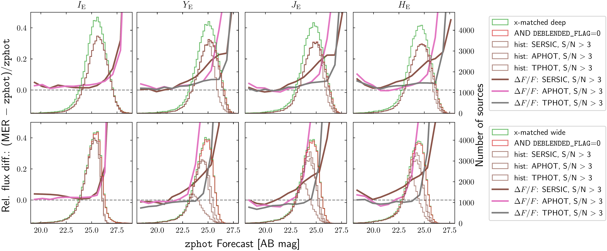
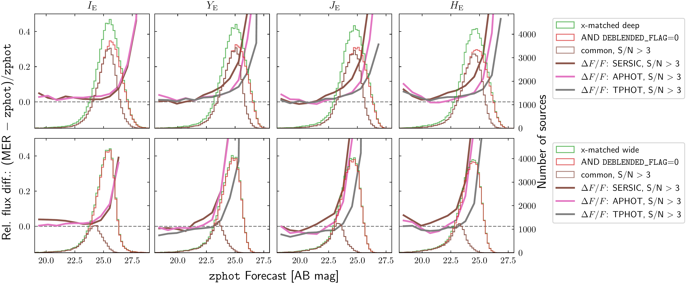
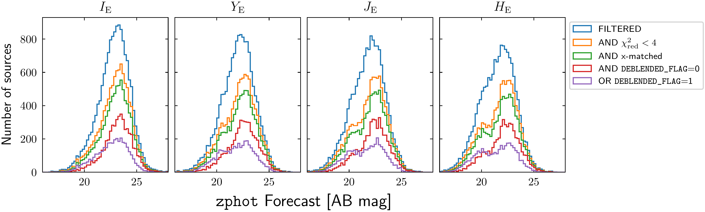
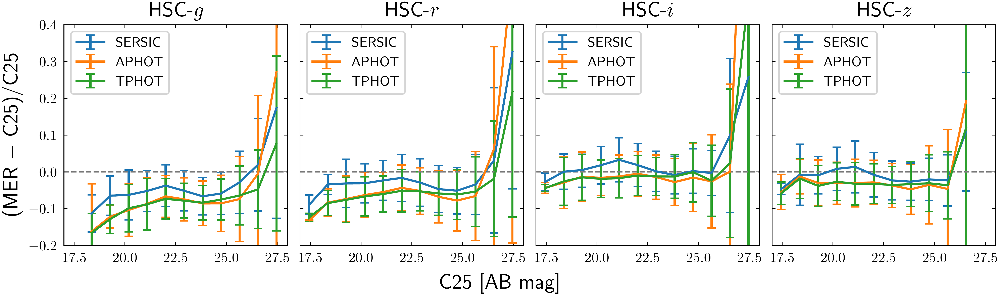
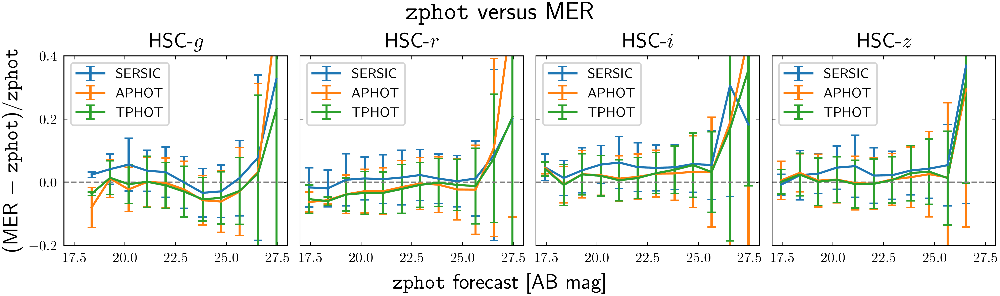

$\newcommand{\ensuremath}{}$
$\newcommand{\xspace}{}$
$\newcommand{\object}[1]{\texttt{#1}}$
$\newcommand{\farcs}{{.}''}$
$\newcommand{\farcm}{{.}'}$
$\newcommand{\arcsec}{''}$
$\newcommand{\arcmin}{'}$
$\newcommand{\ion}[2]{#1#2}$
$\newcommand{\textsc}[1]{\textrm{#1}}$
$\newcommand{\hl}[1]{\textrm{#1}}$
$\newcommand{\footnote}[1]{}$
$\newcommand{\linenumbers}[0]\begin$

# Euclid Data Release 1 (DR1): Multi-band photometry validation on COSMOS extragalactic sources

<mark>Appeared on: 2026-11-13</mark> -  _Paper intended for the A\&A Special Issue "Euclid First Data Release''_

E. Collaboration, et al. -- incl., <mark>K. Jahnke</mark>

**Abstract:** The Euclid Data Release 1 (DR1) contains catalogues of sources covering roughly $1900 {\deg}^2$ , including deep coverage of legacy fields that enable an extensive comparison between $\Euclid$ imaging and multiwavelength observations from other instruments. The Cosmic Evolution Survey (COSMOS) field, observed by $\Euclid$ and included in DR1, has been observed with the $_ James Webb_$ Space Telescope, resulting in the COSMOS2025 catalogue.We compare the Euclid DR1 photometry with the multiwavelength COSMOS2025 data to assess the accuracy of the photometric measurements produced by the different methods implemented in the OU-MER pipeline. We use data from both the Euclid Wide and Deep Surveys, focussing exclusively on extragalactic sources.We use the fluxes of COSMOS2025 to predict the expected fluxes in the $\Euclid$ bands via spectral energy distribution fitting. The redshifts of the sources are either spectroscopic, for a sample of brighter sources, or photometric, to include fainter sources. Both the fluxes in the common Hyper Suprime-Cam bands and the SEDs from COSMOS2025 are used to validate the analysis and to characterise any biases or limitations of the method.The predicted fluxes and the OU-MER measurements are in good agreement, especially for bright and isolated sources. Median offsets depend on band, photometric method, survey depth, and redshift sample. Most are well within 10 \% , although the deep photo-z model-fitting measurements show NIR offsets of approximately 12–13 \% . However, complementary measurements on $\gaia$ stars show an opposite trend, highlighting that photometric validation approaches may suffer from intrinsic uncertainties that prevent a thorough assessment of systematic effects. We find that the OU-MER fluxes typically have larger offsets for systems that have not been correctly deblended in detection.Among the three methods, template-fitting photometry generally shows the smallest offset from the SED-based predictions in the NISP bands and toward fainter magnitudes, while aperture photometry and model-fitting are comparable in $\IE$ .Future analysis on deeper $\Euclid$ data and on fields at different Galactic latitudes will allow us to strengthen the constraints on the photometric accuracy of the $\Euclid$ surveys.

**Figure 17. -** Number of sources and median relative flux difference $\Delta F/F$ for the photo-$z$ sample, as a function of the \zphot forecast magnitudes in the four \Euclid filters. After the $\chi^2_{\rm red} < 2$ cut is applied, the sources are cross-matched either with the deep catalogue (top panel) or the wide one (second panel), represented in green.
    Then we only consider the sources with {\tt DEBLENDED\_FLAG}=0 (shown in red) and with ${\rm S/N} > 3$: this last cut selects a slightly different number of sources for each method and band (as seen in the histograms). The distributions are shown for SERSIC (brown), APHOT (pink), and TPHOT (gray). A reference horizontal line at $\Delta F/F=0$ is shown as a dashed gray line. The same plots are shown for the deep case (third panel) and for the wide case (bottom panel), but only for sources that have ${\rm S/N} > 3$ in all the bands and for all the three photometric methods (`common' histogram shown in brown). The same plots for the spec-$z$ sample are shown in Fig. \ref{fig:specz_deep_wide_histograms_zphot_3}. (*fig:photoz_deep_wide_histograms_zphot_3*)

**Figure 8. -** Distribution of sources in each \Euclid filter as a function of the \zphot forecast magnitude, for the spec-$z$ case. The histograms show the full initial sample of fitted sources (cyan), the sample after applying the $\chi_{\rm red}^2<4$ cut (orange), and the sample after cross-matching with the deep catalogue (green). Cross-matched sources are further divided into non-deblended (red) and deblended (purple) sources. Histograms for the very few NIR-detected sources are omitted, as they account for only a handful of objects. A similar plot for the photo-$z$ case is shown in Fig. \ref{fig:photoz_deep_histograms_zphot}. (*fig:specz_deep_histograms_zphot*)

**Figure 12. -** Same as Fig. \ref{fig:offset_euclid_0_1_specz} for the HSC bands, namely HSC $g$, $r$, $i$, and $z$. _Top_: Relative flux differences between the MER fluxes and the C25 ones in the four HSC bands for model-fitting (`SERSIC'), aperture photometry (`APHOT'), and template-fitting (`TPHOT'). Only the median lines with the NMADs for the sources with \texttt{VIS\_DET}=1, \texttt{DEBLENDED\_FLAG}=0, and with ${\rm S/N} > 3$ in MER are shown in these plots.
    _Bottom_: While the upper panel directly compares MER and C25, these plots show a comparison between the MER fluxes and the \zphot forecast. The largest difference is seen in the HSC $g$ band at the brighter end, while the other bands behave in the same way, within the errors, in the two panels. More details in Sect. \ref{sect:hsc_discussion}. The photo-$z$ case is shown in Fig. \ref{fig:offset_HSC_cosmos_mer_photoz}. (*fig:offset_HSC_cosmos_mer*)

